# Chapter 8: Scaling an Application from Zero to Millions of Users

> System Design Course Notes

Every system starts small. A college project runs happily on one machine, but the same design collapses once real traffic arrives. This chapter walks through the **evolution of an architecture**, one bottleneck at a time, from a single server to a globally distributed system. Each stage exists because the previous one broke in a specific way, so I have written every step as **problem → solution → trade-off**.

---

## Table of Contents

1. [Why Do We Need to Scale?](#1-why-do-we-need-to-scale)
2. [Stage 1: Single Server](#2-stage-1-single-server)
3. [Stage 2: Separate Application and Database Servers](#3-stage-2-separate-application-and-database-servers)
4. [Stage 3: Multiple Application Servers and a Load Balancer](#4-stage-3-multiple-application-servers-and-a-load-balancer)
5. [Stage 4: Database Replication](#5-stage-4-database-replication)
6. [Stage 5: Caching](#6-stage-5-caching)
7. [Stage 6: Content Delivery Network (CDN)](#7-stage-6-content-delivery-network-cdn)
8. [Stage 7: Multiple Data Centers](#8-stage-7-multiple-data-centers)
9. [Stage 8: Database Sharding](#9-stage-8-database-sharding)
10. [Stage 9: Messaging Queues](#10-stage-9-messaging-queues)
11. [The Full Picture](#11-the-full-picture)
12. [Quick Revision Table](#12-quick-revision-table)

---

## 1. Why Do We Need to Scale?

**Analogy: a movie ticket counter.**

One person sells tickets. Suddenly 1,000 people show up.

- That one person is overloaded.
- Tickets are issued one by one, so the person at position 600 waits a very long time.
- Overall speed (throughput) drops and the experience gets worse.

**Fix:** open a second counter and split the crowd, roughly 500 per counter. Load per person halves, and the people at the back are served much sooner.

The same thing happens to software. When 1,000, 5,000 or 10,000 requests hit a server at once:

| Symptom | What is happening |
|---|---|
| Slow responses | CPU and memory are saturated, so requests queue up |
| Crashes | The server runs out of resources and goes down |
| Poor user experience | Latency rises and requests time out |

**Scaling** is the practice of adding capacity (or using it smarter) so performance stays acceptable as load grows.

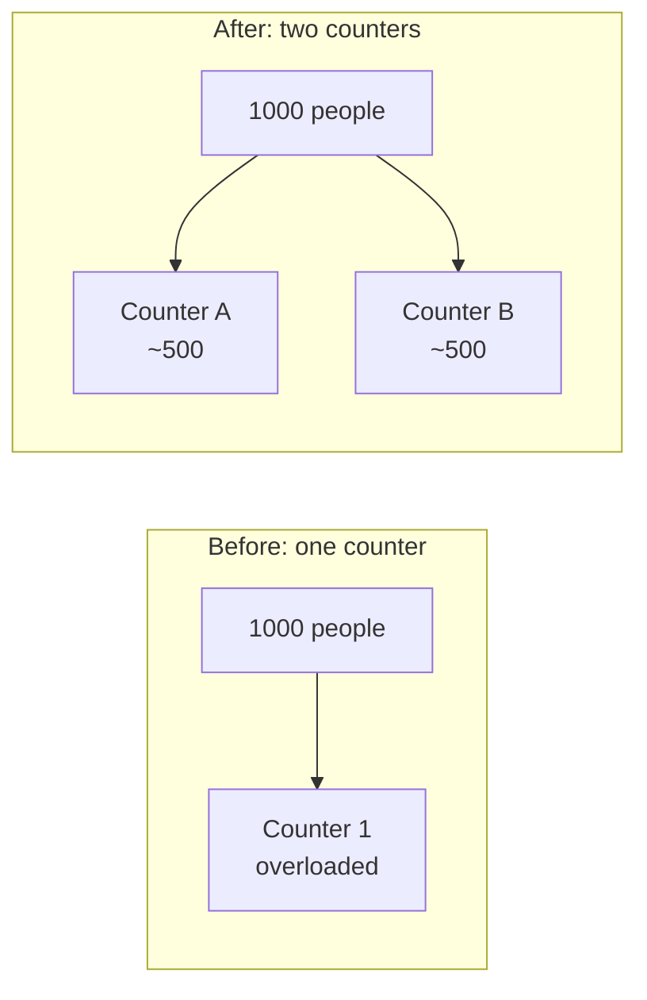

---

## 2. Stage 1: Single Server

This is the typical college-project setup: **everything lives on one machine**.

- Application (business logic), for example Node.js or Spring Boot
- Database, for example MongoDB or any SQL database

The client talks directly to that one server.

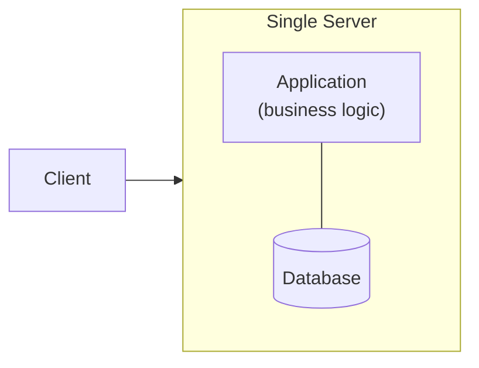

**Good for:** learning, prototypes, tiny user bases.
**Problem:** application and database fight over the same CPU and memory. One failure takes down everything.

---

## 3. Stage 2: Separate Application and Database Servers

As users grow, the first move is to **split the responsibilities**:

- **Application server** runs only business logic.
- **Database server** runs only the database.

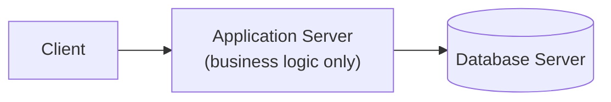

**Why it helps:** the load is distributed. Each machine now does one job, can be sized for that job, and can be tuned and scaled independently.

**What is still wrong:** there is only **one** application server. If traffic keeps growing, its CPU and memory become the limit, and if it crashes the whole system is down. It is a **Single Point of Failure (SPOF)**.

---

## 4. Stage 3: Multiple Application Servers and a Load Balancer

Fix: **run several copies of the application server** (horizontal scaling).

New problem: the client does not know which server to talk to. Enter the **load balancer**.

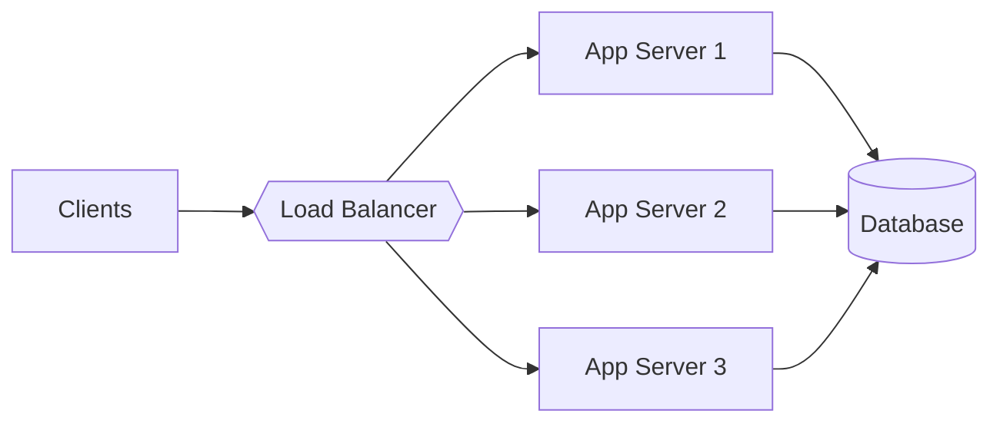

**What the load balancer does:** it decides which application server gets each incoming request, based on traffic and server health (which servers are active, which are down).

**Benefits**

- Traffic is spread, so no single server is overwhelmed.
- If one server dies, the others keep serving. The application tier is no longer a SPOF.
- More servers can be added as traffic grows.

> Load balancer internals (types and algorithms) are covered in the earlier load balancer chapter, so I am not repeating them here.

**Still wrong:** the database is a single server. If it crashes, every request fails.

---

## 5. Stage 4: Database Replication

The database is now the SPOF. If it goes down, no user request that needs data can be fulfilled, even though we have many healthy application servers.

**Solution: replication using a leader/follower architecture** (also called master/slave in older terminology).

- One **master** node.
- Several **slave** nodes that hold copies of the master's data.

### Read and write routing

| Operation | Goes to | Example |
|---|---|---|
| **Read** | Any slave | Fetch my personal details |
| **Write** | Master only | Change my email address |

After the master applies a write, it **replicates the change to every slave**, so slaves remain copies of the master.

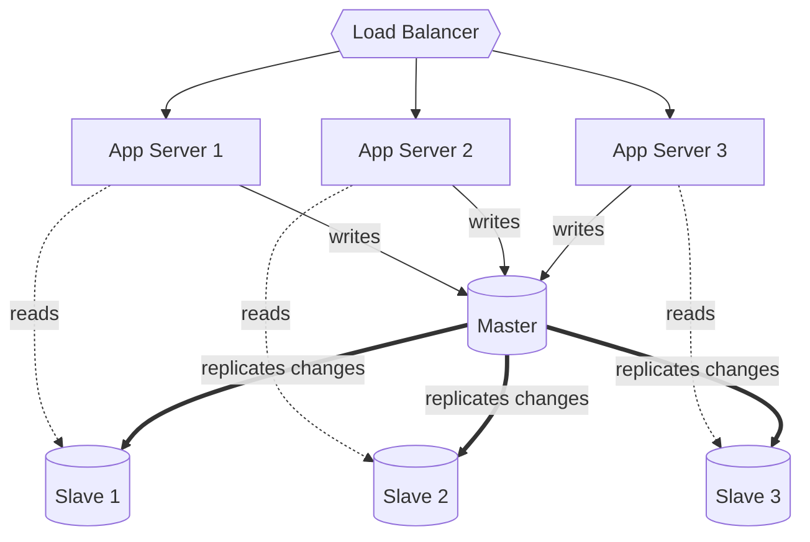

### Failure handling

- **A slave goes down:** other slaves keep serving reads (Slave 2, 3, 4...).
- **The master goes down:** one of the slaves is **promoted to master** and starts accepting writes. This is called failover.

**Result:** the database is no longer a single point of failure, and read load is spread across many nodes.

> **My note:** replication is asynchronous in many setups, so a slave can briefly lag behind the master. Reads from slaves may be slightly stale. This is an early taste of the consistency vs. availability trade-off.

---

## 6. Stage 5: Caching

Even with replicas, database operations are **expensive**, and they get slower as user count rises.

### Without cache vs. with cache

The numbers below are illustrative, to build intuition.

**Without a cache (read goes to a slave):**

| Hop | Time |
|---|---|
| Client to App Server | 2 ms |
| App Server to Slave DB | 4 ms |
| Slave DB back to App Server | 4 ms |
| App Server back to Client | 2 ms |
| **Total** | **12 ms** |

**With a distributed cache (cache hit):**

| Hop | Time |
|---|---|
| Client to App Server | 2 ms |
| App Server to Cache | 1 ms |
| Cache back to App Server | 1 ms |
| App Server back to Client | 2 ms |
| **Total** | **6 ms** |

The cache is fast because it is an **in-memory** store. Same result, half the latency, and the database is left alone.

### Request flow

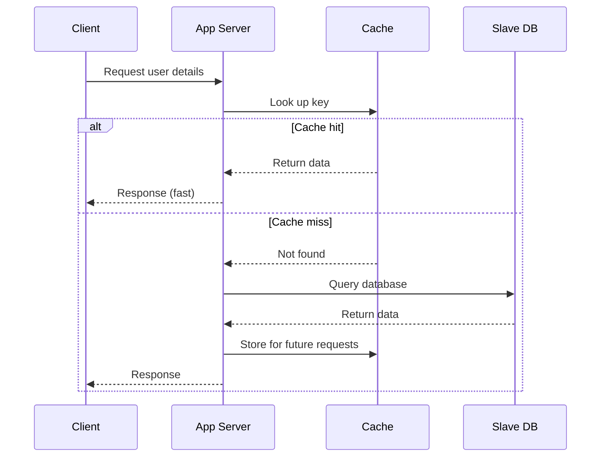

A cache hit skips the database entirely. On a miss, the app reads from the database and **populates the cache for next time**.

> Caching gets its own full chapter right after this one (eviction policies, write policies, local vs. distributed).

---

## 7. Stage 6: Content Delivery Network (CDN)

A CDN is a **geographically distributed caching layer for static content**:

- HTML pages
- Images
- Videos
- Audio

### The problem

Imagine a global app (a streaming service, for example). We run data centers in, say, India and the USA. Each data center contains application servers, plus a master and slaves.

Now a lot of traffic starts coming from the UK. Every UK request has to **travel across the world** to reach a data center, which means high latency and a poor experience.

### The solution

Host a **CDN edge location in the UK**. UK users are served from there.

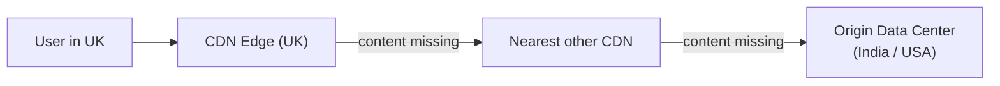

**Lookup order**

1. Check the nearest CDN edge. If it has the content, serve it.
2. If not, check the next nearest CDN.
3. If still not found, go to the origin data center.

**Rule of thumb:** static data goes on a CDN. Large and globally distributed user bases need CDNs because traffic arrives from many regions.

---

## 8. Stage 7: Multiple Data Centers

What if an entire data center fails? With only two data centers (India and USA), losing the USA one means all US traffic must be served from India, or be dropped.

**Solution: multiple data centers at two levels.**

1. **Within a region:** Data Center 1, 2 and 3. If DC1 fails, DC2 takes over, then DC3.
2. **Across regions:** if an entire region fails, another region (for example the USA) serves its traffic.

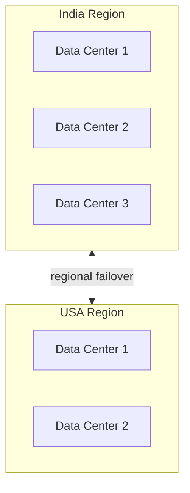

**Benefit:** **high availability**. Multiple independent failures are needed before users notice an outage.

---

## 9. Stage 8: Database Sharding

Say a `users` table has **1 million rows** and we need to search it. Database operations are already costly, and a naive search might scan every row. Indexing helps, but it has its own drawbacks (a topic for another day).

**Sharding** splits a huge dataset into smaller pieces. Each piece is a **shard**, and each shard behaves like an **independent database**, optionally on its own server.

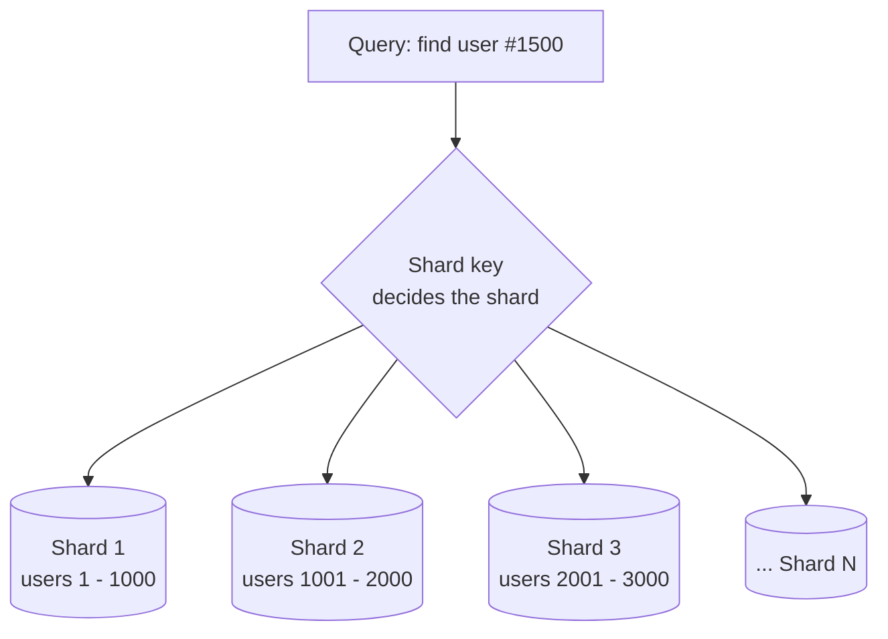

**Why it helps**

- A query hits only the **relevant shard**, which holds far fewer rows.
- Each shard can run on separate hardware, so this is **horizontal scaling of the database**.
- Searches become faster and load is spread.

### The shard key

The **shard key** is the attribute used to decide which shard a record belongs to. Some options:

| Strategy | Example |
|---|---|
| Name-based | Names starting with A to F go to Shard 1, and so on |
| Age-based | Age ranges map to shards |
| Geo/location-based | Region decides the shard |
| Gender-based | Possible, but usually a poor key |

> **My note:** choosing the key matters a lot. A bad key creates "hot" shards that take most of the traffic and defeat the purpose. Good keys spread data and load evenly.

---

## 10. Stage 9: Messaging Queues

Messaging queues (Kafka, RabbitMQ, SQS) do not scale a system directly, but they **protect it from crashing under bursts** and keep performance steady.

### Example: an e-commerce order

Placing an order triggers a chain of services:

1. **Inventory service**: decrease stock
2. **Payment service**: charge the user
3. **Shipment service**: arrange delivery
4. **Notification service**: tell the user

### Without a queue

During a sale, 10 million requests arrive together. The order service calls inventory, payment, shipment and notification directly, so all 10 million hit each of them.

Suppose the payment service can only handle ~1 million at a time. It is overwhelmed, it fails, and **the whole order fails** (and possibly the whole system goes down).

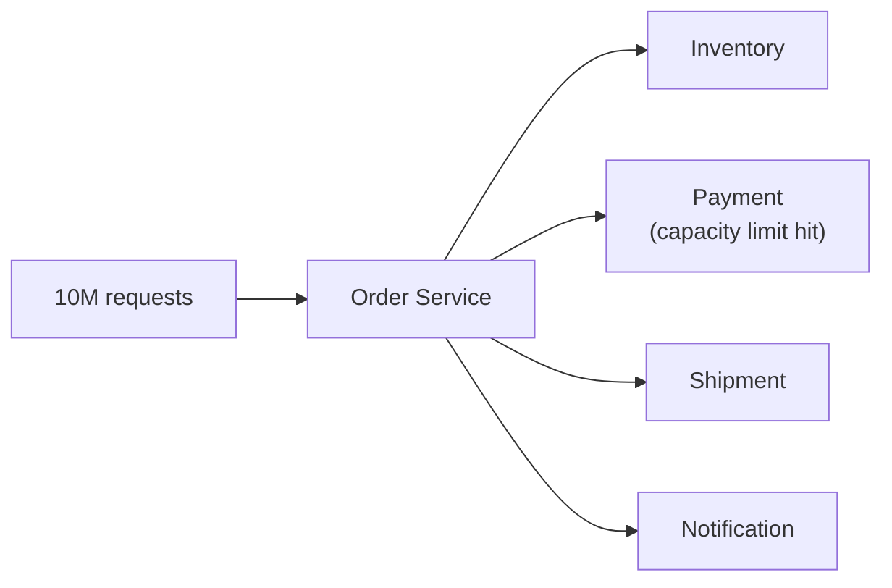

### With a queue

Requests are **stored in the queue first**. The user can immediately be told "your order has been placed". Each downstream service then **consumes at its own pace**.

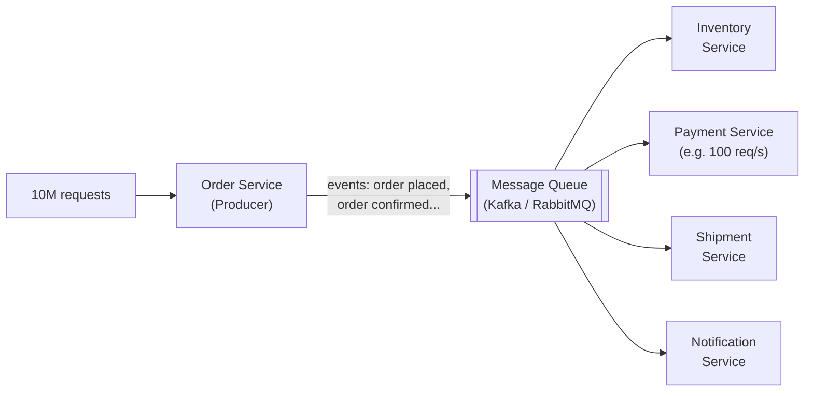

If the payment service handles 100 requests per second, it pulls 100 per second from the queue and works through the backlog steadily. If load grows further, **scale the payment service horizontally** by adding instances that consume from the same queue.

### Producer and consumer

- **Producer:** emits events (for example Order Placed, Order Confirmed, Ready to Ship). Here, the order service.
- **Consumers:** services that read the events and act on them (inventory, payment, shipment, notification).

**Benefits:** load smoothing, decoupling between services, resilience (events wait in the queue if a service is briefly down), and independent scaling of each consumer.

---

## 11. The Full Picture

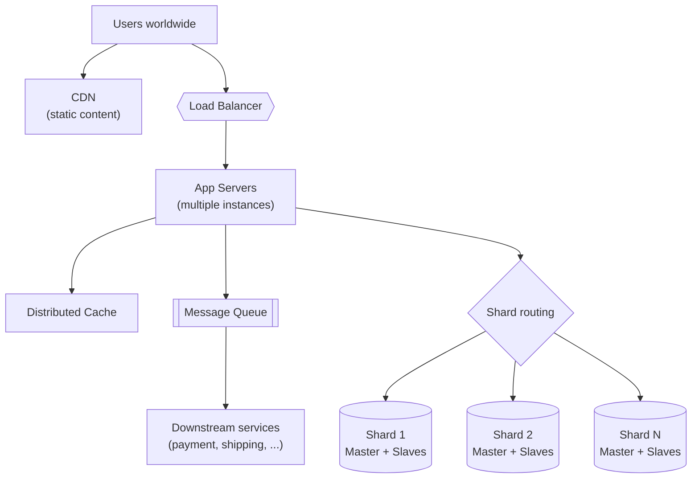

All of this is replicated across multiple data centers and regions for high availability.

---

## 12. Quick Revision Table

| Stage | Component | Problem it solves |
|---|---|---|
| 1 | Single server | Starting point (app and DB together) |
| 2 | Separate app and DB servers | Resource contention on one machine |
| 3 | Multiple app servers + load balancer | App server overload and SPOF |
| 4 | Database replication (master/slave) | Database as SPOF, read load |
| 5 | Cache | Slow, costly database reads; extra network hops |
| 6 | CDN | High latency for global users; static content |
| 7 | Multiple data centers | Data-center or region-level failure |
| 8 | Sharding | Huge datasets, slow queries, DB scale limits |
| 9 | Messaging queues | Traffic bursts overwhelming downstream services |

### Key takeaways

- Scale **one bottleneck at a time**. Do not over-engineer on day one.
- Eliminate **single points of failure** at every tier.
- Spread load (load balancer, replicas, shards), and **avoid unnecessary work** (cache, CDN).
- Use **asynchronous** processing (queues) to absorb spikes.
- Every step adds complexity. Add a component only when the problem justifies it.
