# Chapter 8 — Scaling an Application from Zero to Millions of Users

> **System Design Course Notes**
>
> Learn how real-world applications evolve from a single server into scalable, resilient, globally distributed systems. This chapter explains the motivation, architecture, internal request flows, trade-offs, and failure scenarios behind each major scaling technique.

---

## Table of Contents

- [1. Understanding Application Scaling](#1-understanding-application-scaling)
  - [1.1 What Does Scaling Mean?](#11-what-does-scaling-mean)
  - [1.2 Vertical vs. Horizontal Scaling](#12-vertical-vs-horizontal-scaling)
  - [1.3 Important Performance Metrics](#13-important-performance-metrics)
- [2. Stage 1: Single-Server Architecture](#2-stage-1-single-server-architecture)
- [3. Stage 2: Separate Application and Database Servers](#3-stage-2-separate-application-and-database-servers)
- [4. Stage 3: Horizontal Scaling and Load Balancing](#4-stage-3-horizontal-scaling-and-load-balancing)
- [5. Stage 4: Database Replication](#5-stage-4-database-replication)
- [6. Stage 5: Caching](#6-stage-5-caching)
- [7. Stage 6: Content Delivery Networks](#7-stage-6-content-delivery-networks)
- [8. Stage 7: Multiple Data Centers and Regions](#8-stage-7-multiple-data-centers-and-regions)
- [9. Stage 8: Database Sharding](#9-stage-8-database-sharding)
- [10. Stage 9: Messaging Queues and Asynchronous Processing](#10-stage-9-messaging-queues-and-asynchronous-processing)
- [11. Putting Everything Together](#11-putting-everything-together)
- [12. Common Architectural Challenges](#12-common-architectural-challenges)
- [13. Quick Revision Table](#13-quick-revision-table)
- [14. Interview Questions](#14-interview-questions)
- [15. Final Takeaways](#15-final-takeaways)

---

# 1. Understanding Application Scaling

## 1.1 What Does Scaling Mean?

Imagine building a university management application.

Initially, it has 20 users. One server can comfortably handle their requests, and the database contains only a few thousand records.

Now imagine that the university adopts the application for 50,000 students. Later, other universities begin using it, bringing the total to one million users.

The original architecture may begin experiencing:

- Slow API responses.
- High CPU and memory utilization.
- Database connection exhaustion.
- Slow queries and database contention.
- Request timeouts.
- Service crashes during peak traffic.
- Increasing infrastructure costs.

The problem is not necessarily that the application code is incorrect. The system may simply be receiving more work than its current infrastructure can handle.

**Scaling is the process of increasing a system's capacity to handle growing workloads while maintaining acceptable performance, reliability, and cost.**

A workload can grow in several ways:

| Dimension | Example |
|---|---|
| Number of users | From 1,000 to 1 million registered users |
| Concurrent users | From 100 to 50,000 active users |
| Request rate | From 100 to 100,000 requests per second |
| Data volume | From 1 GB to 10 TB |
| Geographic distribution | From one country to users worldwide |
| Computational complexity | From simple lookups to expensive analytics |

An important distinction: **registered users are not the same as concurrent users, and neither directly determines requests per second.**

One million registered users might generate only a few hundred requests per second. A smaller application with frequent polling or real-time updates might generate substantially more traffic.

Therefore, architecture should be designed around measured or estimated workload characteristics, not just a headline user count.

## 1.2 Vertical vs. Horizontal Scaling

There are two fundamental approaches to increasing computing capacity.

### Vertical scaling (scale up)

Increase the resources available to an existing machine.

For example:

- 2 CPU cores → 8 CPU cores.
- 8 GB RAM → 32 GB RAM.
- A small database instance → a larger database instance.

The application continues running on the same server, but that server becomes more powerful.

### Horizontal scaling (scale out)

Add more machines or instances and distribute the workload between them.

For example:

- 1 application server → 4 application servers.
- 1 database node → multiple database nodes.
- 1 worker → a pool of 20 workers.

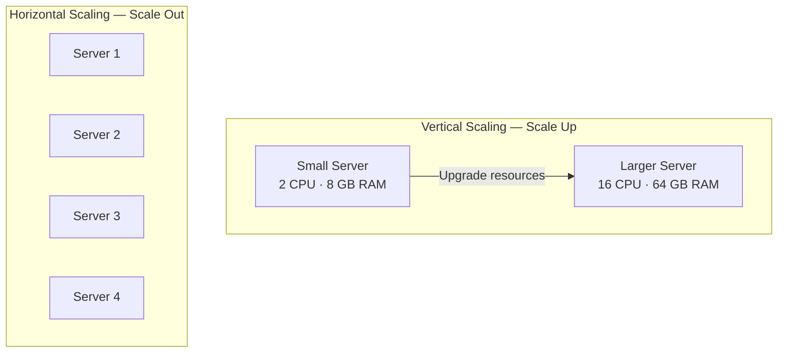

### Comparison

| Property | Vertical Scaling | Horizontal Scaling |
|---|---|---|
| Approach | Upgrade existing hardware | Add more instances |
| Complexity | Usually lower | Usually higher |
| Capacity | Limited by machine size | Can grow by adding instances, within system limits |
| Failure impact | Large if the machine is a single point of failure | Individual failures can be tolerated if redundancy is designed correctly |
| Application changes | Often minimal | May require distributed-state handling |
| Cost | Larger machines can become expensive | Can use many smaller instances |
| Typical use | Early systems, some databases | Large web applications, distributed services |

Vertical scaling is often the simplest first step. Horizontal scaling becomes attractive when a single machine is no longer sufficient, when availability requirements increase, or when distributing workloads improves cost efficiency.

Neither approach is universally superior. Distributed systems introduce network communication, coordination, and operational complexity.

## 1.3 Important Performance Metrics

Before scaling a system, we need to understand what is actually limiting it.

### Latency

Latency is the time required to complete an operation.

For example, if an API takes 200 milliseconds to return a response, its latency is 200 ms for that request.

Common metrics include:

- **p50:** half of requests finish within this time.
- **p95:** 95% of requests finish within this time.
- **p99:** 99% of requests finish within this time.

Tail latency matters because an acceptable average can hide a large number of slow requests.

### Throughput

Throughput measures how much work a system completes per unit of time.

Examples include:

- Requests per second (RPS).
- Orders per minute.
- Database transactions per second.

A server may handle 1,000 requests per second at low latency but become unstable at 1,500 requests per second.

### Concurrency

Concurrency describes how many operations are in progress at the same time.

It is different from throughput. A system may have thousands of requests in progress even if it completes only a few hundred requests each second.

### Resource utilization

Typical measurements include:

- CPU utilization.
- Memory utilization.
- Disk I/O.
- Network bandwidth.
- Database connection pool usage.

### Little's Law

A useful relationship in queueing systems is Little's Law:

\[
L = \lambda W
\]

Where:

- \(L\) = average number of operations in the system.
- \(\lambda\) = average arrival rate, measured in operations per second.
- \(W\) = average time spent in the system, measured in seconds.

For example, if an API receives 200 requests per second and the average time spent in the system is 0.5 seconds:

\[
L = 200 \times 0.5 = 100
\]

Approximately 100 requests are in progress on average.

If latency increases to 2 seconds while the arrival rate remains 200 requests per second:

\[
L = 200 \times 2 = 400
\]

The system now has approximately four times as many requests in progress. This can increase memory usage, connection consumption, and queueing pressure.

**Core principle:** identify the bottleneck before choosing a scaling technique. Adding application servers does little if the database is already the limiting resource.

---

# 2. Stage 1: Single-Server Architecture

## 2.1 Architecture

The simplest application places its main components on one machine.

Typical components include:

- Web server or API server.
- Application business logic.
- Database.
- Local file storage.
- Background tasks.

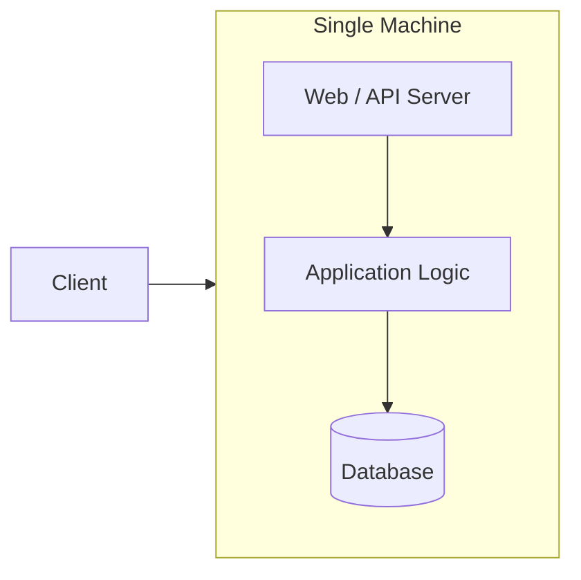

For example, a Node.js application might expose REST APIs, execute business logic, and communicate with a PostgreSQL database running on the same virtual machine.

## 2.2 Request lifecycle

Consider a user requesting their profile.

1. The browser sends an HTTP request.
2. The web server receives it.
3. The application authenticates the user.
4. The application queries the database.
5. The database returns the profile.
6. The application constructs the response.
7. The server returns the response to the browser.

All processing occurs on one machine.

## 2.3 Why this architecture works initially

A single-server architecture has several advantages:

- Simple deployment.
- Low infrastructure cost.
- Minimal network communication between components.
- Easy debugging.
- Straightforward local development.
- Fewer distributed-systems failure modes.

For a prototype, university project, or small internal application, this is often the correct starting point.

## 2.4 What breaks as the application grows?

### Problem 1: Resource contention

The application and database compete for CPU, memory, disk, and other resources.

An expensive database query might consume CPU needed by API handlers. A memory-intensive application process might put pressure on the database's available memory.

### Problem 2: A single point of failure

A **single point of failure (SPOF)** is a component whose failure can make the entire service unavailable.

If the machine crashes, both the application and database become unavailable.

### Problem 3: Limited capacity

Eventually, the machine reaches its practical resource limits. Adding more traffic can increase queueing and latency rather than useful throughput.

### Problem 4: Deployment risk

Restarting the machine or performing certain maintenance operations may interrupt both application traffic and database access.

## 2.5 First improvement: vertical scaling

The simplest response is often to upgrade the machine.

However, vertical scaling has limits, and it does not solve the single-point-of-failure problem.

**When to move on:** when the application and database compete for resources, have different resource requirements, or need to be managed independently.

---

# 3. Stage 2: Separate Application and Database Servers

## 3.1 The architectural change

Move the application and database onto separate machines.

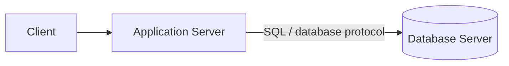

The application server executes business logic. The database server manages persistent data.

The two machines communicate over a private network.

## 3.2 Why separation helps

### Independent resource allocation

Application servers commonly need CPU and memory for request handling, runtime execution, and concurrent operations.

Database servers may benefit from substantial memory for caching data and indexes, fast storage, and carefully managed I/O.

Separating the components allows each machine to be sized and configured for its workload.

### Independent scaling

Suppose application traffic doubles while the database workload stays approximately the same.

The application server can be upgraded without necessarily upgrading the database server.

Conversely, database storage or memory can be increased without changing the application's compute capacity.

### Better isolation

Application deployments and database maintenance can be managed separately. A spike in application memory usage no longer directly consumes the database machine's RAM.

## 3.3 The new request flow

1. The client sends a request to the application server.
2. The application performs validation and business logic.
3. The application sends a query over the network.
4. The database executes the query.
5. The database returns the result.
6. The application sends an HTTP response to the client.

This introduces a network boundary between the application and database. Network latency, connectivity, authentication, and database connection management now matter.

## 3.4 What is still wrong?

There is still only one application server and one database server.

If the application server fails, users cannot access the application. If the database fails, operations that depend on it may fail.

The application tier can also reach its capacity limit independently of the database.

Separating responsibilities improves isolation and manageability, but it does not by itself provide redundancy.

**Next step:** add multiple application instances and distribute requests between them.

---

# 4. Stage 3: Horizontal Scaling and Load Balancing

## 4.1 The problem

Suppose one application server handles 500 requests per second at the desired latency.

Traffic grows to 2,000 requests per second. The server may become overloaded.

Upgrading the machine might help, but a larger machine still has a finite capacity.

Instead, run multiple application instances.

## 4.2 Architecture

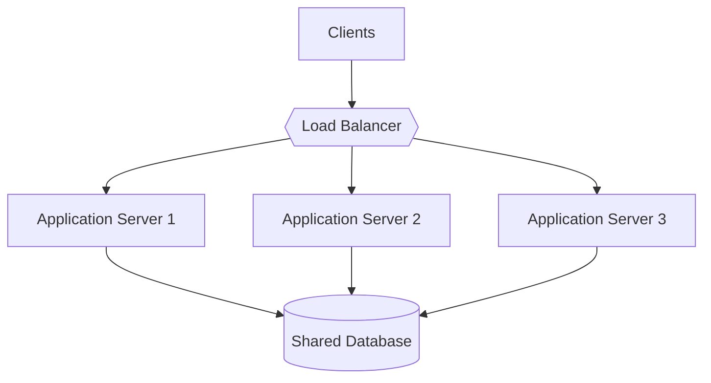

A **load balancer** receives incoming requests and distributes them among available application servers.

The client normally connects to a stable service endpoint rather than selecting an application instance itself.

## 4.3 How load balancing works

A simplified request lifecycle:

1. A request reaches the load balancer.
2. The load balancer identifies eligible backend instances.
3. Its routing algorithm selects an instance.
4. The request is forwarded to that instance.
5. The application processes the request.
6. The response travels back through the load balancer to the client.

Common routing strategies include:

- **Round robin:** rotate through backend servers.
- **Least connections:** prefer servers with fewer active connections.
- **Weighted routing:** send more traffic to servers with greater assigned capacity.
- **IP hash:** use client IP information to select a backend.
- **Latency-aware routing:** prefer backends with favorable observed response times, when supported.

Health checks help the load balancer avoid routing new requests to unhealthy instances.

These strategies have different limitations. For example, least connections does not necessarily identify the server with the least CPU load, and IP hashing does not guarantee that every client is evenly distributed.

## 4.4 Horizontal scaling and capacity

Assume each application instance can sustainably handle 500 requests per second under the same workload and latency target.

| Instances | Approximate aggregate capacity |
|---:|---:|
| 1 | 500 requests/s |
| 2 | 1,000 requests/s |
| 4 | 2,000 requests/s |
| 8 | 4,000 requests/s |

These figures are illustrative. Real scaling is rarely perfectly linear because of shared database capacity, network overhead, synchronization, contention, and uneven traffic.

For example, four application servers cannot collectively sustain 2,000 requests per second if the shared database becomes overloaded at 900 requests per second.

## 4.5 Stateless application servers

Horizontal scaling works best when any healthy application instance can handle any request.

This motivates the concept of a **stateless application server**.

A stateless application instance does not depend on its own local memory or disk to preserve essential user state between requests.

For example, storing a user's session only in Server 1's memory creates a problem if the next request reaches Server 2.

Common solutions include:

- Storing session data in a shared Redis instance or database.
- Using appropriately designed signed tokens for authentication.
- Storing uploaded files in shared object storage.
- Keeping durable business state in a shared database.

A token-based system still needs to handle expiration, revocation, authorization, and key management correctly.

Sticky sessions can keep a client attached to the same backend, but they reduce routing flexibility and do not replace reliable state management.

## 4.6 What problem remains?

The shared database is still a bottleneck and a potential single point of failure.

Adding more application servers can actually make the problem worse because more instances may issue database queries concurrently.

**Next step:** improve database read capacity and resilience.

---

# 5. Stage 4: Database Replication

## 5.1 Why application scaling is not enough

Consider an application with ten healthy application servers and one database server.

Each application instance handles incoming requests, but most requests eventually query the same database.

As traffic grows, the database may experience:

- High CPU usage.
- Disk I/O saturation.
- Too many concurrent queries.
- Connection pool exhaustion.
- Increased query latency.

The database is now the limiting component.

One way to improve read capacity and availability is **database replication**.

## 5.2 What is replication?

Replication maintains copies of data on multiple database nodes.

A common topology is a leader with multiple followers, also known as a primary-replica architecture.

- **Primary (leader):** accepts writes in a typical single-writer design.
- **Replicas (followers):** receive replicated changes and may serve reads.

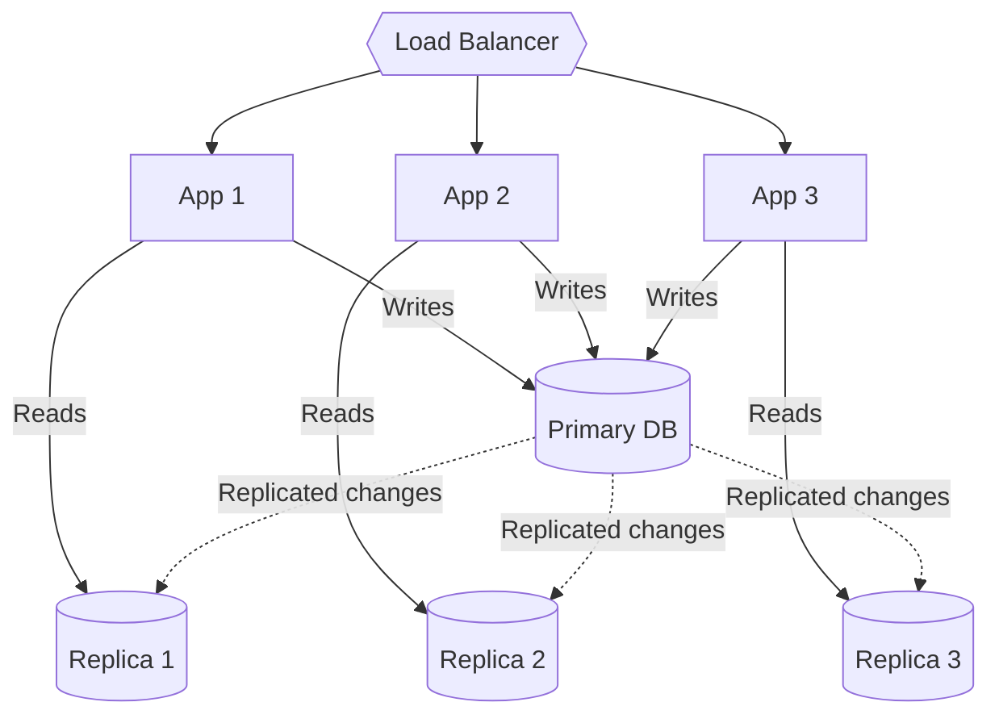

The diagram illustrates possible routing, not a mandatory rule. Reads can also go to the primary when consistency requirements demand it.

## 5.3 How replication works

Consider a user updating their email address.

1. The application sends the update to the primary.
2. The primary validates and commits the write according to its database configuration.
3. The database records the changes in its replication mechanism, such as a transaction log.
4. The changes are transmitted to replicas.
5. Each replica applies the changes to its local data.

The exact replication protocol depends on the database and configuration.

### Synchronous replication

The primary waits for acknowledgment from the required replica or replicas before reporting the write as successful.

This can improve durability guarantees, but it may increase latency and make writes unavailable when required replicas cannot respond.

### Asynchronous replication

The primary can acknowledge a write before all replicas have applied it.

This often reduces write latency, but replicas may temporarily contain older data. If a primary fails before changes reach an appropriate replica, some acknowledged writes may be lost, depending on the replication and failover guarantees.

Semi-synchronous and quorum-based approaches offer other trade-offs.

## 5.4 Read scaling

Suppose the workload contains 90,000 reads and 10,000 writes per minute.

In a single-primary architecture, the primary may otherwise need to process all 100,000 operations.

Replicas can absorb some of the read workload, leaving the primary more capacity for writes.

However, replication does not automatically distribute writes. In a single-writer topology, writes still pass through the primary.

The actual benefit depends on read/write ratios, query complexity, replication lag, and the capacity of the database nodes.

## 5.5 The replica lag problem

Imagine a user changes their email address.

The primary immediately stores the new email, but a replica has not yet applied the change.

If the next request reads from that replica, the user may see the old email.

This is called **replication lag**.

A common solution is read-after-write routing: direct the relevant read to the primary, or use a mechanism that waits until the selected replica has caught up sufficiently.

Other techniques include session consistency tokens and waiting for a replication position to be reached.

## 5.6 Replication and high availability

Replication alone does not guarantee automatic recovery.

A robust failover design may require:

1. Detecting that the primary is unhealthy.
2. Determining whether it has actually failed rather than merely becoming unreachable.
3. Selecting an eligible replica.
4. Promoting it to primary.
5. Preventing the old primary from accepting conflicting writes.
6. Redirecting clients to the new primary.
7. Reintroducing or rebuilding the recovered node.

This requires careful coordination to prevent split-brain behavior, where two nodes independently accept writes as primary.

**Important distinction:** replication creates copies of data; failover coordinates recovery when a node becomes unavailable.

## 5.7 What problem remains?

Even with replicas, frequently requested data may repeatedly be fetched from the database.

Database queries still consume CPU, memory, connections, and I/O. Replication helps distribute reads, but it does not eliminate the cost of repeatedly computing or retrieving the same result.

**Next step:** cache frequently accessed data.

---

# 6. Stage 5: Caching

## 6.1 What is caching?

A cache stores reusable data in a location that can serve it faster or more cheaply than recomputing it or retrieving it from the original source.

Examples include:

- User profiles.
- Product details.
- Frequently accessed configuration.
- Search results.
- Expensive query results.
- Computed permissions or metadata, when safe to reuse.

Caches are commonly implemented using in-memory stores such as Redis, Memcached, or application-local memory.

The key idea is simple:

**If the system repeatedly needs the same information, it may be unnecessary to retrieve or compute that information every time.**

## 6.2 Request flow: without a cache

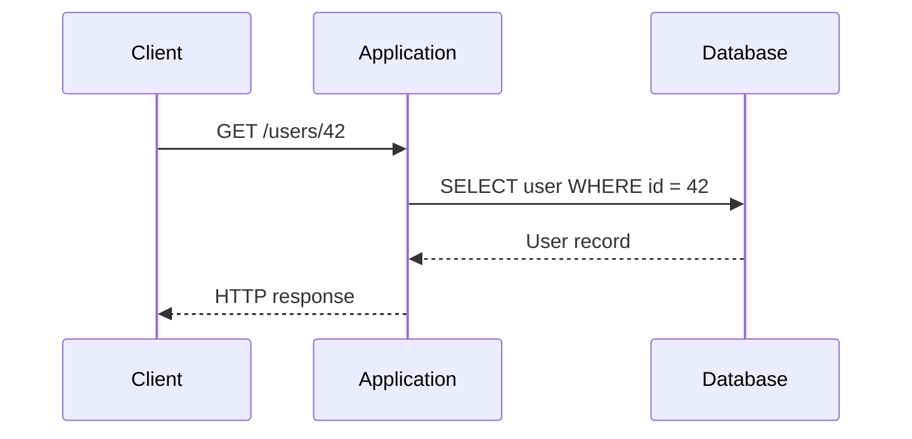

Every request that requires the record performs a database lookup.

## 6.3 Request flow: with a cache

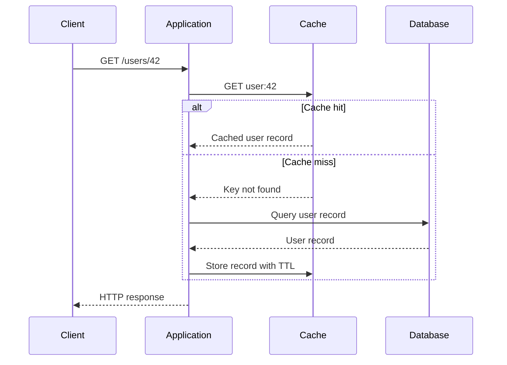

### Cache hit

The requested data is already in the cache.

The application can return it without querying the database.

### Cache miss

The requested data is absent or no longer usable.

The application retrieves it from the source of truth, stores it in the cache, and returns it.

The next request may then be served directly from the cache.

## 6.4 Why caching improves performance

Consider illustrative latency values:

| Operation | Example latency |
|---|---:|
| Application-to-cache lookup | 1 ms |
| Application-to-database lookup | 10 ms |

A cache hit avoids the database lookup, potentially reducing latency and database workload.

These figures are illustrative, not benchmarks. Actual latency depends on network distance, payload size, connection management, query plans, hardware, and load.

Caching also reduces the number of repeated database operations. This can be more valuable than the latency reduction alone because the saved database capacity becomes available for writes, misses, and other work.

## 6.5 Cache-aside pattern

A widely used strategy is **cache-aside**.

The application controls when data is loaded into the cache.

### Read operation

1. Look up the cache key.
2. If found, return the cached value.
3. Otherwise, query the database.
4. Store the result in the cache.
5. Return the result.

### Write operation

A common approach is:

1. Update the database.
2. Invalidate the corresponding cache entry.
3. Allow the next read to load the latest committed value.

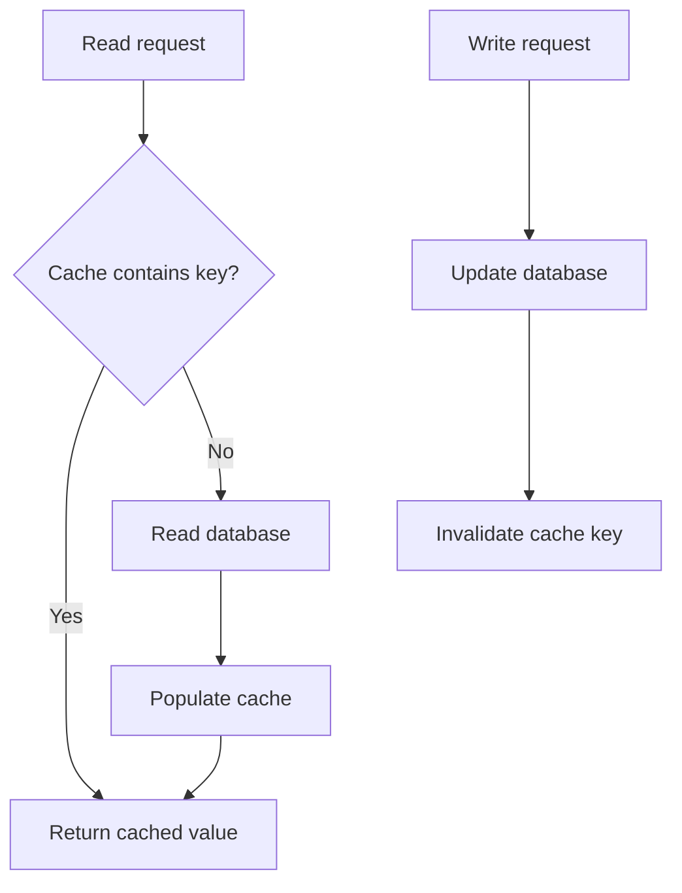

The exact ordering and failure-handling strategy depend on the consistency requirements.

## 6.6 Cache invalidation and stale data

Caching introduces a new challenge: **the cached value can become outdated**.

Suppose a product's price changes from $100 to $80, but the cache still contains $100.

Users may continue seeing the old price until the entry expires or is invalidated.

Common strategies include:

- **Time-to-live (TTL):** automatically expire entries after a configured duration.
- **Explicit invalidation:** remove or refresh an entry when the underlying data changes.
- **Write-through:** write changes to the cache as part of a coordinated write path.
- **Write-behind:** acknowledge or buffer cache writes before persisting them to the backing store, accepting additional durability and consistency risks.
- **Versioning:** associate cached values with versions so obsolete data can be identified.

No strategy eliminates every consistency problem. For critical information such as balances, inventory reservations, or permissions, cache behavior must be designed around explicit correctness requirements.

## 6.7 Other cache problems

### Cache stampede

Many requests simultaneously miss the same key and all query the database.

**Mitigation:** request coalescing, per-key locks, early refresh, or controlled background regeneration.

### Hot keys

A very popular key receives disproportionate traffic.

**Mitigation:** local caching, replication, request coalescing, or specialized distribution strategies.

### Cache failure

If a shared cache becomes unavailable, requests may fall back to the database and overwhelm it.

**Mitigation:** bounded retries, circuit breakers, rate limits, graceful degradation, and sufficient database protection.

### Memory limitations

A cache cannot hold every possible object indefinitely.

**Mitigation:** TTLs, size limits, and eviction policies such as LRU or LFU, chosen according to the workload.

## 6.8 What problem remains?

A distributed cache can reduce database work, but it does not solve every kind of latency.

Users far from the application still experience network delay. Furthermore, static assets such as images, videos, CSS, and JavaScript files may be better served from geographically distributed infrastructure.

**Next step:** use a Content Delivery Network.

---

# 7. Stage 6: Content Delivery Networks

## 7.1 The geographic latency problem

Suppose the application runs in a data center in the United States.

A user in Pakistan requests a 5 MB image hosted by that application.

Even if the server responds quickly, the request and response must travel across a significant geographic distance. Network routing, congestion, and the time required to transfer the image contribute to latency.

Repeating this process for every image, video, stylesheet, or JavaScript file creates unnecessary load on the origin.

## 7.2 What is a CDN?

A **Content Delivery Network (CDN)** is a geographically distributed infrastructure that delivers content from locations closer to users.

CDNs are particularly useful for:

- Images.
- CSS and JavaScript.
- Fonts.
- Video and audio segments.
- Downloadable files.
- Publicly cacheable pages and API responses.

A CDN can also provide TLS termination, traffic filtering, DDoS protection, and other edge services, depending on the provider and configuration.

## 7.3 Architecture

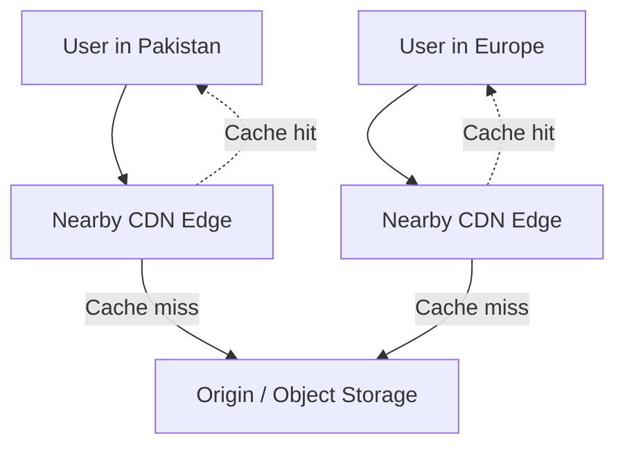

The diagram shows independent users being served by their respective edge locations. Real routing and cache hierarchies depend on the CDN provider.

## 7.4 How a CDN request works

Consider a user requesting an image.

1. The browser requests the image using its CDN URL.
2. The request is routed to an appropriate CDN edge.
3. The edge checks whether it has a usable cached copy.
4. If the object is cached and valid, the edge returns it.
5. Otherwise, the edge fetches the object from the configured origin or upstream.
6. The edge may cache the object according to its cache policy.
7. The response is delivered to the user.

A CDN does not universally search a sequence of progressively more distant CDN nodes. Its cache hierarchy, routing, and origin-fetch behavior depend on the provider.

## 7.5 Why a CDN matters

A CDN can reduce:

- Geographic network latency.
- Repeated origin requests.
- Bandwidth consumed by the origin.
- Load on application servers when content is served directly from the edge.

It can also improve resilience when cached content remains available during certain origin failures.

However, a CDN does not make uncached dynamic operations automatically fast. Personalized responses, rapidly changing data, and authenticated content require careful caching rules.

## 7.6 Cache correctness and invalidation

Suppose a website replaces `logo.png`, but the CDN continues serving the previous version.

Common approaches include:

- Versioned asset names, such as `logo.v2.png`.
- Content-hashed filenames, such as `logo.a8f31c.png`.
- Explicit cache purging.
- Carefully configured cache-control headers.

Versioned assets are particularly useful because new content can be referenced by a new URL without waiting for every cached copy of the old URL to expire.

**Key distinction:** application caches usually help application code retrieve data efficiently, while CDNs distribute cacheable content close to end users.

---

# 8. Stage 7: Multiple Data Centers and Regions

## 8.1 Why one data center may not be enough

A single data center can become unavailable because of:

- Network failures.
- Power or cooling problems.
- Infrastructure faults.
- Regional connectivity issues.
- Cloud-region outages.
- Operational mistakes.

Multiple application servers within one data center do not protect against every data-center-level failure.

To improve resilience, systems may deploy infrastructure across multiple availability zones and geographic regions.

## 8.2 Availability zones vs. regions

These concepts should not be confused.

- **Availability zone:** an isolated infrastructure location within a cloud region, designed to reduce the impact of certain failures.
- **Region:** a broader geographic area containing cloud infrastructure and typically multiple availability zones.

Deploying across availability zones is often a practical first step for high availability. Cross-region deployments add geographic resilience but also increase cost and operational complexity.

## 8.3 Architecture

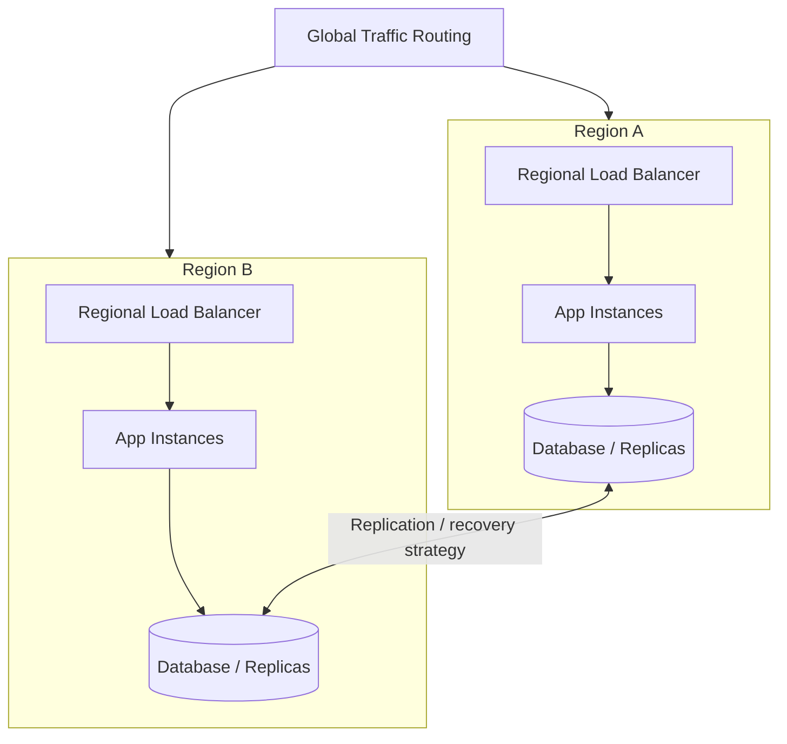

This is a conceptual multi-region architecture. It does not imply that both databases accept writes or that cross-region replication is synchronous.

## 8.4 Active-active vs. active-passive

### Active-active

Multiple regions actively serve traffic.

Advantages:

- Traffic can be served from more than one region.
- Capacity can be distributed geographically.
- A healthy region may continue serving during another region's outage.

Challenges:

- Data consistency across regions.
- Conflict resolution if multiple regions modify the same records.
- More complicated routing and failover.
- Cross-region network costs.

### Active-passive

One region primarily serves traffic while another is prepared to take over.

Advantages:

- Simpler write ownership in many designs.
- Potentially easier consistency management.
- Standby capacity can be reserved for disaster recovery.

Challenges:

- Failover takes time.
- Standby infrastructure costs money.
- Data replication lag can affect recovery.
- Recovery procedures must be tested.

## 8.5 Availability is not the same as durability

These concepts are related but different.

- **Availability:** the service is able to respond to requests.
- **Durability:** committed data survives failures according to the system's guarantees.

A service may remain online but lose recently acknowledged writes after an improperly designed failover. Conversely, durable data may remain safe while the application is temporarily unavailable.

A robust design considers both.

## 8.6 RTO and RPO

Two important disaster-recovery metrics are:

**Recovery Time Objective (RTO):** the target maximum time required to restore service after a disruption.

**Recovery Point Objective (RPO):** the target maximum amount of data loss, expressed as a period of time.

For example, a system with an RTO of 10 minutes aims to restore service within 10 minutes. An RPO of 1 minute means the disaster-recovery strategy aims to limit lost data to approximately the last minute of changes.

These are targets, not automatic guarantees. Meeting them requires suitable replication, backups, recovery procedures, monitoring, and testing.

## 8.7 The consistency trade-off

Cross-region replication introduces network latency and possible partitions.

When two regions cannot communicate, a system must follow its chosen consistency and availability guarantees. Some designs reject certain writes until coordination is possible; others allow local writes and reconcile conflicts later.

There is no universally correct choice. Financial ledgers, social feeds, collaborative applications, and analytical systems have different requirements.

**Important:** multi-region deployment improves resilience only when routing, data ownership, replication, dependencies, and failover are designed consistently.

---

# 9. Stage 8: Database Sharding

## 9.1 When replication is no longer enough

Replication can improve read capacity, but in a conventional single-primary design, the primary still handles writes.

As a database grows, a single node may eventually struggle with:

- Total data size.
- Write throughput.
- Index size.
- Memory requirements.
- Storage capacity.
- Backup and recovery duration.
- Maintenance operations.

At this point, the system may need to distribute the dataset itself.

## 9.2 What is sharding?

**Sharding is horizontal partitioning of a dataset across multiple database nodes or logical partitions.**

Each shard holds only part of the overall dataset.

For example, suppose a user database contains 90 million records.

Instead of storing all 90 million records on one database node, we distribute them across three shards:

| Shard | Illustrative user IDs |
|---|---|
| Shard 1 | 1–30 million |
| Shard 2 | 30–60 million |
| Shard 3 | 60–90 million |

These ranges are simplified and are used here only to illustrate partitioning.

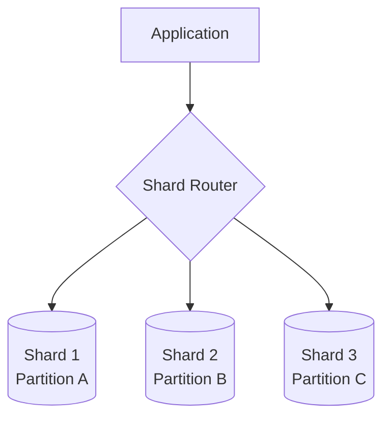

A shard is a partition of the logical dataset. It may run on a separate server, a separate database cluster, or a managed distributed database platform.

## 9.3 How a shard key works

The **shard key** determines how records are assigned to shards and often how queries are routed.

Suppose each user record has a `user_id`.

A hash-based strategy might use:

\[
\operatorname{shard}(id) = \operatorname{hash}(id) \bmod N
\]

Here, \(N\) is the number of logical partitions in a simple fixed-partition example.

The router calculates the destination from the user's identifier and sends the request to the appropriate shard.

Real systems may use consistent hashing, range partitioning, virtual shards, or routing metadata instead. Changing the number of physical nodes does not always mean changing the number of logical partitions.

## 9.4 Common sharding strategies

### Range-based sharding

Assign records according to ranges of the shard key.

Example:

- IDs 1–1,000,000 → Shard A.
- IDs 1,000,001–2,000,000 → Shard B.

Advantages:

- Straightforward routing for range queries.
- Records with nearby key values can be colocated.

Disadvantages:

- New records may disproportionately target the newest range.
- Uneven data distribution can create hot shards.

### Hash-based sharding

Apply a hash function to the shard key.

Advantages:

- Can distribute records more evenly when keys are suitably chosen.
- Reduces the likelihood of simple sequential keys targeting the same partition.

Disadvantages:

- Range queries may need to access many shards.
- Resharding can be difficult with simplistic fixed-modulo designs.

### Geographic sharding

Partition data by region.

Examples include storing European customer data in a European data region and North American customer data in a North American region.

Advantages:

- Can reduce regional access latency.
- May help meet data residency requirements.

Disadvantages:

- Global queries may require cross-region access.
- Users moving between regions need a defined migration strategy.
- Geographic traffic and data volume may be uneven.

## 9.5 Choosing a good shard key

A good shard key should ideally:

- Distribute data relatively evenly.
- Distribute writes and traffic effectively.
- Support the application's common query patterns.
- Avoid concentrating popular records on one shard.
- Remain stable enough to minimize expensive data movement.

A key that distributes stored records evenly can still create uneven traffic if a small number of records receive most of the requests.

This leads to the concept of a **hot shard**: a partition that receives disproportionately high traffic or workload.

For example, partitioning social media data by celebrity ID might cause one shard to receive an enormous volume of reads for a popular celebrity.

Possible mitigations include caching, splitting hot partitions, spreading access patterns, or designing specialized data representations.

## 9.6 What happens when a query does not include the shard key?

Suppose a query asks:

```sql
SELECT * FROM users WHERE email = 'user@example.com';
```

If `email` is not the shard key and no routing index maps email addresses to shards, the router may not know which shard contains the record.

It may need to query all shards and combine the results.

This is called a **scatter-gather query**.

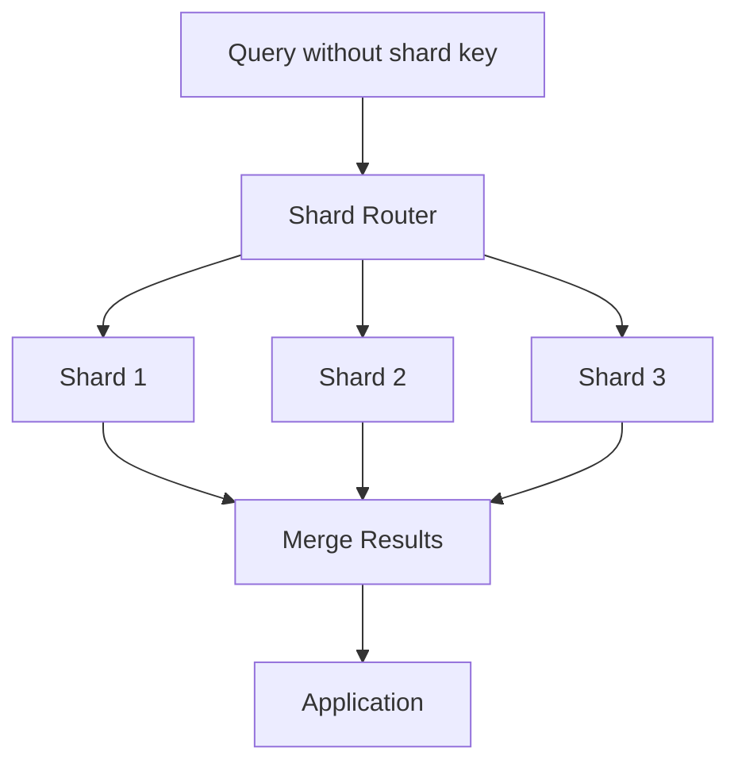

Scatter-gather operations can increase latency, resource usage, and network traffic. Some systems solve this problem using secondary indexes, routing services, or deliberate denormalization.

## 9.7 Replication and sharding solve different problems

These concepts are frequently confused.

**Replication** creates multiple copies of the same data.

**Sharding** distributes different portions of the data.

A large database architecture may combine both:

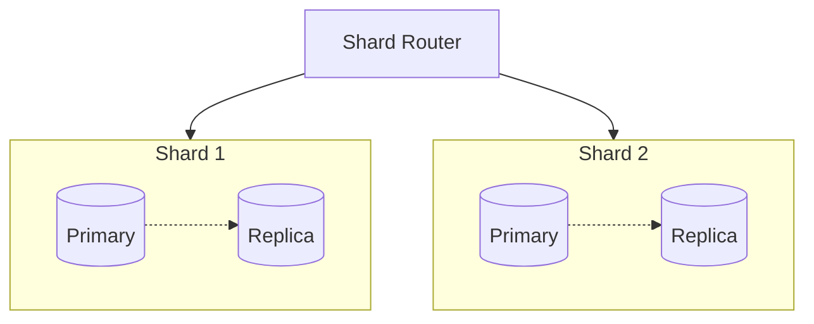

Each shard manages a different portion of the dataset, while replication provides copies of that portion.

The architecture still needs appropriate routing, failover, consistency, backup, and resharding mechanisms.

## 9.8 Additional sharding challenges

Sharding increases operational complexity.

Important concerns include:

- Cross-shard joins.
- Transactions spanning multiple shards.
- Unique constraints across the entire dataset.
- Rebalancing when capacity grows.
- Uneven traffic distribution.
- Global secondary indexes.
- Backup and recovery coordination.

Sharding should generally be introduced when measured data size, throughput, or operational constraints justify it. Indexes, query optimization, schema design, caching, and vertical scaling may be sufficient for many applications.

---

# 10. Stage 9: Messaging Queues and Asynchronous Processing

## 10.1 The problem: sudden traffic bursts

Imagine an e-commerce platform running a major sale.

Millions of customers attempt to place orders within a short period.

Processing an order may involve:

1. Validating the order.
2. Reserving inventory.
3. Processing payment.
4. Creating a shipment.
5. Sending an email or push notification.

If the order endpoint waits for every downstream operation to finish, its latency and resource consumption depend on all those services.

A slow notification provider, for example, may delay order responses even when payment and inventory systems are healthy.

## 10.2 What is a message queue?

A message queue is an intermediary that stores messages until consumers process them.

The application or service producing messages is the **producer**. The component receiving and processing them is the **consumer**.

Examples of messaging technologies include:

- RabbitMQ.
- Amazon SQS.
- Apache Kafka.

They are not identical. RabbitMQ and SQS provide queue-oriented messaging capabilities, while Kafka is primarily a distributed event-streaming platform with durable, partitioned logs and consumer offsets.

The choice depends on delivery semantics, ordering requirements, throughput, retention, routing, and operational needs.

## 10.3 Synchronous processing

Without asynchronous processing, a request may wait for several downstream services.

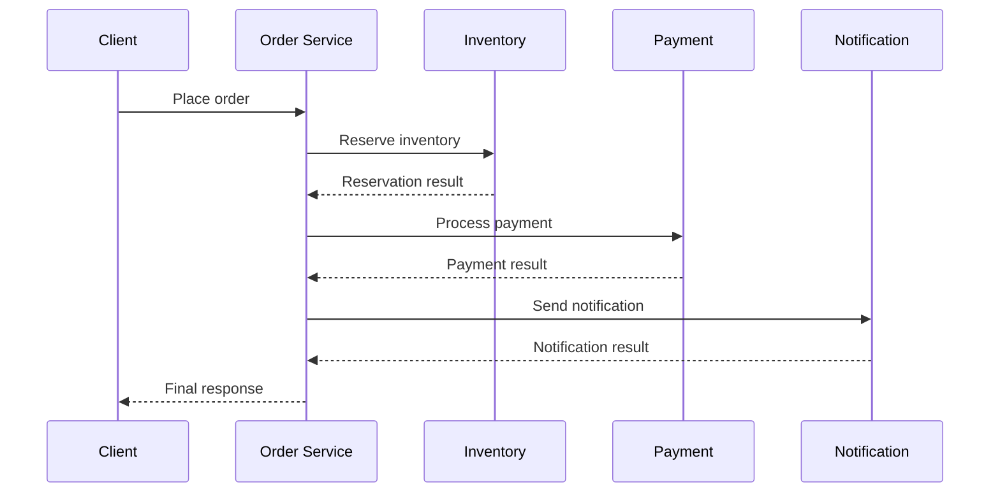

The response time includes the time spent waiting for downstream operations. If those operations run sequentially, their latencies may accumulate.

Not every downstream operation should be asynchronous, however. A payment or inventory operation may need to complete, or at least reach a defined durable state, before the application can truthfully confirm the order.

## 10.4 Asynchronous processing

With a queue, the application can record a request or event durably and allow independent workers to process eligible tasks.

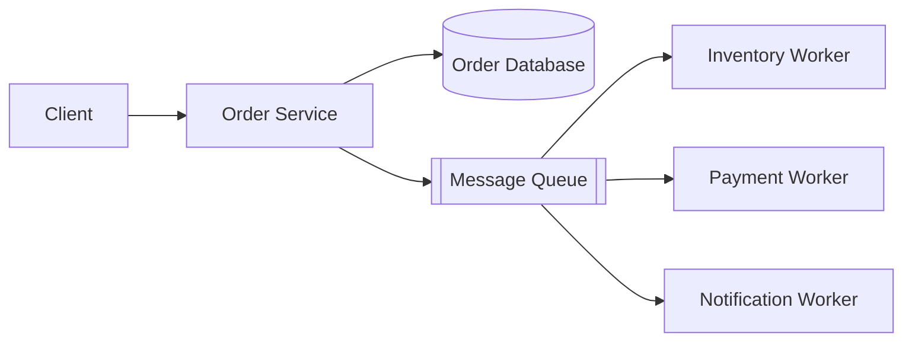

This is a simplified diagram. Real order workflows usually need explicit state transitions and dependencies rather than independently executing every operation without coordination.

### Producer responsibilities

The producer creates messages such as:

- `OrderPlaced`
- `PaymentRequested`
- `InventoryReserved`
- `NotificationRequested`

The message should include sufficient identifiers and data for the consumer to process it safely.

### Consumer responsibilities

Consumers receive messages and perform the relevant work.

They may:

- Validate the event.
- Execute the operation.
- Update durable state.
- Retry transient failures.
- Record success or failure.
- Acknowledge or commit progress according to the messaging system's semantics.

## 10.5 How queues absorb bursts

Assume messages arrive at a rate of 10,000 per second while a consumer group processes 6,000 per second.

The backlog grows by approximately:

\[
10{,}000 - 6{,}000 = 4{,}000
\]

messages per second, assuming those rates remain constant.

A queue can absorb the temporary excess workload, subject to its storage and capacity limits.

When the arrival rate drops below the processing rate, the consumers can work through the backlog.

However, if arrivals permanently exceed processing capacity, the backlog continues growing. The system must add processing capacity, reduce incoming work, or reject/defer excess requests.

A queue absorbs a burst; it does not eliminate an ongoing capacity shortage.

## 10.6 Independent scaling of consumers

Suppose notifications are slower than payment processing.

The system can add notification workers without adding an equivalent number of payment workers.

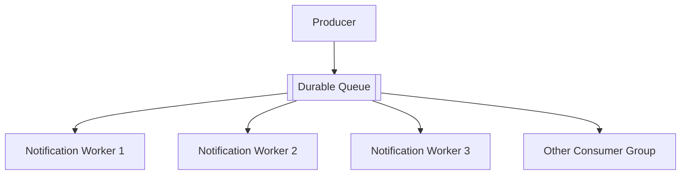

The actual concurrency and message distribution depend on the messaging system. For example, Kafka parallelism is constrained by the number of partitions within a consumer group.

Independent scaling helps when a particular workload needs more capacity, but workers may still compete for shared databases, external APIs, or other downstream resources.

## 10.7 Reliability: retries and idempotency

Distributed messaging systems commonly deliver messages with **at-least-once** semantics: a message may be delivered more than once.

For example:

1. A worker processes a payment request.
2. The payment succeeds.
3. The worker crashes before recording its completion or acknowledging the message.
4. The message is delivered again.
5. The worker attempts the payment again.

Without appropriate safeguards, this could charge the customer twice.

An **idempotent operation** produces the same intended result when the same operation is repeated with the same identity.

Common techniques include:

- Idempotency keys.
- Unique event or operation IDs.
- Database uniqueness constraints.
- Deduplication records.
- Safe state transitions.
- Provider-supported idempotency tokens.

Exactly-once processing is not a universal property that a queue automatically provides across databases, payment providers, and external services. End-to-end correctness requires coordinating the entire workflow.

## 10.8 The transactional outbox pattern

Another problem occurs when the application updates its database but fails before publishing the corresponding message.

For example:

1. The order is committed to the database.
2. The process crashes before publishing `OrderPlaced`.
3. The order exists, but downstream consumers never receive the event.

A common solution is the **transactional outbox pattern**.

The application stores the business change and an outgoing event in the same database transaction. A separate publisher reads the outbox and sends events to the message broker, marking them as published or otherwise tracking progress.

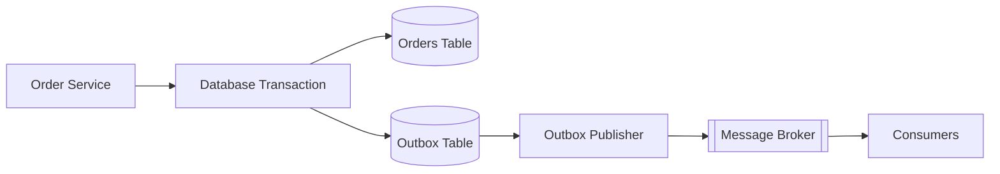

The publisher may send the same event more than once, so consumers still need appropriate idempotency.

The outbox prevents the business update and event record from being separated by a crash between two independent writes. It does not eliminate every possible delivery failure.

## 10.9 Failed messages and dead-letter queues

Some messages fail repeatedly because of invalid data, permanent business errors, or unavailable dependencies.

A retry policy should distinguish transient failures from permanent failures and use bounded retries with appropriate backoff.

After repeated failures, a message may be moved to a **dead-letter queue (DLQ)** for investigation or controlled reprocessing.

A complete design should include monitoring, alerting, and procedures for recovering failed messages.

## 10.10 Messaging does not automatically mean the order is complete

A critical distinction is the difference between accepting a request and completing its business operation.

An application may immediately return:

> Your order has been received and is being processed.

That is different from claiming:

> Your order is confirmed, payment has succeeded, and inventory is reserved.

The latter requires evidence that the relevant operations actually succeeded.

Queues are particularly useful for notifications, analytics, search indexing, background processing, and workflows whose intermediate states can be represented explicitly.

---

# 11. Putting Everything Together

A production architecture combines these techniques based on its actual requirements.

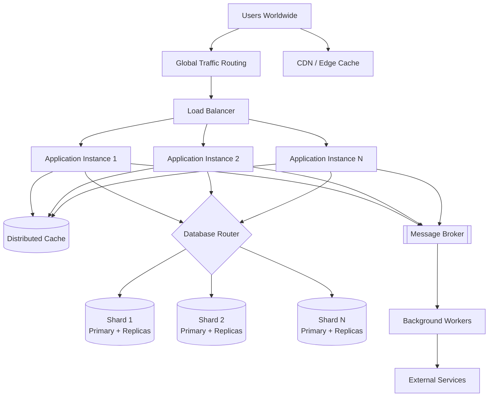

This diagram shows the major building blocks, not a mandatory implementation. A small application may not need sharding, multiple regions, or a message broker. A large system may use several caches, different databases for different workloads, and multiple independent service boundaries.

## 11.1 A request through the architecture

Consider a user opening a product page.

1. **Global routing:** directs the request toward a suitable entry point or region.
2. **CDN:** serves cacheable static assets such as product images, fonts, and JavaScript.
3. **Load balancer:** selects a healthy application instance.
4. **Application:** authenticates the request when necessary and executes business logic.
5. **Cache:** checks for reusable product data.
6. **Database router:** routes a cache miss to the appropriate database partition, if sharding is used.
7. **Database:** returns the required product record.
8. **Cache population:** the application may cache the result for future requests.
9. **Response:** the application returns the product information to the client.

A purchase follows a different flow. The system must validate current prices, enforce inventory rules, process payment correctly, and persist the appropriate order state. It must not rely on potentially stale cache entries as the sole authority for critical business decisions.

## 11.2 Why every component exists

| Component | Primary responsibility |
|---|---|
| Load balancer | Distribute requests across application instances |
| Multiple application instances | Increase compute capacity and support instance-level redundancy |
| Database replication | Maintain data copies, potentially improving read capacity and recovery |
| Cache | Avoid repeated database lookups or computations |
| CDN | Deliver cacheable content closer to users |
| Multiple zones and regions | Reduce the impact of infrastructure and geographic failures |
| Database sharding | Distribute a large dataset and workload across partitions |
| Message broker or queue | Buffer work and decouple producers from consumers |
| Background workers | Process asynchronous tasks independently |
| Monitoring and alerting | Detect saturation, failures, and abnormal behavior |

## 11.3 Scaling is an iterative process

A practical scaling workflow is:

1. Measure the current system.
2. Identify the bottleneck.
3. Determine whether it is caused by CPU, memory, database I/O, network latency, contention, or an external dependency.
4. Choose the simplest suitable improvement.
5. Load-test the modified architecture.
6. Measure whether the bottleneck moved elsewhere.
7. Add further complexity only when justified.

For example, adding four application instances may reveal that the database connection pool is now exhausted. Increasing the pool size without understanding database capacity might worsen the overload. The correct solution could instead involve query optimization, connection pooling, caching, or additional database capacity.

**The goal is not to maximize the number of components. It is to meet the system's performance, availability, durability, and cost requirements with an architecture that can be operated reliably.**

---

# 12. Common Architectural Challenges

The techniques above solve important problems, but they also introduce new failure modes.

## 12.1 Bottleneck migration

Scaling one component can expose a bottleneck elsewhere.

Example:

- Initially, the application server is CPU-bound.
- More application instances are added.
- Database query concurrency increases.
- The database becomes overloaded.

This is why performance testing must measure the complete request path rather than one component in isolation.

## 12.2 Cascading failures

Suppose a database slows down significantly.

Application requests begin waiting longer for database results. Requests accumulate, consuming threads, memory, or connections. The application servers then become overloaded and may start failing too.

This can create a cascading failure.

Common defenses include:

- Request timeouts.
- Bounded connection pools.
- Concurrency limits.
- Backpressure.
- Circuit breakers.
- Load shedding.
- Graceful degradation.

These controls prevent an unhealthy dependency from consuming unbounded resources throughout the system.

## 12.3 Backpressure

Backpressure is a mechanism for communicating or enforcing the fact that a downstream component cannot safely accept more work.

For example, if a worker pool is saturated, the system may slow producers, reject requests, limit concurrency, or defer tasks.

Without backpressure, adding queues can simply move overload into an ever-growing backlog.

## 12.4 Graceful degradation

A system can sometimes continue providing essential functionality while optional features are unavailable.

For example:

- Serve cached product information while a recommendation service is down.
- Accept a request to send a noncritical notification later.
- Disable an expensive analytics feature during overload.

Degradation must be designed around business requirements. A payment or authorization check cannot safely be skipped just because the system is under pressure.

## 12.5 Observability

A distributed architecture needs visibility into what is happening across components.

Three common pillars are:

- **Metrics:** numerical measurements such as latency, throughput, error rate, and queue depth.
- **Logs:** records of events and failures.
- **Traces:** the path a request follows across multiple services.

Useful alerts may include:

- Rising p95 or p99 latency.
- Increasing HTTP error rates.
- Database connection saturation.
- Replica lag.
- Cache failure rates.
- Queue backlog growth.
- Repeated consumer failures.
- Reduced healthy-instance counts.

Observability helps engineers determine not only that a system is slow, but also where the delay originates.

## 12.6 Reliability requires redundancy at every critical layer

Having three application servers does not make the whole system highly available if all three depend on one database that has no recovery plan.

Similarly, multiple regions do not provide meaningful disaster recovery if all regions depend on one unavailable external service or on data that cannot be restored.

The complete dependency graph matters.

## 12.7 Security must scale too

As an application becomes distributed, security boundaries multiply.

Important practices include:

- Encrypting traffic between services where appropriate.
- Applying least-privilege access controls.
- Protecting database and cache endpoints from public exposure.
- Authenticating service-to-service requests.
- Managing secrets securely.
- Limiting requests to prevent abuse.
- Ensuring cache keys and policies cannot leak personalized data.
- Auditing access to sensitive operations.

Performance and reliability improvements must not weaken authorization or data isolation.

---

# 13. Quick Revision Table

| Stage | Technique | Main problem addressed | Main trade-off |
|---|---|---|---|
| 1 | Single server | Simplest starting architecture | Limited capacity and high failure impact |
| 2 | Separate application and database | Resource contention and independent management | More network and operational complexity |
| 3 | Multiple app instances + load balancer | Application capacity and instance-level redundancy | Distributed state and routing complexity |
| 4 | Database replication | Read distribution and database recovery options | Replication lag and failover complexity |
| 5 | Caching | Repeated database work and computation | Stale data and invalidation complexity |
| 6 | CDN | Geographic delivery latency and origin bandwidth | Cache correctness and invalidation |
| 7 | Multiple zones and regions | Infrastructure and geographic failures | Cost, replication, and recovery complexity |
| 8 | Database sharding | Dataset size and database throughput limits | Routing, rebalancing, and cross-shard operations |
| 9 | Messaging queues | Traffic bursts and synchronous coupling | Backlog management and delivery semantics |

## Concepts you must never confuse

| Concept A | Concept B | Difference |
|---|---|---|
| Vertical scaling | Horizontal scaling | More resources per machine vs. more instances |
| Replication | Sharding | Copies of data vs. partitions of data |
| Cache | Database | Fast reusable copies vs. authoritative persistent records |
| CDN | Application cache | Geographic content delivery vs. application-level reuse |
| Availability | Durability | Ability to serve requests vs. preservation of committed data |
| Synchronous | Asynchronous processing | Wait for the operation vs. process it independently |
| Queue | Worker | Stores or delivers work vs. executes work |
| Registered users | Concurrent users | Accounts that exist vs. users active at the same time |
| Throughput | Latency | Work completed per unit of time vs. time taken per operation |
| Replication | Automatic failover | Copying data vs. coordinating recovery |
| Fault tolerance | Scalability | Handling failures vs. handling growing workloads |

---

# 14. Interview Questions

### Q1. Why not add more application servers immediately?

Because the bottleneck may not be the application tier. Additional instances can increase database contention, connection usage, or downstream traffic. Measure the system before deciding.

### Q2. Does replication increase write throughput?

Not necessarily. In a conventional single-primary architecture, writes still go through the primary. Replication is primarily useful for maintaining copies of data and can distribute read workloads. Write scaling requires additional design.

### Q3. Does a cache guarantee that users see the latest data?

No. Cached data may be stale. TTLs, invalidation, versioning, and read-routing strategies help, but correctness depends on the consistency requirements and implementation.

### Q4. Does a load balancer eliminate a single point of failure?

No. The load balancer itself and its supporting infrastructure must also be redundant or managed as a highly available service.

### Q5. Why is statelessness useful?

It allows requests to be routed to any suitable application instance without depending on local session state. This makes load distribution, recovery, and horizontal scaling easier.

### Q6. When should a database be sharded?

When measured capacity limits, data volume, write throughput, or operational constraints justify distributing the dataset across partitions. Sharding is not automatically beneficial for every database.

### Q7. Why can sharding make queries slower?

A query that cannot be routed to a specific shard may need to execute across several shards, after which the results must be combined. Network calls and distributed coordination can outweigh the benefits.

### Q8. Do message queues prevent service failures?

No. They can buffer work and reduce direct coupling, but consumers can still fail, queues can fill, and external dependencies can remain unavailable. Retries, idempotency, backpressure, and monitoring are essential.

### Q9. Why is a queue useful if it does not increase processing capacity?

It separates the rate at which work arrives from the rate at which it is processed. This allows temporary bursts to be absorbed and work to be processed at a sustainable rate, provided the backlog remains manageable.

### Q10. Should every application use multiple regions?

No. Multi-region architectures introduce cost and consistency challenges. They are justified when availability, disaster recovery, latency, or regulatory requirements warrant the additional complexity.

### Q11. What is the difference between scaling and high availability?

Scaling increases the system's capacity to handle workload. High availability aims to keep the system operational despite failures. Techniques such as replication and redundant instances can support both, but they solve different problems.

### Q12. How would you scale a system from 1,000 to one million users?

There is no universal sequence based solely on user count. A reasonable approach is to establish performance targets, measure workload, optimize expensive operations, separate resource-intensive components, scale application instances, improve data access, and introduce partitioning or geographic distribution when justified. The actual architecture depends on request rates, read/write ratios, data size, availability targets, and budget.

---

# 15. Final Takeaways

The evolution of a scalable application is a sequence of engineering decisions, not a checklist that every system must complete.

- **Start simple.** A single server can be the right architecture for an early product.
- **Measure before scaling.** Identify the real bottleneck instead of adding infrastructure blindly.
- **Separate responsibilities.** Independent components can be tuned, deployed, and scaled according to their workloads.
- **Distribute application traffic.** Multiple instances and load balancing improve capacity and resilience when dependencies are also protected.
- **Design data access carefully.** Replication, caching, and sharding address different database-related challenges.
- **Bring content closer to users.** CDNs reduce the cost of repeatedly delivering cacheable content from distant origins.
- **Plan for failure.** Redundancy, recovery objectives, health checks, and tested failover procedures are essential.
- **Decouple work where appropriate.** Queues help absorb bursts and support independent processing, but they require reliable delivery and failure handling.
- **Protect the system from overload.** Timeouts, bounded concurrency, backpressure, and graceful degradation prevent cascading failures.
- **Account for complexity.** Every new component introduces operational costs, dependencies, and failure modes.

The most important principle in system design is this:

> **Do not scale for the sake of scale. Build the simplest architecture that meets your current requirements, measure its limits, and evolve it deliberately as the workload and reliability requirements grow.**