# Chapter 9 — Caching, Distributed Caching, and Cache Policies

> **System Design Course Notes**
>
> Goal: Understand how caching improves application performance, how local and distributed caches differ, how cache entries are managed, and how to design reliable caching strategies for real-world systems.

---

## Table of Contents

1. [The Problem: Repeated Expensive Work](#1-the-problem-repeated-expensive-work)
2. [What Is a Cache?](#2-what-is-a-cache)
3. [How Caching Works](#3-how-caching-works)
4. [Cache Hit Ratio and Performance](#4-cache-hit-ratio-and-performance)
5. [Why Not Cache Everything?](#5-why-not-cache-everything)
6. [Cache Placement: Local vs. Distributed](#6-cache-placement-local-vs-distributed)
7. [Common Caching Strategies](#7-common-caching-strategies)
8. [Cache Eviction Policies](#8-cache-eviction-policies)
9. [Cache Expiration and Invalidation](#9-cache-expiration-and-invalidation)
10. [Cache Write Policies](#10-cache-write-policies)
11. [Cache Stampede, Penetration, and Hot Keys](#11-cache-stampede-penetration-and-hot-keys)
12. [Cache Failures and Reliability](#12-cache-failures-and-reliability)
13. [Choosing the Right Caching Strategy](#13-choosing-the-right-caching-strategy)
14. [Practical Implementation: Cache-Aside in Node.js](#14-practical-implementation-cache-aside-in-nodejs)
15. [Monitoring and Observability](#15-monitoring-and-observability)
16. [Interview Questions](#16-interview-questions)
17. [Final Cheat Sheet](#17-final-cheat-sheet)

---

# 1. The Problem: Repeated Expensive Work

Consider an e-commerce application with millions of users.

Every time a user opens a product page, the application might need to retrieve:

- Product details
- Product price
- Product availability
- Product reviews
- Related products

Some of this information is requested thousands of times but changes only occasionally.

Without caching, every request may require the application to query the database repeatedly.

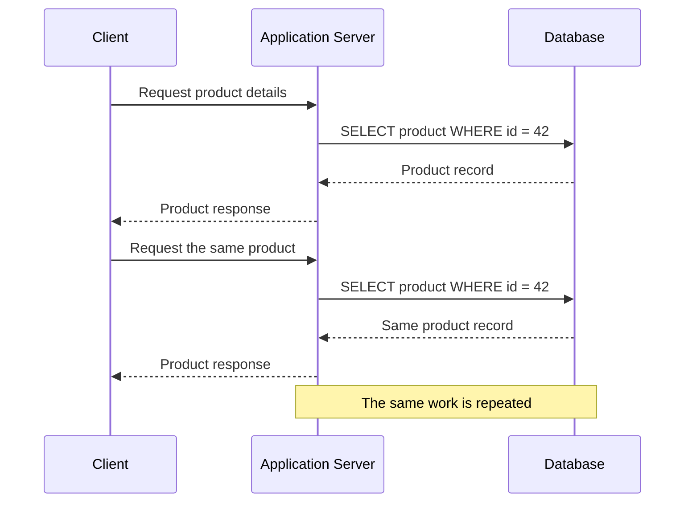

## 1.1 Why is repeated database access expensive?

A database query may involve:

1. Sending a request over the network.
2. Parsing and planning the query.
3. Locating the required records.
4. Accessing memory or storage.
5. Executing joins, filtering, or aggregation.
6. Returning results over the network.

The actual cost depends on the query, indexes, database configuration, workload, and whether the required data is already in memory.

The main issue is not that every database query is slow. It is that repeatedly executing the same expensive operation wastes resources when its result could be reused.

## 1.2 The scalability problem

Suppose a product receives 20,000 requests per second.

If every request queries the database, the database may need to handle 20,000 corresponding reads per second, in addition to writes and other queries.

As traffic grows, several things can happen:

- Database CPU and memory utilization increase.
- Connection pools become exhausted.
- Query queues grow.
- Response latency increases.
- Other database operations compete for resources.
- The application eventually reaches a throughput limit.

This creates a bottleneck: the application may be able to handle more requests, but its database cannot efficiently serve all of them.

## 1.3 The solution: reuse previously computed results

Instead of retrieving the same product repeatedly, the application can temporarily store the result in a fast storage layer.

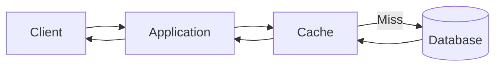

The cache allows the application to reuse results instead of repeatedly performing the same database operation.

**Core principle:** If data is expensive to retrieve, frequently reused, and acceptable to serve under a defined freshness policy, caching can improve both performance and scalability.

---

# 2. What Is a Cache?

A **cache** is a storage layer that keeps copies of data or computed results so that future requests can retrieve them more efficiently.

A cache is generally optimized for fast access rather than permanent storage.

Common caching technologies include:

- Redis
- Memcached
- In-process memory caches
- Operating-system page caches
- CPU caches
- Content Delivery Networks (CDNs)

Caching is not limited to databases. It can also store API responses, rendered HTML, configuration values, authorization metadata, computed reports, and other reusable results.

## 2.1 Cache as a key-value store

Many application caches expose a key-value interface.

For example:

```text
Key:   product:42
Value: {
         "id": 42,
         "name": "Mechanical Keyboard",
         "price": 120,
         "currency": "USD"
       }
```

The application retrieves the value using the key:

```text
GET product:42
```

If the entry exists, the cache returns the stored value. Otherwise, the application must obtain the data from another source.

A well-designed cache key uniquely identifies the result being cached.

For example:

```text
product:42
user:1001
user:1001:orders:page:1
search:keyboard:sort:price:page:1
```

If the output depends on multiple parameters, those parameters may need to be represented in the key. Otherwise, one request might accidentally receive another request's result.

## 2.2 Why is a cache fast?

Caches commonly keep data in RAM, avoiding many storage and query-processing costs associated with retrieving data from a database.

However, the performance difference depends on the architecture:

- An in-process memory lookup avoids a network round trip.
- A Redis lookup usually requires a network request.
- A database lookup may involve network communication, query execution, and storage access.
- A well-indexed database query against data already in memory can also be fast.

Therefore, caching does not guarantee that every request becomes faster. It is most useful when the avoided work costs more than the additional cache access.

## 2.3 Cache versus database

| Property | Cache | Database |
|---|---|---|
| Primary purpose | Accelerate repeated access | Persist and manage authoritative data |
| Typical access | Optimized for fast retrieval | Depends on query and storage design |
| Data lifetime | Often temporary or reconstructible | Usually durable |
| Capacity | Often constrained by memory and cost | Can use memory, SSDs, disks, and distributed storage |
| Data model | Frequently key-value or specialized structures | Relational, document, key-value, and other models |
| Recovery | Entries may be rebuilt or reloaded | Durability and recovery are core responsibilities |
| Consistency role | Often serves a copy of data | Commonly serves as the source of truth |

**Important:** A cache can support persistence, replication, and snapshots. These features do not automatically make it equivalent to the application's authoritative database.

---

# 3. How Caching Works

The basic caching lifecycle has three possible outcomes:

1. The requested entry exists and is usable.
2. The entry is missing.
3. The entry exists but is expired, invalid, or unusable.

## 3.1 Cache hit

A **cache hit** occurs when the requested key has a usable cached value.

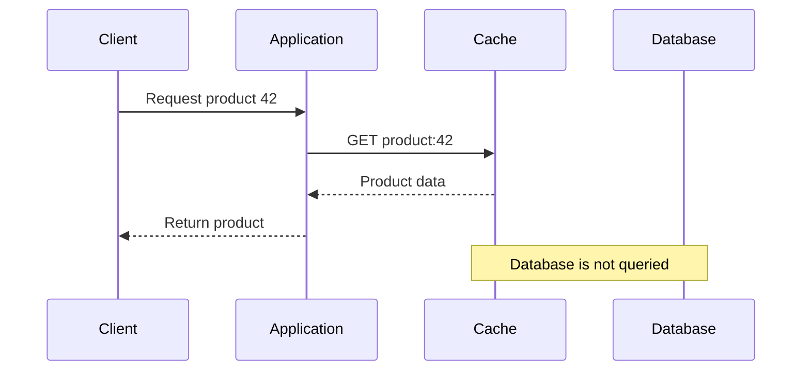

A cache hit avoids the database lookup that would otherwise be necessary.

## 3.2 Cache miss

A **cache miss** occurs when the cache cannot provide a usable value.

In a common strategy called cache-aside, the application fetches the data from the database and then populates the cache.

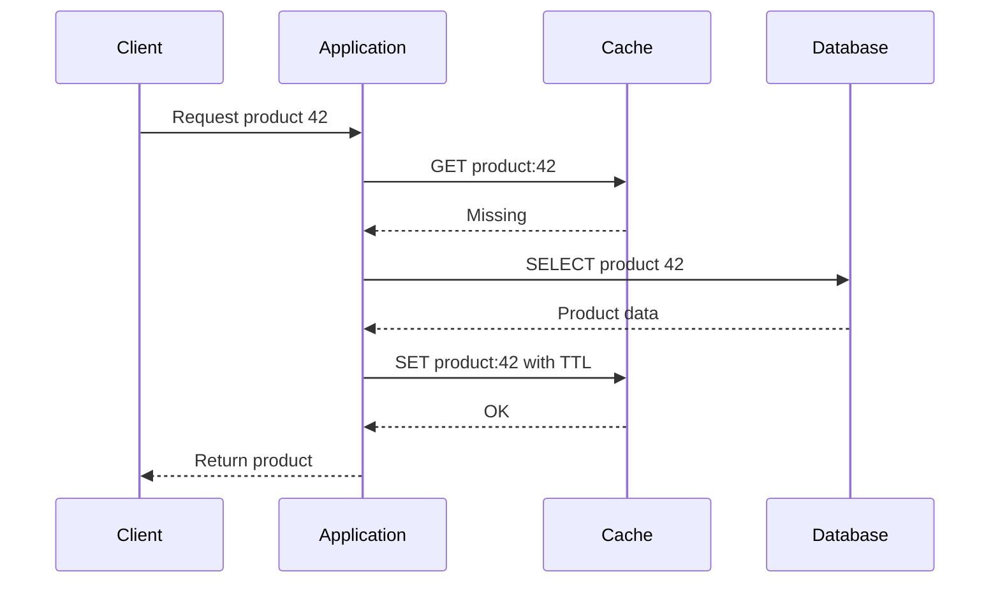

The next request can use the cached value, assuming the entry remains present and valid.

Notice that the first request after a cache miss still pays for the database query and the cache population operation.

## 3.3 Cache miss does not necessarily mean cache failure

A miss can occur for several normal reasons:

- The key has never been cached.
- The entry expired.
- The entry was evicted to free memory.
- The application invalidated the entry after a write.
- A cache restart removed nonpersistent entries.
- Another application instance has not populated the entry yet.

A cache miss is a normal part of caching. The important question is whether the system handles misses efficiently and safely.

## 3.4 The cache-aside read algorithm

```text
function getProduct(id):
    key = "product:" + id

    value = cache.get(key)

    if value exists:
        return value

    value = database.getProduct(id)

    if value does not exist:
        return NOT_FOUND

    cache.set(key, value, TTL)

    return value
```

This example illustrates the concept rather than a complete production implementation. Real systems must also handle cache timeouts, database errors, serialization, concurrent misses, and invalidation.

---

# 4. Cache Hit Ratio and Performance

A cache is useful only if its performance benefit outweighs its costs.

## 4.1 Hit ratio

The **cache hit ratio** measures the proportion of cache requests successfully served from the cache.

\[
\text{Hit Ratio} =
\frac{\text{Cache Hits}}
{\text{Cache Hits}+\text{Cache Misses}}
\]

Suppose an application makes 100,000 cache lookups:

- 90,000 are hits.
- 10,000 are misses.

Then:

\[
\text{Hit Ratio}=\frac{90,000}{100,000}=90\%
\]

The miss ratio is:

\[
\text{Miss Ratio}=1-\text{Hit Ratio}=10\%
\]

If each miss triggers one database read, approximately 10,000 database reads are required for those lookups, rather than 100,000.

This estimate assumes the lookups are counted consistently and that each miss generates one database read. Retries, concurrent misses, batching, and negative caching can change the actual database request count.

## 4.2 Average latency: a worked example

Assume:

- Cache-hit latency: 2 ms
- Cache-miss latency, including database retrieval and cache population: 22 ms
- Hit ratio: 90%

The simplified average latency is:

\[
L_{\text{avg}} =
H L_{\text{hit}} + (1-H)L_{\text{miss}}
\]

Substituting the values:

\[
L_{\text{avg}} =
0.90(2)+0.10(22)
\]

\[
L_{\text{avg}}=1.8+2.2=4\text{ ms}
\]

Without the cache, assume each database-backed request takes 22 ms. Under these illustrative assumptions, the average falls from 22 ms to 4 ms.

Actual production latency depends on concurrency, queueing, network overhead, request distributions, and tail latency. A weighted average is useful for intuition but does not predict p95 or p99 latency by itself.

## 4.3 Hit ratio is not the whole story

A 99% hit ratio is not automatically better than a 90% hit ratio.

Consider two caches:

- Cache A has a 99% hit ratio, but misses trigger expensive database queries.
- Cache B has a 90% hit ratio, but its misses are inexpensive and its entries require less memory.

Cache A may still be preferable, but the hit ratio alone cannot establish that.

Monitor several metrics together:

- Hit and miss ratios
- Cache lookup latency
- Database query volume
- End-to-end request latency
- Memory usage and evictions
- Timeout and error rates
- Hot-key concentration

**The goal is not to maximize hit ratio at any cost. The goal is to improve overall system performance, cost, and reliability.**

---

# 5. Why Not Cache Everything?

Caching every possible result creates its own problems.

## 5.1 Memory is limited

Suppose a cache has 4 GB of usable memory and each cached entry consumes an average of 4 KB, including its key and estimated storage overhead.

Ignoring allocator overhead, fragmentation, metadata, replication, and operational headroom:

\[
\frac{4 \times 1024 \times 1024\text{ KB}}{4\text{ KB}}
\approx 1,048,576\text{ entries}
\]

The theoretical capacity is approximately one million entries. Actual usable capacity will be lower and depends on the cache implementation and workload.

If the application attempts to cache ten million entries, it must either allocate more memory, remove entries, or reject some writes.

## 5.2 Cold data wastes resources

Suppose a product catalog contains one million products, but only 10,000 products receive almost all requests.

Caching the entire catalog may consume memory on products that are rarely accessed.

A better strategy may be to keep frequently requested products in the cache and retrieve cold products from the database when needed.

This takes advantage of **locality of reference**.

### Temporal locality

Data accessed recently is more likely to be accessed again soon.

Example: A user repeatedly opens the same product page.

### Spatial locality

Data near recently accessed data may also be accessed soon.

Example: A user browsing one category may request neighboring products.

Spatial locality is especially relevant to block storage, sequential access, and prefetching, although application caches can also exploit related access patterns.

## 5.3 Cached data can become stale

Suppose the database contains:

```text
product:42 -> price = 100
```

The cache stores the same value.

The product price changes to 120, but the cache still contains 100.

The cache now returns an outdated result.

This is the **cache consistency problem**: keeping a cached copy sufficiently aligned with the authoritative data.

## 5.4 Not every value should be cached the same way

Consider these examples:

| Data | Potential caching strategy |
|---|---|
| Product descriptions | Relatively long TTL if updates are infrequent |
| Product prices | Short TTL or explicit invalidation, depending on business requirements |
| User profile | Cache with invalidation on updates |
| Public configuration | Longer TTL if changes are infrequent |
| Search results | Cache using normalized query parameters and a suitable TTL |
| Account balance | Carefully controlled caching, if cached at all |
| Payment authorization result | Do not rely on an ordinary stale cache as the authoritative decision |

A useful rule is to classify data by its change rate, read frequency, cost to recompute, and tolerance for stale values.

---

# 6. Cache Placement: Local vs. Distributed

Caches can be placed at different layers of the architecture.

## 6.1 Local cache

A **local cache** resides inside an application's own process or on its host.

Examples include an in-memory JavaScript `Map`, an LRU library, or a per-process object cache.

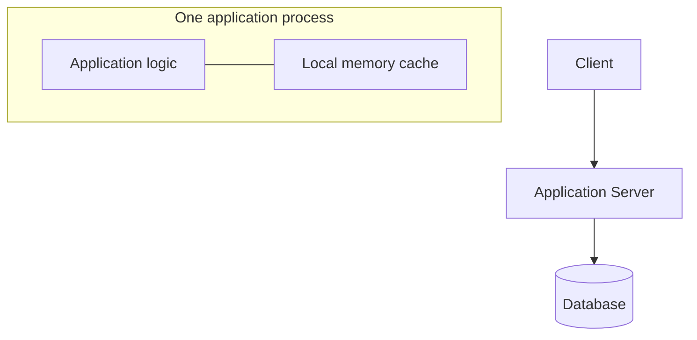

### Advantages

- Very low access overhead.
- No separate cache network request.
- Simple to implement.
- Can reduce traffic to a shared distributed cache.

### Disadvantages

- Each application instance has its own copy.
- Memory consumption is repeated across instances.
- Entries can differ between instances.
- Restarting the process may clear the cache.
- Data invalidation becomes harder when many servers hold copies.

### Example: inconsistent local caches

Suppose three application servers cache the same user's profile.

```text
Server 1 cache: user:1001 -> name = Ali
Server 2 cache: user:1001 -> name = Ali
Server 3 cache: user:1001 -> name = Ali
```

The user changes their name to Ahmed. The database is updated, but only Server 3 invalidates its local entry.

```text
Server 1 cache: user:1001 -> name = Ali
Server 2 cache: user:1001 -> name = Ali
Server 3 cache: user:1001 -> name = Ahmed
Database:       user:1001 -> name = Ahmed
```

A request routed to Server 1 can still return Ali.

A local cache does not automatically synchronize with other processes. The application needs an invalidation, expiration, versioning, or refresh strategy.

## 6.2 Distributed cache

A **distributed cache** is a shared caching service accessed by multiple application instances over a network.

Redis and Memcached are common examples.

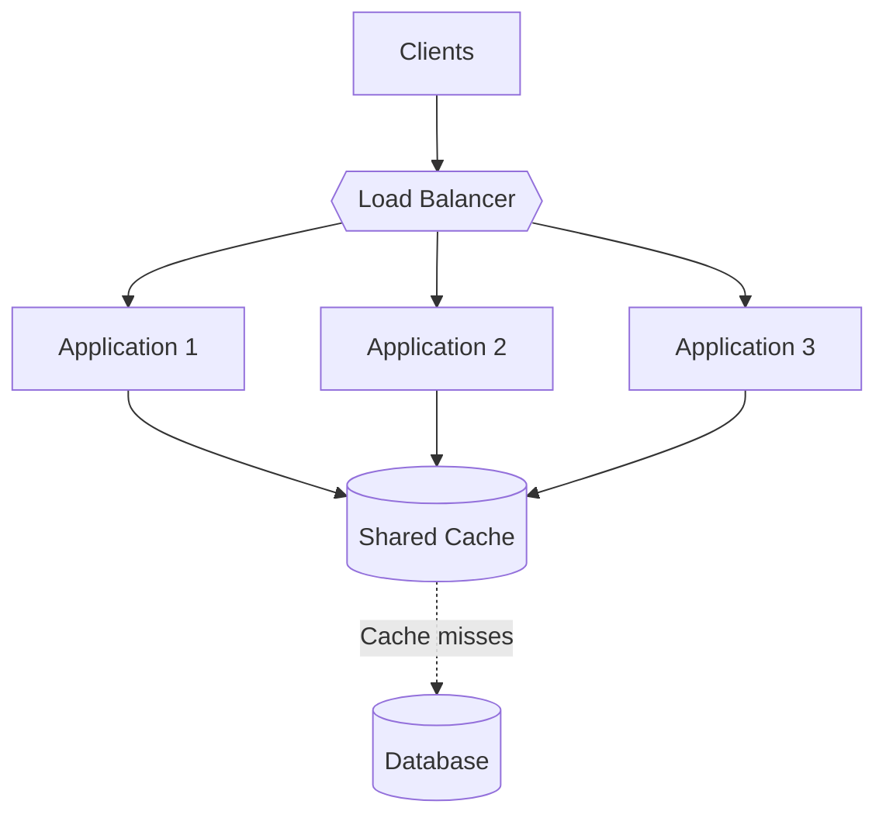

All application servers can access the same logical cache, so an entry written by one server can be reused by another.

### Advantages

- Shared entries across application instances.
- Less duplicate cache storage across application processes.
- Independent capacity and scaling options.
- Centralized cache management.
- Useful for frequently accessed shared data.

### Disadvantages

- Network latency on each remote lookup.
- Additional infrastructure and operational cost.
- Potential network partitions and service failures.
- Cache saturation or hot keys can become bottlenecks.
- A shared cache can still return stale data if invalidation and write ordering are poorly designed.

### Important consistency clarification

A distributed cache does **not** automatically guarantee that every entry is current.

For example, if an application updates the database but fails to invalidate the corresponding Redis key, all servers using Redis may receive the same stale value.

Sharing a cache solves the problem of independent per-process copies, but it does not eliminate the need for cache invalidation and consistency rules.

## 6.3 Local vs. distributed cache

| Property | Local cache | Distributed cache |
|---|---|---|
| Location | Application process or host | Separate shared service |
| Access overhead | Usually lower | Includes network overhead |
| Sharing | Limited to a process or host | Shared by connected instances |
| Memory usage | Repeated across processes | Centralized or partitioned across cache nodes |
| Failure domain | Usually limited to one process | May affect many application instances |
| Invalidation | Difficult across many local copies | Easier to coordinate through a shared keyspace |
| Best use | Small, extremely hot, reusable data | Shared application data across instances |

## 6.4 Can both be used together?

Yes. A common architecture uses two caching layers:

- **L1:** Local in-memory cache.
- **L2:** Distributed cache.
- **L3:** Database or another authoritative data source.

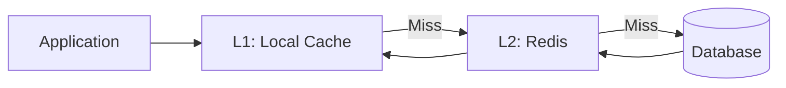

The request follows this path:

1. Check the local cache.
2. If the local cache misses, check Redis.
3. If Redis misses, query the database.
4. Populate Redis and the local cache.
5. Return the result.

This reduces remote cache traffic for very hot data.

However, the additional layer creates another consistency problem: invalidating Redis does not automatically remove old entries from every local cache.

Systems commonly address this through short local TTLs, versioned keys, pub/sub invalidation, event-based invalidation, or by avoiding an L1 cache for data that requires tight freshness guarantees.

---

# 7. Common Caching Strategies

Cache placement answers **where the cache lives**. A caching strategy answers **how the application reads and writes through it**.

The two concepts are related but different.

## 7.1 Cache-aside (lazy loading)

Cache-aside is one of the most common application caching strategies.

The application explicitly checks the cache and fetches missing data from the underlying data store.

### Read flow

1. Look up the key in the cache.
2. Return the value on a hit.
3. On a miss, query the database.
4. Store the result in the cache.
5. Return the result to the caller.

### Write flow

A common approach is:

1. Update the database.
2. Invalidate the corresponding cache key.
3. Let a later read repopulate the cache.

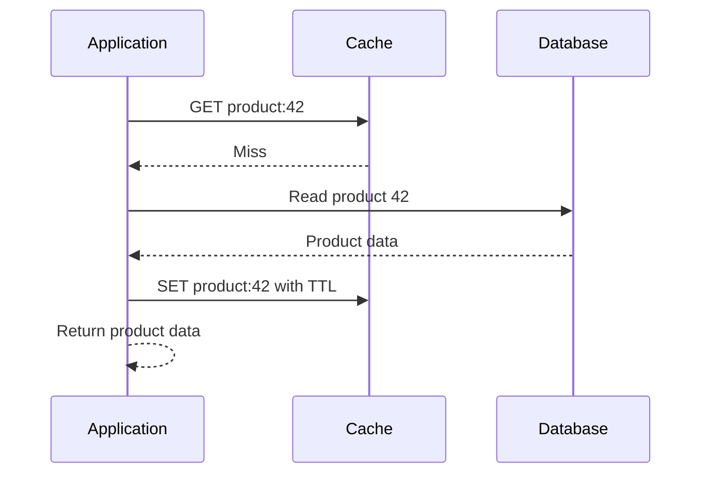

### Advantages

- Simple and widely applicable.
- Only requested data is loaded into the cache.
- The application controls the fallback behavior.
- Works with many cache implementations.

### Disadvantages

- The first request after a miss is slower.
- Popular missing keys can produce many simultaneous database queries.
- Explicit invalidation is required after writes if stale data must be avoided.
- Cache and database operations are not automatically atomic.

**Use cache-aside when:** The workload is read-heavy, the data is reusable, and the application can tolerate a defined amount of staleness or manage invalidation.

## 7.2 Read-through

With **read-through caching**, the application requests data through a cache layer that is responsible for loading missing entries from the underlying store.

Conceptually:

```text
Application -> Cache
                 |
                 | If missing, load data
                 v
              Database
```

The application does not implement the entire miss-and-load sequence itself; the cache library or service does.

Read-through and cache-aside have similar read outcomes, but differ in which component owns the loading logic.

## 7.3 Write-through

With write-through caching, a write is propagated to the cache and the underlying data store as part of the write operation.

The exact order depends on the implementation.

```text
Application
    |
    v
Cache layer
    |
    v
Database
```

The intention is to keep the cached representation aligned with the persistent representation.

Write-through behavior does not, by itself, guarantee atomic updates across the cache and database. The system still needs to handle partial failures, concurrency, and update ordering.

## 7.4 Write-back (write-behind)

With write-back caching, the system acknowledges a cache write before the underlying database update has completed.

The database update happens asynchronously.

```text
Application -> Cache -> Acknowledge
                   |
                   v
             Background worker
                   |
                   v
                Database
```

This can improve write latency, but it introduces a window in which the cache and database differ.

If the cache or background worker loses an acknowledged update before it is persisted, data can be lost unless the design uses durable buffering, replication, recovery, and retry mechanisms.

## 7.5 Read and write strategies compared

| Strategy | Main idea | Key advantage | Main concern |
|---|---|---|---|
| Cache-aside | Application loads on a miss | Simple and flexible | Miss handling and invalidation |
| Read-through | Cache layer loads on a miss | Centralizes loading behavior | Requires suitable cache abstraction |
| Write-through | Propagate writes to cache and data store | Fresh cache values after successful writes | Extra write-path work and partial failures |
| Write-back | Acknowledge before persistence completes | Low write latency | Durability and eventual consistency |

These strategies can be combined. For example, an application can use cache-aside for reads and database-first invalidation for writes.

---

# 8. Cache Eviction Policies

A cache has finite capacity. When it cannot retain all entries, it needs a way to decide which entries to remove.

An **eviction policy** chooses which entries should leave the cache to free resources.

Eviction is different from expiration: an entry can be evicted before its TTL ends, and an expired entry can become invalid even when the cache has plenty of free memory.

## 8.1 FIFO — First In, First Out

FIFO removes the entry that was inserted earliest.

Imagine the cache contains:

```text
Insertion order:

A -> B -> C

A is oldest
C is newest
```

When entry D must be inserted and the cache is full:

```text
Before: [A, B, C]
Insert: D
Evict:  A

After:  [B, C, D]
```

### Advantages

- Easy to understand.
- Simple implementations are possible.
- Does not require tracking the most recent access to each entry.

### Disadvantages

- Ignores how frequently an entry is used.
- May remove a highly popular entry merely because it is old.
- Does not adapt to recent access patterns.

### Example

A popular product was cached yesterday, while another product was cached one minute ago. FIFO can remove the popular product first, even if it is requested thousands of times per hour.

FIFO is useful as a conceptual baseline, but its simplicity may come at the expense of hit ratio.

## 8.2 LRU — Least Recently Used

LRU evicts the entry that has not been accessed for the longest time.

It relies on **temporal locality**: recently accessed data is likely to be accessed again.

Suppose the entries are ordered from most recently used to least recently used:

```text
Most recent
    |
    v
[A] -> [C] -> [D] -> [B] -> [E]
                                  |
                                  v
                            Least recent
```

If a new entry must be inserted, E is the eviction candidate.

If B is accessed, the order changes:

```text
Before: [A] -> [C] -> [D] -> [B] -> [E]
Access: B

After:  [B] -> [A] -> [C] -> [D] -> [E]
```

B becomes the most recently used entry.

### Advantages

- Adapts to changing access patterns.
- Preserves recently accessed entries.
- Works well when temporal locality is strong.

### Disadvantages

- Requires access metadata and bookkeeping.
- A frequently used item can still be evicted if it is untouched for a long enough period.
- Sequential scans can push useful entries out of the cache.

### Implementation note

A common exact LRU implementation combines:

- A hash map for average O(1) key lookup.
- A doubly linked list for average O(1) movement and removal.

The most recently used entry sits at one end, while the least recently used entry sits at the other.

This makes the basic lookup and eviction operations efficient, although concurrency, memory overhead, and production implementation details still matter.

## 8.3 LFU — Least Frequently Used

LFU evicts the entry with the lowest access frequency.

Example:

| Entry | Access count |
|---|---:|
| A | 500 |
| B | 120 |
| C | 4 |
| D | 1 |

If the cache needs space, D is the natural eviction candidate, assuming all entries are otherwise equivalent.

### Advantages

- Preserves consistently popular data.
- Can work well when access frequency is stable.
- Useful when a small set of items receives most requests.

### Disadvantages

- Historical popularity can dominate recent demand.
- An item that was popular months ago may remain cached after demand disappears.
- Maintaining frequency counters introduces overhead.
- Frequency ties require a tie-breaking rule.

Many practical LFU implementations use frequency aging or decaying counters to adapt to changing workloads.

## 8.4 FIFO vs. LRU vs. LFU

| Property | FIFO | LRU | LFU |
|---|---|---|---|
| Primary signal | Insertion order | Recent access | Access frequency |
| Tracks every access | No | Yes | Usually |
| Adapts to recent demand | Poorly | Well | Depends on aging |
| Protects repeatedly accessed data | Not necessarily | If accesses remain recent | If frequency remains high |
| Implementation complexity | Low | Moderate | Moderate to high |

There is no universally best eviction policy. The best choice depends on the workload, memory constraints, access patterns, and the cache implementation.

## 8.5 Other policies worth knowing

### Random replacement

Randomly selects an entry to evict.

It is simple and can be useful where the overhead of maintaining more sophisticated metadata is undesirable.

### TTL-based expiration

Removes entries after a configured lifetime.

TTL is primarily an expiration mechanism rather than a pure capacity-based eviction policy, although real caches often combine TTL with a separate memory eviction policy.

### Size-aware eviction

Some caches consider the memory size of entries rather than treating every entry as equally expensive.

This can matter when cached values vary substantially in size.

### Modern practical implementations

Production caches may use approximations or hybrids rather than exact LRU or LFU. For example, Redis supports multiple configurable eviction policies, including LRU-like and LFU-like policies.

Always verify the behavior of the cache implementation you are using rather than assuming every product implements a policy identically.

---

# 9. Cache Expiration and Invalidation

Eviction and expiration are often confused, but they solve different problems.

- **Eviction:** Remove entries to manage resource constraints.
- **Expiration:** Stop treating an entry as valid after a configured lifetime.
- **Invalidation:** Remove or supersede an entry because the underlying data has changed or the cached result is no longer valid.

## 9.1 TTL — Time to Live

TTL defines how long a cached entry is intended to remain valid.

For example:

```text
SET product:42 "{...}" EX 300
```

In Redis, this example stores the key with a 300-second expiration.

After the TTL elapses, the key is no longer available as a valid cached entry.

A TTL provides a bound on cache-entry lifetime, but it does not guarantee that every cached value remains fresh for its entire lifetime.

If the database changes immediately after the cache is populated, the cached value can be stale until it expires or is invalidated.

## 9.2 How should TTL be selected?

A useful TTL depends on:

- How often the underlying data changes.
- How expensive it is to fetch or compute the value.
- How much staleness the application can tolerate.
- How much database load the cache should absorb.
- Whether updates can explicitly invalidate entries.

Example starting points, not universal recommendations:

| Data | Illustrative TTL |
|---|---|
| Static reference data | Several hours |
| Product descriptions | Several minutes |
| Search results | Tens of seconds to a few minutes |
| Frequently updated dashboards | A few seconds |
| User session data | Based on session and security requirements |

Some systems use a TTL of zero or no TTL for particular entries and rely on explicit deletion or a separate retention policy. That requires careful memory management.

## 9.3 TTL jitter

If thousands of entries are created at exactly the same time with identical TTLs, many can expire together.

This may cause a sudden burst of cache misses and database queries.

**TTL jitter** adds a small random variation to expiration times.

For example:

```text
Base TTL: 300 seconds

Actual TTL:
300 + random(0, 60) seconds
```

This spreads expiration events over time.

Jitter is particularly helpful for batch-populated caches and large collections of similarly aged entries.

## 9.4 Cache invalidation after a database write

Suppose the cache contains:

```text
product:42 -> price = 100
```

The user updates the price to 120.

A common cache-aside write sequence is:

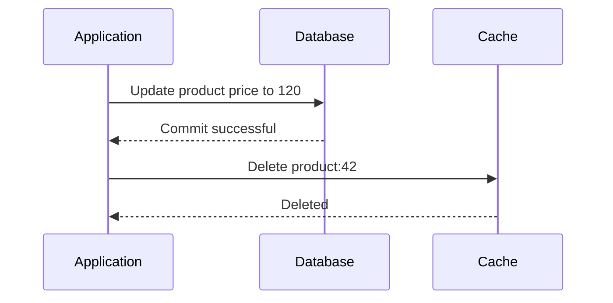

The next read misses the cache, fetches the updated database value, and repopulates the cache.

This pattern is often called **cache invalidation** or **cache-aside write invalidation**.

It is generally safer than blindly setting the cache before the database transaction succeeds. However, it still has race conditions.

### A race condition to understand

1. Request A misses the cache and starts reading the old database value, 100.
2. Request B updates the database to 120 and deletes the cache key.
3. Request A finishes its earlier database read and stores 100 in the cache.
4. Future requests may receive 100 until another invalidation or expiration occurs.

This is why simply updating the database and deleting the cache key does not provide strict consistency under all concurrent interleavings.

Possible mitigations include versioned entries, conditional writes, locking, update events, or other concurrency-control mechanisms appropriate to the workload.

## 9.5 Cache-aside consistency guarantees

A common database-first invalidation pattern provides a practical level of consistency, but not automatic atomic consistency between the database and cache.

For many product catalogs and public content systems, brief staleness may be acceptable.

For security decisions, financial records, inventory reservations, and other correctness-sensitive operations, the authoritative operation should enforce its invariants in the appropriate transactional system. An ordinary cache should not be trusted as the sole authority for critical state.

---

# 10. Cache Write Policies

Write policies determine how changes propagate between the cache and the underlying data store.

They are particularly important when the application performs updates rather than just reads.

## 10.1 Write-through

In write-through caching, the cache layer propagates writes to the underlying data store as part of the write operation.

A simplified flow is:

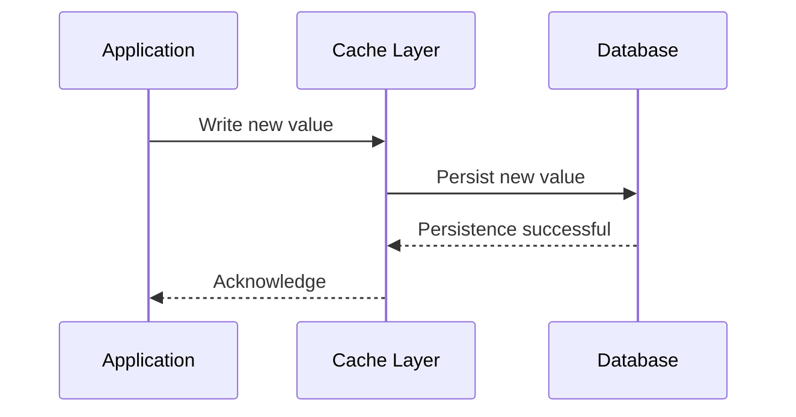

The precise ordering of cache updates and database writes depends on the implementation.

### Advantages

- Cached data can be kept aligned with successful writes.
- Subsequent reads can avoid loading the newly written value again.
- The application can centralize write propagation.

### Disadvantages

- Writes may take longer.
- Every write requires coordination with the backing store.
- A partial failure can leave the cache and database inconsistent unless recovery is implemented.
- It does not automatically create a distributed transaction across both systems.

**Use write-through when:** Keeping the cached representation updated as part of the write workflow is worth the additional write-path cost.

## 10.2 Write-back (write-behind)

In write-back caching, the system acknowledges a write before the database has necessarily persisted it.

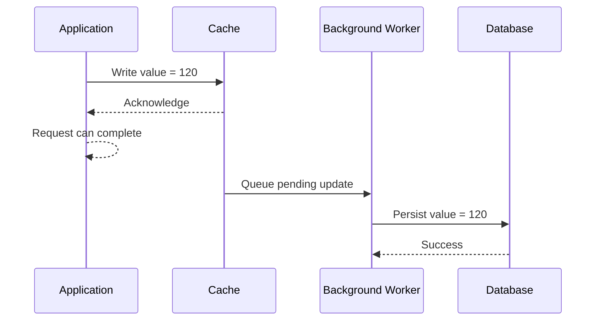

The database may temporarily retain the previous value.

### Advantages

- Lower write latency in the request path.
- Multiple updates may be batched.
- Database work can be scheduled and grouped.
- Useful for some write-heavy workloads.

### Disadvantages

- The database can lag behind the cache.
- Failed background writes need retries and monitoring.
- Updates may be lost if they are acknowledged but not durably recorded.
- Multiple workers must preserve appropriate ordering.
- A database read that bypasses the cache may return older data.

### A critical production distinction

Write-back is not automatically safe just because the cache is replicated.

A robust design needs to consider what happens when:

- The cache process crashes.
- The host loses power.
- The network fails.
- The database is unavailable.
- A background job is retried.
- Two updates arrive in a different order than expected.

Durable queues, write-ahead logs, replication, idempotent processing, retry policies, and recovery procedures can reduce these risks.

For important data, the acknowledged write must be recoverable after a failure if the application promises that it has been saved.

## 10.3 Write-around

Write-around is another useful policy.

The application writes directly to the database without immediately populating the cache.

```text
Application -> Database

Later read:
Application -> Cache -> Miss
Application -> Database -> Fetch value
Application -> Cache -> Populate
```

### Why use it?

Suppose a system imports millions of records that are unlikely to be read immediately.

Populating the cache for every imported record can evict useful hot entries.

Write-around avoids this pollution by letting data enter the cache only when it is requested.

### Trade-off

The first read after a write is more likely to miss the cache.

## 10.4 Write policies compared

| Policy | Write destination | Write latency | Main concern |
|---|---|---|---|
| Write-through | Cache layer propagates to database | Often higher | Coordination and partial failures |
| Write-back | Cache first; database later | Often lower | Durability and delayed persistence |
| Write-around | Database directly | Depends on database | First read may miss |

### Do not confuse write policy with write ordering

The names describe broad strategies, not universal guarantees.

For example, a write-through system might update the database before refreshing the cache, while another implementation may use a different order.

Always specify the actual success condition:

- When is a write acknowledged?
- When is the database transaction committed?
- When can another reader see the new value?
- What happens if the cache update fails?
- What happens if the database update fails?

These questions matter more than the policy name alone.

---

# 11. Cache Stampede, Penetration, and Hot Keys

A production cache must handle more than ordinary hits and misses.

Three important failure patterns are cache stampedes, cache penetration, and hot keys.

## 11.1 Cache stampede

A **cache stampede** occurs when many requests attempt to rebuild the same missing or expired entry at approximately the same time.

Suppose a popular product's cache entry expires while 5,000 requests arrive.

Without coordination:

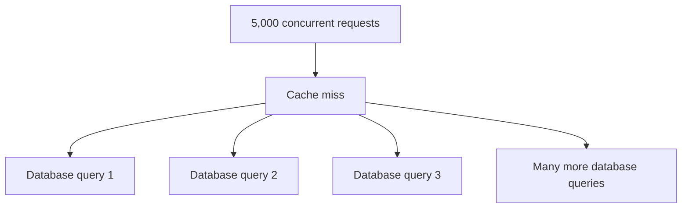

Thousands of requests may execute the same database query, creating a burst of load.

### Solution 1: Single-flight request coalescing

Allow one request to fetch the missing value while concurrent requests wait for its result.

```text
Request A -> Cache miss -> Database query
Request B -> Cache miss -> Wait for A
Request C -> Cache miss -> Wait for A

A fetches value
A, B, and C receive the result
```

This is often implemented within an application process. A distributed lock or equivalent coordination mechanism may be needed when many application instances are involved.

### Solution 2: TTL jitter

Vary expiration times to reduce synchronized misses across many entries.

### Solution 3: Refresh before expiration

Refresh hot entries before they expire, especially when rebuilding them is expensive.

### Solution 4: Stale-while-revalidate

If the data is safe to serve slightly stale, return the existing value while a background task refreshes it.

This trades strict freshness for lower latency and reduced database load.

## 11.2 Cache penetration

Cache penetration happens when requests repeatedly ask for data that does not exist.

Example:

```text
GET product:999999999
GET product:999999999
GET product:999999999
```

If the application caches only successful results, every request can miss the cache and query the database again.

This can happen because of invalid user input, automated scanning, or malicious traffic.

### Solution 1: Negative caching

Cache a representation of the fact that the item does not exist.

```text
product:999999999 -> NOT_FOUND
```

Give negative entries a suitable TTL and ensure that the application distinguishes a cached absence from a cache miss.

Use shorter negative TTLs when a previously missing item may be created soon.

### Solution 2: Validate identifiers

Reject malformed identifiers before accessing the database.

### Solution 3: Rate limiting

Limit abusive or unusually high request rates.

### Solution 4: Bloom filters

A Bloom filter can quickly identify values that are definitely absent from a known set.

It may produce false positives, meaning it can indicate that an item might exist when it does not. A correctly constructed Bloom filter does not produce false negatives for items that were inserted, assuming it has not been corrupted or incorrectly used.

A Bloom filter is a probabilistic membership structure, not a replacement for the authoritative database.

## 11.3 Hot keys

A **hot key** is a cache entry that receives a disproportionately large share of requests.

Example:

```text
product:42 -> 100,000 requests/second
product:17 ->       50 requests/second
product:93 ->       10 requests/second
```

Even if the cache cluster has many nodes, one hot key can concentrate work on a single node or partition, depending on the cache architecture.

### Mitigation strategies

- Cache extremely hot data locally as an L1 layer.
- Replicate hot values where the cache technology supports suitable read distribution.
- Precompute frequently requested results.
- Use request coalescing for expensive rebuilds.
- Spread traffic across multiple equivalent keys or shards when the data model permits it.
- Monitor per-key or per-partition request concentration.

Sharding alone does not solve a single hot key if every request for that key maps to the same partition.

## 11.4 Quick comparison

| Problem | Root cause | Common mitigation |
|---|---|---|
| Cache stampede | Many requests rebuild the same entry | Single-flight, refresh-ahead, stale-while-revalidate |
| Cache penetration | Repeated lookups for nonexistent data | Negative caching, validation, Bloom filters |
| Hot key | Excessive traffic concentrated on one entry | Local caching, replication, workload distribution |

---

# 12. Cache Failures and Reliability

A cache should generally be treated as an optimization layer unless the system explicitly relies on it for durable state.

However, losing the cache can still severely affect the application.

## 12.1 What happens when Redis goes down?

Suppose Redis becomes unavailable.

If every application request normally checks Redis before reaching the database, the application may experience:

1. Cache connection failures.
2. Additional request latency from timeouts.
3. A sudden increase in database traffic.
4. Database connection pool exhaustion.
5. Increased application errors.

The cache outage can become a database outage if the fallback behavior is not designed carefully.

## 12.2 Cache avalanche

A **cache avalanche** is a sudden increase in cache misses across many keys, often caused by mass expiration, cache restart, or broad invalidation.

Unlike a stampede, which often focuses on rebuilding one popular entry, an avalanche can affect a large portion of the workload.

Mitigations include:

- TTL jitter.
- Gradual warming of important keys.
- Request rate limits.
- Database capacity planning.
- Circuit breakers and load shedding.
- Stale serving where acceptable.

## 12.3 Fail-open vs. fail-closed

When the cache is unavailable, the application needs an explicit fallback policy.

### Fail-open

Continue the request using the authoritative data source when possible.

This is common when caching is only an optimization.

However, failing open must not mean ignoring business rules or bypassing security checks.

### Fail-closed

Reject or defer the operation when a required dependency is unavailable.

This may be necessary when the system cannot safely proceed without a particular piece of information.

Neither approach is universally correct. The choice depends on the operation and its correctness requirements.

## 12.4 Production reliability checklist

- Set finite cache connection and request timeouts.
- Avoid unbounded retries.
- Use exponential backoff with jitter where appropriate.
- Apply circuit breakers when repeated failures would otherwise cause cascading latency.
- Limit database fallback concurrency.
- Ensure cache failure cannot bypass authorization or transactional constraints.
- Plan for cold-cache recovery after restarts.
- Monitor cache availability and database saturation.
- Test the system with the cache unavailable.

**A cache should improve resilience under normal conditions without becoming an uncontrolled source of cascading failure.**

---

# 13. Choosing the Right Caching Strategy

Consider the following decision process.

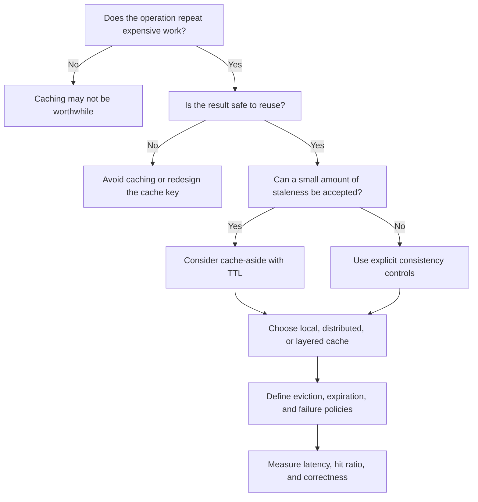

## 13.1 Practical recommendations

| Scenario | Reasonable starting point |
|---|---|
| Single process with a small hot dataset | Local in-memory cache |
| Multiple application servers sharing common data | Distributed cache |
| Read-heavy catalog with occasional updates | Cache-aside with TTL and invalidation |
| Expensive computation with many concurrent identical requests | Cache results and coalesce concurrent recomputation |
| Data with expensive rebuilds and tolerance for slight staleness | Consider refresh-ahead or stale-while-revalidate |
| Large batch import with uncertain future reads | Write-around |
| Write-heavy workload with asynchronous persistence | Consider write-back only with a clear durability and recovery design |
| Critical financial or transactional state | Preserve authoritative transactional correctness; use caching selectively |

## 13.2 Questions to ask before introducing a cache

1. What expensive work are we avoiding?
2. Which requests are likely to reuse the same result?
3. What is the acceptable staleness window?
4. How will entries be invalidated after writes?
5. What happens when the cache is full?
6. What happens when the cache is unavailable?
7. How are simultaneous misses coordinated?
8. How will hit ratio and end-to-end latency be measured?
9. Can the application safely operate with an empty cache?
10. Does the cache key include all parameters that affect the result?

If these questions have no clear answers, introducing a cache may add complexity without solving the underlying problem.

---

# 14. Practical Implementation: Cache-Aside in Node.js

The following example demonstrates cache-aside using Redis and a database abstraction.

It focuses on the essential read path and includes finite cache timeouts, database error propagation, and a TTL.

Install the Redis client:

```bash
npm install redis
```

Start a Redis instance using your preferred development setup, then configure its connection URL.

## 14.1 Example implementation

```javascript
import { createClient } from "redis";

const redis = createClient({
  url: process.env.REDIS_URL ?? "redis://localhost:6379",
  socket: {
    connectTimeout: 1000,
    reconnectStrategy: (retries) =>
      retries < 3 ? Math.min(retries * 100, 1000) : false,
  },
});

redis.on("error", (err) => {
  console.error("Redis error:", err.message);
});

await redis.connect();

const TTL_SECONDS = 300;
const CACHE_TIMEOUT_MS = 100;

async function withTimeout(promise, ms) {
  let timer;

  try {
    return await Promise.race([
      promise,
      new Promise((_, reject) => {
        timer = setTimeout(
          () => reject(new Error("Cache operation timed out")),
          ms
        );
      }),
    ]);
  } finally {
    clearTimeout(timer);
  }
}

async function getProduct(id, db) {
  const key = `product:${id}`;

  // Attempt the cache lookup.
  try {
    const cached = await withTimeout(
      redis.get(key),
      CACHE_TIMEOUT_MS
    );

    if (cached !== null) {
      return JSON.parse(cached);
    }
  } catch (err) {
    // Cache is an optimization here.
    // Continue to the authoritative data source.
    console.warn("Cache read failed:", err.message);
  }

  // Database failures must not be converted into cache misses.
  const product = await db.getProductById(id);

  if (product === null) {
    // A real implementation may negative-cache this result.
    return null;
  }

  // Populate the cache on a best-effort basis.
  try {
    await withTimeout(
      redis.set(key, JSON.stringify(product), {
        EX: TTL_SECONDS,
      }),
      CACHE_TIMEOUT_MS
    );
  } catch (err) {
    console.warn("Cache population failed:", err.message);
  }

  return product;
}

export { getProduct };
```

Here, `db.getProductById(id)` is a placeholder for a real database repository method.

This is a teaching example, not a complete production cache client.

### What this implementation demonstrates

- Cache-aside read flow.
- A unique cache key for each product.
- TTL-based expiration.
- Database fallback after cache errors.
- Cache population after successful database reads.
- Separate handling of cache failures and database failures.

### Important limitations

1. `Promise.race` stops waiting for the cache operation but does not necessarily cancel the underlying Redis command.
2. A short timeout can cause fallback requests to reach the database while Redis is still processing commands.
3. The simple implementation does not coalesce concurrent misses.
4. Database errors propagate to the caller rather than being silently treated as missing data.
5. `JSON.parse` can fail if cached data is malformed.
6. The code does not implement write invalidation, negative caching, distributed locking, metrics, or schema versioning.
7. The Redis connection and reconnection lifecycle must be managed carefully in a real application.
8. Failing open is appropriate only if the database fallback preserves all required business and security guarantees.

## 14.2 Adding cache invalidation

After successfully committing a database update, a simple cache-aside write path can delete the old cache entry:

```javascript
async function updateProduct(id, changes, db) {
  const updated = await db.updateProductById(id, changes);

  try {
    await redis.del(`product:${id}`);
  } catch (err) {
    console.error("Cache invalidation failed:", err.message);
  }

  return updated;
}
```

This example illustrates the basic idea but has an important limitation: if the database commit succeeds and the cache deletion fails, stale data may remain cached.

A production implementation should define how invalidation failures are recovered. Options include retryable invalidation events, an outbox written in the same database transaction, versioned cache keys, or short TTLs as a secondary safeguard.

The database update should remain authoritative, and the application should not claim that cache invalidation succeeded when it did not.

---

# 15. Monitoring and Observability

A caching strategy should be evaluated using actual workload measurements rather than intuition alone.

## 15.1 Core metrics

| Metric | What it tells you |
|---|---|
| Cache hit ratio | How often the cache provides a usable entry |
| Cache miss ratio | How often the fallback path is needed |
| Cache lookup latency | Time spent communicating with or accessing the cache |
| Database query rate | Whether caching is reducing database work |
| Cache memory utilization | Whether capacity is becoming a constraint |
| Eviction rate | How frequently entries are removed due to capacity pressure |
| Expiration rate | How many entries reach their TTL |
| Cache error rate | How often operations fail |
| Timeout rate | Whether cache operations exceed the allowed latency |
| p95 and p99 request latency | Whether the overall application is meeting latency goals |
| Stampede frequency | How often concurrent requests rebuild the same entry |

## 15.2 Interpreting common patterns

### High hit ratio, high latency

Possible causes:

- The cache is overloaded.
- Network latency is high.
- Values are large or expensive to serialize.
- The application spends substantial time outside the cache lookup.

### Low hit ratio, high database load

Possible causes:

- TTLs are too short.
- Cache capacity is insufficient.
- The workload has little reuse.
- Cache keys are inconsistent.
- Many requests are for unique or nonexistent data.

### High eviction rate

Possible causes:

- The working set exceeds cache capacity.
- Entries are too large.
- The eviction policy does not fit the access pattern.
- The cache contains too much low-value data.

### High database load immediately after expiration

Possible causes:

- Synchronized TTL expiration.
- Missing request coalescing.
- Expensive cache rebuilds.
- Too many keys expiring together.

The correct response depends on the evidence. Increasing memory may help capacity pressure, but it will not necessarily fix poor keys, a stampede, or a workload with almost no reusable data.

---

# 16. Interview Questions

## Q1. Why is caching useful?

Caching avoids repeatedly retrieving or computing reusable results. This can reduce latency, database load, and infrastructure costs.

## Q2. What is the difference between a cache hit and a cache miss?

A hit means a usable value is found in the cache. A miss means the application needs another source or computation to obtain the result.

## Q3. What is the difference between local and distributed caching?

Local caching stores data inside an application process or host. Distributed caching provides a shared service that multiple application instances can access.

## Q4. Does a distributed cache eliminate stale data?

No. It eliminates the need for separate independent cache copies in each application process, but stale entries can still exist if updates, invalidation, expiration, or concurrent writes are not handled correctly.

## Q5. What is the difference between eviction and expiration?

Eviction removes entries to manage cache capacity. Expiration makes entries invalid after a specified lifetime.

## Q6. When would you choose LRU over LFU?

LRU is attractive when recent accesses predict future demand. LFU can be useful when long-term popularity matters, especially if the implementation accounts for changing demand.

## Q7. What is cache-aside?

The application checks the cache first, fetches missing data from the database, and then populates the cache.

## Q8. What is a cache stampede?

Many concurrent requests attempt to rebuild the same missing or expired entry, potentially overloading the database.

## Q9. What is negative caching?

Negative caching temporarily stores the fact that a requested item does not exist, avoiding repeated database lookups for the same nonexistent item.

## Q10. Why can write-back caching be dangerous?

The system may acknowledge a change before the authoritative database has persisted it. A failure can lose acknowledged data unless the pending write is durably recorded and recoverable.

## Q11. What happens when the cache is unavailable?

The application follows its defined fallback policy. It may query the database, serve permissible stale data, or reject the operation. Database fallback must be protected against overload.

## Q12. How do you choose a TTL?

Choose it based on data freshness requirements, change frequency, read frequency, cache capacity, and the cost of rebuilding entries. Use invalidation when expiration alone is insufficient.

## Q13. What is the difference between write-through and write-around?

Write-through propagates writes through the cache layer to the underlying data store. Write-around writes directly to the database without immediately populating the cache.

## Q14. Can a cache replace a database?

Usually not for application data that requires durable, authoritative storage. A cache is generally an optimization over an authoritative data source.

## Q15. How do you prevent a cache stampede across multiple servers?

Possible approaches include distributed coordination, refresh-ahead, stale-while-revalidate, TTL jitter, and limiting concurrent rebuilds. The appropriate choice depends on whether stale results are acceptable and how the cache is deployed.

---

# 17. Final Cheat Sheet

## 17.1 Caching fundamentals

| Concept | Meaning |
|---|---|
| Cache | Fast storage for reusable data |
| Cache hit | A usable value is found |
| Cache miss | The value must be fetched or recomputed |
| Hit ratio | Fraction of lookups served by the cache |
| TTL | Lifetime configured for a cache entry |
| Eviction | Removal to free cache capacity |
| Invalidation | Removal or supersession because a value is no longer valid |

## 17.2 Cache placement

| Approach | Best suited for |
|---|---|
| Local cache | Extremely fast access to small, reusable data within a process |
| Distributed cache | Shared data accessed by multiple application instances |
| Layered cache | Combining low-latency local lookups with shared caching |

## 17.3 Eviction and write policies

| Category | Policy | Main idea |
|---|---|---|
| Eviction | FIFO | Remove the earliest inserted entry |
| Eviction | LRU | Remove the least recently used entry |
| Eviction | LFU | Remove the least frequently used entry |
| Write | Write-through | Propagate writes to the cache and underlying store |
| Write | Write-back | Acknowledge before persistence completes |
| Write | Write-around | Write directly to the database without immediate cache population |

## 17.4 Common failure modes

| Problem | Main idea |
|---|---|
| Stale cache | Cached data no longer matches the authoritative data |
| Cache stampede | Many requests rebuild one entry concurrently |
| Cache penetration | Repeated requests target nonexistent entries |
| Cache avalanche | Many entries miss or expire together |
| Hot key | A small number of keys receive disproportionate traffic |
| Cache outage | The application loses its optimization layer and may overload the database |

## 17.5 The five principles to remember

1. **Cache for reuse:** Caching is most valuable when data or computation is expensive and repeatedly requested.
2. **Define freshness:** Every cached value needs an explicit expiration, invalidation, or other validity strategy.
3. **Separate responsibilities:** Placement, eviction, expiration, and write policies solve different problems.
4. **Design for failure:** Cache outages, concurrent misses, and partial write failures must have defined behavior.
5. **Measure the result:** A cache is successful when it improves end-to-end performance, resource utilization, and reliability without violating correctness requirements.

---

## Final Perspective

Caching is not simply adding Redis between an application and a database. It is a system-design decision that introduces another copy of data, another failure mode, and another set of consistency rules.

A well-designed caching system answers four fundamental questions:

- **What should be cached?** Frequently reused, expensive-to-retrieve data.
- **Where should it be cached?** Locally, in a distributed service, or in multiple layers.
- **How should entries be managed?** Through eviction, expiration, and invalidation.
- **How should changes and failures be handled?** Through an explicit write strategy, concurrency controls, and recovery mechanisms.

The central trade-off is simple: caching can make reads faster and reduce load, but it introduces complexity around freshness, capacity, and failure handling.

Understanding those trade-offs is what turns caching from a performance trick into a reliable system-design technique.