# Chapter 9: Caching, Distributed Caching and Cache Policies

> System Design Course Notes

Caching is one of the highest-leverage techniques in system design. This chapter covers what a cache is, why we need one, how it flows, where to place it (local vs. distributed), and the two families of policies that govern it: **eviction** (what to remove) and **write** (where to update).

---

## Table of Contents

1. [The Problem: Repeated Expensive Work](#1-the-problem-repeated-expensive-work)
2. [What Is a Cache?](#2-what-is-a-cache)
3. [Cache Hit and Cache Miss](#3-cache-hit-and-cache-miss)
4. [Why Not Store Everything in the Cache?](#4-why-not-store-everything-in-the-cache)
5. [Local Cache](#5-local-cache)
6. [Distributed Cache](#6-distributed-cache)
7. [Cache Policies](#7-cache-policies)
8. [Eviction Policies](#8-eviction-policies)
9. [Write Policies](#9-write-policies)
10. [Cheat Sheet](#10-cheat-sheet)

---

## 1. The Problem: Repeated Expensive Work

Consider an e-commerce app. Some data is requested **again and again**: a user's profile, the price of a popular item, a frequently searched product.

Without caching, every request follows the full path:

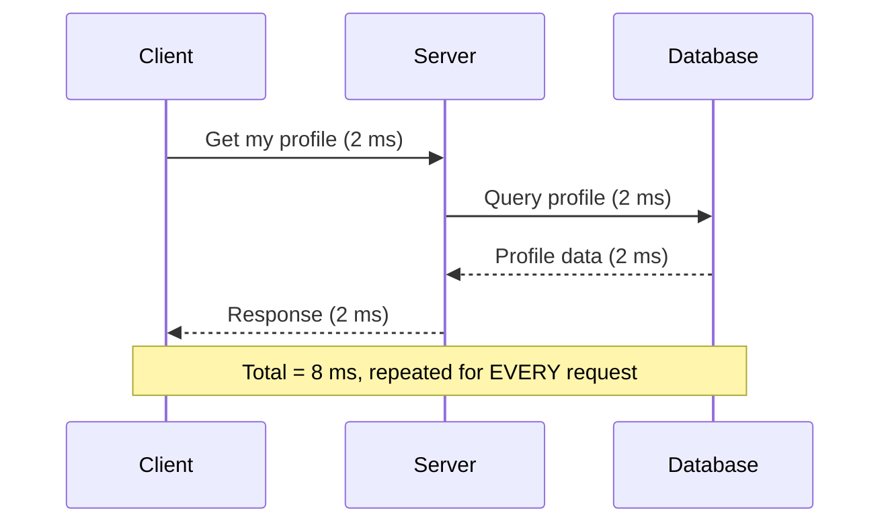

Every repeat of the same request pays for:

- **An extra network call** to the database
- **Recomputation / re-querying** of data that has not changed
- **Added load on the database**, and database operations are costly

With one user this is fine. With 10,000 or 1,000,000 users repeatedly asking for similar data, the database becomes the bottleneck and the whole request-response time degrades.

---

## 2. What Is a Cache?

A **cache** is a fast, **temporary** storage layer that holds frequently accessed data. It is fast because it is typically an **in-memory** solution (for example Redis or Memcached).

With a cache in place:

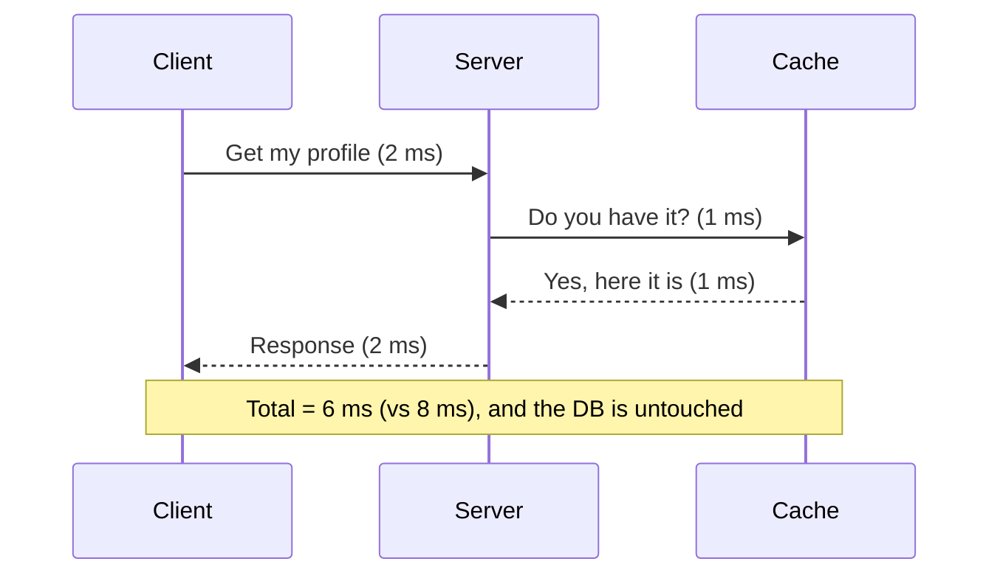

**What caching gives us**

| Benefit | Explanation |
|---|---|
| Fewer network calls | No trip to the database for repeated data |
| No recomputation | Computed or fetched once, reused many times |
| Lower database load | The DB serves only what the cache cannot |
| Faster responses | Memory access is much quicker than disk and network round trips |

The numbers are illustrative, but the pattern is real: repeated reads of hot data should not keep hammering the database.

---

## 3. Cache Hit and Cache Miss

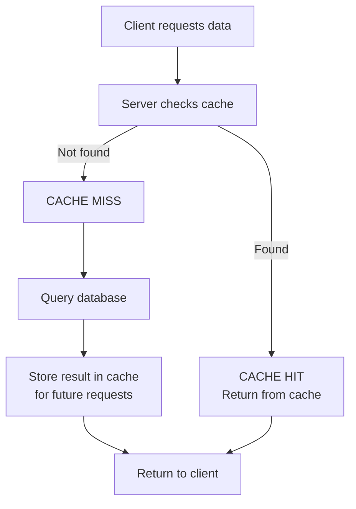

- **Cache hit:** the data is in the cache, so it is returned immediately and the database is never touched.
- **Cache miss:** the data is not in the cache. The server fetches it from the database, returns it to the client, and **also stores it in the cache** so the next request is a hit.

The **hit ratio** (hits divided by total requests) is the main measure of how well a cache is working.

---

## 4. Why Not Store Everything in the Cache?

If caching is so good, why keep a database at all?

- A cache is **limited in size** (memory is expensive and finite) and holds **temporary** data.
- If we dump huge amounts of data into the cache, **searching the cache itself becomes slow** and the cache loses its main advantage.

**Division of labour**

- **Database:** the source of truth, holding the effectively unlimited full dataset.
- **Cache:** only the **relevant, hot** subset.

Which brings up the real question: *what should be in the cache, and what should be removed?* That is what cache policies answer (Section 7).

---

## 5. Local Cache

A **local cache** lives **inside the application server's own memory**.

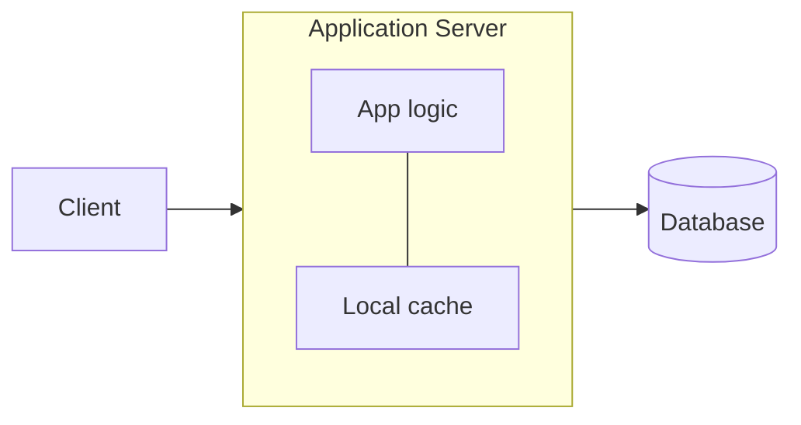

**Good fit:** a single application server. It is simple and very fast (no network hop to reach the cache).

### The problem: multiple servers

Once the application is scaled out behind a load balancer, **each server has its own separate cache**, and these caches do not know about each other.

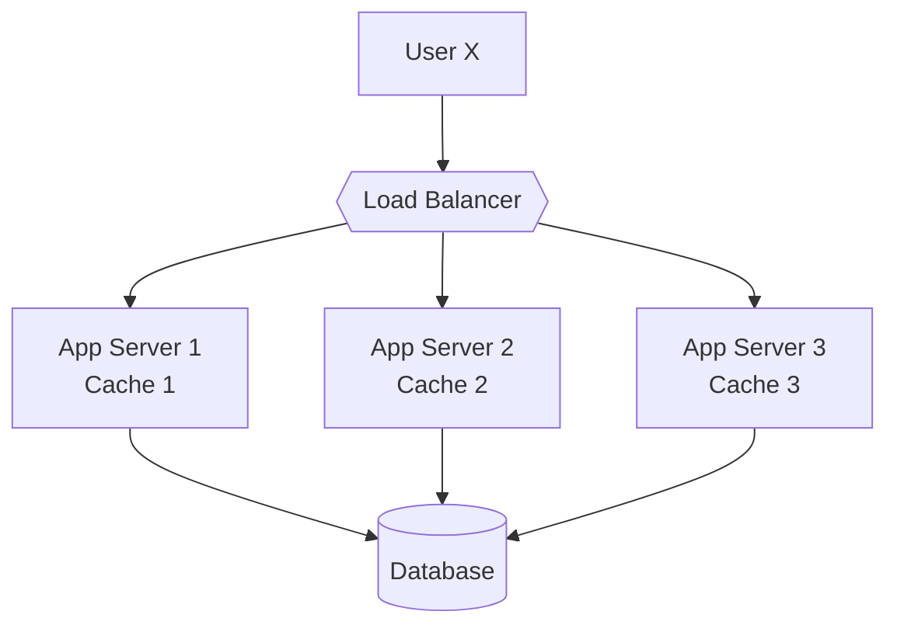

This causes two issues.

**Issue 1: poor reuse (repeated cache misses)**

1. User X requests their profile. LB sends it to Server 1. Cache 1 is empty, so it is a miss. Fetched from the DB and stored in Cache 1.
2. User X asks again. This time LB sends it to Server 2. Cache 2 is empty, so it is **another miss** even though the data was already cached elsewhere.

**Issue 2: data inconsistency (stale data)**

1. Server 2's cache already holds X's old profile.
2. X updates the profile. The request lands on Server 3, which updates the DB and its own Cache 3.
3. Later X reads the profile, the LB routes to Server 2, and **Server 2 returns the old profile from its stale cache**.

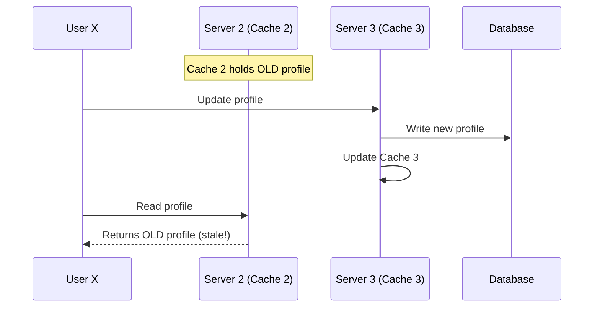

---

## 6. Distributed Cache

To fix this, use a **distributed (shared, global) cache**: one cache layer, in a shared location, that **all application servers use**. Redis is the common example.

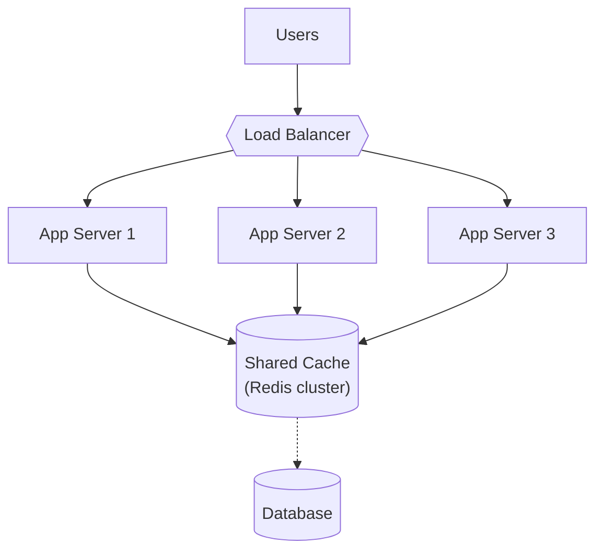

**What it fixes**

- All servers see the **same, up-to-date data**, so there is no per-server inconsistency.
- Data cached by one server is a hit for every other server.
- The cache can be **scaled independently**: run a Redis **cluster** with multiple instances if load grows, so the cache is not a single point of failure.

**Trade-off:** it is accurate but a bit slower than a local cache, because reaching it costs an **extra network call**.

### Local vs. distributed at a glance

| | Local cache | Distributed cache |
|---|---|---|
| Location | Inside each app server | Shared, separate layer |
| Speed | Fastest (no network hop) | Slightly slower (network call) |
| Consistency | Can be stale across servers | Consistent across servers |
| Cache reuse across servers | No | Yes |
| Scaling | Tied to the app server | Scales independently |
| Best for | Single server, small hot data | Multiple servers, shared data |

---

## 7. Cache Policies

Two questions decide how good a cache is:

1. **What data should be removed** when the cache is full? → **Eviction policies**
2. **Where should a write go** (cache, database, or both)? → **Write policies**

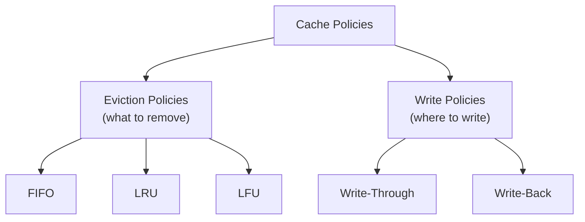

---

## 8. Eviction Policies

A cache holds limited, temporary data, so old entries must be removed to make room for new ones. Eviction policies decide **which entry to kick out**.

### 8.1 FIFO (First In, First Out)

The entry that was **added to the cache first** is removed first, regardless of how useful it is.

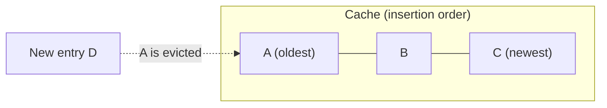

**Weakness:** it ignores usage. If A is accessed every hour while B and C are touched once every five days, FIFO still evicts A simply because it arrived first.

### 8.2 LRU (Least Recently Used)

Keep **recently used** entries at the top and push untouched ones toward the bottom. When space is needed, evict the entry at the **bottom**, the one unused for the longest time.

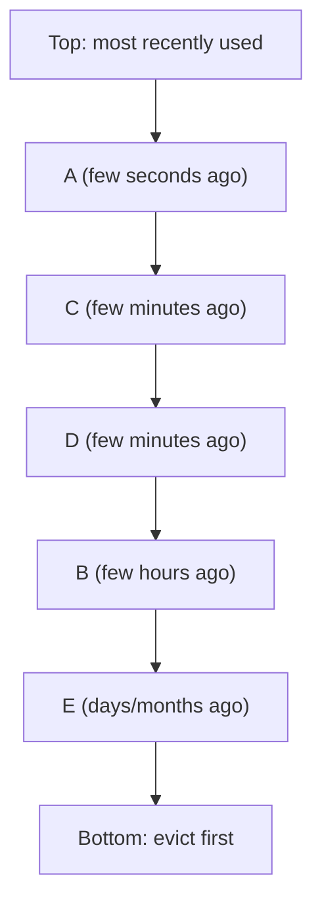

Every time an entry is accessed, it moves back to the top. **Idea:** data used recently is likely to be used again soon (temporal locality).

### 8.3 LFU (Least Frequently Used)

Track **how many times** each entry has been accessed and evict the one with the **lowest access count**.

| Entry | Access count |
|---|---|
| A | 5 |
| B | 3 |
| C | 1 ← evicted when new entry D arrives |

**Idea:** popular data (accessed many times) stays; rarely used data goes.

> **My note:** LFU can keep an entry that was extremely popular in the past but is no longer used, since its count stays high. LRU adapts faster to changing access patterns, which is one reason it is the most widely used default.

### Eviction policy comparison

| Policy | Evicts | Looks at | Weakness |
|---|---|---|---|
| FIFO | Oldest inserted | Insertion time | Ignores how useful the data is |
| LRU | Longest unused | Recency of access | Can drop a frequently used item after a quiet spell |
| LFU | Lowest access count | Frequency of access | Old popular items can linger |

---

## 9. Write Policies

When data is **updated**, where should the change go first: the cache, the database, or both? Write policies answer this.

### 9.1 Write-Through

The write goes to the **cache and the database at the same time**. The cache writes through to the database immediately.

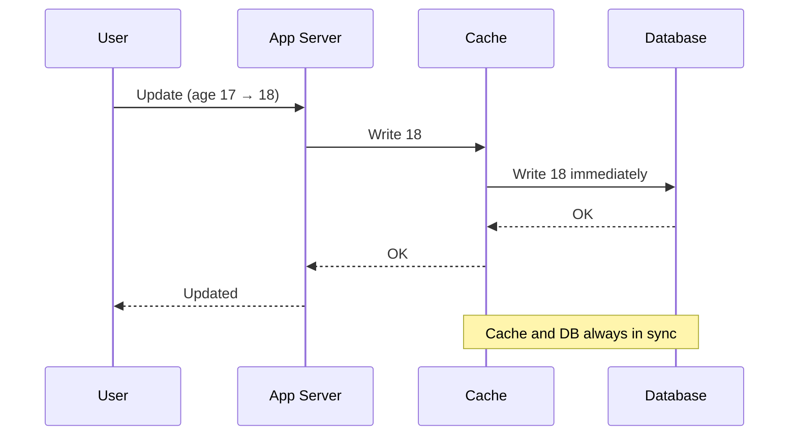

| Pros | Cons |
|---|---|
| Strong **data consistency**: cache and DB stay in sync | **Slower writes**: every write also pays for a database call |
| No data lost if the cache fails | Extra network call per write |

### 9.2 Write-Back (Write-Behind)

The write goes to the **cache only**. The cache immediately acknowledges, and the database is updated **later, asynchronously**, in the background.

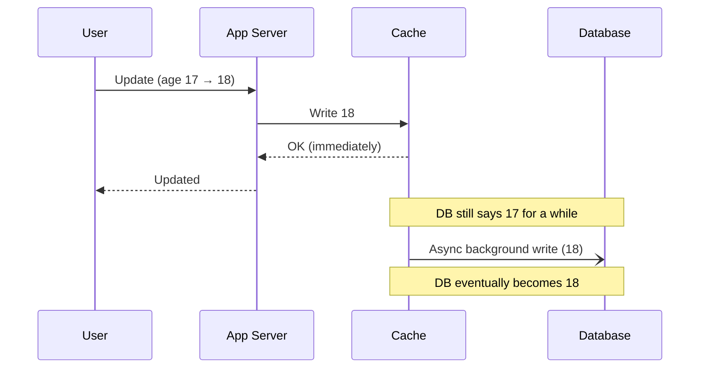

| Pros | Cons |
|---|---|
| **Fast writes**: no database call in the request path | **Temporary inconsistency**: cache says 18, DB still says 17 for a while |
| Reduces database load | **Risk of data loss**: if the cache crashes before the background write, the update is lost |

### Write policy comparison

| | Write-Through | Write-Back |
|---|---|---|
| Write path | Cache + DB together | Cache first, DB later |
| Write speed | Slower | Faster |
| Consistency | Strong | Eventual |
| Data-loss risk | Low | Higher (if cache fails before flush) |
| Best for | Data that must be accurate (payments, profiles) | Write-heavy workloads where speed matters |

---

## 10. Cheat Sheet

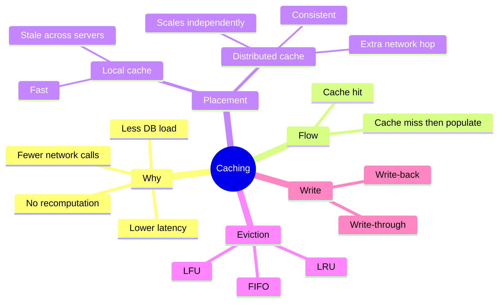

### Key takeaways

- A cache is **fast, temporary, in-memory** storage for **hot data**. It never replaces the database.
- **Hit** = served from cache. **Miss** = fetch from the DB, then populate the cache.
- **Local cache** is fast but inconsistent across multiple servers. **Distributed cache** fixes this at the cost of a network hop.
- **Eviction policies** (FIFO, LRU, LFU) decide what to remove. **Write policies** (write-through, write-back) decide where updates go.
- Every choice is a **trade-off**: speed vs. consistency, simplicity vs. accuracy.
