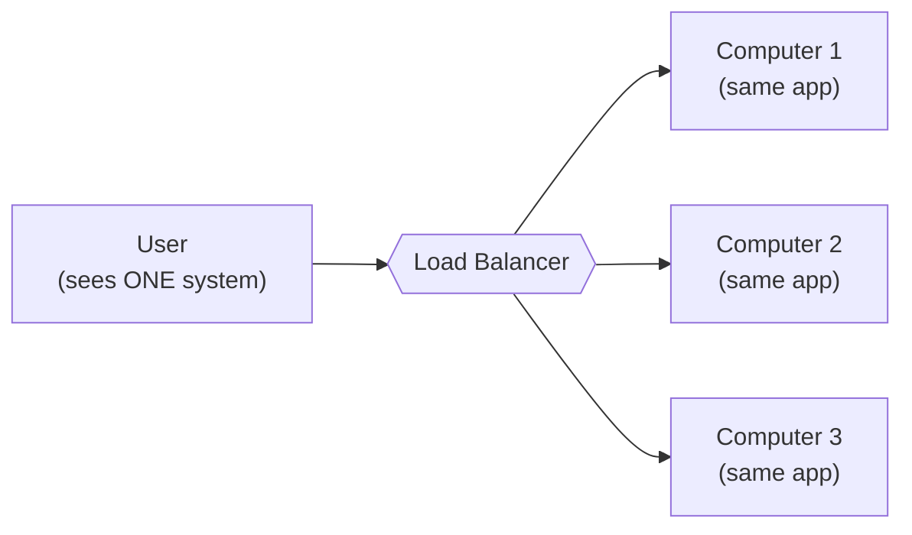
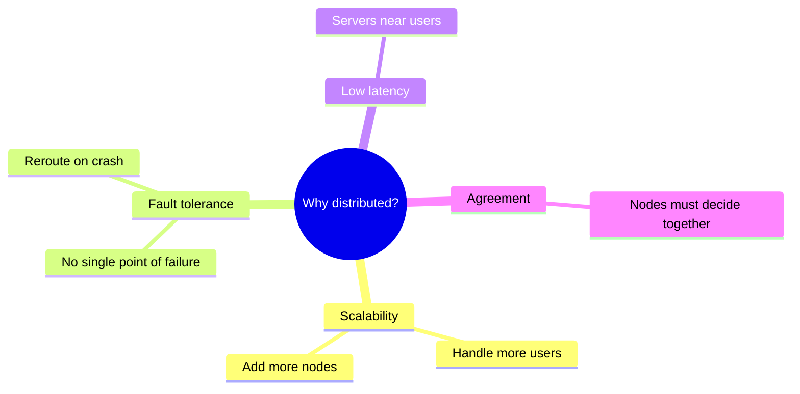
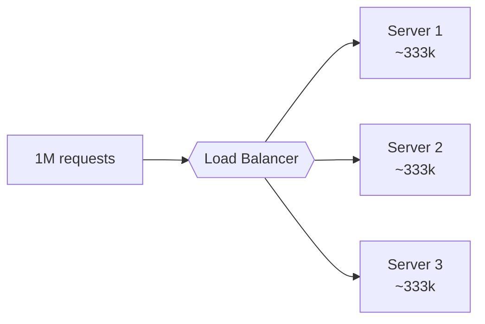
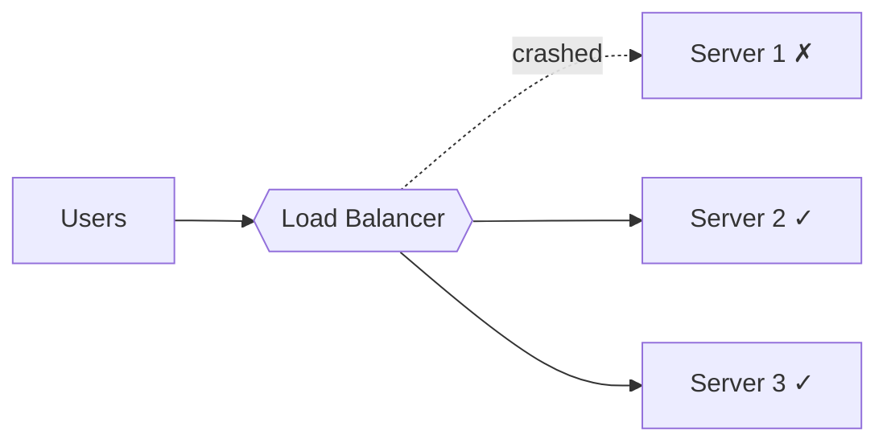
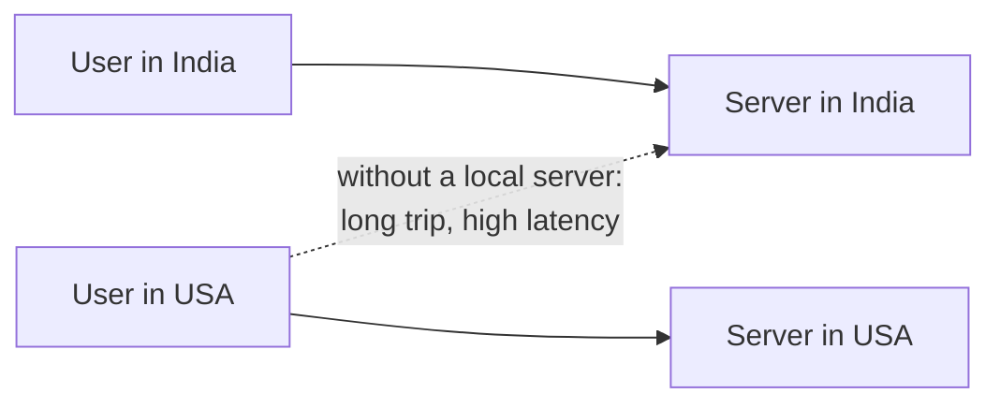
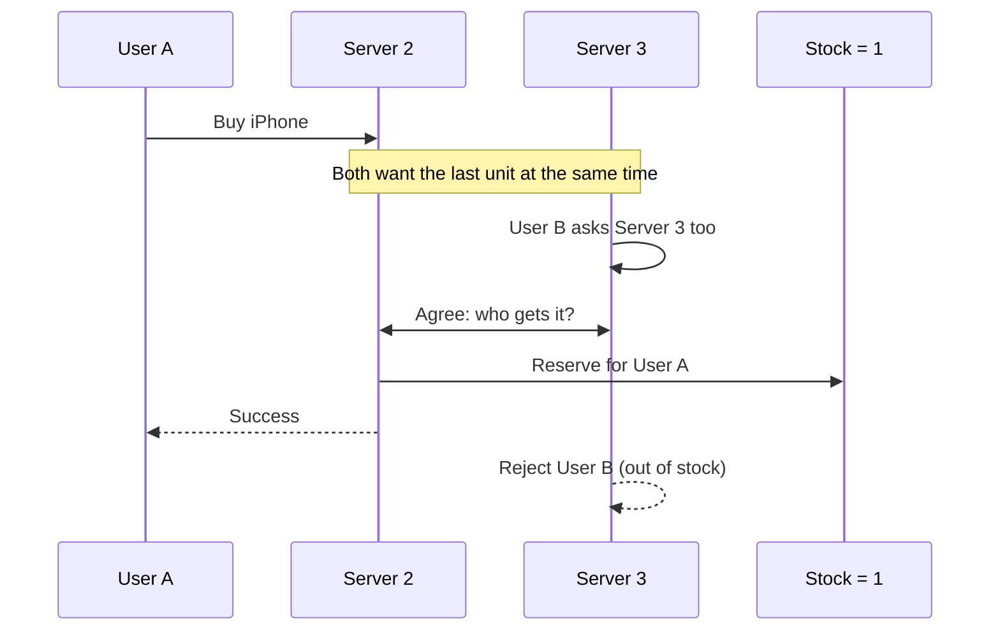
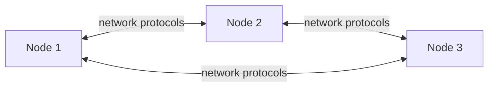

# Chapter 10: Introduction to Distributed Systems

> System Design Course Notes

Load balancers, horizontal scaling, regions and availability zones are not isolated topics. They are all pieces of one bigger idea: the **distributed system**. This chapter ties them together, defines the term properly, and lists the four main reasons we build systems this way.

---

## Table of Contents

1. [What Is a Distributed System?](#1-what-is-a-distributed-system)
2. [The Pieces We Already Know](#2-the-pieces-we-already-know)
3. [Why Distributed Systems?](#3-why-distributed-systems)
   - [3.1 Scalability](#31-scalability)
   - [3.2 Fault Tolerance](#32-fault-tolerance)
   - [3.3 Low Latency](#33-low-latency)
   - [3.4 Agreement](#34-agreement)
4. [How Nodes Talk to Each Other](#4-how-nodes-talk-to-each-other)
5. [What Comes Next: CAP Theorem](#5-what-comes-next-cap-theorem)
6. [Quick Revision](#6-quick-revision)

---

## 1. What Is a Distributed System?

A **distributed system** is a collection of **multiple independent computers (nodes)** that work together on the same task, yet **appear to the user as a single computer**.

Say an e-commerce application is hosted on three independent machines. Each one offers the same features. The user just uses the site and never knows which machine served them.

**Working definition I use:**

> Many computers, working together, trying to solve a large problem, while looking like one computer to the user.

---

## 2. The Pieces We Already Know

Everything below is already a part of distributed systems:

| Concept | Role in a distributed system |
|---|---|
| Load balancer | Routes traffic across multiple server instances |
| Horizontal scaling | Adds more machines instead of making one bigger |
| Regions | Geographic locations that host infrastructure |
| Availability zones | Isolated locations inside a region |
| Database replication | Multiple DB nodes holding the same data |

### Quick refresher: why we scale horizontally

A single machine has a fixed capacity. If one million users arrive, one server may simply run out of capacity. There are two options:

- **Vertical scaling:** buy a bigger machine (has a ceiling).
- **Horizontal scaling:** add more identical machines and distribute requests among them.

Horizontal scaling gives two immediate wins:

1. **Load is shared**: no single server carries a million requests.
2. **No single backup problem**: if one server crashes, the load balancer sends traffic to the others. A single-server setup has no such fallback and the entire system goes down.

---

## 3. Why Distributed Systems?

### 3.1 Scalability

When the number of users grows, a single server may not be able to fulfil all requests. Instead of replacing it, we **add more servers** and spread requests across them.

### 3.2 Fault Tolerance

With only one server, that server is a **Single Point of Failure (SPOF)**. If it crashes, nobody can be served.

With multiple servers, a crash is survivable: the failed node is bypassed and requests go to healthy ones.

### 3.3 Low Latency

**Latency** is the delay between a request and its response. Distance matters.

Imagine `google.com` is served only from a server in India. A user in the USA sends a request, and it has to travel a very long way. Even half a second of extra delay degrades the experience.

**Fix:** also host a server in the USA. US users are now served locally, and total latency across the system drops.

### 3.4 Agreement

Multiple servers means multiple decision makers, and sometimes they must **agree on one outcome** immediately.

**Example: the last iPhone.**

- The database shows **only 1 iPhone left** in stock.
- User A hits Server 2 and User B hits Server 3 **at the same instant**, both trying to buy it.
- Only one of them can get it. The servers must **agree on whose request wins**, within milliseconds, before responding.

I think of it as an auction that is settled in milliseconds. Slow agreement hurts the user experience, and wrong agreement oversells stock.

---

## 4. How Nodes Talk to Each Other

Nodes are separate machines, so they communicate over the **network** using **networking protocols** (HTTP, TCP, gRPC and similar). This is exactly why networks matter so much in distributed systems: they are shared, slow compared to memory, and can fail.

---

## 5. What Comes Next: CAP Theorem

Distributed systems have three desirable properties: **Consistency, Availability and Partition Tolerance**. The big result is that **we cannot have all three at once**. That is the **CAP theorem**, covered in Chapter 12.

---

## 6. Quick Revision

| Reason | One-line summary | Typical tool |
|---|---|---|
| Scalability | More users, so add more nodes | Horizontal scaling + load balancer |
| Fault tolerance | One failure must not kill the system | Redundant nodes, replicas |
| Low latency | Serve users from nearby servers | Multi-region deployment, CDN |
| Agreement | Nodes must decide together, fast | Consensus / coordination |

### Key takeaways

- A distributed system is **many independent computers acting as one**.
- Load balancers, horizontal scaling, regions and AZs are all building blocks of it.
- The four motivations are **scalability, fault tolerance, low latency and agreement**.
- Nodes communicate over networks, so the network is both the glue and the weakest link.
