# Chapter 10 — Introduction to Distributed Systems

> **System Design Course Notes**  
> Level: Beginner to Intermediate  
> Goal: Understand what distributed systems are, why modern applications use them, how independent nodes cooperate, and why coordination, communication, and failures make distributed computing fundamentally different from running an application on a single machine.

---

## Table of Contents

- [1. What Is a Distributed System?](#1-what-is-a-distributed-system)
  - [1.1 Definition](#11-definition)
  - [1.2 What Is a Node?](#12-what-is-a-node)
  - [1.3 A Real-World Example](#13-a-real-world-example)
  - [1.4 Distributed Systems vs. Single-Machine Systems](#14-distributed-systems-vs-single-machine-systems)
- [2. The Building Blocks of a Distributed System](#2-the-building-blocks-of-a-distributed-system)
  - [2.1 Application Servers](#21-application-servers)
  - [2.2 Load Balancers](#22-load-balancers)
  - [2.3 Horizontal Scaling](#23-horizontal-scaling)
  - [2.4 Databases and Replication](#24-databases-and-replication)
  - [2.5 Regions and Availability Zones](#25-regions-and-availability-zones)
- [3. Why Do We Build Distributed Systems?](#3-why-do-we-build-distributed-systems)
  - [3.1 Scalability](#31-scalability)
  - [3.2 Fault Tolerance and Availability](#32-fault-tolerance-and-availability)
  - [3.3 Low Latency and Geographic Distribution](#33-low-latency-and-geographic-distribution)
  - [3.4 Coordination and Agreement](#34-coordination-and-agreement)
- [4. How Distributed Nodes Communicate](#4-how-distributed-nodes-communicate)
  - [4.1 Communication Through Networks](#41-communication-through-networks)
  - [4.2 Why Network Communication Is Difficult](#42-why-network-communication-is-difficult)
  - [4.3 Partial Failure](#43-partial-failure)
  - [4.4 Timeouts and Retries](#44-timeouts-and-retries)
- [5. Common Architectures of Distributed Systems](#5-common-architectures-of-distributed-systems)
  - [5.1 Client–Server Architecture](#51-clientserver-architecture)
  - [5.2 Replicated Architecture](#52-replicated-architecture)
  - [5.3 Distributed Data Architecture](#53-distributed-data-architecture)
  - [5.4 Multi-Region Architecture](#54-multi-region-architecture)
- [6. Challenges and Trade-Offs](#6-challenges-and-trade-offs)
- [7. Introduction to the CAP Theorem](#7-introduction-to-the-cap-theorem)
- [8. When Should You Use a Distributed System?](#8-when-should-you-use-a-distributed-system)
- [9. Quick Revision](#9-quick-revision)
- [10. Interview Questions](#10-interview-questions)
- [11. Key Takeaways](#11-key-takeaways)

---

# 1. What Is a Distributed System?

## 1.1 Definition

A **distributed system** is a collection of independent computing nodes that communicate over a network and coordinate their activities to provide a service or accomplish a common task.

The nodes may run on different physical machines, virtual machines, or containers. They can process requests, store data, execute background jobs, or coordinate decisions.

From the application's perspective, these components cooperate to deliver a complete result.

Consider an e-commerce application. One server handles your request, another processes payments, and a database stores your order. A message broker may deliver an event to a separate inventory service.

Each component performs part of the work, but together they implement one business workflow.

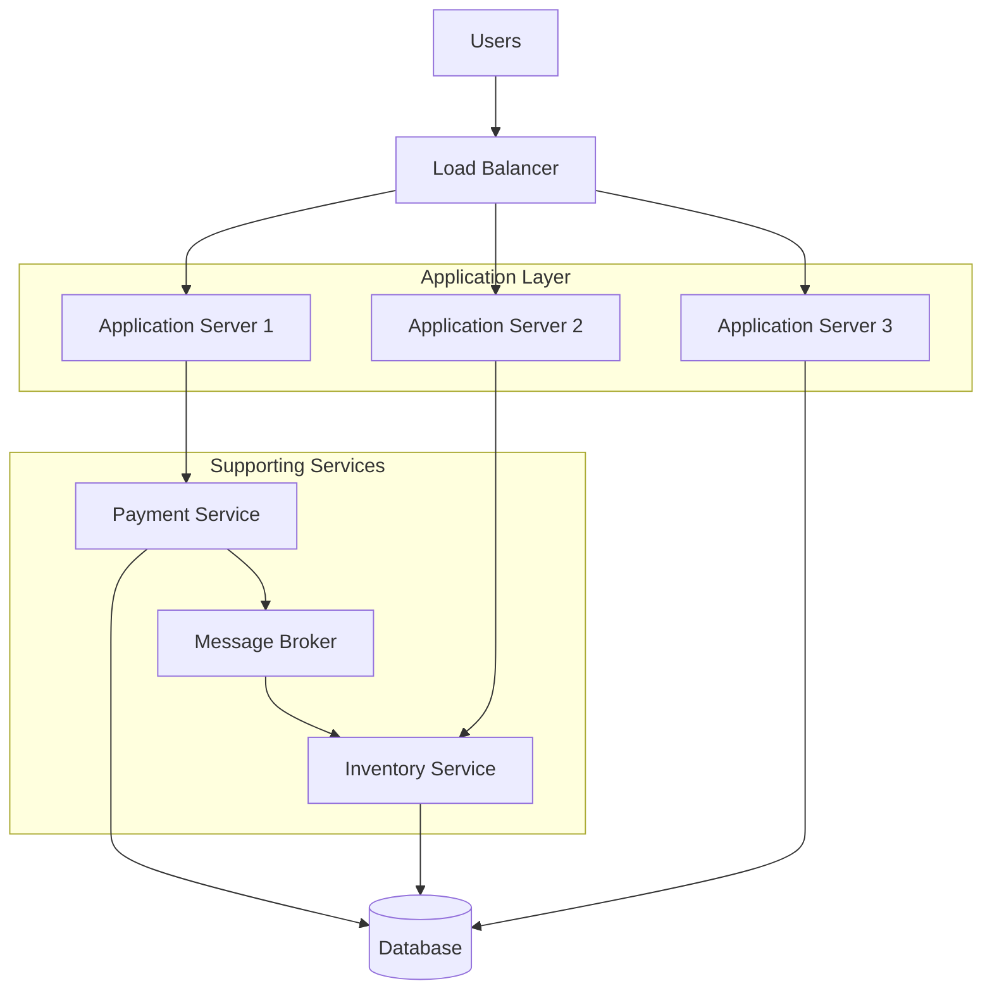

The diagram represents a simplified distributed architecture. Not every application requires all these components, and a production system may contain many more.

### The central idea

A distributed system combines three fundamental characteristics:

1. **Multiple independent nodes:** Computing responsibilities are spread across separate processes or machines.
2. **Communication over a network:** Nodes exchange requests, responses, messages, or data.
3. **Coordination:** Nodes cooperate to provide correct behavior despite concurrency, delays, and failures.

A collection of machines is not automatically a well-designed distributed system. The important part is how those machines communicate, coordinate, and collectively provide a service.

### Does a distributed system always appear as one computer?

Not necessarily.

A traditional distributed application often tries to hide its internal complexity behind a single API or user interface. However, some distributed systems explicitly expose multiple services or nodes to their operators and clients.

Therefore, the idea that "many computers appear as one" is a useful mental model, not a strict requirement.

## 1.2 What Is a Node?

A **node** is an individual participant in a distributed system.

Depending on the architecture, a node might be:

- An application server processing HTTP requests.
- A database server storing records.
- A cache server holding frequently accessed data.
- A message broker distributing events.
- A worker processing background jobs.
- A coordination service participating in a consensus protocol.

For example, a three-node database cluster contains three database nodes. Each node is independently running software and communicating with the others.

### Node vs. process vs. server

These terms are related but not interchangeable.

| Term | Meaning |
|---|---|
| Process | A running instance of a program |
| Server | Software or a machine that provides a service |
| Node | A participant in a distributed system |
| Cluster | A group of nodes cooperating to provide a service |

One physical machine can run multiple processes and host several logical nodes. Conversely, a single logical service may span many machines.

## 1.3 A Real-World Example

Imagine an online shopping platform serving millions of customers.

A customer places an order. The system may perform the following operations:

1. An application server receives the order request.
2. An inventory service checks whether the requested item is available.
3. A payment service attempts to authorize payment.
4. An order service records the order.
5. A message broker distributes an order-created event.
6. A notification worker sends a confirmation email.

These operations may happen in different processes and on different machines.

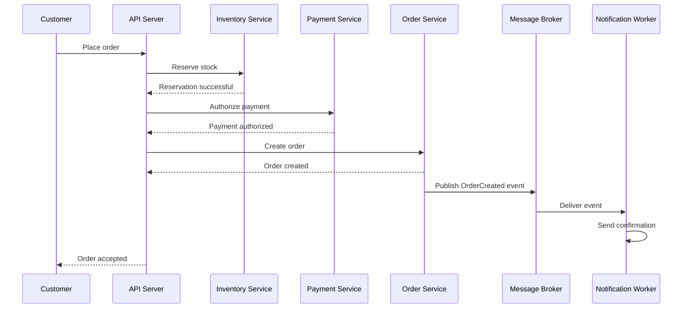

This is a simplified successful workflow. Real implementations must handle payment failures, reservation expiration, duplicate messages, timeouts, and partial completion.

**Important observation:** The order workflow depends on several independently operating components. A failure in one component can affect the workflow even when the other components remain healthy.

That is one of the central challenges of distributed system design.

## 1.4 Distributed Systems vs. Single-Machine Systems

A single-machine application runs its relevant components on one computer. A distributed application spreads work across multiple independent nodes.

| Dimension | Single-machine application | Distributed system |
|---|---|---|
| Computing resources | One machine | Multiple nodes |
| Communication | Function calls and local IPC | Often network requests or messages |
| Scaling | Primarily vertical, unless redesigned | Can scale horizontally |
| Failure impact | Machine failure can stop the application | Failures may affect only part of the system |
| Coordination | Often handled through local synchronization | May require distributed coordination |
| Latency | Local operations can be very fast | Network communication adds latency |
| Operations | Often simpler | More complex monitoring and deployment |

A single-machine application can still use multiple processes, threads, or containers. The defining concern is whether independent components must coordinate across machine or process boundaries.

### Why is distributed computing fundamentally harder?

Inside one process, a function call can return immediately or raise an exception. Across a network, a request may be delayed, lost, duplicated, or processed successfully while its response never reaches the caller.

A timeout does not necessarily mean the operation failed.

This uncertainty changes how software must be designed.

---

# 2. The Building Blocks of a Distributed System

Distributed systems are constructed from smaller architectural components. Understanding these components makes it easier to understand why large applications are designed the way they are.

## 2.1 Application Servers

An **application server** executes application logic.

Examples include:

- Authenticating users.
- Calculating shopping cart totals.
- Validating requests.
- Applying business rules.
- Calling databases and external services.

Suppose a web application runs three identical application instances:

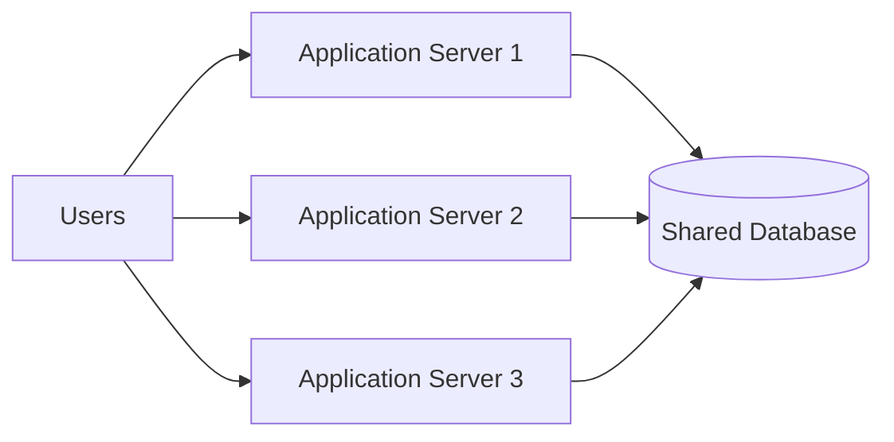

All three instances can process requests, but they must be designed to cooperate correctly.

For example, if a user's shopping cart exists only in the memory of Server 1, a later request routed to Server 2 may not find it.

Common solutions include:

- Keeping application instances stateless.
- Storing shared session data in a database or distributed cache.
- Using signed tokens where appropriate.
- Ensuring shared state is managed through a consistent storage mechanism.

A stateless application server does not mean the entire application has no state. It means an individual server does not need to retain essential client state between requests.

## 2.2 Load Balancers

A **load balancer** distributes incoming requests across multiple backend instances.

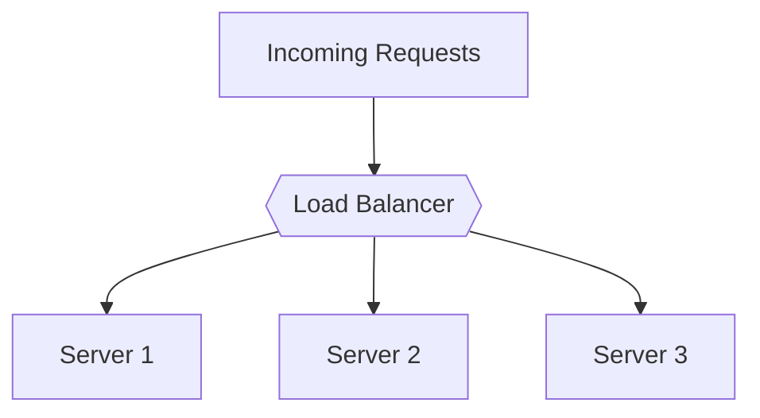

Without a load balancer, clients may need to know which server to contact. With one, clients can access a common endpoint.

Load balancers may use strategies such as:

- Round robin.
- Least connections.
- Weighted distribution.
- Consistent hashing in suitable architectures.

They can also perform health checks and stop routing traffic to instances that are known to be unhealthy.

However, a load balancer does not automatically eliminate every single point of failure. If the load balancer itself is a single unprotected instance, it can become a failure point. Production systems commonly use redundant load-balancing infrastructure.

## 2.3 Horizontal Scaling

**Horizontal scaling** means adding more computing instances to handle additional workload.

**Vertical scaling** means increasing the resources available to an existing machine, such as CPU, RAM, or storage capacity.

| Vertical scaling | Horizontal scaling |
|---|---|
| Increase the capacity of one machine | Add more machines or instances |
| Often simpler initially | Requires distributing work |
| Limited by machine capacity and cost | Can support larger aggregate capacity |
| May retain a single-machine failure risk | Can improve resilience when designed with redundancy |

For example, if one application server handles 1,000 requests per second under a specified workload, three equivalent servers might handle approximately 3,000 requests per second under ideal conditions.

That estimate is not a guarantee. Shared database limits, network overhead, uneven traffic, locking, and other bottlenecks can prevent linear scaling.

Horizontal scaling is useful when requests can be distributed efficiently across independent instances.

## 2.4 Databases and Replication

Application servers are not the only components that can be distributed. Data storage can also span multiple nodes.

**Database replication** means maintaining copies of data on multiple database nodes.

Replication may improve read capacity, availability, or recovery options, depending on the replication design.

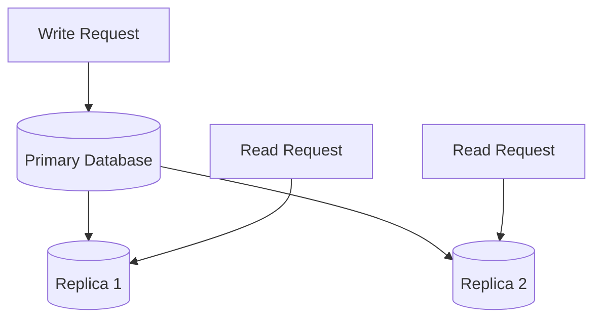

This is a simplified primary-replica architecture.

A primary typically accepts writes and propagates changes to replicas. Depending on the system, replication may be synchronous or asynchronous.

With asynchronous replication, a replica can temporarily lag behind the primary. A read from that replica may return older data.

Replication is different from sharding:

- **Replication:** Multiple nodes maintain copies of the same data.
- **Sharding:** Different nodes store different portions of the data.
- **Replication and sharding:** A system can shard its dataset and replicate each shard for additional resilience.

These techniques solve different problems and are frequently combined.

## 2.5 Regions and Availability Zones

Cloud infrastructure is organized geographically and physically to support performance, resilience, and operational requirements.

### Region

A **region** is a geographic area containing cloud infrastructure.

Examples include regions located in different parts of Europe, Asia, or North America.

Deploying across multiple regions can reduce latency for distant users and help a service survive certain regional failures.

### Availability zone

An **availability zone (AZ)** is an isolated infrastructure location within a cloud region. It typically has independent facilities and infrastructure designed to reduce correlated failures.

A region generally contains multiple availability zones.

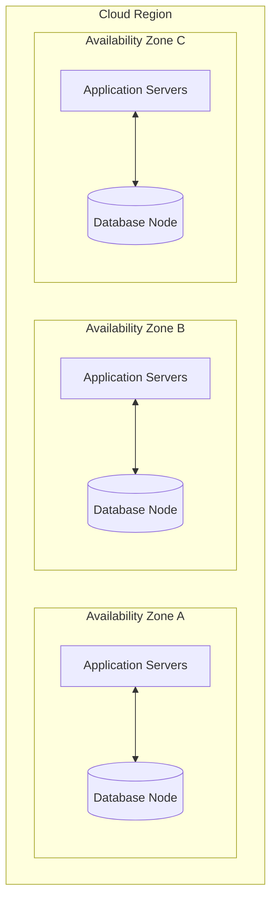

This diagram illustrates possible placement, not a complete production topology.

A multi-AZ architecture can survive certain zone failures only if the relevant application components, data, networking, and failover mechanisms are appropriately configured.

**Key distinction:** Multiple servers in one zone protect against some server failures. Multiple zones can protect against a broader class of infrastructure failures. Multiple regions can protect against some regional failures, but introduce additional networking, consistency, and operational complexity.

---

# 3. Why Do We Build Distributed Systems?

Distributed systems are commonly designed to address four broad needs:

1. Scalability.
2. Fault tolerance and availability.
3. Low latency.
4. Coordination and agreement.

These motivations often overlap. A design decision that improves one property may increase cost or make another property harder to achieve.

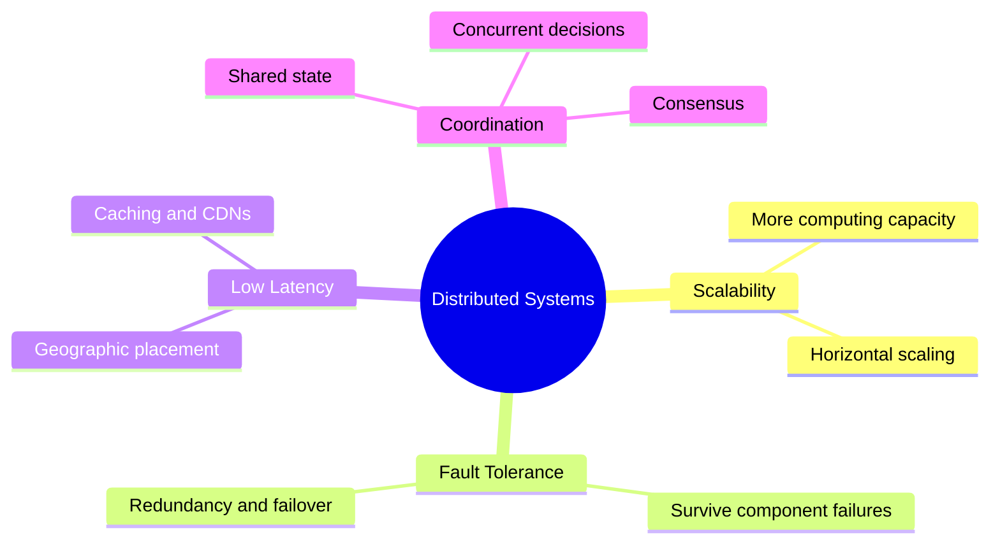

## 3.1 Scalability

**Scalability** is a system's ability to handle increased workload by adding resources or changing its architecture.

Workload growth may come from:

- More active users.
- More requests per user.
- Larger datasets.
- More background jobs.
- More expensive application operations.

### The single-server problem

Imagine an application receives one million requests during a particular period.

A single server has finite CPU, memory, network, and connection capacity. If the incoming workload exceeds those limits, requests may become slower, queue up, or fail.

Adding application instances can distribute the work.

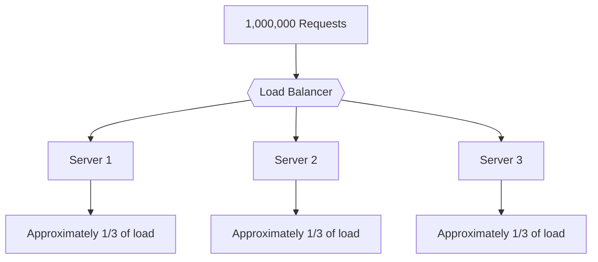

The one-third distribution is illustrative. Actual request distribution depends on traffic patterns, routing, server capacity, and the load-balancing strategy.

### Two forms of scaling

**Vertical scaling**

Increase the resources of an existing server.

Example: Increase an instance from 4 CPU cores and 16 GB RAM to 16 CPU cores and 64 GB RAM.

**Horizontal scaling**

Add more servers and distribute requests between them.

Example: Run ten application instances instead of two.

### The hidden bottleneck

Adding application servers does not necessarily make the entire system scale.

Suppose every application instance sends database queries to one overloaded database. The application tier may scale successfully while the database remains the bottleneck.

A distributed architecture must consider the whole request path:

- Application capacity.
- Database throughput.
- Cache capacity and hit rate.
- Network bandwidth.
- Connection pools.
- External service limits.
- Queue processing rates.

**Engineering principle:** Scale the bottleneck, not merely the component that is easiest to duplicate.

### When is distributed scaling useful?

It is particularly useful when a workload can be divided among multiple independent workers or servers without requiring excessive coordination.

Tasks that require frequent synchronization or shared mutable state may scale less efficiently.

## 3.2 Fault Tolerance and Availability

Failures are inevitable in large systems. Machines restart, processes crash, networks become unavailable, and storage devices fail.

A distributed system can reduce the impact of these failures by providing redundant components and mechanisms to detect and recover from problems.

### Single point of failure

A **single point of failure (SPOF)** is a component whose failure can cause an unacceptable loss of service because no effective alternative is available.

Consider a system with one application server:

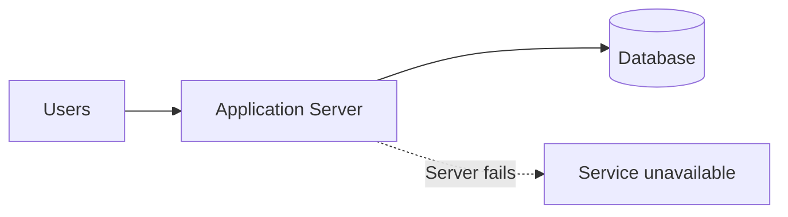

If the application server fails, the service may become unavailable.

Now consider multiple application instances behind a load balancer:

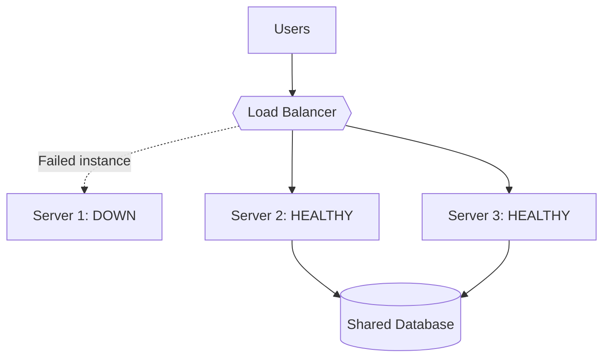

The system may continue serving requests through Servers 2 and 3.

This only works if the remaining instances have sufficient capacity and the shared dependencies are still available.

### Redundancy is not enough by itself

A system can contain multiple servers and still fail completely if they all depend on one unavailable database, network path, credential service, or load balancer.

Resilience requires examining the full dependency chain.

For example:

| Failure | Possible mitigation |
|---|---|
| Application instance crashes | Multiple instances and health checks |
| Availability zone fails | Deploy across multiple zones |
| Database node fails | Replication and automated failover |
| Network connection breaks | Timeouts, retries, alternate paths |
| Queue worker crashes | Durable queues and recoverable jobs |
| Entire region fails | Cross-region recovery or failover |

Every mitigation has limitations. Replicas may be stale, failover may take time, and retries may amplify load.

### Fault tolerance vs. high availability

These terms are related but distinct.

- **Fault tolerance** is the ability to continue providing an acceptable service despite specified failures.
- **High availability** is the goal of keeping a service accessible for a high proportion of time.

A system can have high availability without tolerating every possible failure. Likewise, some faults may be tolerated with reduced performance or functionality.

### Availability in practice

Availability is often expressed as a percentage.

| Target availability | Approximate annual downtime |
|---|---:|
| 99% | 3.65 days |
| 99.9% | 8.76 hours |
| 99.99% | 52.56 minutes |
| 99.999% | 5.26 minutes |

These figures assume a 365-day year and represent simple downtime budgets. Actual service-level objectives may use monthly windows and define which failures count.

Higher availability usually requires additional engineering, redundancy, monitoring, and operational investment.

## 3.3 Low Latency and Geographic Distribution

**Latency** is the time required for an operation or request to receive a response.

Users often perceive latency directly: a page loads slowly, a search takes too long, or a payment confirmation appears late.

One important contributor to latency is the distance between communicating systems.

### Why geography matters

Imagine an application hosted only in Asia.

A user in Asia may reach the application relatively quickly. A user in North America may experience additional network delay because requests and responses travel farther and pass through more network infrastructure.

Deploying application capacity closer to users can reduce network latency.

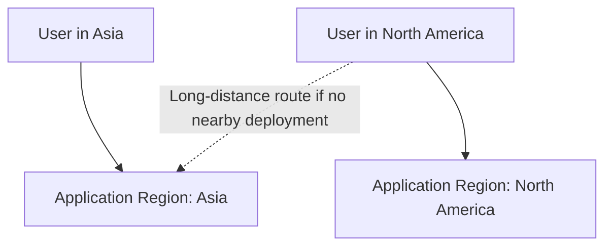

In a multi-region architecture, routing may direct users to a nearby healthy region. A global routing layer, DNS-based routing, or an anycast network can help implement this, depending on the architecture.

### Geographic distribution is not the only solution

Other approaches can also reduce latency:

- **Caching:** Keep frequently accessed data closer to the application or user.
- **Content delivery networks (CDNs):** Serve static or cacheable content from distributed edge locations.
- **Connection reuse:** Avoid repeatedly establishing connections.
- **Efficient APIs:** Reduce unnecessary network round trips.
- **Database optimization:** Reduce query execution and data-transfer time.
- **Asynchronous processing:** Move nonessential work out of the critical request path.

### Important trade-off

A nearby server does not guarantee a fast response.

The request may still be slow because of database queries, overloaded CPUs, distant dependencies, or cache misses.

A useful mental model is:

**Total request latency = network delay + processing time + dependency delays + queueing and other overhead.**

This is a conceptual decomposition, not an exact universal formula.

### Why multi-region deployments are harder

If the same application runs in several regions, its data and dependencies must be managed carefully.

For example:

- How quickly do updates become visible in other regions?
- What happens when regions cannot communicate?
- Which region accepts writes?
- How are conflicting updates resolved?
- How does the system recover after a regional outage?

Geographic distribution improves some performance and resilience characteristics, but introduces additional coordination challenges.

## 3.4 Coordination and Agreement

Distributed nodes frequently need to make decisions involving shared resources or shared state.

Examples include:

- Deciding which user gets the last item in stock.
- Preventing duplicate payment processing.
- Electing a leader for a coordination task.
- Allocating a unique identifier.
- Ensuring a distributed transaction follows the required rules.
- Deciding which configuration version is authoritative.

The underlying problem is **concurrency**: multiple operations can occur at the same time.

### Example: Selling the last iPhone

Suppose an online store has exactly one phone remaining.

Two customers submit purchase requests almost simultaneously. Their requests reach different application servers.

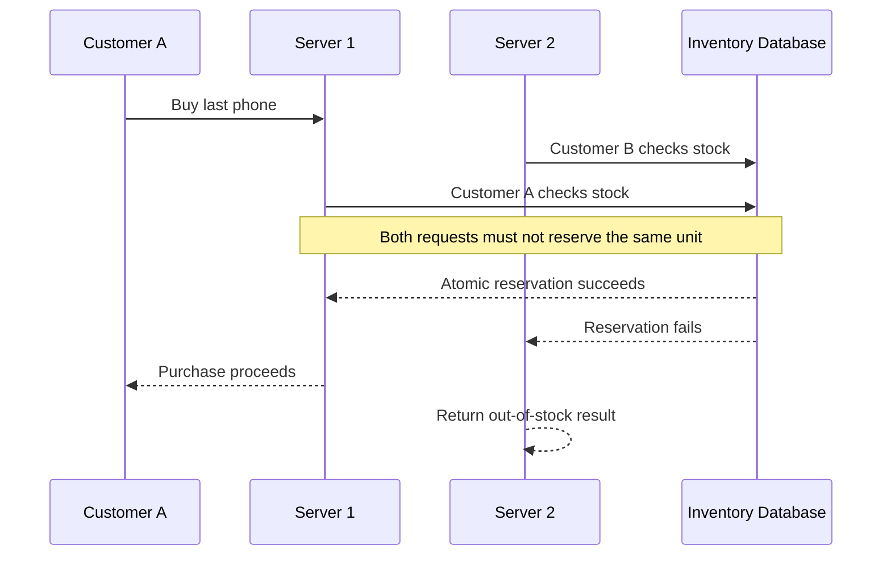

The critical requirement is not that the application servers negotiate directly with each other. The requirement is that the system enforces a correct outcome.

A common solution is an **atomic conditional update** at the database:

```sql
UPDATE inventory
SET quantity = quantity - 1
WHERE product_id = 42
  AND quantity > 0;
```

The application checks the number of affected rows:

- One row updated: the reservation succeeded.
- Zero rows updated: the reservation did not succeed.

Assuming the database provides the required atomicity and isolation guarantees, concurrent requests cannot both decrement the same final unit successfully through this operation.

This is often simpler than implementing a distributed consensus protocol specifically for inventory reservation.

### When is distributed consensus necessary?

More specialized coordination mechanisms are needed when multiple nodes must agree on a shared decision or ordering of operations without relying on a single authoritative component.

Consensus protocols, such as Raft, help a group of nodes agree on an ordered sequence of decisions under specified failure assumptions.

They are used in some replicated databases, metadata systems, and coordination services.

**Important distinction:** Not every distributed interaction requires consensus. Database transactions, atomic operations, locks, leases, and carefully designed ownership rules may solve particular problems. The correct choice depends on the required guarantees and failure model.

### Why agreement is difficult

Nodes may observe events in different orders. Messages can be delayed. A node may fail after receiving a request but before responding.

Consequently, two nodes can temporarily have different information about the same system.

Distributed systems must define which decisions are authoritative, how conflicts are handled, and what happens when communication is interrupted.

---

# 4. How Distributed Nodes Communicate

## 4.1 Communication Through Networks

Nodes communicate using networking protocols and messaging mechanisms.

Common examples include:

| Technology | Typical role |
|---|---|
| TCP | Reliable, ordered byte-stream transport |
| HTTP | Request-response application protocol |
| HTTPS | HTTP secured with TLS |
| gRPC | Remote procedure calls, commonly using HTTP/2 |
| WebSockets | Persistent, bidirectional communication |
| Message queues | Asynchronous delivery and buffering |
| UDP | Datagram transport without TCP's built-in reliability guarantees |

These technologies serve different purposes. HTTP and gRPC operate at a different conceptual layer from TCP, while message queues provide messaging semantics that go beyond raw network transport.

### Synchronous communication

In synchronous request-response communication, a caller sends a request and waits for a result.

Example:

```text
API Server
    |
    | HTTP request
    v
Payment Service
    |
    | HTTP response
    v
API Server
```

This is straightforward, but the caller's progress depends on the response or on reaching a timeout.

### Asynchronous communication

In asynchronous communication, the sender can publish a message or enqueue work without waiting for the final processing result.

Example:

```text
Order Service
    |
    | Publish OrderCreated
    v
Message Broker
    |
    | Deliver message
    v
Email Worker
```

Asynchronous messaging can reduce direct dependencies between services and absorb temporary workload spikes.

However, it introduces additional concerns, such as duplicate delivery, message ordering, retries, dead-letter queues, and eventual consistency.

## 4.2 Why Network Communication Is Difficult

Communication within one process and communication between machines have different characteristics.

A local function call normally operates within one process and can access shared memory. A network request crosses several boundaries and introduces uncertainty.

A remote call may experience:

1. Network congestion.
2. Packet loss or connection interruption.
3. Server overload.
4. Process crashes.
5. Slow dependency responses.
6. Delayed or duplicated application-level requests.
7. Successful execution followed by a lost response.

### The ambiguous outcome problem

Suppose an API server sends a payment request.

The payment service processes the request successfully, but the response is lost.

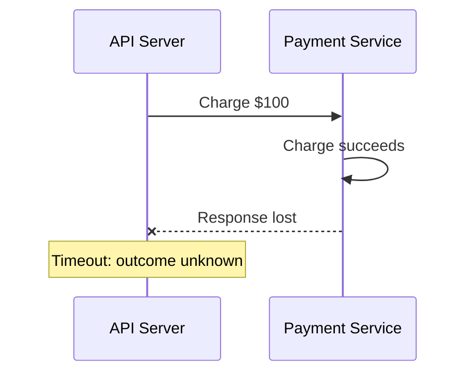

The API server cannot conclude that the payment failed simply because it did not receive a response.

This distinction is fundamental:

**A timeout tells you that a response did not arrive in time. It does not prove that the remote operation was never executed.**

## 4.3 Partial Failure

A **partial failure** occurs when some components of a distributed system fail while others continue operating.

For example:

- The application servers remain healthy.
- The database is reachable.
- The payment service becomes unavailable.
- The rest of the application continues to serve unrelated requests.

A single-machine program often has a more straightforward failure model. In a distributed system, the caller may not know whether a remote component is down, overloaded, partitioned from the network, or merely slow.

This uncertainty makes failure detection difficult.

### Designing for partial failure

Common techniques include:

- Health checks and failure detection.
- Timeouts on remote calls.
- Bounded retries.
- Circuit breakers.
- Bulkheads that isolate resource consumption.
- Redundant service instances.
- Graceful degradation.
- Durable queues for recoverable background work.

Each technique addresses particular failure modes. None makes failures impossible.

## 4.4 Timeouts and Retries

A timeout limits how long a caller waits for an operation.

A retry attempts an operation again after a failure or timeout.

Both can improve resilience, but they must be used carefully.

### The retry problem

Imagine a client retries every timed-out request immediately.

If the server is already overloaded, retries increase traffic, causing more requests to time out and triggering still more retries.

This can create a **retry storm**.

A better retry policy may include:

- A finite retry limit.
- Exponential backoff.
- Random jitter to avoid synchronized retries.
- A total request deadline.
- Retry decisions based on error type.
- Idempotency protection for operations with side effects.

### Idempotency

An operation is **idempotent** if repeating it produces the same intended result as performing it once.

For example, setting a user's preferred language to `en` is naturally idempotent when implemented as a state-setting operation.

Creating an order or charging a card is not automatically idempotent. Repeating the request may create duplicate effects unless the application provides suitable safeguards.

An idempotency key allows the service to recognize repeated attempts belonging to the same logical operation.

This is especially useful when a client must safely retry after an ambiguous timeout.

---

# 5. Common Architectures of Distributed Systems

## 5.1 Client–Server Architecture

In a client-server system, clients send requests to servers that provide services.

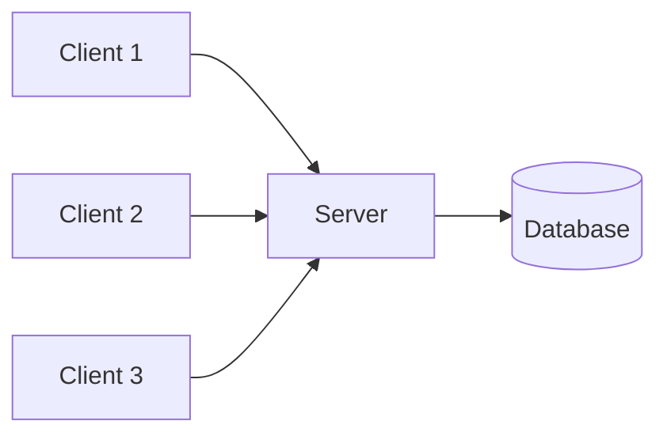

The server may itself be distributed across several instances. A simple client-server architecture does not necessarily imply that the backend is distributed.

## 5.2 Replicated Architecture

A replicated architecture maintains multiple instances of a service or copies of data.

Application replication distributes request-processing capacity. Database replication maintains multiple copies of data.

These are related but separate design decisions.

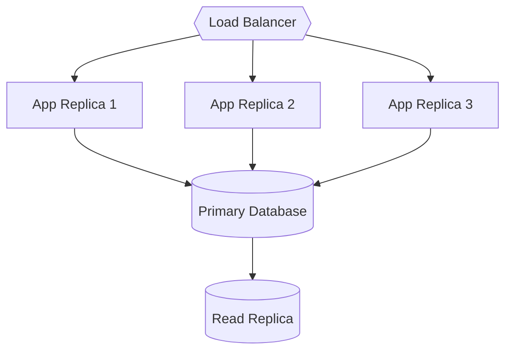

The architecture shown is illustrative. It includes application replicas and a database read replica, but does not imply that all reads should go to the replica or that replication is instantaneous.

## 5.3 Distributed Data Architecture

A dataset may be partitioned across multiple nodes.

This technique is called **sharding** or partitioning.

For example, users might be distributed across three shards based on a partition key.

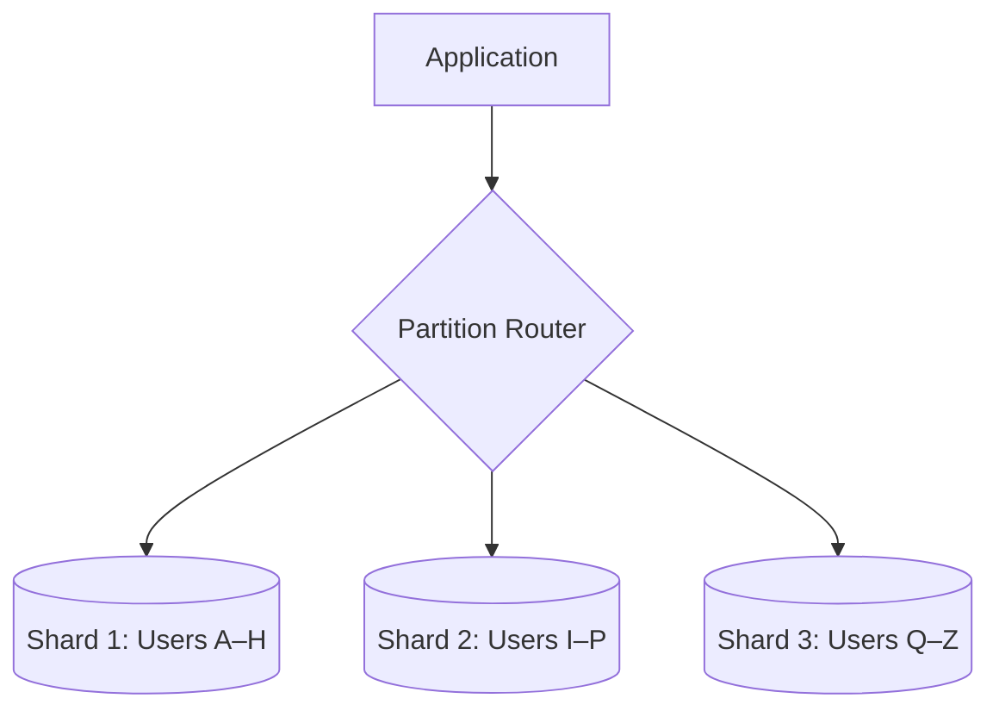

The letter ranges are conceptual only; real partitioning strategies may use hashes, ranges, directory mappings, or other techniques.

Sharding allows a dataset to grow beyond the practical capacity of one node. However, it introduces challenges involving data distribution, rebalancing, cross-shard queries, and transactions.

## 5.4 Multi-Region Architecture

A multi-region architecture deploys relevant components in more than one geographic region.

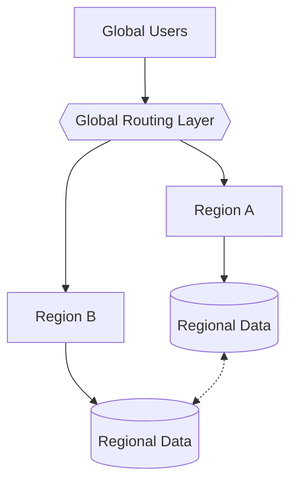

The data connection may represent replication or another synchronization mechanism. Its behavior depends on the chosen database and consistency model.

Multi-region designs can improve geographic responsiveness and disaster recovery. They can also increase costs and complicate writes, failover, and conflict resolution.

---

# 6. Challenges and Trade-Offs

Distributed systems solve important problems, but they also create new ones.

## 6.1 Network partitions

A **network partition** occurs when groups of nodes cannot communicate with one another reliably, even though some nodes may continue running.

For example, two database replicas may both be operational but unable to exchange updates.

The system must decide how to behave when communication is unavailable.

Should it continue accepting certain operations? Should it reject them until communication recovers? Should it allow temporary disagreement?

These decisions depend on the required consistency, availability, and business guarantees.

## 6.2 Data consistency

Consistency concerns the guarantees a system provides when data is read and written.

With strongly consistent behavior, a successful write may need to become visible to subsequent reads according to a defined ordering guarantee.

With eventual consistency, replicas may temporarily disagree but converge if updates stop and communication and repair mechanisms eventually succeed.

Neither model is universally best. The correct choice depends on the application.

For example, a social media view counter may tolerate temporary disagreement. An inventory reservation system needs stronger protection against selling unavailable stock.

## 6.3 Operational complexity

A distributed system typically requires more than writing application code.

Engineers must also manage:

- Service discovery.
- Configuration distribution.
- Deployment and rollback.
- Logging and tracing across services.
- Metrics and alerting.
- Capacity planning.
- Security between components.
- Failure recovery.
- Data migrations.
- Incident response.

A system that performs well in a local development environment may behave very differently under real network delays, concurrency, and failures.

## 6.4 Coordination overhead

Distributed nodes often need additional communication to maintain correctness.

For example, a transaction involving multiple services may require coordination, retries, compensation, or a workflow orchestrator.

If each request requires many sequential network round trips, latency increases and throughput may fall.

Good system design therefore seeks to minimize unnecessary coordination while preserving the guarantees the application actually needs.

## 6.5 Cost and complexity

More servers, replicated storage, cross-region networking, and redundant infrastructure increase operational costs.

Distribution should solve a real requirement rather than be introduced simply because it appears more sophisticated.

A single well-designed application with one database can be the right architecture for a small product.

The goal is not maximum distribution. The goal is an appropriate balance of scalability, reliability, latency, correctness, and cost.

---

# 7. Introduction to the CAP Theorem

The **CAP theorem** describes an important trade-off in distributed data systems when a network partition occurs.

CAP refers to:

- **Consistency (C):** In the usual CAP formulation, every successful operation behaves as though there were one up-to-date copy of the data, respecting a single-copy ordering model.
- **Availability (A):** Every request received by a non-failing node receives a non-error response, even if that response cannot incorporate the latest update.
- **Partition Tolerance (P):** The system continues operating despite communication failures that divide nodes into groups unable to communicate.

The central result is that **when a network partition occurs, a distributed system cannot guarantee both CAP consistency and CAP availability for every request**.

It must make a choice for affected operations:

- Preserve the required consistency guarantee by rejecting or delaying some requests.
- Preserve availability by responding even when the latest data cannot be guaranteed.

This does not mean that distributed systems permanently choose only two properties under every condition. The key trade-off concerns behavior during a partition.

### Example: Two database replicas

Suppose two replicas store an account balance.

Replica A receives a write that changes the balance from $100 to $50. A network partition prevents Replica B from receiving the update.

A client then asks Replica B for the balance.

If B returns $100, it may violate the required consistency guarantee. If B refuses to return a successful result until it can safely determine the correct value, the operation may lose availability under the CAP definition.

The correct design depends on the operation, data model, and consistency requirements.

**Further study:** See the dedicated CAP Theorem chapter for consistency models, partition scenarios, and examples of CP and AP behavior.

---

# 8. When Should You Use a Distributed System?

Use distributed architecture when its benefits justify its operational and engineering costs.

### Signs that distribution may be necessary

- One machine cannot handle the required workload.
- A service must remain available after certain component failures.
- Users across distant geographic locations need responsive service.
- The dataset exceeds practical single-node capacity.
- Background processing must scale independently.
- Separate components have distinct scaling or deployment requirements.
- Business requirements justify redundant infrastructure or disaster recovery.

### Signs that a simpler architecture may be better

- The workload is small and predictable.
- A single machine has sufficient capacity.
- The application has no strict availability or geographic requirements.
- The team cannot yet operate a complex distributed deployment safely.
- Cross-service communication would add complexity without meaningful benefits.

### A practical progression

A reasonable architecture often evolves as requirements grow:

1. **Start simple:** One application and one database.
2. **Improve the fundamentals:** Optimize queries, add indexes, and measure bottlenecks.
3. **Scale the application tier:** Add instances behind a load balancer.
4. **Introduce caching:** Reduce repeated work and unnecessary database reads.
5. **Scale data infrastructure:** Consider replication, partitioning, or other database strategies.
6. **Improve resilience:** Deploy across availability zones and eliminate critical single points of failure.
7. **Expand geographically:** Consider multi-region deployment when latency or disaster-recovery requirements justify it.
8. **Introduce coordination mechanisms:** Use transactions, queues, consensus, or workflow patterns when the actual correctness requirements call for them.

This progression is a guide, not a mandatory sequence. Real systems may need some capabilities much earlier because of regulatory, security, or availability requirements.

---

# 9. Quick Revision

| Concept | Meaning | Common techniques |
|---|---|---|
| Distributed system | Independent nodes cooperate through communication | Network protocols, service coordination |
| Node | A participant in the system | Servers, database nodes, workers |
| Scalability | Handle increased workload | Horizontal scaling, sharding, caching |
| Fault tolerance | Continue operating despite specified failures | Redundancy, failover, replication |
| Availability | Keep the service accessible | Health checks, redundant components |
| Low latency | Reduce time to complete an operation | Caching, CDNs, geographic placement |
| Coordination | Ensure related operations obey required rules | Transactions, locks, consensus |
| Replication | Maintain copies of data | Primary-replica or multi-leader designs |
| Sharding | Partition data across nodes | Hash, range, or directory-based partitioning |
| Partial failure | Some components fail while others continue | Timeouts, retries, isolation |
| Network partition | Nodes cannot communicate across a network split | Partition-aware consistency policies |
| CAP theorem | During a partition, consistency and availability cannot both be guaranteed for all requests | Choose behavior according to requirements |

## Key Takeaways

- A distributed system consists of independent computing nodes that communicate and coordinate over a network.
- Load balancers, application replicas, databases, caches, regions, and availability zones are common building blocks.
- The major motivations include scalability, fault tolerance, low latency, and coordination.
- Horizontal scaling increases aggregate capacity but does not automatically remove shared bottlenecks.
- Redundancy improves resilience only when dependencies and failure modes are considered.
- Geographic distribution can reduce latency but introduces additional data-management and coordination challenges.
- Network timeouts create uncertainty: a request may have succeeded even when its response was never received.
- Replication copies data; sharding partitions data.
- Not every distributed problem requires consensus. Use the simplest mechanism that satisfies the required correctness guarantees.
- Distributed systems introduce operational and engineering costs. Adopt them when their benefits justify those costs.

---

# 10. Interview Questions

### Q1. What is a distributed system?

A collection of independent nodes that communicate and coordinate over a network to provide a service or accomplish a common task.

### Q2. Why do distributed systems need networks?

Nodes operate independently and must exchange requests, data, events, or coordination messages. The network connects those nodes but also introduces latency, communication failures, and uncertainty.

### Q3. What is the difference between horizontal and vertical scaling?

Vertical scaling increases the resources of an existing machine. Horizontal scaling adds machines or instances and distributes work among them.

### Q4. Does adding more servers automatically make a system fault-tolerant?

No. The system must detect failures, route around failed instances, maintain sufficient capacity, and ensure that shared dependencies do not become single points of failure.

### Q5. Why is distributed coordination difficult?

Nodes can receive messages at different times, process concurrent requests, and temporarily lose communication. They may therefore have different information about shared state and need explicit mechanisms to preserve correctness.

### Q6. What is a partial failure?

A situation in which some components fail or become unreachable while other components remain operational.

### Q7. What is the difference between replication and sharding?

Replication maintains copies of data on multiple nodes. Sharding divides a dataset into partitions stored on different nodes.

### Q8. Does a timeout mean a request failed?

No. The remote operation may have succeeded even though the response was delayed or lost. Retrying a non-idempotent operation can cause duplicate effects unless appropriate safeguards are implemented.

### Q9. Why is deploying across multiple regions difficult?

Regions introduce longer network paths, additional failure scenarios, replication delays, and questions about write ownership, consistency, conflict resolution, and failover.

### Q10. Does every distributed system need consensus?

No. Consensus is necessary for certain distributed agreement problems, but many operations can be implemented with transactions, atomic updates, ownership rules, or other mechanisms that provide the required guarantees.

### Q11. What does the CAP theorem tell us?

During a network partition, a distributed data system cannot guarantee both CAP consistency and CAP availability for all requests. Its behavior must reflect the application's correctness and availability requirements.

### Q12. Should every application be distributed?

No. A simpler architecture is often cheaper, easier to maintain, and more than sufficient. Distribution should be driven by measurable requirements and justified trade-offs.

---

**Next recommended topic:** Chapter 11 — [Choose the Next System Design Topic]

Build on this foundation by studying how distributed data systems manage consistency, replication, failure recovery, and coordination.