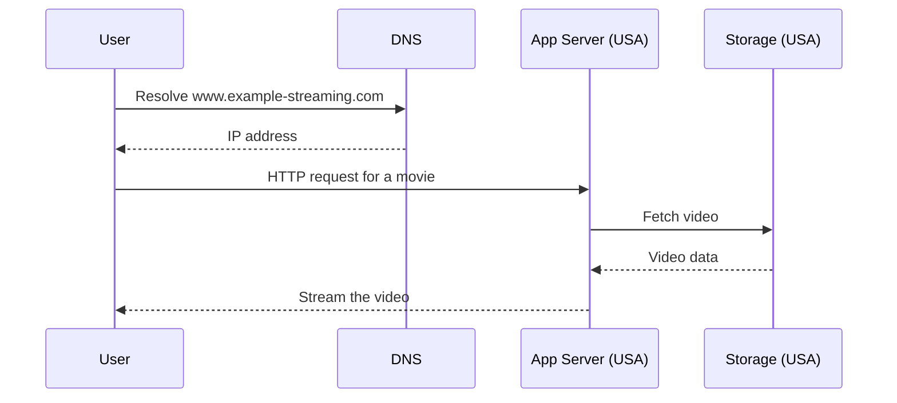
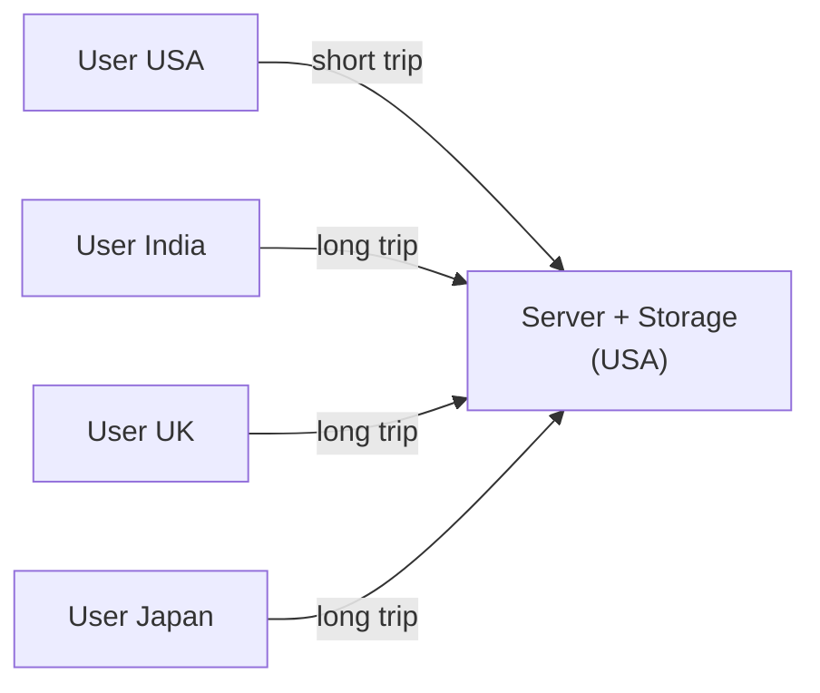
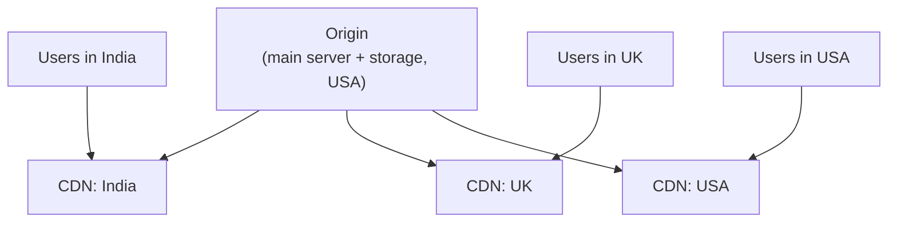
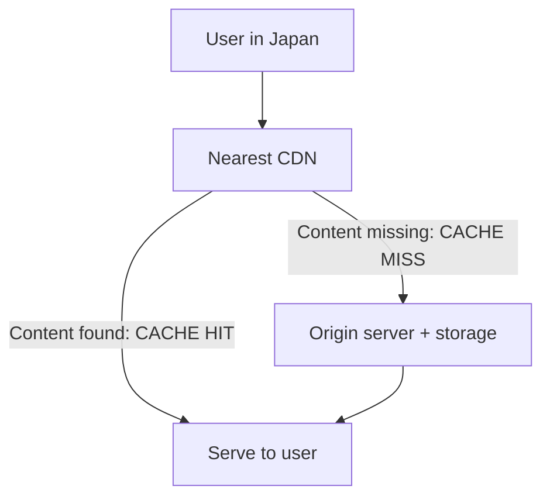
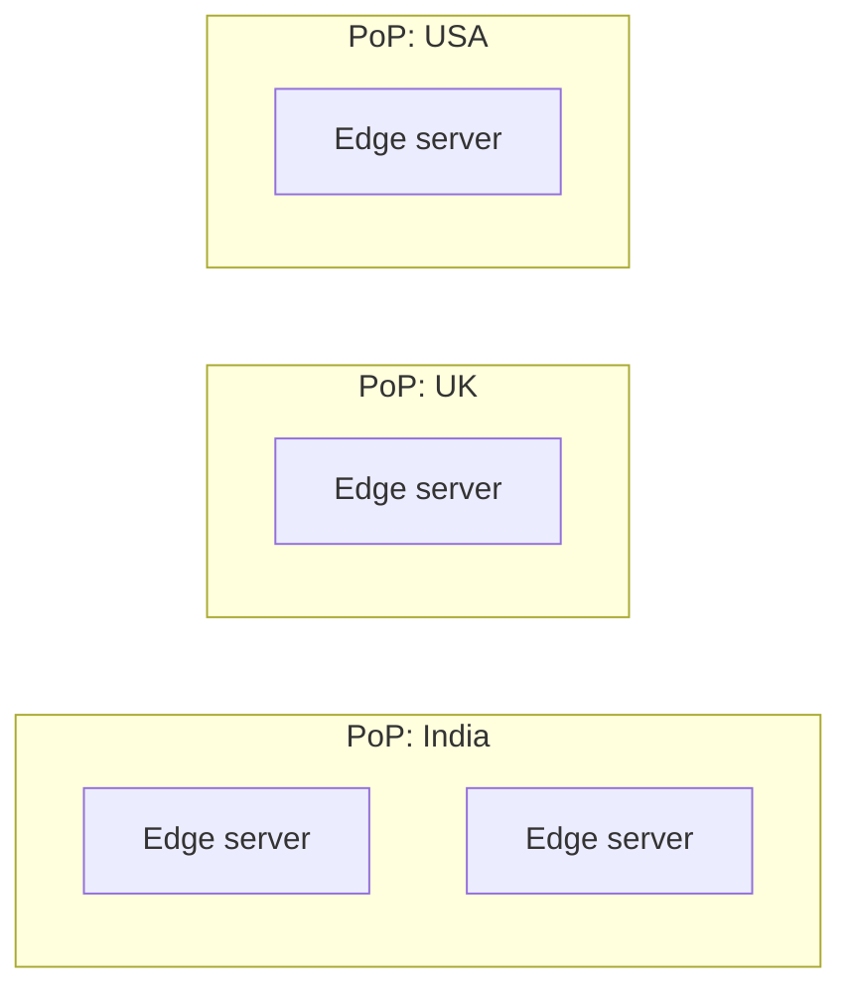
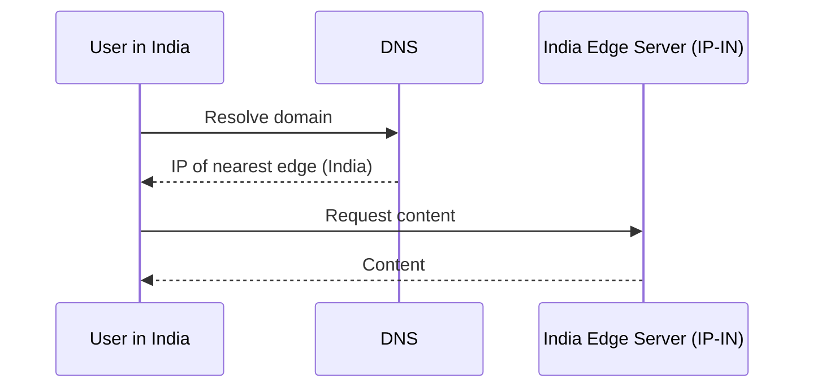
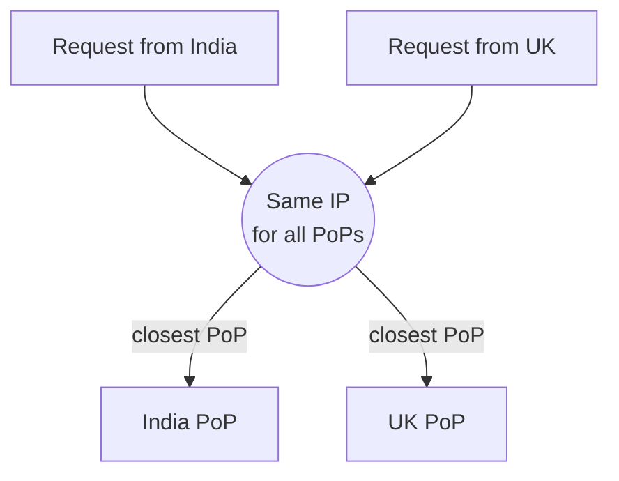
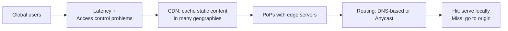

# Chapter 11: Content Delivery Network (CDN)

> System Design Course Notes

A CDN puts copies of static content close to users. This chapter covers the two problems it solves (latency and access control), how a request flows through it, the vocabulary (point of presence, edge server), and the two routing techniques: DNS-based routing and Anycast.

---

## Table of Contents

1. [The Setup: A Global Streaming App](#1-the-setup-a-global-streaming-app)
2. [How a Request Works Without a CDN](#2-how-a-request-works-without-a-cdn)
3. [Problem 1: Latency](#3-problem-1-latency)
4. [Problem 2: Access Control](#4-problem-2-access-control)
5. [Enter the CDN](#5-enter-the-cdn)
6. [Cache Hit, Cache Miss and the Origin](#6-cache-hit-cache-miss-and-the-origin)
7. [Terminology: PoP and Edge Server](#7-terminology-pop-and-edge-server)
8. [How Users Are Routed to the Nearest Edge](#8-how-users-are-routed-to-the-nearest-edge)
9. [Quick Revision](#9-quick-revision)

---

## 1. The Setup: A Global Streaming App

Take a streaming platform. Users arrive from the **USA, India, Japan and the UK**, and all of them want the same thing: to open the site and watch a video.

Backend pieces:

- **Application server** (handles requests)
- **Object storage (for example S3)** that holds all the movies and series

For this chapter, assume **both the server and the storage are hosted in the USA**.

---

## 2. How a Request Works Without a CDN



1. The user types the domain name.
2. **DNS** resolves the domain to an **IP address**.
3. The browser sends an **HTTP request** to that IP (the app server).
4. The server fetches the video from storage and sends it back.

Simple, and it works. Until users are spread across the world.

---

## 3. Problem 1: Latency

Everything lives in the USA, so:

- US users are served quickly.
- Users in India, Japan and the UK have to reach across the planet for every request. **Latency goes up.**



**Could we just move the server somewhere central?**

Placing it between India and the USA helps those two, but the UK and Japan are still far away. There is no single location close to every geography, so a single central server is **not practically possible**.

---

## 4. Problem 2: Access Control

Some content may be **banned in a country** (for example by a government order), or may be **licensed only for one region**.

- Banned content must **not** be served to users in that country.
- Region-exclusive content must **only** be shown to users from that region.

With one global repository holding every video, **separating content by geography is hard**. What we want is a **local storage** in each region that holds only what that region is allowed to see, and that serves local users directly without touching the central server.

---

## 5. Enter the CDN

A **CDN (Content Delivery Network)** is a network of servers placed in different regions, which **caches static content** and serves it to nearby users.

**Static content** means content that does not change per request:

- Videos
- Images
- Audio
- HTML pages



**How it solves both problems**

| Problem | How the CDN helps |
|---|---|
| Latency | Content is served from a nearby location, so requests do not cross continents and never reach the origin for cached content |
| Access control | Region-specific content is placed only on CDNs in the allowed region (Indian-only titles live on the India CDN, so UK and Japan users never see them) |

At heart, a CDN is **caching**, applied geographically.

> Just like a normal cache, a CDN cannot hold everything. It stores a **relevant subset** of videos for each region, and that is what lets local users fetch them fast.

---

## 6. Cache Hit, Cache Miss and the Origin

What if there is **no CDN in the user's country** (say, none in Japan)?

1. The request goes to the **nearest available CDN**, which serves it if it has the content.
2. If that CDN **does not have** the content (a cache miss), the request goes on to the **origin server**.



Structure in one line: one **main repository (origin)** holding everything, plus **many local CDN locations** holding the relevant slice for their geography.

---

## 7. Terminology: PoP and Edge Server

| Term | Meaning |
|---|---|
| **Point of Presence (PoP)** | A physical location where CDN infrastructure is hosted (the USA PoP, the India PoP, the UK PoP, the Japan PoP) |
| **Edge server** | A CDN server sitting at a PoP, at the "edge" of the network close to users |



---

## 8. How Users Are Routed to the Nearest Edge

When a request comes from India, how do we make sure it goes to the India edge server and not the USA one? CDNs use different techniques. Two key ones:

### 8.1 DNS-Based Routing

**Every PoP has its own, different IP address.** When the user resolves the domain, the DNS answer gives the IP of the **nearest** PoP's edge server, and the request is sent there.



```
India PoP  → IP 203.x.x.1
UK PoP     → IP 198.x.x.2
USA PoP    → IP 192.x.x.3
```
(Addresses above are placeholders, only to show that each PoP has a different one.)

### 8.2 Anycast

**All PoPs share the same IP address.** The network itself delivers each request to the **closest PoP** announcing that address, so a request from India lands in India and one from the UK lands in the UK.



### DNS-based routing vs. Anycast

| | DNS-based routing | Anycast |
|---|---|---|
| IP per PoP | Different for each PoP | Same for all PoPs |
| Who picks the nearest PoP | DNS answer | Network routing |
| Result | User gets the nearest PoP's IP | Request lands at the closest PoP |

---

## 9. Quick Revision



### Key takeaways

- A CDN is **geographic caching of static content** (videos, images, audio, HTML).
- It solves **latency** (serve from nearby) and **access control** (region-specific local storage).
- A CDN holds only a **relevant subset**. On a miss, the request falls back to the **origin**.
- Locations are **PoPs**, servers are **edge servers**.
- Routing to the nearest edge uses **DNS-based routing** (different IPs) or **Anycast** (same IP, closest PoP wins).
