# Chapter 11 — Content Delivery Networks (CDNs)

> **System Design Course Notes**
>
> Goal: Understand how CDNs reduce latency, offload origin infrastructure, deliver content globally, and handle caching, routing, geographic restrictions, and security at scale.

---

## Table of Contents

1. [The Problem: Serving a Global Application](#1-the-problem-serving-a-global-application)
2. [What Happens Without a CDN?](#2-what-happens-without-a-cdn)
3. [Why Global Content Delivery Is Difficult](#3-why-global-content-delivery-is-difficult)
4. [What Is a CDN?](#4-what-is-a-cdn)
5. [CDN Architecture and Request Flow](#5-cdn-architecture-and-request-flow)
6. [Cache Hits, Cache Misses, and the Origin](#6-cache-hits-cache-misses-and-the-origin)
7. [CDN Terminology](#7-cdn-terminology)
8. [How Users Reach the Appropriate Edge](#8-how-users-reach-the-appropriate-edge)
9. [DNS-Based Routing vs. Anycast](#9-dns-based-routing-vs-anycast)
10. [What Content Should a CDN Cache?](#10-what-content-should-a-cdn-cache)
11. [Cache-Control, TTL, and Invalidation](#11-cache-control-ttl-and-invalidation)
12. [Origin Shielding and Multi-Tier CDNs](#12-origin-shielding-and-multi-tier-cdns)
13. [Geographic Restrictions and Content Security](#13-geographic-restrictions-and-content-security)
14. [CDN Failure Scenarios](#14-cdn-failure-scenarios)
15. [CDN vs. Reverse Proxy vs. Load Balancer](#15-cdn-vs-reverse-proxy-vs-load-balancer)
16. [Practical Example: Delivering a Video](#16-practical-example-delivering-a-video)
17. [Choosing and Designing a CDN Strategy](#17-choosing-and-designing-a-cdn-strategy)
18. [Interview Questions](#18-interview-questions)
19. [Final Cheat Sheet](#19-final-cheat-sheet)

---

# 1. The Problem: Serving a Global Application

Imagine building a video-streaming platform similar to Netflix.

Users from Pakistan, India, the United Kingdom, Japan, and the United States want to watch the same movie.

The application initially has two main components:

- **Application servers:** Handle API requests, authentication, metadata, and business logic.
- **Object storage:** Stores video files, images, subtitles, and other media assets.

For simplicity, assume the application and its object storage are initially located in the United States.

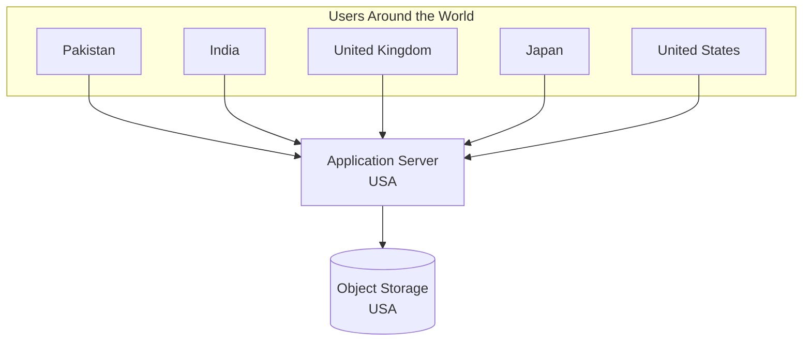

This architecture can work well when the application has relatively little traffic and users are geographically close to the servers.

However, as the platform grows, several problems emerge:

1. Users far from the origin experience additional network latency.
2. Large media files consume substantial bandwidth.
3. Repeated downloads increase the load on the origin.
4. Traffic spikes can overwhelm origin infrastructure.
5. Regional content restrictions become harder to enforce consistently.

The challenge is not simply storing the data. It is delivering the right data to the right user, quickly and reliably, regardless of location.

---

# 2. What Happens Without a CDN?

Consider a user in Pakistan requesting a video stored in the United States.

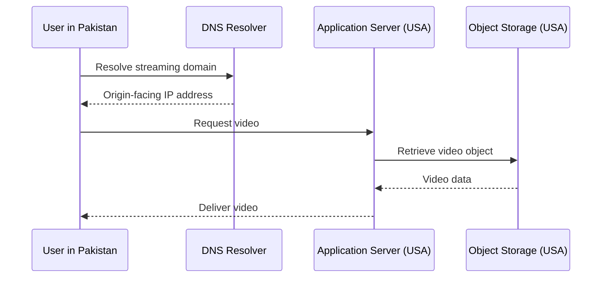

The simplified process is:

1. The user resolves the streaming domain through DNS.
2. The browser or streaming client connects to the server.
3. The application determines which content the user requested.
4. The server retrieves the media from storage, if necessary.
5. The media is transferred over the network to the user.

In an actual streaming architecture, the application server usually does not fetch and relay every byte of every video. It may authorize the request and return a URL or manifest pointing to object storage or a CDN. The direct-origin flow above illustrates the basic problem rather than prescribing a production design.

## 2.1 Why is this inefficient?

Suppose a movie is 5 GB in size and 10,000 users download it.

The total transferred payload is:

\[
5\text{ GB}\times10{,}000=50{,}000\text{ GB}
\]

That is approximately 50 TB using decimal units.

If every download must be served directly by the origin, the origin or its delivery infrastructure must support the corresponding transfer volume.

A CDN can reduce repeated origin transfers by caching reusable content and serving subsequent requests from its distributed infrastructure.

The first request for a particular object at a particular edge may still require a transfer from the origin or an upstream cache.

---

# 3. Why Global Content Delivery Is Difficult

Two major challenges motivate CDNs: latency and origin load.

Geographic content restrictions are another important concern, but they require additional controls beyond caching.

## 3.1 Problem 1: Network latency

Network latency is the time it takes for data to travel between endpoints and for the relevant processing to complete.

A user in the United States may be relatively close to a US-hosted server. A user in Pakistan or Japan may need to communicate across much longer network paths.

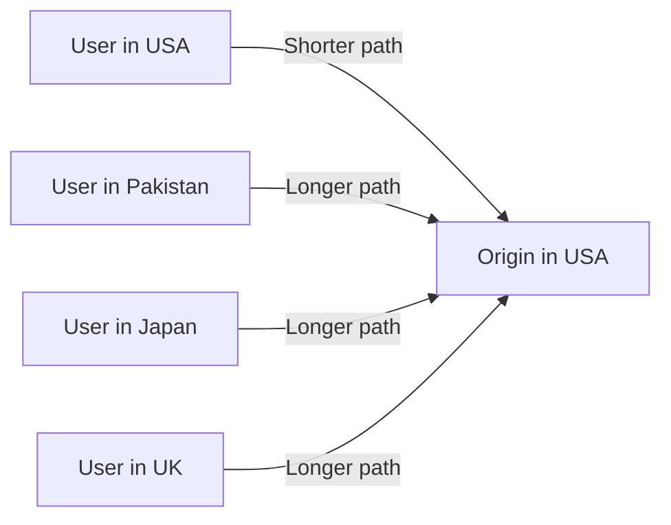

Longer network paths can increase round-trip time (RTT). Congestion, routing decisions, peering arrangements, packet loss, and the number of connection round trips can also affect latency.

For large files, throughput and available bandwidth matter in addition to latency.

### Why not put the origin in one central location?

There is no single physical location that is close to every user around the world.

Moving the origin to a different continent merely changes which users benefit most.

A globally distributed delivery architecture is more effective than trying to find one universally optimal origin location.

## 3.2 Problem 2: Origin bandwidth and capacity

A popular video might be requested millions of times.

Without caching, repeated downloads can consume:

- Origin bandwidth.
- Object-storage request capacity.
- Application-server resources if the application relays the media.
- Network and infrastructure budget.

A CDN allows an edge location to retain a reusable copy of an object, reducing repeated requests to the origin.

For example:

```text
1,000 requests for the same video
             |
             v
      CDN edge cache
             |
      First request: miss
             |
             v
           Origin
             |
             v
      Cache the video
             |
      Remaining requests
             |
             v
        Edge cache hits
```

The actual origin request count depends on cache policy, concurrent misses, object expiration, revalidation, and cache capacity.

## 3.3 Geographic restrictions are a separate problem

Suppose a streaming platform has the rights to show a movie in Pakistan but not in the United Kingdom.

Simply placing the movie on a Pakistan edge does not guarantee that UK users cannot access it.

The same object might exist at another edge, be requested through a different hostname, or be accessed directly through the origin.

A secure system needs an explicit authorization policy based on factors such as:

- The user's entitlement.
- The permitted geographic region.
- The requested content.
- The validity of the request.
- The origin and CDN delivery configuration.

A CDN can enforce or participate in these policies, but **geographic distribution alone is not access control**.

---

# 4. What Is a CDN?

A **Content Delivery Network (CDN)** is a geographically distributed network of servers and supporting infrastructure that delivers content to users from suitable locations near them.

CDNs commonly cache:

- Images.
- Videos and audio.
- CSS and JavaScript.
- Fonts.
- Downloadable files.
- Public HTML pages.
- Selected API responses.

Many CDNs also provide services such as TLS termination, request filtering, DDoS protection, bot mitigation, compression, and edge computing.

The fundamental idea is:

> Keep reusable content closer to the people who request it, while reducing unnecessary work at the origin.

## 4.1 CDN architecture

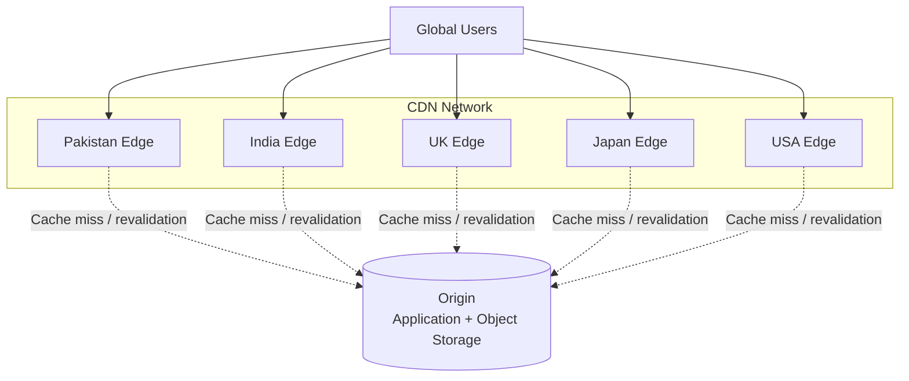

The diagram is conceptual. A real CDN may have multiple edge locations per country, regional caches, origin shields, private links, and more complicated routing.

## 4.2 What is the origin?

The **origin** is the authoritative source from which the CDN obtains content when it cannot satisfy a request from its cache.

An origin may be:

- An object-storage bucket.
- A web server.
- An application server.
- A backend API.
- Another upstream content service.

The origin does not need to be one physical machine.

For example, a streaming platform might use:

```text
Application API
    |
    +-- User authentication
    +-- Subscription verification
    +-- Video metadata

Object Storage
    |
    +-- Original video files
    +-- Encoded video renditions
    +-- Subtitles
    +-- Thumbnail images
```

The CDN can deliver media from object storage while the application API continues to handle authentication, metadata, and business logic.

## 4.3 Why is a CDN different from merely copying files to several servers?

Manually copying content to multiple servers is a form of geographic replication, but a CDN typically adds:

- Intelligent request routing.
- Automated cache population.
- Cache expiration and invalidation.
- Request collapsing or origin shielding.
- Traffic management.
- Monitoring and observability.
- Security and access-control integrations.

A CDN is therefore more than a collection of geographically distributed file servers.

---

# 5. CDN Architecture and Request Flow

Understanding the request lifecycle is the most important part of understanding a CDN.

## 5.1 First request: cache miss

Suppose a user requests:

```text
https://media.example.com/movies/movie-42/segment-001.m4s
```

The selected edge does not have this segment cached.

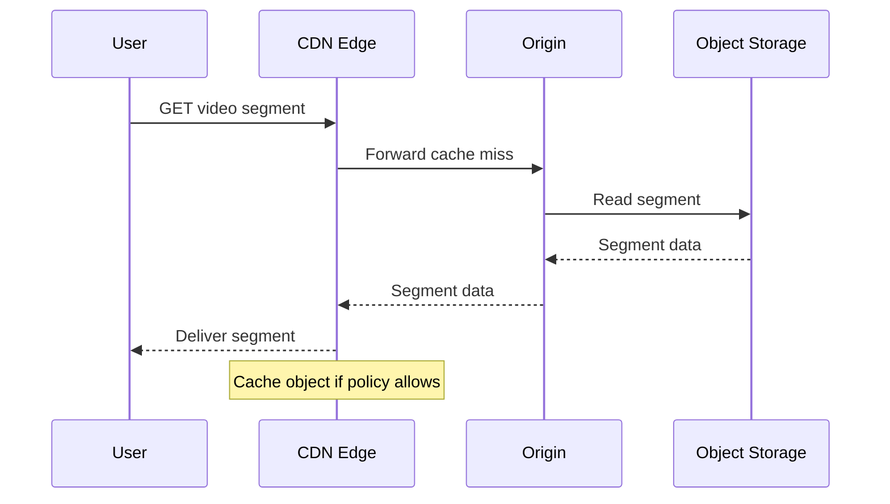

The edge retrieves the content through its configured upstream path, delivers it to the user, and may store it for subsequent requests.

Some CDNs can fetch content directly from the configured origin without a separate application-server hop.

## 5.2 Subsequent request: cache hit

Another user requests the same cacheable object from an edge that already has it.

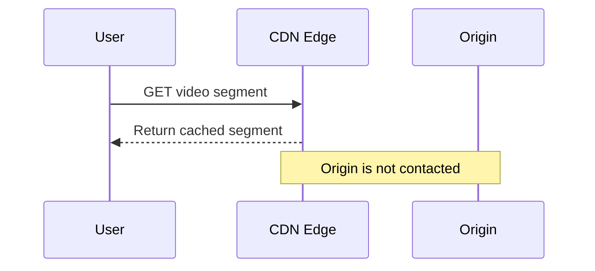

The edge serves the content without retrieving it from the origin again.

This reduces origin traffic and can improve response latency.

However, the request still needs to reach the CDN, and the edge must perform the necessary cache lookup and policy checks.

## 5.3 Cache hit versus cache miss

| Property | Cache hit | Cache miss |
|---|---|---|
| Object available at edge | Yes | No usable cached copy |
| Origin retrieval | Usually unnecessary | Usually required |
| Expected latency | Usually lower | Usually higher |
| Origin load | Reduced | Increased |
| Cache population | Usually unnecessary | May occur after retrieval |

A cache miss is not an error. It is a normal event in an on-demand caching system.

The edge may also revalidate an existing cached object with the origin rather than download it again. If the object has not changed, the origin can confirm that the cached copy remains usable.

---

# 6. Cache Hits, Cache Misses, and the Origin

## 6.1 What happens if an edge does not have the content?

A CDN can retrieve content from an upstream cache or the origin.

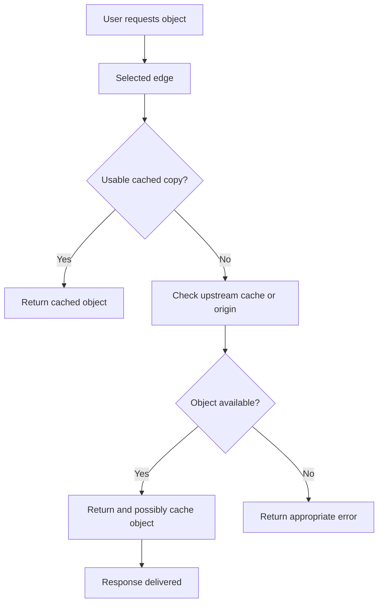

A request does not necessarily travel directly from the nearest edge to the origin. Multi-tier CDNs may retrieve the object from a regional cache first.

## 6.2 Cache fill

**Cache fill** is the process of obtaining and storing an object after a miss.

For example:

```text
Request: image-42.jpg

Edge cache:
    MISS

Upstream:
    Fetch image-42.jpg

Edge:
    Store image-42.jpg, subject to cache policy

Response:
    Deliver image-42.jpg
```

An edge may decide not to cache the response if:

- The response is marked private or non-cacheable.
- The object exceeds configured size limits.
- The cache policy excludes its path.
- The request is personalized.
- The response has unsuitable status or headers.
- The edge has insufficient capacity or a policy that prevents storage.

## 6.3 Cache hit ratio

A useful metric is the CDN cache hit ratio.

\[
\text{Hit Ratio} =
\frac{\text{Cache Hits}}
{\text{Cache Hits}+\text{Cache Misses}}
\]

Suppose a CDN processes one million cache lookups:

- 900,000 are hits.
- 100,000 are misses.

Then:

\[
\text{Hit Ratio}=\frac{900,000}{1,000,000}=90\%
\]

This ratio measures the fraction of cache lookups served from the cache. A CDN's exact reporting definitions may differ, particularly when it distinguishes request hits from byte hits, revalidations, or requests bypassing cache.

## 6.4 Why byte hit ratio also matters

A small image and a large video segment count as one request each, but they contribute very different amounts of traffic.

The **byte hit ratio** measures how much requested data volume is served from cache rather than fetched from upstream.

For large media delivery, byte hit ratio can be especially informative.

A CDN can have a high request hit ratio but a lower byte hit ratio if large objects frequently miss.

---

# 7. CDN Terminology

## 7.1 Point of Presence (PoP)

A **Point of Presence (PoP)** is a physical or network location where a CDN operates infrastructure.

A PoP may contain:

- Multiple edge servers.
- Routers and network equipment.
- Cache storage.
- Load-balancing infrastructure.
- Network connections to upstream providers.

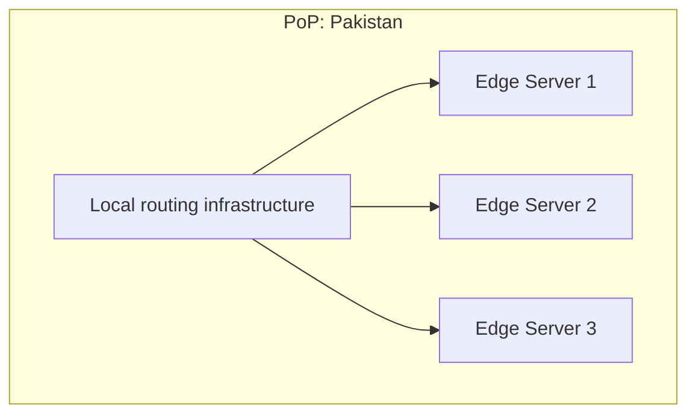

A PoP is a location or facility; it is not necessarily one server.

## 7.2 Edge server

An **edge server** is a server that handles requests near the edge of the CDN's network, close to users relative to the origin.

An edge server may:

- Serve cached objects.
- Retrieve content from an upstream.
- Terminate TLS connections.
- Apply request rules.
- Perform limited processing at the edge.

## 7.3 Origin server

The **origin server** is the upstream source of content.

The origin may be a storage service, web server, API, or another backend system.

## 7.4 Regional cache

A regional cache is an intermediate caching layer that serves multiple edge locations.

It can reduce the number of duplicate requests reaching the origin.

## 7.5 Cache invalidation

Cache invalidation removes or supersedes cached content when the cached version should no longer be served.

For example, when a website publishes a new version of a stylesheet, the CDN may need to stop serving the old version.

## 7.6 Origin shield

An **origin shield** is an additional shared caching layer between edge locations and the origin.

Instead of many edge locations independently fetching the same object from the origin, they can reuse a copy from the shield.

Origin shielding is explained in Section 12.

---

# 8. How Users Reach the Appropriate Edge

A CDN may have hundreds or thousands of PoPs. How does a request reach a suitable one?

The CDN needs a traffic-steering mechanism.

Two important techniques are:

1. DNS-based routing.
2. Anycast routing.

They operate at different layers and are not mutually exclusive. A CDN can use DNS-based traffic steering together with Anycast.

---

# 9. DNS-Based Routing vs. Anycast

## 9.1 DNS-based routing

DNS translates a domain name into one or more resource records, often including IP addresses.

A CDN can use DNS responses to direct clients toward suitable edge locations.

For example:

```text
media.example.com
        |
        v
CDN DNS system
        |
        +-- User/network near Pakistan -> IP A
        |
        +-- User/network near UK       -> IP B
        |
        +-- User/network near USA      -> IP C
```

The IP addresses below are illustrative placeholders, not real CDN endpoints.

### Request flow

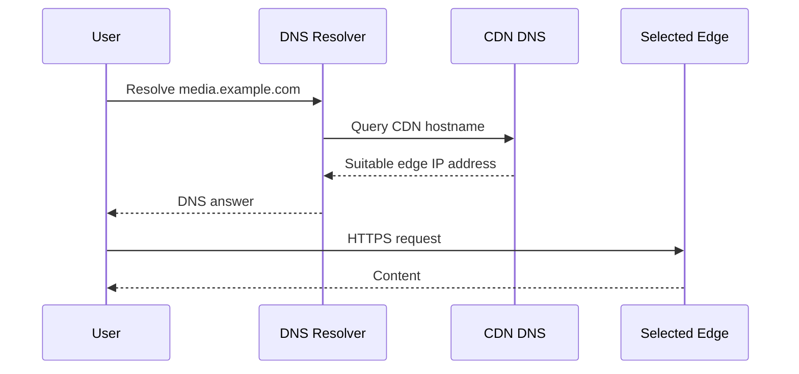

### How does the CDN choose an answer?

The CDN may consider:

- The recursive DNS resolver's apparent location.
- Network topology.
- Current edge availability.
- Network congestion or performance information.
- Capacity and traffic-management policies.
- The requested service or hostname.

DNS-based routing can use geolocation, latency measurements, or other traffic-steering methods.

### Important limitation: DNS sees the resolver

A recursive DNS resolver may be located somewhere different from the end user.

For example, a user in Pakistan might use a DNS resolver whose apparent location is in another country. Depending on the resolver and CDN, the DNS answer may not reflect the user's exact location.

Some systems use EDNS Client Subnet to provide limited information about the client's network prefix, but this is not universal and has privacy implications.

DNS-based routing also interacts with caching and TTLs. A client may continue using an existing answer until its DNS cache expires.

**Therefore, DNS-based routing can direct users toward an appropriate edge, but it does not guarantee that every user always receives the geographically closest IP address.**

## 9.2 Anycast routing

Anycast allows the same IP address to be announced from multiple network locations.

The network routing system chooses a route to one of the locations advertising that address.

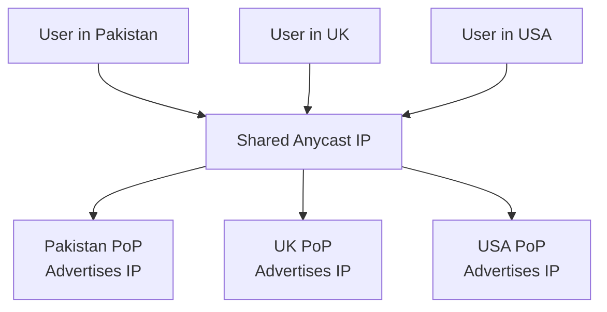

The same IP address can be reachable through different PoPs because the network uses routing information to select a path.

### How Anycast works conceptually

1. Multiple PoPs advertise reachability for the same IP prefix.
2. Routers exchange routing information.
3. The routing system selects a route based on routing policy and path selection.
4. The packet is delivered to the PoP selected by that route.

### Does Anycast always choose the geographically nearest PoP?

No.

Internet routing does not simply measure geographic distance and select the nearest server.

The chosen PoP depends on routing policies, network topology, peering, path availability, and other routing decisions.

The selected PoP is often a good network destination for the user, but it is not guaranteed to be the physically closest one.

### What happens when a PoP fails?

If a PoP stops advertising a route and routing updates propagate, traffic may be redirected to another location advertising the same prefix.

This can improve availability, although route convergence and application-level health are separate concerns.

A PoP can have a functioning network route while an individual service is unhealthy. Production systems need additional health checks and traffic-management controls.

## 9.3 DNS-based routing vs. Anycast

| Property | DNS-based routing | Anycast |
|---|---|---|
| Primary mechanism | DNS responses | IP routing |
| Address model | Can return different IPs for different users | Same IP prefix advertised from multiple locations |
| Selection point | DNS-based traffic steering | Network route selection |
| Depends on DNS cache TTL | Yes | Not for choosing the advertised route after resolution |
| Failover behavior | Depends on DNS policy and cached answers | Depends on route withdrawal and convergence |
| Closest location guaranteed? | No | No |
| Can they be combined? | Yes | Yes |

## 9.4 Which technique is better?

Neither is universally better.

DNS-based routing offers flexible traffic steering and can direct users toward different endpoints. Anycast provides a shared address and lets network routing select a destination.

A CDN may combine DNS, Anycast, health checks, network telemetry, and internal load balancing to achieve the desired behavior.

The important design question is not merely which technique is used, but how the system handles traffic distribution, overload, failures, and changes in network conditions.

---

# 10. What Content Should a CDN Cache?

CDNs are commonly associated with static content, but the distinction between static and dynamic content requires care.

## 10.1 Static content

Static content does not need to be regenerated differently for every request.

Examples include:

- Product images.
- JavaScript bundles.
- CSS stylesheets.
- Fonts.
- Public video segments.
- Public downloadable files.

These objects are strong caching candidates when they are reusable and have suitable cache policies.

## 10.2 Dynamic content

Dynamic content is generated or selected based on request-specific information.

Examples include:

- A user's account dashboard.
- Personalized recommendations.
- Shopping cart contents.
- Account balances.
- Private documents.
- Personalized API responses.

Dynamic content is not automatically uncacheable. A CDN may cache selected dynamic responses when the cache key and authorization model are designed appropriately.

However, caching personalized content incorrectly can expose one user's information to another.

## 10.3 Cacheability depends on more than whether content is static

A response is a good caching candidate when:

1. Reuse is likely.
2. The cached representation is correct for the requests that share it.
3. Its freshness requirements can be met.
4. Caching is permitted by the origin's policy.
5. Security and authorization remain correct.

For example, a static file can still be private or restricted. Conversely, a dynamic API response can be cacheable for a short time if it is identical for all requests that share the same cache key.

## 10.4 Cache-key design

A cache key identifies the object or response being cached.

For example:

```text
/media/movie-42/segment-001.m4s
```

If different users request the same public video segment, they may be able to reuse the same cached object.

But consider:

```text
/api/profile
```

If the response depends on the authenticated user, caching solely by URL may cause data to be shared incorrectly.

The cache key and caching policy must account for every request attribute that affects the response, while avoiding unnecessary key fragmentation.

Relevant attributes may include:

- URL path.
- Query parameters.
- Selected request headers.
- Content encoding.
- Locale.
- Device or representation variant.
- Authorization or entitlement context, when safely supported.

Including too many attributes can fragment the cache. Including too few can return incorrect or unauthorized content.

---

# 11. Cache-Control, TTL, and Invalidation

A CDN needs rules that determine how long it can reuse an object and when it must retrieve or validate a new version.

## 11.1 Cache-Control

HTTP responses can use the `Cache-Control` header to communicate caching instructions.

Example:

```http
Cache-Control: public, max-age=3600
```

This indicates that the response can be cached by shared caches and is fresh for up to 3,600 seconds, subject to the applicable HTTP caching rules and CDN configuration.

Another example:

```http
Cache-Control: no-store
```

This directs compliant caches not to store the response.

The exact meaning of each directive matters. For example, `no-cache` does not mean the same thing as `no-store`: it generally requires validation before a stored response is reused.

CDNs may also have their own configuration for cache TTLs, overrides, and bypass rules. Those settings must be understood alongside the origin's HTTP headers.

## 11.2 TTL

TTL stands for **Time to Live**.

If a cached object has a TTL of 300 seconds, the cache may treat it as fresh for five minutes before it needs to expire or be revalidated.

```text
t = 0 seconds
Object cached

t = 100 seconds
Object is still fresh

t = 300 seconds
Freshness lifetime ends

Next request
Revalidate or fetch a usable replacement
```

Expiration does not necessarily mean the object must be downloaded again in full. The cache may use conditional requests to check whether the origin's copy has changed.

## 11.3 Versioned assets

One of the simplest ways to handle static-asset updates is to include a content hash or version in the URL.

For example:

```text
/assets/app.a81f92c.js
/assets/app.b42c103.js
```

If the file changes, its URL changes.

The application can then cache the versioned file for a long period:

```http
Cache-Control: public, max-age=31536000, immutable
```

This pattern is appropriate when the URL genuinely identifies an immutable version of the asset.

The HTML document or manifest that references the file must then be updated to point to the new URL.

## 11.4 Cache invalidation and purging

Sometimes the URL stays the same while the content changes.

For example:

```text
/images/company-logo.png
```

If the file is replaced at the origin, a CDN may continue serving the previously cached version until its freshness lifetime ends or it is invalidated.

Possible approaches include:

- Purging a specific URL.
- Purging a group of tagged objects, where supported.
- Using a short TTL.
- Revalidating with the origin.
- Publishing versioned URLs.

Purging can be useful for urgent changes, but invalidation across distributed infrastructure is not necessarily instantaneous.

**Versioned URLs are usually preferable for frequently deployed static assets because they avoid relying exclusively on global purge timing.**

---

# 12. Origin Shielding and Multi-Tier CDNs

A large CDN may have many edge locations.

Without an intermediate cache, multiple edges can independently fetch the same popular object from the origin.

This increases origin traffic, especially during a global content launch.

## 12.1 The problem

Suppose 100 edge locations simultaneously receive requests for the same newly published video.

If each edge misses independently, the origin could receive approximately 100 fetches for the same object, although request collapsing and other optimizations may reduce this.

## 12.2 The solution: origin shield

An origin shield is an intermediate cache that multiple edge locations use before reaching the origin.

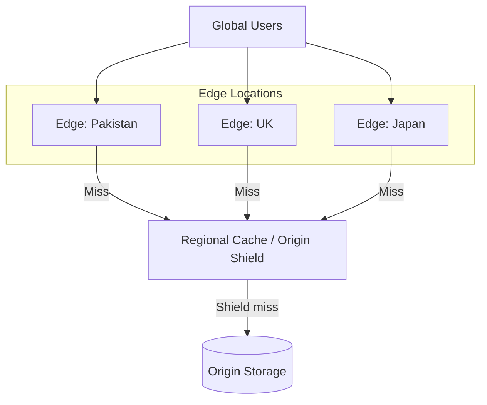

If the shield already has the object, it can return it to the requesting edge without contacting the origin again.

## 12.3 Benefits

- Fewer duplicate requests to the origin.
- Reduced origin bandwidth.
- Better handling of simultaneous demand for the same object.
- Potentially improved cache efficiency across multiple edge locations.

## 12.4 Trade-offs

- Additional network hop on shield misses.
- Additional cache infrastructure.
- Potential regional bottlenecks.
- Another layer of cache freshness and failure behavior to manage.

An origin shield is especially useful when many edge locations request the same objects and origin load is expensive.

---

# 13. Geographic Restrictions and Content Security

CDNs can help enforce geographic access policies, but caching and authorization must work together.

## 13.1 Geographic restrictions

A content provider may have licensing agreements that allow a movie to be shown only in certain countries.

A request may need to satisfy several conditions:

```text
Can the user access the content?

1. Is the user authenticated, if required?
2. Does the user have the correct subscription or entitlement?
3. Is the content licensed for the relevant region?
4. Is the request authorized to access this object?
5. Is the URL or access token still valid?
```

The exact checks depend on the application.

The CDN can participate in geographic and authorization checks using trusted request metadata, edge logic, signed URLs, signed cookies, or integration with the origin.

## 13.2 Why storing different files in different regions is insufficient

Suppose a restricted movie is cached at a UK edge even though the licensing policy does not permit UK users to watch it.

The existence of that cached copy does not mean it must be served. The CDN should enforce the applicable access policy before returning the object.

Likewise, keeping a movie only in one region does not necessarily prevent unauthorized access if the origin or another delivery path is exposed.

Access restrictions should be enforced at the delivery boundary and, where appropriate, at the origin.

## 13.3 Signed URLs

A signed URL includes a cryptographic signature that authorizes access under specific conditions.

Conceptually:

```text
https://media.example.com/movie-42/segment-001.m4s
    ?expires=...
    &signature=...
```

The signature can be used to validate that the request was generated by an authorized party and has not been altered.

Depending on the implementation, the signature may cover:

- The resource path.
- An expiration timestamp.
- Selected query parameters.
- An access policy.

The CDN must validate the signature correctly. Merely adding a `signature` query parameter does not secure a resource.

Signed URLs are useful for temporary access to private downloads and video segments.

## 13.4 Signed cookies

Signed cookies can authorize access to multiple resources under a policy, such as a set of video segments for one playback session.

They can be more convenient than generating a separate signed URL for every resource, depending on the delivery design.

## 13.5 Do not accidentally cache private content publicly

Consider a personalized endpoint:

```text
GET /api/account
```

The response for User A must not be reused for User B.

Possible safeguards include:

- Using appropriate private or non-cacheable response directives.
- Configuring CDN cache rules carefully.
- Validating authentication and authorization.
- Including the correct identity or representation dimensions in the cache key when shared caching is intentionally supported.
- Preventing direct origin access that bypasses required checks.

The right design depends on the sensitivity of the data and the CDN's capabilities.

**A cache hit must never be allowed to bypass required authorization.**

---

# 14. CDN Failure Scenarios

A production CDN is a distributed system. It can experience failures involving routing, caches, origins, configuration, and network connectivity.

## 14.1 Origin outage

The origin becomes unavailable.

If an edge has a fresh cached object, it may continue serving that object.

However, uncached objects and requests requiring origin revalidation may fail.

Some CDNs support serving stale content during certain origin errors when explicitly configured and permitted by the relevant caching rules.

This is useful for public assets, but it must not be applied indiscriminately to private or correctness-sensitive responses.

## 14.2 Cache cold start

A newly created edge, restarted cache, or newly published asset may have few cached objects.

The initial requests miss and fetch data from upstream systems.

If many edges start cold simultaneously, origin traffic may increase significantly.

Mitigations include:

- Gradual cache warming for important objects.
- Origin shielding.
- Request coalescing.
- Capacity planning.
- Rate limiting.
- Controlled rollout of cache configuration.

## 14.3 Cache stampede

Many requests arrive for an expired or missing popular object at the same time.

Without coordination, they can generate redundant upstream fetches.

Request collapsing, refresh-ahead, stale-while-revalidate where appropriate, and origin shielding can reduce the impact.

## 14.4 Incorrect cache configuration

A configuration error may cause:

- Private responses to be cached publicly.
- Updated assets to remain stale.
- Important content to bypass caching.
- Query parameters to be ignored incorrectly.
- Cache keys to include unnecessary values and reduce hit ratio.

CDN configuration changes should be tested and monitored like application changes.

## 14.5 Routing failure

A PoP or network path may become unavailable.

DNS-based systems may return alternative endpoints according to their health and traffic-steering configuration. Anycast systems may redirect traffic following route changes and convergence.

Neither technique eliminates the need for monitoring, health checks, and fallback planning.

## 14.6 DDoS and traffic spikes

A CDN can absorb and distribute large volumes of traffic, particularly for cacheable content.

It may also provide traffic filtering, rate limiting, and other security capabilities.

However, a CDN does not automatically eliminate DDoS risk. Attack traffic can target uncached endpoints, expensive dynamic APIs, authentication services, or the origin directly if those paths remain exposed.

Origin access controls and suitable rate-limiting policies are essential.

---

# 15. CDN vs. Reverse Proxy vs. Load Balancer

These technologies overlap, but their primary responsibilities differ.

## 15.1 CDN

A CDN distributes content geographically and serves reusable objects from edge locations.

Its primary objective is efficient content delivery at global scale.

## 15.2 Reverse proxy

A reverse proxy receives requests on behalf of backend servers and forwards them to appropriate upstream services.

It may provide:

- TLS termination.
- Request routing.
- Caching.
- Compression.
- Authentication integration.
- Request filtering.

A CDN edge often performs reverse-proxy functions.

## 15.3 Load balancer

A load balancer distributes traffic across multiple backend servers or endpoints.

Its primary objective is to distribute workload and improve availability or utilization.

A load balancer may operate within one region or across regions, depending on the architecture.

## 15.4 Comparison

| Property | CDN | Reverse proxy | Load balancer |
|---|---|---|---|
| Primary purpose | Global content delivery | Mediate requests to upstream services | Distribute traffic across endpoints |
| Geographic distribution | Core capability | Not required | Not required |
| Caching | Common | Optional | Depends on implementation |
| Backend routing | Often supported | Core capability | Core capability |
| Static asset delivery | Core use case | Possible | Not its main purpose |
| Global edge network | Common | Not required | Not required |

A single product may provide all three sets of capabilities. The distinctions describe architectural roles rather than mutually exclusive product categories.

---

# 16. Practical Example: Delivering a Video

Consider a video platform that stores encoded video segments in object storage.

Instead of downloading one enormous file, an adaptive streaming player typically requests a manifest and then retrieves many smaller segments.

## 16.1 High-level architecture

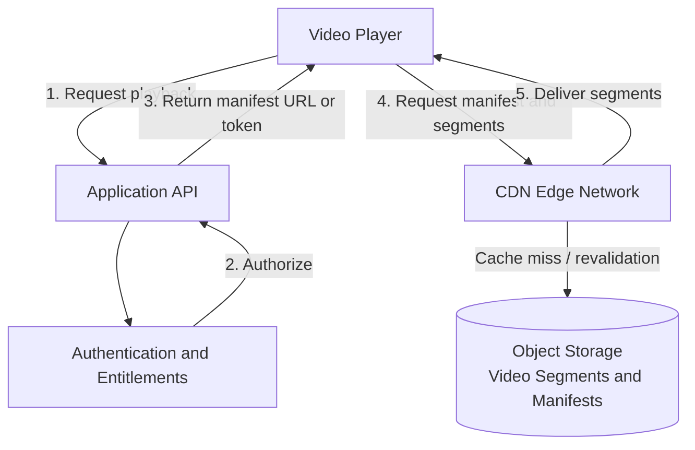

The application API handles playback authorization and returns the necessary manifest or delivery information. The CDN handles delivery of cacheable media objects.

## 16.2 Example request lifecycle

Assume the player requests:

```text
/videos/movie-42/1080p/segment-001.m4s
```

On the first request at an edge:

1. The player sends the request to the CDN.
2. The CDN checks the cache and access policy.
3. If the object is missing, the CDN retrieves it from the configured upstream.
4. The CDN returns the segment and may cache it.
5. Subsequent authorized requests can reuse the cached segment.

The next segment might be:

```text
/videos/movie-42/1080p/segment-002.m4s
```

Each segment is a separate object and may have its own cache state.

## 16.3 Why CDNs work particularly well for video

Video streaming has several favorable properties:

- Many users request the same content.
- Media segments can be large.
- Popular content creates predictable demand.
- Once published, encoded segments often remain unchanged.
- Different video qualities can be stored as distinct objects.

This makes public or appropriately authorized media segments strong caching candidates.

## 16.4 Adaptive bitrate streaming

A streaming service may offer multiple renditions of a video:

```text
movie-42/
    360p/
    720p/
    1080p/
    4k/
```

The player chooses segments based on bandwidth, buffer health, and playback conditions.

The CDN can cache each rendition independently.

The trade-off is that more renditions create more distinct objects, and less popular renditions may have lower cache reuse.

## 16.5 Cost and origin-load reduction

Suppose the same popular segment is requested 100,000 times.

If one edge can serve most of those requests from cache, the origin may only need to supply the segment when the cache is first populated or when a refresh is necessary.

In practice, requests may reach multiple PoPs, and each may need its own copy. An origin shield can further reduce duplicated origin retrievals.

The exact savings depend on geographic demand, cache capacity, object popularity, expiration policy, and CDN pricing.

---

# 17. Choosing and Designing a CDN Strategy

The correct CDN design depends on the workload and the guarantees the application needs.

## 17.1 Questions to answer

Before selecting a CDN architecture, determine:

1. Where are the users located?
2. Which objects are requested most frequently?
3. How large are the objects?
4. How often does content change?
5. How much staleness is acceptable?
6. Which responses contain private or personalized data?
7. Does the application require geographic restrictions?
8. How should the origin behave under a cache outage?
9. How much origin traffic can the system support during a cold start?
10. What metrics will demonstrate that the CDN is working?

## 17.2 Practical starting points

| Workload | Potential approach |
|---|---|
| Public images and frontend assets | CDN caching with versioned URLs |
| Popular videos | Edge caching with origin shielding |
| Private downloads | Signed URLs or cookies with authorization checks |
| Personalized API responses | Carefully controlled private caching or no shared caching |
| Frequently changing content | Appropriate TTLs and revalidation |
| Regional licensing restrictions | Explicit geographic and entitlement enforcement |
| Expensive dynamic endpoints | Selective caching where response variation and authorization are handled correctly |

## 17.3 A practical design checklist

- [ ] Define which paths are cacheable.
- [ ] Configure cache keys correctly.
- [ ] Set appropriate TTLs and cache directives.
- [ ] Use versioned URLs for immutable assets where possible.
- [ ] Define purge and invalidation procedures.
- [ ] Protect private content.
- [ ] Prevent unauthorized direct access to the origin.
- [ ] Configure origin shielding where it provides value.
- [ ] Plan for origin outages and cold-cache behavior.
- [ ] Monitor request hit ratio and byte hit ratio.
- [ ] Measure end-user latency across regions.
- [ ] Test traffic routing and failure behavior.

---

# 18. Interview Questions

## Q1. What is a CDN?

A CDN is a geographically distributed content-delivery network that serves reusable content from suitable edge locations to reduce latency and origin load.

## Q2. Why is a CDN useful for video streaming?

Video files and segments are often large and requested repeatedly. Caching them at distributed edges reduces repeated origin transfers and brings content closer to viewers.

## Q3. What is the difference between an origin and an edge server?

The origin is the upstream source of content. An edge server is part of the CDN infrastructure that serves cached content and retrieves missing objects from an upstream source.

## Q4. What is a Point of Presence?

A PoP is a physical or network location containing CDN infrastructure. It can include multiple edge servers and networking components.

## Q5. What happens on a CDN cache miss?

The CDN retrieves the object from an upstream cache or the origin, subject to access and cache policies. It returns the object and may cache it for later requests.

## Q6. How does a CDN reduce origin load?

It serves repeated requests from cached copies rather than retrieving the same content from the origin every time.

## Q7. What is the difference between DNS-based routing and Anycast?

DNS-based routing uses DNS answers to steer clients toward endpoints. Anycast advertises the same IP prefix from multiple locations and relies on network routing to select a destination.

## Q8. Does Anycast always route a user to the geographically nearest PoP?

No. Network routing depends on routing policies, topology, peering, and availability rather than geographic distance alone.

## Q9. Can a CDN cache dynamic content?

Yes, if the response is reusable and the cache key, freshness policy, and authorization model are designed correctly. Personalized responses require particular care.

## Q10. How does a CDN handle updated content?

Depending on the configuration, it may wait for expiration, revalidate with the origin, purge cached entries, or use versioned URLs that identify new content.

## Q11. What is origin shielding?

Origin shielding introduces a shared upstream cache between edge locations and the origin to reduce duplicate origin fetches.

## Q12. Does storing content in a specific country enforce geographic restrictions?

No. Content location alone is not an authorization mechanism. Geographic policies and access controls must be enforced through appropriate request validation and origin/CDN configuration.

## Q13. Can a CDN replace a load balancer?

Not conceptually. A CDN primarily optimizes global content delivery, while a load balancer distributes traffic across endpoints. A CDN may include load-balancing capabilities, but the architectural roles differ.

## Q14. What happens if the origin becomes unavailable?

Fresh cached objects may remain available, but uncached objects and requests requiring origin access can fail. Serving stale content during failures is possible only when the applicable policy and configuration permit it.

## Q15. Why are versioned asset URLs useful?

A changed asset receives a new URL, so the CDN can cache each immutable version for a long time without relying on immediate invalidation of the previous URL.

---

# 19. Final Cheat Sheet

## 19.1 Core concepts

| Term | Meaning |
|---|---|
| CDN | Distributed network for delivering content |
| Origin | Authoritative upstream source |
| Edge server | Server that handles requests near users |
| PoP | Location containing CDN infrastructure |
| Cache hit | Usable object found in cache |
| Cache miss | Object must be retrieved or rebuilt |
| Cache fill | Fetching and storing an object after a miss |
| Origin shield | Shared intermediate cache before the origin |
| TTL | Configured freshness or lifetime period |
| Cache invalidation | Removing or superseding outdated cached objects |

## 19.2 Routing

| Technique | How it works |
|---|---|
| DNS-based routing | DNS responses steer clients toward suitable endpoints |
| Anycast | Multiple locations advertise the same IP prefix; routing selects a destination |
| Health-based traffic steering | Traffic is directed away from unhealthy endpoints according to system capabilities |

## 19.3 Security and reliability

| Concern | Typical approach |
|---|---|
| Stale content | TTL, revalidation, invalidation, versioned URLs |
| Origin overload | Caching, origin shielding, request collapsing |
| Cold cache | Gradual warming and origin capacity planning |
| Private content | Correct cache policy and authorization |
| Temporary download access | Signed URLs or cookies |
| Geographic licensing | Explicit region and entitlement checks |
| Origin outage | Defined fallback and stale-serving policies |
| Cache misconfiguration | Testing, observability, and controlled rollouts |

## 19.4 The five principles to remember

1. **Bring reusable content closer to users.** Geographic distribution reduces the distance that content must travel.
2. **Reduce repeated origin work.** Cache hits can save bandwidth, storage requests, and backend processing.
3. **Understand routing accurately.** DNS and Anycast can select suitable edges, but neither guarantees the physically nearest location.
4. **Treat caching and authorization separately.** A cached object must not bypass access-control requirements.
5. **Design for misses and failures.** Cache misses, cold starts, stale content, and origin outages are normal conditions that require deliberate handling.

---

## Final Perspective

A CDN is a form of geographically distributed caching combined with traffic steering, content-delivery infrastructure, and often additional security services.

Its main architectural value comes from reducing the amount of work that must happen at the origin and reducing the distance between users and reusable content.

However, a CDN does not automatically solve every global-system problem. It does not guarantee that every request reaches the nearest server, that every cached object is fresh, or that regional restrictions are enforced correctly.

A production-quality design must coordinate four concerns:

- **Delivery:** Where should the request be served?
- **Caching:** Which content can be reused, and for how long?
- **Security:** Who is allowed to access the content?
- **Reliability:** What happens when an edge, network path, or origin fails?

Once these concerns are understood, a CDN becomes much easier to reason about as a system-design building block rather than merely a network of servers that stores files close to users.