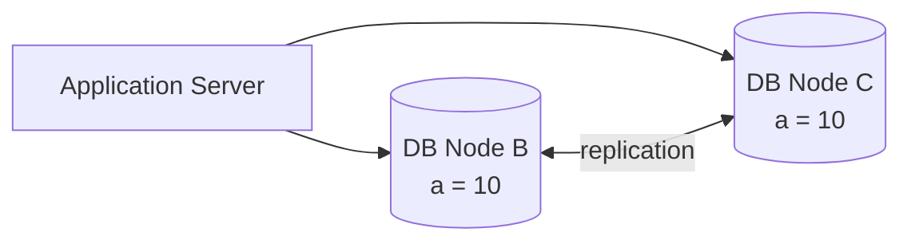
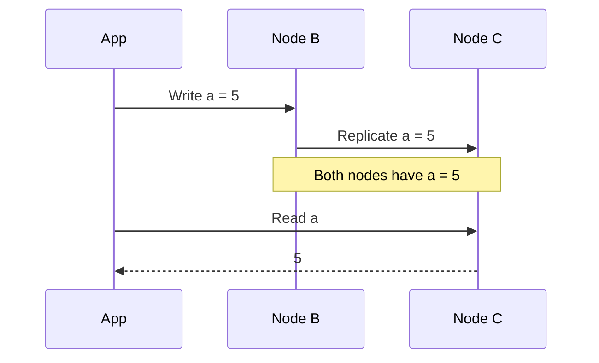
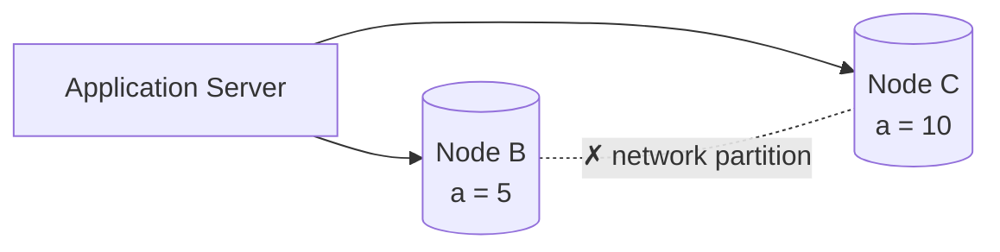
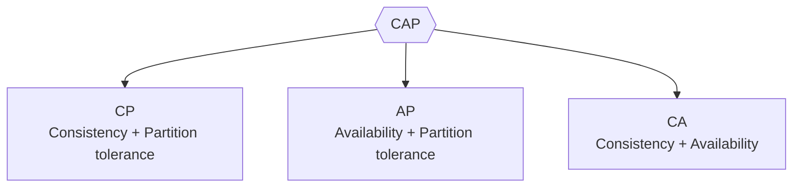
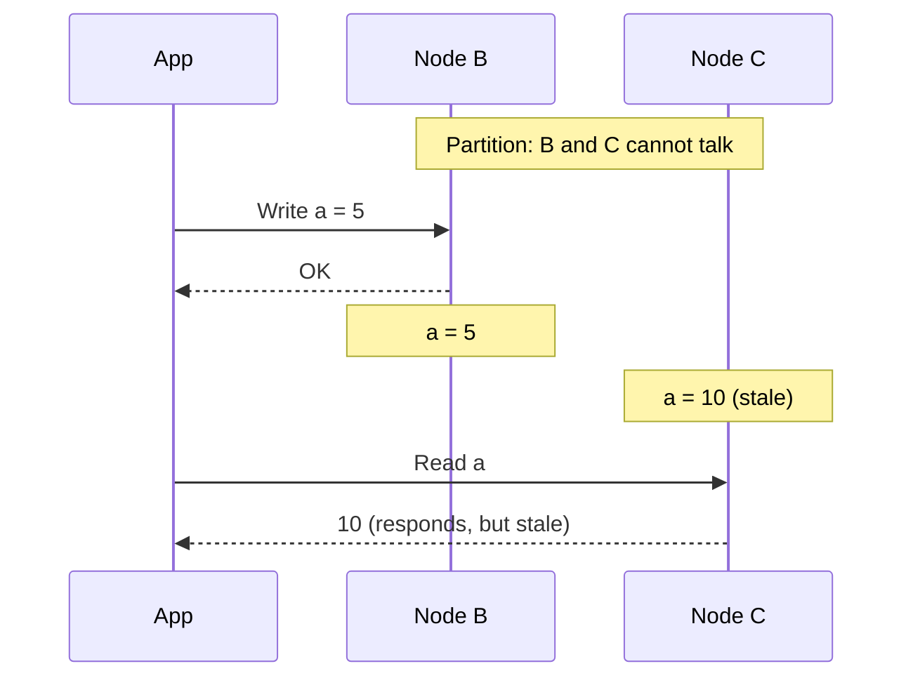
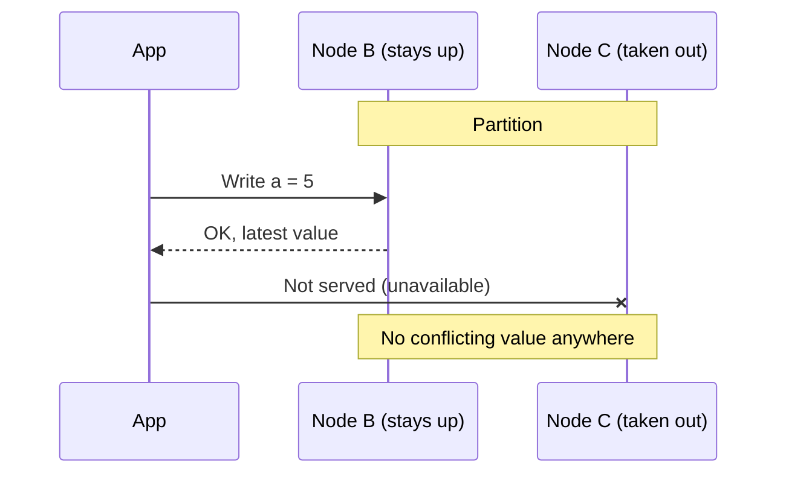
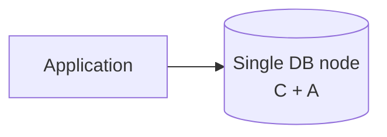
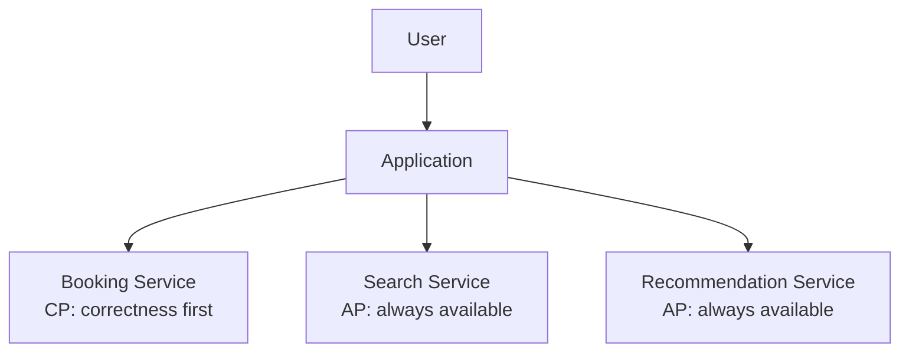

# Chapter 12: CAP Theorem (Consistency, Availability, Partition Tolerance)

> System Design Course Notes

CAP is the central trade-off of distributed systems. This chapter defines each of the three properties with one running example, shows why all three cannot hold together, works through the three possible pairings (CP, AP, CA), and finishes with how to apply the choice service by service.

---

## Table of Contents

1. [Recap and Setup](#1-recap-and-setup)
2. [The Three Properties](#2-the-three-properties)
3. [What the Theorem Says](#3-what-the-theorem-says)
4. [Why We Cannot Have All Three](#4-why-we-cannot-have-all-three)
5. [The Three Combinations](#5-the-three-combinations)
6. [Why Partition Tolerance Is Not Negotiable](#6-why-partition-tolerance-is-not-negotiable)
7. [Applying CAP: A Ticket Booking System](#7-applying-cap-a-ticket-booking-system)
8. [Quick Revision](#8-quick-revision)

---

## 1. Recap and Setup

In a distributed system we have multiple application servers, and for the database we typically use **leader/follower replication**: writes go to the leader, reads can be served by followers, and nodes **replicate data between each other** so every node holds the same data.

**Running example used throughout**

- One application server
- Two database nodes, **B** and **C**
- A variable **`a`** that is `10` on both nodes at the start

A user wants to change `a` from 10 to 5.

---

## 2. The Three Properties

### 2.1 Consistency (C)

All nodes hold the **same data**. After `a` is updated to 5, the change is replicated, so reading `a` from B **or** C always returns **5**.

### 2.2 Availability (A)

Every node **responds** to requests. The response may be a success or a failure message, but it must be a **proper, non-error response**: the node must answer. If both B and C answer, both are available.

### 2.3 Partition Tolerance (P)

A **partition** is a **communication break between nodes**: B and C can no longer talk, so replication stops.

Partition tolerance means that even with this break, **the system keeps running**: both nodes stay up and keep responding.

---

## 3. What the Theorem Says

> In a distributed system, we **cannot have all three** of Consistency, Availability and Partition Tolerance at the same time. We can have **at most two**.

---

## 4. Why We Cannot Have All Three

Start by trying to get all three, using the running example.

1. **Consistency:** write `a = 5` to B, replicate to C. Both show 5. ✓
2. **Availability:** both nodes respond. ✓
3. **Partition tolerance:** now break the link between B and C. The system must keep running.

Write `a = 5` to B. Replication to C **fails** because of the partition. Now:

| Node | Value of `a` |
|---|---|
| B | 5 |
| C | 10 |

Data is **inconsistent**. Once we insist on partition tolerance, **consistency is lost** (if we also insist on both nodes answering). Each pair can be achieved, but not all three.

---

## 5. The Three Combinations

### 5.1 AP: Availability + Partition Tolerance (drop Consistency)

During a partition, both nodes stay up and keep responding, even though they may disagree.

Both nodes are available and the system tolerates the partition, but the data is temporarily **inconsistent**.

### 5.2 CP: Consistency + Partition Tolerance (drop Availability)

Say consistency cannot be given up (bookings, for instance). During a partition, to prevent two different values we **stop serving from the node that cannot be kept in sync**. Only one node stays up and takes writes, so the data stays consistent, but the other node is **unavailable**.

The system stays consistent and partition tolerant, but **not all nodes are available**.

### 5.3 CA: Consistency + Availability (drop Partition Tolerance)

To have both, nothing may break the replication path. If a partition happens, the system would have to **stop**: no reads, no writes. While stopped, the data cannot diverge, so consistency holds, but the system is not running through the partition.

In practice, CA only really exists when there is **no distribution**, i.e. a **single database node**. One node means no replication, so no partition can occur, and that node is both consistent and available.

---

## 6. Why Partition Tolerance Is Not Negotiable

> **In the real world, never trade off partition tolerance.**

Networks fail. Cables get cut, links get congested, machines get isolated. If the design drops P, the system must **shut down** whenever the network breaks, which is unacceptable for most systems.

So the real choice in a distributed system is between:

| Choice | Behaviour during a partition |
|---|---|
| **CP** | Refuse or hold some requests to stay correct |
| **AP** | Keep answering from every node, accept temporary inconsistency |

CA is effectively "not a distributed system" (a single node).

---

## 7. Applying CAP: A Ticket Booking System

You do not choose one setting for the entire application. **Pick the right property per service.**

Think of a movie ticket booking platform with three services:

| Service | Job | Choice | Why |
|---|---|---|---|
| **Booking service** | Handles concurrent bookings | **CP** | Cannot drop consistency. Two people must never get the same seat |
| **Search service** | Search theatres and movies | **AP** | User-facing, must always respond. A slightly stale result is acceptable |
| **Recommendation service** | Suggest movies on the home page | **AP** | User-facing, must always respond. Stale recommendations are harmless |

So the properties are **distributed across different services** based on what each one needs.

---

## 8. Quick Revision

| Property | Meaning | Memory hook |
|---|---|---|
| **C**onsistency | All nodes have the same data | Same answer from any node |
| **A**vailability | Every node responds without error | Always answers |
| **P**artition tolerance | System keeps running despite a communication break between nodes | Survives network failure |

| Pair | What you give up | Where it fits |
|---|---|---|
| **CP** | Availability (some nodes unavailable in a partition) | Bookings, payments, anything needing correctness |
| **AP** | Consistency (stale reads possible) | Search, recommendations, feeds |
| **CA** | Partition tolerance | Only a single-node setup, not truly distributed |

### Key takeaways

- CAP says a distributed system can guarantee **at most two of three**.
- **Partition tolerance is a must** in real systems, so the real decision is **CP vs AP**.
- **CP** gives correctness and sacrifices some availability. **AP** gives availability and accepts temporary inconsistency.
- **Mix per service**: use CP where wrong data is costly, AP where being up matters most.
