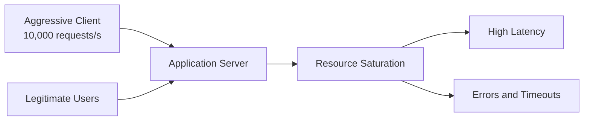
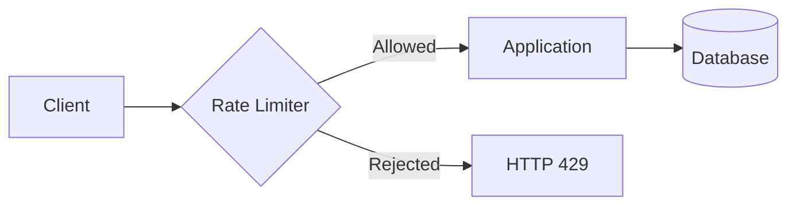
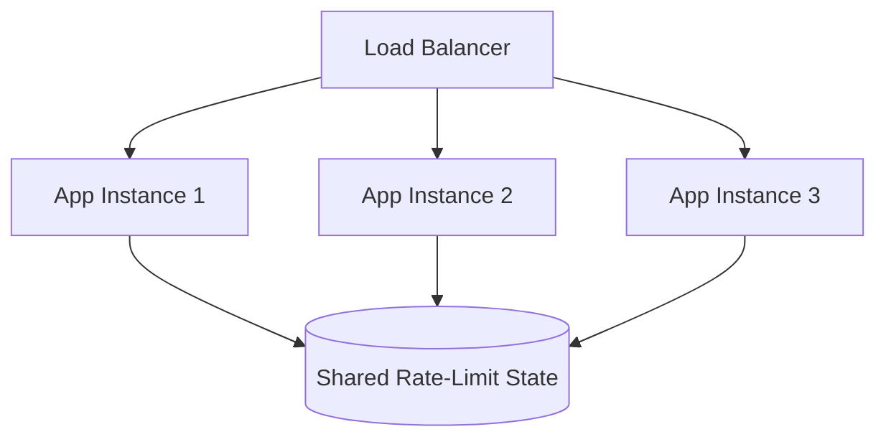
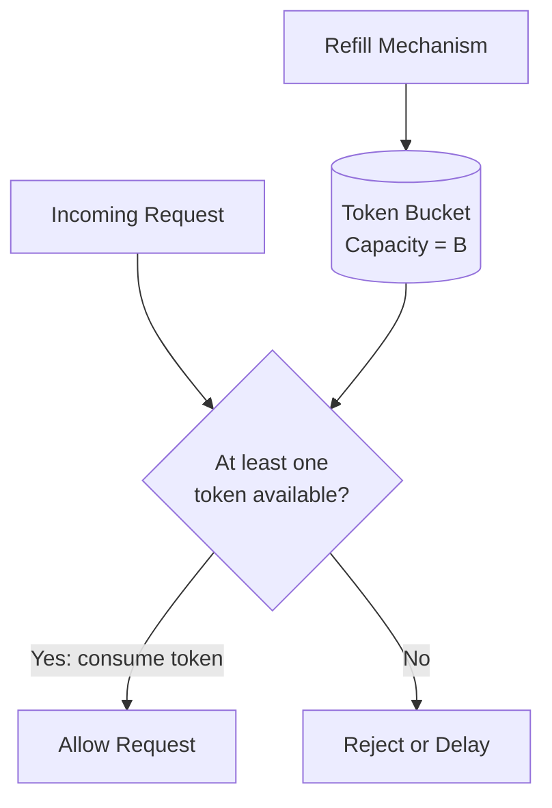
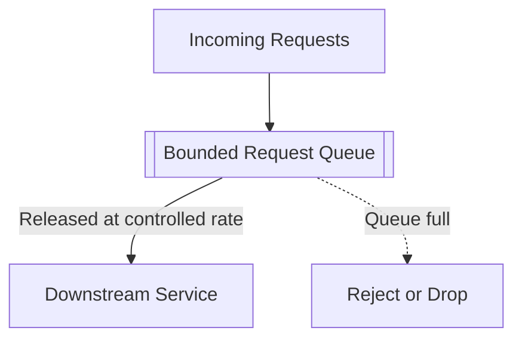
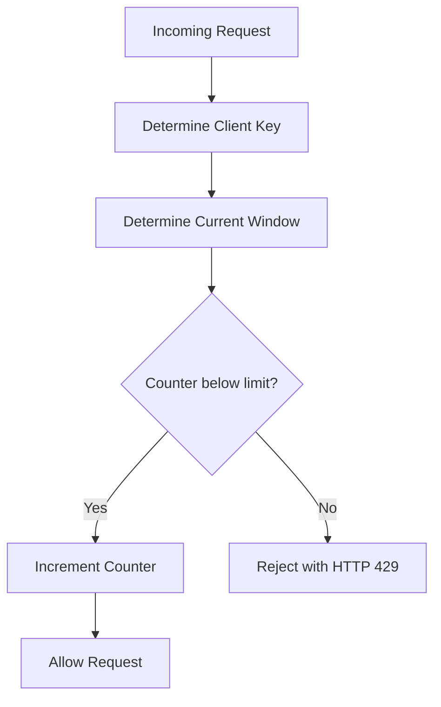
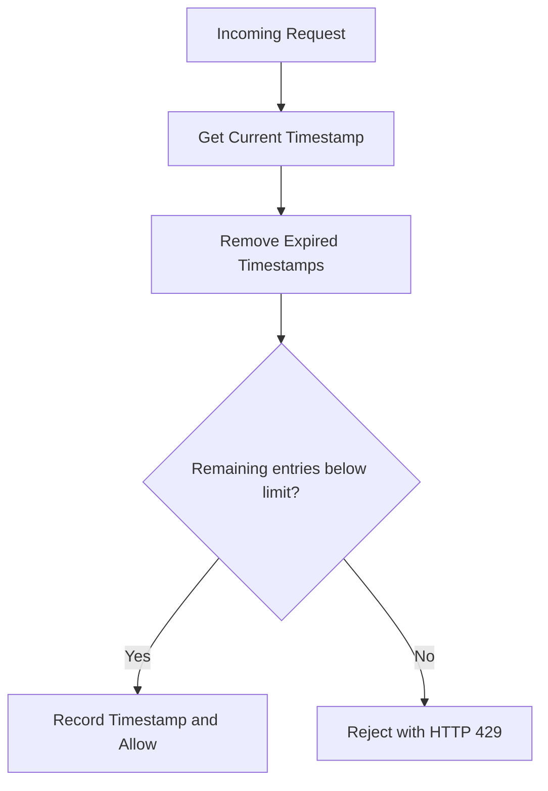
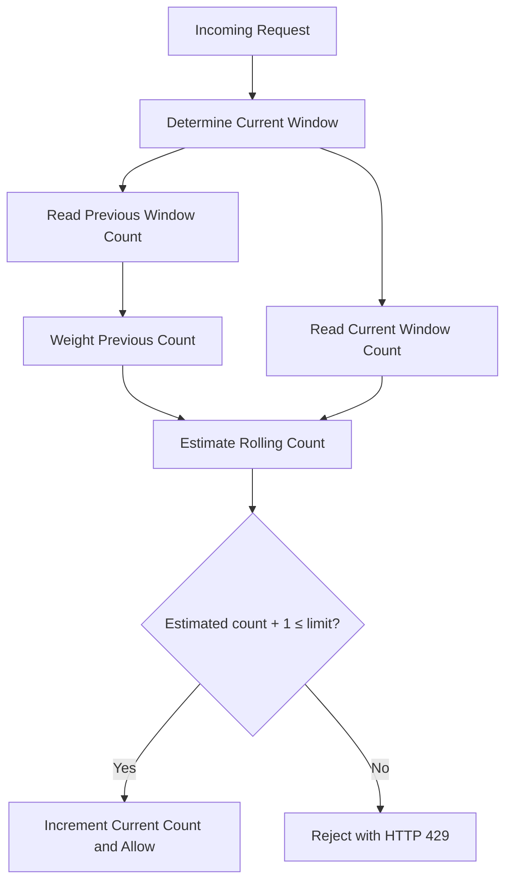
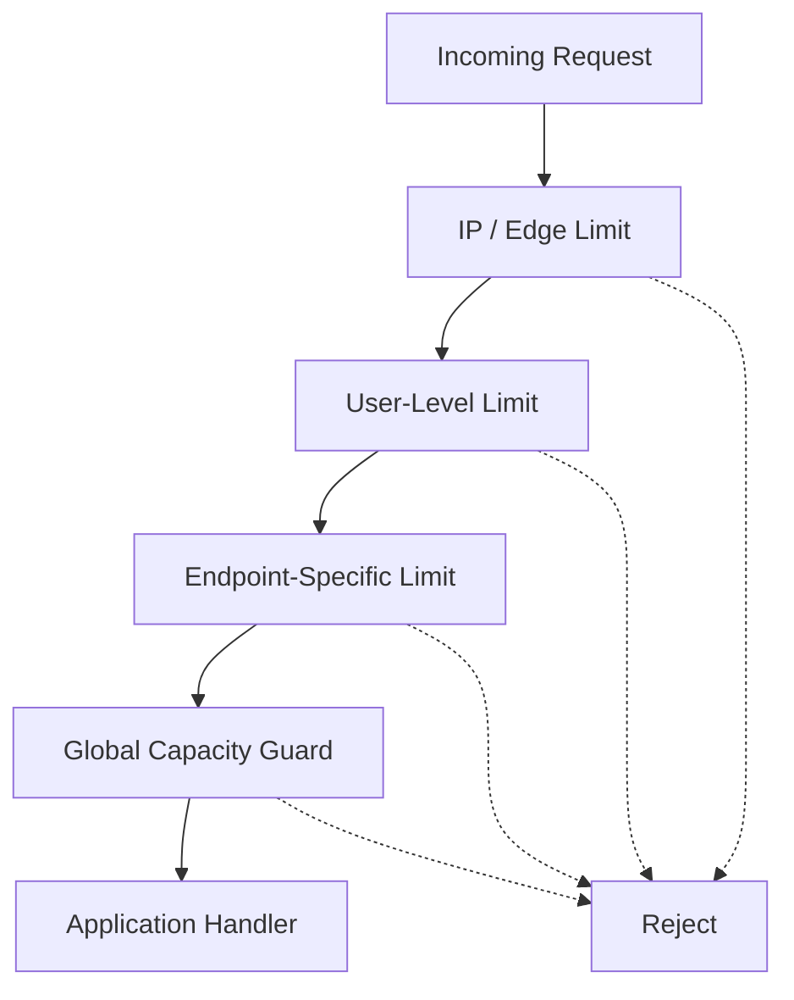

# Chapter 13 — Rate Limiting and Rate Limiting Algorithms

> **System Design Course Notes**
>
> Learn how rate limiting protects APIs and distributed systems from excessive traffic, how the five classic algorithms enforce request limits, and how to choose and implement the right strategy for production systems.

Rate limiting is one of the fundamental building blocks of reliable backend infrastructure. It helps protect services from abusive clients, accidental traffic spikes, brute-force attacks, expensive API usage, and overloaded downstream dependencies.

This chapter develops the concept from first principles, explains the mathematics behind each algorithm, and connects the theory to practical implementation in distributed systems.

---

## Table of Contents

1. [Understanding the Problem](#1-understanding-the-problem)
2. [What Is Rate Limiting?](#2-what-is-rate-limiting)
3. [Where Does a Rate Limiter Live?](#3-where-does-a-rate-limiter-live)
4. [Algorithm 1: Token Bucket](#4-algorithm-1-token-bucket)
5. [Algorithm 2: Leaky Bucket](#5-algorithm-2-leaky-bucket)
6. [Algorithm 3: Fixed Window Counter](#6-algorithm-3-fixed-window-counter)
7. [Algorithm 4: Sliding Window Log](#7-algorithm-4-sliding-window-log)
8. [Algorithm 5: Sliding Window Counter](#8-algorithm-5-sliding-window-counter)
9. [Comparing All Five Algorithms](#9-comparing-all-five-algorithms)
10. [Designing a Production Rate Limiter](#10-designing-a-production-rate-limiter)
11. [Implementation Considerations](#11-implementation-considerations)
12. [Common Mistakes and Interview Questions](#12-common-mistakes-and-interview-questions)
13. [Final Takeaways](#13-final-takeaways)

---

# 1. Understanding the Problem

## 1.1 The request-response model

A typical web application receives requests from clients and returns responses.

For example, consider an API that provides user information:

```text
Client  →  GET /api/users/42  →  Application Server
Client  ←  200 OK             ←  Application Server
```

This is the normal request-response cycle.

Every request consumes resources, even if the response is small.

Depending on the endpoint, processing a request may require:

- CPU time for application logic.
- Memory for request processing.
- Database connections and queries.
- Network bandwidth.
- Cache lookups.
- Calls to external services.
- Authentication and authorization checks.

When request volume remains within the system's capacity, everything works normally.

Problems begin when incoming traffic exceeds what the system can safely process.

## 1.2 What happens when a client sends too many requests?

Imagine that an API can sustainably process 1,000 requests per second while meeting its latency target.

One client starts sending 10,000 requests per second.

If the server accepts every request, several things can happen:

1. The application spends resources processing the excessive traffic.
2. Requests begin waiting in queues.
3. CPU utilization and memory consumption increase.
4. Database connection pools become exhausted.
5. Response times increase.
6. Legitimate users experience timeouts or errors.
7. The service may become unavailable.



The important problem is not simply that one client sends many requests. It is that **uncontrolled demand can consume shared resources and degrade service for everyone**.

The client may be malicious, but it could also be:

- A browser repeatedly polling an endpoint.
- A script containing an accidental infinite loop.
- An application retrying failed requests too aggressively.
- A bot scraping public data.
- A legitimate customer running an expensive integration.
- An attacker attempting to exhaust service capacity.

A good system must handle both malicious traffic and accidental overload.

## 1.3 Why not simply buy a bigger server?

Increasing server capacity can help, but it does not solve every problem.

Suppose a backend can handle 1,000 requests per second, while a single client sends 20,000 requests per second.

Upgrading the backend to handle 2,000 requests per second still leaves the client sending ten times the available capacity.

Moreover, each request may trigger a costly downstream operation. One API endpoint might return a cached object, while another runs an expensive database query.

**Rate limiting controls demand before it consumes excessive resources.**

It complements scaling rather than replacing it.

## 1.4 Rate limiting vs. related techniques

Several techniques address overload, but they solve different problems.

| Technique | Primary purpose |
|---|---|
| Rate limiting | Restrict how frequently requests are admitted |
| Concurrency limiting | Restrict how many operations are in progress simultaneously |
| Load balancing | Distribute traffic across available instances |
| Caching | Avoid repeated computation or data retrieval |
| Queueing | Buffer work for later processing |
| Backpressure | Signal or enforce that downstream capacity is constrained |
| DDoS protection | Detect and mitigate large-scale malicious traffic |
| Autoscaling | Adjust infrastructure capacity as workload changes |

For example, a rate limiter might allow 100 requests per second, while a concurrency limiter permits no more than 20 expensive operations to run simultaneously.

Using both can protect a system more effectively than using either one alone.

---

# 2. What Is Rate Limiting?

## 2.1 Definition

**Rate limiting is a mechanism that controls how frequently a client, user, application, or other identified entity may perform an operation.**

A rate-limiting policy defines which requests are allowed and which exceed the permitted usage.

Consider this policy:

> A client may make at most 3 requests per minute.

Assuming the policy uses a fixed one-minute window, a simplified example is:

| Request | Current count | Decision |
|---|---:|---|
| Request 1 | 1 | Allow |
| Request 2 | 2 | Allow |
| Request 3 | 3 | Allow |
| Request 4 | 3 | Reject |
| Request 5 | 3 | Reject |

The counter resets when the next window begins.

Other algorithms define limits differently, so the phrase "3 requests per minute" does not fully specify the behavior. The algorithm, window semantics, burst policy, and identity key also matter.

## 2.2 HTTP 429: Too Many Requests

When a client exceeds its limit, an HTTP API commonly returns:

```http
HTTP/1.1 429 Too Many Requests
Content-Type: application/json
Retry-After: 10
```

Example response body:

```json
{
  "error": "rate_limit_exceeded",
  "message": "Too many requests. Please try again later."
}
```

The `Retry-After` header can tell the client how long to wait before retrying. Its value may be expressed as a delay in seconds or as an HTTP date.

A production response may also include documented rate-limit headers describing the configured limit, remaining allowance, or reset time. Header conventions vary between APIs.

A client should not immediately retry a rejected request in a tight loop. Doing so can make the overload worse.

## 2.3 What exactly is being limited?

A rate limit needs an identity or key that determines which requests share the same allowance.

Common choices include:

| Rate-limit key | Example | Main consideration |
|---|---|---|
| IP address | 100 requests per minute per IP | Multiple users may share an IP |
| User ID | 100 requests per minute per authenticated user | Requires reliable identity |
| API key | 10,000 requests per day per API key | Keys can be shared or leaked |
| Account or organization | 50,000 requests per hour per organization | Supports account-level quotas |
| Endpoint | 10 login attempts per minute | Protects sensitive operations |
| IP + endpoint | 5 login attempts per minute per IP | More targeted protection |
| Global service | 50,000 requests per second across the service | Protects shared capacity |

A rate limiter can use multiple policies simultaneously.

For example, an API request might be checked against:

1. A per-IP limit.
2. A per-user limit.
3. A per-organization quota.
4. An endpoint-specific limit.
5. A global overload limit.

A request must satisfy the applicable policies before it is admitted.

### Per-user vs. system-wide token buckets

This distinction is especially important.

Suppose an API allows 100 requests per minute per user.

Each user has a separate logical bucket:

```text
User A → Bucket A → 100 requests/minute
User B → Bucket B → 100 requests/minute
User C → Bucket C → 100 requests/minute
```

User A exhausting their bucket does not automatically exhaust User B's bucket.

By contrast, a global bucket might allow only 1,000 requests per second across the entire service. All users compete for that shared allowance.

The algorithm determines how a limit behaves; the **key determines who shares the limit**.

## 2.4 Why rate limiting matters

### Fairness

Prevents one client from consuming a disproportionate share of a shared resource.

### Availability

Helps prevent excessive traffic from overwhelming application components.

### Cost control

Restricts expensive operations such as AI inference, report generation, and external API calls.

### Security

Reduces the speed of brute-force attacks, credential guessing, OTP abuse, and password-reset abuse.

Rate limiting alone does not replace authentication, account lockout policies, bot detection, or DDoS mitigation.

### Predictable service quality

Helps protect latency and throughput by controlling demand before queues and dependencies become saturated.

---

# 3. Where Does a Rate Limiter Live?

## 3.1 Basic architecture

A rate limiter generally sits before the expensive operation it protects.



If a request is rejected at the rate-limiting layer, it does not need to reach the application logic or database.

However, the request has already consumed some resources to reach that layer. The limiter should therefore be placed as early as practical for the threat it is intended to address.

## 3.2 Common deployment locations

### API gateway or edge proxy

The gateway enforces policies before requests reach backend services.

Advantages:

- Centralized configuration.
- Consistent policies across endpoints.
- Reduced unnecessary application work.

A gateway still needs sufficient capacity and appropriate protection of its own.

### Application middleware

The application checks limits in middleware before executing endpoint handlers.

Example request pipeline:

```text
Incoming Request
       ↓
Authentication / Identity Resolution
       ↓
Rate-Limit Check
       ↓
Authorization and Endpoint Logic
       ↓
Database / Downstream Services
```

The exact ordering depends on the framework and threat model. For example, some coarse IP-based limits should be applied before expensive authentication, while user-specific limits require a trustworthy user identity.

### Distributed rate-limiting service

Multiple application instances may consult a shared store or centralized service.



Redis is a common choice for shared counters, token state, and sliding-window data because it provides fast operations and atomic execution mechanisms.

The correct design depends on throughput, latency, consistency, availability, and the precision of the limit.

## 3.3 Why local counters can be incorrect

Suppose three application instances each enforce a limit of 100 requests per minute using independent local counters.

A client sends requests evenly across all three instances:

```text
App 1 → Allows 100
App 2 → Allows 100
App 3 → Allows 100
```

The client may send 300 requests even though the intended shared limit is 100.

Local state is suitable when the policy intentionally applies per instance. Otherwise, the instances need coordinated state or a different quota-allocation strategy.

This is one of the central challenges in distributed rate limiting.

---

# 4. Algorithm 1: Token Bucket

## 4.1 Intuition

Imagine a bucket containing tokens.

Each request must consume one token before it is allowed.

A refill mechanism adds tokens over time. If the bucket is empty, new requests are rejected or delayed until sufficient tokens become available.

The bucket has a maximum capacity, so it cannot accumulate unlimited tokens while idle.

**Token Bucket controls the rate at which requests are admitted while allowing short bursts of traffic.**

## 4.2 Architecture



## 4.3 Parameters

A token bucket is commonly defined by two parameters.

| Parameter | Symbol | Meaning |
|---|---|---|
| Bucket capacity | \(B\) | Maximum number of tokens stored |
| Refill rate | \(r\) | Tokens generated per second |

Assume each request costs one token. Other systems may assign different token costs to different operations.

If the bucket is full, additional refill tokens are discarded.

## 4.4 Mathematical model

Let:

- \(T\) = currently available tokens.
- \(B\) = maximum bucket capacity.
- \(r\) = refill rate in tokens per second.
- \(\Delta t\) = elapsed time since the last update.

The replenished token count is:

\[
T' = \min(B,\ T + r\Delta t)
\]

For a request that consumes one token:

\[
T_{\text{next}} =
\begin{cases}
T' - 1, & T' \geq 1 \\
T', & T' < 1
\end{cases}
\]

The request is allowed only if at least one token is available.

In a practical implementation, the refill calculation can be performed lazily whenever a request arrives. A background thread does not necessarily need to add tokens continuously.

For fractional refill rates, the implementation should retain fractional token credit or use equivalent integer arithmetic. Simply rounding down on every request can introduce incorrect behavior.

## 4.5 Worked example

Suppose the policy is:

- Bucket capacity: 5 tokens.
- Refill rate: 3 tokens per second.
- Initial token count: 5.

The initial state is:

```text
Bucket: [● ● ● ● ●]
Tokens: 5
```

Five requests arrive almost simultaneously.

| Request | Tokens before | Decision | Tokens after |
|---|---:|---|---:|
| 1 | 5 | Allow | 4 |
| 2 | 4 | Allow | 3 |
| 3 | 3 | Allow | 2 |
| 4 | 2 | Allow | 1 |
| 5 | 1 | Allow | 0 |
| 6 | 0 | Reject | 0 |

The bucket can admit five requests in a burst because it had accumulated five tokens.

After the bucket is empty, new tokens become available at a rate of three per second.

After 0.5 seconds, it has accumulated approximately 1.5 tokens, assuming no other requests consume them.

If the implementation supports fractional token credit, it can allow one request and retain the remaining 0.5 token.

### What if nobody sends requests?

Starting with an empty bucket, after two seconds:

\[
T = \min(5,\ 0 + 3 \times 2)
\]

\[
T = \min(5,6) = 5
\]

Only five tokens can be stored. The extra potential token is discarded because the bucket is full.

## 4.6 Understanding burst capacity and sustained rate

The refill rate controls the long-term admission rate, while the capacity controls how much traffic can be admitted in a short burst.

For a bucket initially full, the system can admit five immediate requests even though the refill rate is only three requests per second.

Over a long enough interval, the average admitted rate is constrained by the refill rate, assuming each request costs one token and there are no other admission mechanisms.

A useful way to think about the configuration is:

```text
Capacity → How large can an immediate burst be?

Refill rate → How quickly does the allowance recover?
```

For example:

- Capacity = 10.
- Refill rate = 2 tokens/second.

This allows an initial burst of up to 10 requests, followed by a sustained average of approximately two requests per second.

The bucket does not necessarily force the server to process requests at a constant rate. Five requests admitted simultaneously may still reach the application close together.

## 4.7 Advantages

- Allows short bursts.
- Enforces a configurable sustained admission rate.
- Requires very little state per key.
- Supports fractional refill rates.
- Works well for APIs with uneven traffic patterns.
- Can support weighted operations by assigning different token costs.

## 4.8 Limitations

### Shared-resource competition

If many clients share one global bucket, one client can consume the available tokens before others arrive.

A per-user bucket avoids this particular form of direct competition, but a global bucket may still be needed to protect the overall system.

### Burst-related overload

A token bucket deliberately permits bursts. A downstream service that cannot handle even a short burst may require an additional concurrency limit or traffic-shaping mechanism.

### Distributed coordination

When multiple servers enforce the same bucket, they must coordinate access to its state or deliberately divide the quota between themselves.

### Configuration trade-offs

A large bucket capacity improves burst tolerance but can allow more simultaneous work. A high refill rate increases sustained traffic.

## 4.9 When should you use Token Bucket?

Choose Token Bucket when:

- Short bursts are acceptable.
- Average request rate must be bounded.
- You want low-memory, low-overhead rate limiting.
- Traffic is naturally uneven.
- An API should recover its allowance gradually after usage.

It is a common general-purpose choice for API rate limiting.

---

# 5. Algorithm 2: Leaky Bucket

## 5.1 Intuition

Imagine a bucket with a small hole at the bottom.

Water can enter the bucket at any rate, but it leaves at a controlled rate.

If water arrives too quickly, it accumulates. If the bucket becomes full, additional water spills out.

In the rate-limiting analogy:

- Incoming requests are the water.
- The queue is the bucket.
- The leak rate is the processing or dispatch rate.
- An overflowing bucket represents rejected requests.

**The queue-based Leaky Bucket algorithm smooths bursty incoming traffic into a more regular outgoing stream.**

## 5.2 Architecture



Unlike Token Bucket, which controls admission using available tokens, queue-based Leaky Bucket controls the rate at which queued work is released.

Some systems also use the term *leaky bucket* for a policing algorithm that tracks accumulated traffic and rejects requests beyond a threshold without maintaining a literal queue. Here, we focus on the queue-based traffic-shaping form.

## 5.3 Parameters

| Parameter | Meaning |
|---|---|
| Queue capacity | Maximum number of waiting requests |
| Leak rate | Number of requests released per second |
| Overflow policy | What happens when the queue is full |

The overflow policy may reject the newest request, drop work, or use a different queue management strategy.

## 5.4 Worked example

Suppose:

- Queue capacity: 5 requests.
- Leak rate: 2 requests per second.
- Incoming burst: 5 requests arrive almost simultaneously.

The requests enter the queue:

```text
Incoming: A, B, C, D, E

Queue:
Front → [A] [B] [C] [D] [E] ← Back
```

The worker releases requests at the configured rate.

| Time | Event | Queue |
|---|---|---|
| 0.0 s | Five requests arrive | A, B, C, D, E |
| 0.5 s | One request released | B, C, D, E |
| 1.0 s | One request released | C, D, E |
| 1.5 s | One request released | D, E |
| 2.0 s | One request released | E |
| 2.5 s | Final request released | Empty |

The precise timing depends on the scheduler and implementation. The table illustrates a worker processing two requests per second.

The incoming burst is absorbed by the queue, and the downstream service receives a smoother stream.

## 5.5 What happens when arrivals exceed processing capacity?

Suppose requests arrive at 1,000 requests per second, but the queue drains at 100 requests per second.

The queue grows by approximately:

\[
1{,}000 - 100 = 900
\]

requests per second while both rates remain constant.

If the queue can hold 2,000 requests and begins empty, it fills in approximately:

\[
\frac{2{,}000}{900} \approx 2.22
\]

seconds.

After that, new requests must be rejected or otherwise handled according to the overflow policy.

A queue delays overload; it does not create unlimited processing capacity.

## 5.6 Advantages

- Smooths bursts before work reaches a downstream service.
- Provides a predictable dispatch rate.
- Can protect dependencies with strict throughput constraints.
- Provides a place to apply prioritization or queue management.
- Allows temporary differences between arrival and processing rates.

## 5.7 Limitations

### Queueing latency

Requests may wait a long time before processing.

For interactive APIs, a delayed request can become useless if the client has already timed out.

### Finite queue capacity

A queue must have a bounded capacity or a clear storage and admission policy.

### Stale work

Old requests may no longer be relevant when they reach the front of the queue.

### Head-of-line blocking

A slow or expensive operation at the front of a FIFO queue may delay other operations behind it.

### Not every request can be delayed

Some operations require an immediate response. They may be better rejected with a retry instruction than placed in a long queue.

## 5.8 When should you use Leaky Bucket?

Choose queue-based Leaky Bucket or traffic shaping when:

- A downstream dependency requires a controlled input rate.
- Burst absorption is useful.
- Delayed processing is acceptable.
- Work can be queued and processed later.
- The system needs a predictable dispatch rate.

For interactive APIs, combine queueing with deadlines, bounded capacity, and clear rejection behavior.

---

# 6. Algorithm 3: Fixed Window Counter

## 6.1 Intuition

The Fixed Window Counter algorithm divides time into fixed intervals.

For each client and interval, the system stores a request counter.

For example:

> Allow at most 3 requests per second.

The system maintains a separate counter for each one-second window.

When a new window begins, the counter resets.

## 6.2 Architecture



## 6.3 Parameters

| Parameter | Meaning |
|---|---|
| Window size \(W\) | Duration of each fixed interval |
| Limit \(L\) | Maximum requests allowed within one interval |
| Counter | Number of requests already admitted in the current interval |

## 6.4 Mathematical model

Let:

- \(t\) = current timestamp.
- \(W\) = window duration.
- \(L\) = request limit.

The fixed-window identifier can be calculated as:

\[
\operatorname{window}(t) =
\left\lfloor \frac{t}{W} \right\rfloor
\]

For a limit of 3 requests per second:

\[
W = 1,\qquad L = 3
\]

If the current counter is less than three, the request is accepted and the counter is incremented.

Otherwise, it is rejected.

## 6.5 Worked example

Assume:

- Limit: 3 requests per second.
- Window boundaries: 0 s, 1 s, 2 s, and so on.

| Request time | Window | Counter before | Decision |
|---|---|---:|---|
| 0.10 s | 0–1 s | 0 | Allow |
| 0.30 s | 0–1 s | 1 | Allow |
| 0.70 s | 0–1 s | 2 | Allow |
| 0.80 s | 0–1 s | 3 | Reject |
| 1.05 s | 1–2 s | 0 | Allow |
| 1.20 s | 1–2 s | 1 | Allow |

The counter resets at the start of the next fixed window.

## 6.6 The boundary problem

The most important weakness is that the algorithm treats each fixed window independently.

Suppose the limit is three requests per second.

A client sends:

```text
Time:       0.70 s   0.80 s   0.90 s | 1.10 s   1.20 s   1.30 s
Window:             Window 1          |          Window 2
Requests:      ●        ●        ●    |     ●        ●        ●
```

The first three requests are allowed in Window 1.

At 1.00 second, the counter resets. The next three requests are allowed in Window 2.

The client has now sent six requests in a period of approximately 0.6 seconds.

The configured limit is three requests per fixed one-second window, but the algorithm does not guarantee at most three requests in every possible one-second interval.

For a limit \(L\), a burst of up to approximately \(2L\) requests can be admitted around a window boundary.

This is the **fixed-window boundary problem**.

## 6.7 Advantages

- Very simple to understand and implement.
- Minimal memory usage.
- Low computational overhead.
- Easy to implement with atomic counters and expiration.
- Suitable for coarse quotas and many business-level limits.

## 6.8 Limitations

- Allows boundary bursts.
- Does not strictly enforce the limit over every sliding interval.
- Clients may synchronize their requests around window resets.
- Correct implementation still requires atomic updates in distributed systems.

## 6.9 When should you use Fixed Window Counter?

Choose it when:

- Simplicity and efficiency are priorities.
- The boundary burst is acceptable.
- The policy is a coarse quota, such as requests per calendar minute or daily API usage.
- The system does not require exact enforcement over every rolling interval.

For stricter per-second limits, consider a sliding-window algorithm or Token Bucket.

---

# 7. Algorithm 4: Sliding Window Log

## 7.1 Intuition

The Sliding Window Log algorithm records the timestamp of every accepted request.

When a new request arrives, it examines the timestamps within the current rolling interval.

Unlike Fixed Window Counter, the window moves with the current time.

For example:

> Allow at most 3 requests in any rolling 5-second interval.

The system must consider requests from the last five seconds, regardless of where fixed clock boundaries fall.

## 7.2 Architecture



## 7.3 Parameters

| Parameter | Meaning |
|---|---|
| Window size \(W\) | Duration of the rolling interval |
| Limit \(L\) | Maximum accepted requests in the interval |
| Timestamp log | Ordered collection of accepted request timestamps |

## 7.4 Mathematical model

Let the current time be \(t\).

The active rolling interval is:

\[
(t-W,\ t]
\]

This convention excludes a request exactly \(W\) seconds old and includes requests at the current time.

Other boundary conventions are possible, but they must be consistent.

Let \(S\) be the collection of accepted request timestamps.

Before evaluating a new request, remove all timestamps \(s\) satisfying:

\[
s \leq t-W
\]

The number of remaining timestamps is the current rolling-window count.

The request is accepted if:

\[
|S| < L
\]

After acceptance, append the current timestamp to \(S\).

## 7.5 Worked example

Assume a limit of three requests per five seconds.

| Time | Action | Active timestamps | Decision |
|---|---|---|---|
| 1.0 s | Request | {1.0} | Allow |
| 3.0 s | Request | {1.0, 3.0} | Allow |
| 4.5 s | Request | {1.0, 3.0, 4.5} | Allow |
| 5.5 s | Request | {1.0, 3.0, 4.5} | Reject |
| 6.5 s | Request | {3.0, 4.5, 6.5} | Allow |
| 7.5 s | Request | {4.5, 6.5, 7.5} | Allow |

Let's examine the fourth request.

At time 5.5 seconds, the active interval is:

\[
(0.5,\ 5.5]
\]

All three previous timestamps remain inside the interval:

\[
1.0,\ 3.0,\ 4.5
\]

The limit has already been reached, so the new request is rejected.

At time 6.5 seconds, the interval becomes:

\[
(1.5,\ 6.5]
\]

The timestamp at 1.0 seconds has expired, leaving two entries. The next request can therefore be accepted.

The algorithm enforces the limit over each rolling window rather than relying on fixed clock boundaries.

## 7.6 Advantages

- Exact rolling-window counting for accepted requests, assuming atomic updates and consistent time semantics.
- No fixed-window boundary loophole.
- Easy to explain and reason about.
- Useful when precise per-client limits are required.

## 7.7 Limitations

### Memory consumption

Each accepted request needs a timestamp.

For a client allowed 10,000 requests per minute, the log may contain up to 10,000 timestamps during a busy period.

Across millions of active clients, the memory cost can become substantial.

### Processing overhead

The implementation must remove expired timestamps and count the remaining entries.

A simple list may require expensive operations. An ordered structure can make insertion and expiration more efficient.

### Distributed coordination

Two concurrent requests may both observe that the current count is below the limit unless the check, cleanup, and insertion are performed atomically.

### Rejected requests

A typical implementation does not need to store every rejected request in the accepted-request log. Recording them separately for analytics or security monitoring is a different concern.

## 7.8 Implementation with Redis sorted sets

A Redis sorted set can store each accepted request as a member with its timestamp as the score.

A conceptual structure might look like:

```text
Key: rate_limit:user:42

Score       Member
1000.000    request-a
1001.250    request-b
1002.400    request-c
```

A request-handling script can:

1. Remove expired entries.
2. Count active entries.
3. Reject if the limit has been reached.
4. Otherwise insert a unique member.
5. Set or refresh the key's expiration.

These operations should be executed atomically, for example using a Redis Lua script.

A sorted set is not automatically atomic merely because it is used for the log. The complete decision must be coordinated.

## 7.9 When should you use Sliding Window Log?

Choose it when:

- Exact rolling-window semantics matter.
- The request volume per key is manageable.
- Memory consumption is acceptable.
- The implementation can perform atomic updates.

It is useful for strict API limits, sensitive operations, and cases where fixed-window boundary bursts are unacceptable.

---

# 8. Algorithm 5: Sliding Window Counter

## 8.1 Intuition

Sliding Window Counter combines the low memory usage of Fixed Window Counter with an estimate of a rolling-window request count.

Instead of storing every request timestamp, it stores two counters:

- The previous fixed window's count.
- The current fixed window's count.

It estimates how many requests from the previous window are likely to remain inside the current rolling window.

**The result is a lightweight approximation of a sliding window, not an exact record of every request.**

## 8.2 Architecture



The `estimated count + 1` check is a conservative admission rule for the estimated count. Because the estimate is approximate, it still cannot guarantee exact rolling-window enforcement.

## 8.3 Mathematical model

Let:

- \(W\) = fixed window duration.
- \(L\) = configured request limit.
- \(C_{\text{prev}}\) = count in the previous window.
- \(C_{\text{curr}}\) = count in the current window.
- \(e\) = elapsed time since the current window began.

The fraction of the current window that has elapsed is:

\[
f = \frac{e}{W}
\]

The fraction of the previous window that overlaps the current rolling interval is approximately:

\[
1-f
\]

The estimated rolling count is:

\[
\boxed{
C_{\text{est}} =
C_{\text{curr}} +
C_{\text{prev}}(1-f)
}
\]

A conservative admission rule accepts a new unit-cost request when:

\[
C_{\text{est}} + 1 \leq L
\]

The algorithm increments the current window's counter after accepting the request.

Other implementations use different admission rules or rounding conventions. Those choices affect how closely the limiter follows the intended threshold.

## 8.4 Worked example

Assume:

- Limit: 3 requests per second.
- Window duration: 1 second.
- Previous window count: 2.
- Current window count: 0.
- Current time: 1.2 seconds.

The current window started at 1.0 second.

Therefore:

\[
e = 1.2 - 1.0 = 0.2
\]

The elapsed fraction is:

\[
f = \frac{0.2}{1.0} = 0.2
\]

Approximately 80% of the previous window overlaps the current rolling interval.

The estimated rolling count is:

\[
C_{\text{est}} = 0 + 2(1-0.2)
\]

\[
C_{\text{est}} = 1.6
\]

Before admitting the request, estimate the count after adding it:

\[
C_{\text{est}} + 1 = 2.6
\]

Since:

\[
2.6 \leq 3
\]

the request is accepted.

The current counter becomes 1.

If another request arrives immediately, the estimate becomes:

\[
C_{\text{est}} = 1 + 2(0.8) = 2.6
\]

Adding another request would produce an estimated count of 3.6, so the conservative rule rejects it.

The counter uses a weighted estimate rather than tracking the precise arrival time of each request.

## 8.5 Why does the weighting work?

Imagine that the previous one-second window contains two requests.

At the very beginning of the current window, almost all of the previous window overlaps a one-second rolling interval.

As time advances, an increasing portion of the previous window falls outside that rolling interval.

The weighting factor gradually reduces the contribution of the previous counter.

```text
Previous window                    Current window
|---------------------------------|----------------------------|
0 s                               1 s                          2 s
                                  ^
                                  Current window begins

At t = 1.0 s: previous-window weight ≈ 100%
At t = 1.2 s: previous-window weight ≈ 80%
At t = 1.5 s: previous-window weight ≈ 50%
At t = 1.9 s: previous-window weight ≈ 10%
```

The estimate assumes that requests in the previous window were distributed roughly uniformly across that window.

That assumption is the source of the algorithm's approximation error.

## 8.6 Advantages

- Stores only a small number of counters per key.
- Much more memory-efficient than storing every request timestamp.
- Reduces the boundary spike associated with fixed windows.
- Suitable for high-volume API rate limiting.
- Relatively inexpensive to calculate.

## 8.7 Limitations

### Approximation error

The algorithm does not know exactly when requests occurred within the previous window.

Two request patterns can produce the same counter but have very different actual rolling-window counts.

For example, two requests might have arrived either at the very beginning of the previous window or at its very end. The algorithm sees the same counter value in both cases.

### Admission policy matters

A strict check against the estimated count is not equivalent to exact enforcement.

Rounding, concurrent updates, and the chosen acceptance rule can all affect the result.

### Atomicity is still required

Counters must be updated atomically when several application instances process requests simultaneously.

## 8.8 When should you use Sliding Window Counter?

Choose it when:

- You want low memory overhead.
- Fixed-window boundary bursts are undesirable.
- A close approximation is sufficient.
- You need a practical compromise between accuracy and efficiency.

It is a useful general-purpose choice for high-volume distributed APIs.

---

# 9. Comparing All Five Algorithms

## 9.1 Summary table

| Algorithm | Core mechanism | Burst behavior | State per key | Accuracy |
|---|---|---|---|---|
| Token Bucket | Replenishing token balance | Explicitly allows bounded bursts | Very low | Exact token accounting when implemented correctly |
| Leaky Bucket | Bounded queue with controlled outflow | Buffers bursts; may reject overflow | Proportional to queued work | Controlled output rate, subject to scheduling |
| Fixed Window Counter | Counter reset at fixed boundaries | Can admit boundary bursts | Very low | Exact for fixed windows, not rolling windows |
| Sliding Window Log | Timestamps of accepted requests | Enforces a rolling-window limit | Proportional to accepted requests | Exact rolling-window count with atomic updates |
| Sliding Window Counter | Weighted previous count + current count | Reduces boundary spikes | Very low | Approximate rolling-window count |

Memory usage depends on the implementation and number of active keys. A queue-based Leaky Bucket may consume considerably more memory per key than a token bucket because it stores queued work.

## 9.2 Decision guide

<details>
<summary><strong>Use Token Bucket when...</strong></summary>

You want to allow brief bursts while controlling sustained request volume. It is a strong default for general-purpose API rate limiting.

</details>

<details>
<summary><strong>Use Leaky Bucket when...</strong></summary>

The downstream service needs a controlled output rate, and requests can wait in a bounded queue.

</details>

<details>
<summary><strong>Use Fixed Window Counter when...</strong></summary>

The implementation must be simple and cheap, and the boundary-burst behavior is acceptable.

</details>

<details>
<summary><strong>Use Sliding Window Log when...</strong></summary>

Strict rolling-window enforcement is important and the timestamp storage cost is manageable.

</details>

<details>
<summary><strong>Use Sliding Window Counter when...</strong></summary>

You need a memory-efficient approximation that reduces the fixed-window boundary problem.

</details>

## 9.3 A practical selection table

| Requirement | Suggested starting point |
|---|---|
| General-purpose API traffic | Token Bucket |
| Strict maximum requests in any rolling interval | Sliding Window Log |
| High-volume approximate rolling-window limit | Sliding Window Counter |
| Simple calendar-minute or daily quota | Fixed Window Counter |
| Smooth delivery to a constrained downstream service | Leaky Bucket / traffic shaping |
| Protection against expensive concurrent operations | Concurrency limiter, often combined with rate limiting |
| Global overload protection | Shared global limiter or distributed admission control |

There is no universally best algorithm. The correct choice depends on the policy's semantics, the resource being protected, and the cost of approximation or delay.

---

# 10. Designing a Production Rate Limiter

Understanding the algorithms is only part of the problem. A production implementation must also handle identity, shared state, concurrency, retries, and failure behavior.

## 10.1 Define the policy precisely

A policy should answer:

- Who shares the limit?
- Which operations are counted?
- What is the allowed rate?
- Is there a burst allowance?
- Is the window fixed or rolling?
- Are rejected requests delayed or immediately rejected?
- What response should the client receive?
- Does the policy vary by subscription tier or endpoint?

For example:

```text
Policy:
  Identity: authenticated user ID
  Endpoint: POST /api/reports
  Algorithm: Token Bucket
  Capacity: 5 tokens
  Refill rate: 1 token per 10 seconds
  Request cost: 1 token
  Rejection: HTTP 429
```

This permits a burst of five report requests, while replenishing the allowance at six tokens per minute over the long run.

The example is illustrative. A real report endpoint may also need a concurrency limit because five simultaneous report-generation jobs could be expensive.

## 10.2 Use multiple layers of protection

A robust API may enforce several independent limits.



For example:

- The IP limit restricts basic unauthenticated flooding.
- The user limit prevents a single account from monopolizing capacity.
- The endpoint limit protects expensive operations.
- The global guard protects the service as a whole.

The checks should be designed carefully so that their overhead does not become a new bottleneck.

## 10.3 Why distributed state is necessary

Consider a system with five application servers.

A client is allowed 100 requests per minute.

If every server independently allows 100 requests, the effective allowance can approach 500 requests per minute when traffic is distributed across all five servers.

To enforce one shared limit, the application instances need to coordinate.

Common approaches include:

1. A centralized rate-limiting service.
2. A shared store such as Redis.
3. Atomic scripts or operations against shared state.
4. Deliberately partitioned quota allocations.
5. A dedicated gateway that owns the relevant policy.

Each approach has different latency, availability, and consistency characteristics.

## 10.4 Atomicity and race conditions

Suppose a Fixed Window Counter has a limit of 10 requests.

The current count is 9.

Two requests arrive at almost the same time.

Without atomic coordination:

```text
Request A reads count = 9
Request B reads count = 9

Request A decides: allow
Request B decides: allow

Request A writes count = 10
Request B writes count = 10
```

Both requests were allowed, but the final counter is only 10. The counter failed to reflect that two requests had been admitted.

This is a race condition.

The correct operation must combine the decision and update in a coordinated, atomic manner.

For a simple fixed-window counter, an atomic increment followed by a carefully coordinated threshold check can help. For more complex algorithms, the entire check-and-update sequence may need to execute in one atomic operation.

Redis Lua scripts are one option for coordinating these operations on a single Redis execution context.

Atomicity alone is not a complete distributed-systems guarantee. Failover, replication, persistence, and cross-region behavior also matter if strict limits must survive those events.

## 10.5 Choosing the rate-limit key

A key might look like:

```text
rate_limit:user:42:reports
```

This could represent the report-generation limit for user 42.

A fixed-window counter key might include a window identifier:

```text
rate_limit:user:42:reports:window:123456
```

The identifier distinguishes one time window from another.

A sliding-window log may instead keep a single key for the user and endpoint, with individual request timestamps stored inside it.

Key design affects:

- Isolation between users.
- Memory consumption.
- Expiration behavior.
- Operational observability.
- Resistance to high-cardinality abuse.

### Beware of unbounded keys

If an attacker can create unlimited unique identifiers and each identifier creates a permanent rate-limit record, the limiter itself can consume excessive memory.

Use expiration, bounded storage, identity validation, and appropriate coarse-grained controls.

## 10.6 Time and clock correctness

Time-based algorithms rely on accurate timestamps.

Important considerations include:

- Use a consistent time source for distributed decisions.
- Prefer monotonic time for local elapsed-duration measurements.
- Account for clock skew when timestamps come from different machines.
- Use consistent window-boundary semantics.
- Avoid rounding that silently changes the effective rate.

For a distributed sliding-window log, timestamps generated by different servers can be inconsistent if their clocks differ significantly.

A centralized store's clock, a trusted time source, or another carefully designed timestamp strategy may be appropriate depending on the implementation.

## 10.7 Handling rate-limiter failures

Suppose the rate limiter depends on Redis, but Redis becomes unavailable.

Should the application continue accepting requests?

There are two common strategies.

### Fail open

Allow requests when the rate limiter cannot be consulted.

Advantages:

- The service may remain available.
- Temporary limiter outages do not block all users.

Disadvantages:

- The system may be exposed to overload.
- Abuse and expensive operations may proceed without limits.

### Fail closed

Reject requests when the limiter cannot determine whether they are allowed.

Advantages:

- Maintains stricter protection for sensitive resources.

Disadvantages:

- A rate-limiter outage can make otherwise healthy application endpoints unavailable.

The right choice depends on the endpoint.

A noncritical public read endpoint might use a different failure policy from a costly payment-related operation or an authentication endpoint under attack.

A hybrid design can use local emergency limits, bounded fallback behavior, or a gateway-level guard during shared-store failures.

## 10.8 Retry behavior and exponential backoff

When a client receives HTTP 429, it should respect the retry guidance when provided.

Repeatedly retrying immediately can create a retry storm.

A common strategy is exponential backoff with jitter:

\[
d_n = \min(d_{\max}, d_0 \cdot 2^n)
\]

Where:

- \(d_0\) is the initial delay.
- \(n\) is the retry number.
- \(d_{\max}\) is the maximum delay.

Jitter adds a random component to the delay so many clients do not retry simultaneously.

For example, if 1,000 clients are rate-limited at the same time, retrying all of them exactly one second later can produce another synchronized burst.

Retries should also be bounded. Not every failure is transient, and not every operation is safe to repeat.

---

# 11. Implementation Considerations

## 11.1 Suggested implementation progression

A useful learning sequence is:

1. Implement Fixed Window Counter using an in-memory map.
2. Add expiration and cleanup.
3. Move state into Redis.
4. Make the check-and-update atomic.
5. Implement Token Bucket using elapsed time and refill calculations.
6. Implement Sliding Window Log using timestamps.
7. Implement Sliding Window Counter using two window counters.
8. Add HTTP 429 responses and retry headers.
9. Add metrics, tests, and failure handling.
10. Load-test with concurrent clients.

This progression builds understanding before introducing distributed-state complexity.

## 11.2 Core pseudocode: Token Bucket

```text
function allowRequest(key, now):
    state = loadBucket(key)

    elapsed = max(0, now - state.lastUpdated)

    tokens = min(
        capacity,
        state.tokens + elapsed * refillRate
    )

    if tokens >= requestCost:
        tokens = tokens - requestCost
        allowed = true
    else:
        allowed = false

    saveBucket(key, tokens, now)

    return allowed
```

This is conceptual pseudocode, not a concurrency-safe production implementation.

A real implementation must coordinate the read, refill calculation, decision, and state update atomically. It should also validate parameters, account for fractional tokens, and define how missing or expired state is initialized.

## 11.3 Core pseudocode: Fixed Window Counter

```text
function allowRequest(key, now):
    windowId = floor(now / windowSize)
    counterKey = key + ":" + windowId

    count = atomicallyIncrement(counterKey)

    if count <= limit:
        return ALLOW
    else:
        return REJECT
```

The increment must be atomic. The storage key should expire after the window is no longer needed.

This basic version counts attempts, including rejected requests if the increment happens before the threshold check. That can be acceptable for some designs, but it is not identical to a counter of accepted requests.

If the policy requires tracking accepted requests only, the admission decision and increment must be coordinated atomically.

## 11.4 Core pseudocode: Sliding Window Log

```text
function allowRequest(key, now):
    atomically:
        remove timestamps <= now - windowSize

        count = number of remaining timestamps

        if count >= limit:
            return REJECT

        insert unique timestamp for now
        return ALLOW
```

This illustrates the essential logic.

A production implementation must ensure the cleanup, count, and insertion occur as one coordinated operation. Otherwise, concurrent requests can exceed the configured threshold.

## 11.5 Metrics to monitor

A production rate limiter should expose metrics that help engineers understand both the policy and the system's health.

Useful metrics include:

- Total requests checked.
- Requests allowed.
- Requests rejected.
- Rejection rate by endpoint and policy.
- Rate-limiter decision latency.
- Shared-store latency and errors.
- Active rate-limit keys.
- Cache or state-store memory usage.
- Queue depth if requests are delayed.
- False positives reported by users.
- Distribution of remaining quota.

Monitoring should avoid using unbounded high-cardinality labels such as arbitrary user IDs in metric dimensions. Such labels can create a separate observability scaling problem.

## 11.6 Testing the implementation

Important test cases include:

- Requests below the threshold.
- Requests exactly at the threshold.
- Requests just above the threshold.
- Requests arriving at window boundaries.
- Multiple requests arriving simultaneously.
- Bucket refill over fractional intervals.
- Idle periods followed by bursts.
- Expired keys.
- Redis timeouts and failures.
- Application restarts.
- Multiple application instances sharing the same policy.
- Invalid or spoofed client identity information.
- Retry behavior after HTTP 429.

For concurrency tests, verify the number of admitted requests, not only the final counter value.

---

# 12. Common Mistakes and Interview Questions

## 12.1 Common mistakes

### Mistake 1: Assuming rate limiting solves every overload problem

Rate limiting controls request admission. It does not automatically constrain the number of expensive operations already in progress.

**Better approach:** combine rate limiting with concurrency limits, timeouts, and downstream protection when appropriate.

### Mistake 2: Giving every server an independent limit

This can multiply the effective allowance when requests are distributed across instances.

**Better approach:** define whether the policy is per-instance or shared, then implement the appropriate state coordination.

### Mistake 3: Confusing Token Bucket with Leaky Bucket

Token Bucket allows bounded bursts while controlling the long-term admission rate.

Queue-based Leaky Bucket buffers requests and releases them at a controlled rate.

### Mistake 4: Assuming Fixed Window Counter enforces every rolling interval

It enforces limits within fixed, aligned windows. It can admit nearly twice the configured limit around a boundary.

**Better approach:** choose a rolling-window algorithm or Token Bucket if the required semantics demand it.

### Mistake 5: Treating Sliding Window Counter as exact

The algorithm estimates the rolling count using aggregated counters.

**Better approach:** use Sliding Window Log if exact rolling-window counting is a hard requirement.

### Mistake 6: Forgetting atomicity

Concurrent requests can pass the same threshold check if updates are not coordinated.

**Better approach:** make the complete admission decision atomic where necessary.

### Mistake 7: Blindly trusting the client IP

Applications behind proxies may see the proxy's address instead of the original client address. Improperly trusting forwarded headers can also allow spoofing.

**Better approach:** use a correctly configured trusted-proxy chain and authenticated identities where appropriate.

### Mistake 8: Ignoring legitimate shared IP addresses

Universities, offices, and mobile networks may place many users behind the same public IP.

**Better approach:** avoid relying exclusively on IP limits for authenticated traffic, and combine policies where appropriate.

### Mistake 9: Returning 429 without useful retry behavior

Clients may retry too early and increase pressure on the service.

**Better approach:** provide suitable retry guidance and document client behavior.

### Mistake 10: Treating rate limiting as complete DDoS protection

A limiter inside the application cannot prevent all network-level or volumetric attacks that overwhelm the infrastructure before the request reaches it.

**Better approach:** use layered controls, including edge filtering, provider-level DDoS mitigation, and application rate limiting.

---

## 12.2 Interview questions

### Q1. What is rate limiting?

Rate limiting restricts how frequently an identified client or group of clients can perform operations within a defined policy.

It helps protect service capacity, fairness, cost, and security.

### Q2. What is the difference between rate limiting and throttling?

Terminology varies between systems.

Rate limiting usually refers to enforcing a request allowance. Throttling often refers more broadly to controlling request flow, which may include slowing or delaying traffic rather than rejecting it.

### Q3. Why does Token Bucket allow bursts?

Because tokens accumulate while the bucket is below capacity. A client can spend accumulated tokens quickly, even if the refill rate is relatively low.

### Q4. Is Token Bucket fair across multiple users?

Not automatically.

A shared global bucket allows users to compete for the same tokens. Separate per-user buckets provide individual allowances, but a global protection policy may still be required.

### Q5. What is the difference between Token Bucket and Leaky Bucket?

Token Bucket controls admission using available tokens and permits bounded bursts.

Queue-based Leaky Bucket buffers incoming requests and releases them at a controlled rate, potentially adding latency and rejecting requests when the queue fills.

### Q6. Why does Fixed Window Counter have a boundary problem?

Because the counter resets at fixed boundaries. A client can consume the full allowance just before a boundary and another full allowance immediately afterward.

### Q7. Which algorithm provides exact rolling-window enforcement?

Sliding Window Log can provide exact rolling-window counting when timestamps are recorded correctly and the decision and update are atomic.

### Q8. Why is Sliding Window Counter more memory-efficient?

It stores aggregated counters rather than a timestamp for every accepted request.

The trade-off is that it estimates the rolling count rather than knowing the exact arrival times.

### Q9. How do you implement rate limiting across multiple Node.js servers?

A common approach is to use Redis or a dedicated gateway with shared state. The algorithm's check-and-update operation must be atomic, and the design must account for store failures, latency, and distributed deployment.

### Q10. What happens if Redis goes down?

The result depends on the failure policy.

A fail-open system may continue allowing requests, while a fail-closed system may reject requests. A hybrid system may use emergency local limits or another fallback strategy.

### Q11. How do you prevent a user from bypassing an IP-based rate limit?

Use multiple signals and policies, such as authenticated user IDs, API keys, organization IDs, and endpoint-specific limits. IP-based controls remain useful but should not be the only identity mechanism when stronger identities are available.

### Q12. How do you protect an expensive endpoint?

Use an endpoint-specific rate limit, and consider a concurrency limit, request deadline, cost-based quota, and downstream resource protection.

For example, generating a report might consume more resources than retrieving a cached profile. Counting both as one identical request may not adequately protect the service.

### Q13. Can rate limiting be performed without Redis?

Yes.

A single-process application can use local state, while a gateway or dedicated service may use another shared storage or coordination mechanism.

The correct choice depends on whether the limit must be shared across instances, how much precision is required, and what failure behavior is acceptable.

### Q14. How would you choose a rate-limiting algorithm for a public API?

Start with the desired policy.

- Use Token Bucket when short bursts are acceptable.
- Use Fixed Window Counter for simple coarse quotas.
- Use Sliding Window Counter for efficient approximate rolling limits.
- Use Sliding Window Log for exact rolling-window counting.
- Use queue-based Leaky Bucket when the goal is to shape the outgoing traffic rate.

Then evaluate concurrency, state storage, atomicity, retry behavior, and operational requirements.

---

# 13. Final Takeaways

Rate limiting is not merely a counter attached to an API endpoint. It is an admission-control mechanism that helps a distributed system protect its shared resources.

The five algorithms solve related but distinct problems:

- **Token Bucket:** allows bounded bursts while enforcing a sustained admission rate.
- **Leaky Bucket:** smooths incoming traffic by releasing queued work at a controlled rate.
- **Fixed Window Counter:** provides a simple and inexpensive limit within aligned time intervals.
- **Sliding Window Log:** tracks individual timestamps for exact rolling-window counting.
- **Sliding Window Counter:** estimates a rolling-window count using a small number of aggregated counters.

When designing a production limiter, remember to:

- Define exactly who shares the allowance.
- Select the algorithm according to the intended semantics.
- Coordinate shared state across application instances.
- Make admission decisions atomic when concurrent requests could violate the policy.
- Return useful HTTP 429 responses and support responsible retries.
- Combine rate limiting with concurrency control when expensive operations require it.
- Define failure behavior for the limiter's dependencies.
- Monitor rejection rates, latency, and storage health.
- Use infrastructure-level DDoS protection where application-level limits are insufficient.

The central principle is:

> **A reliable system must control not only how much work it can process, but also how much work it agrees to accept.**

Rate limiting establishes that boundary, helping preserve service quality for legitimate users even when demand becomes excessive.