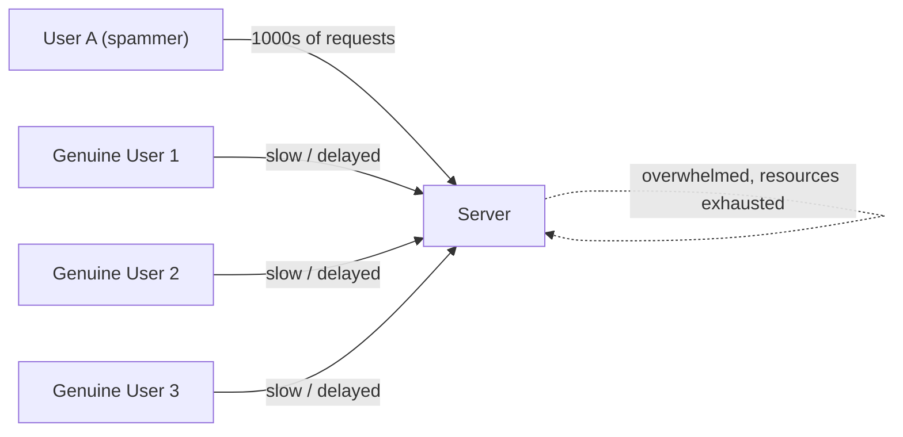
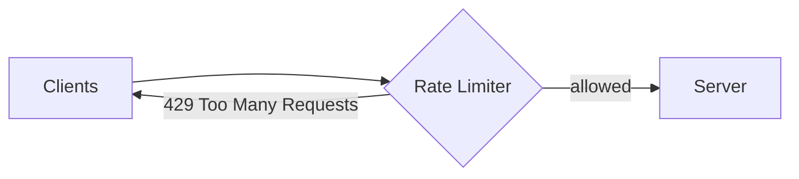
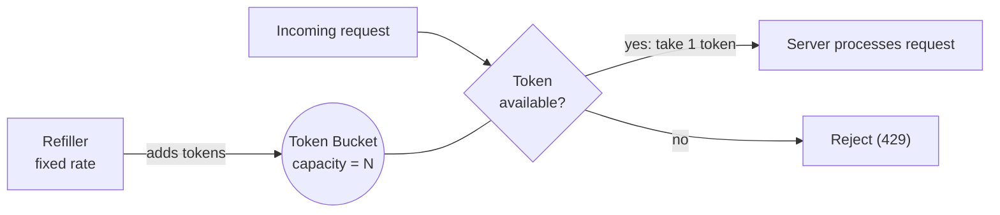
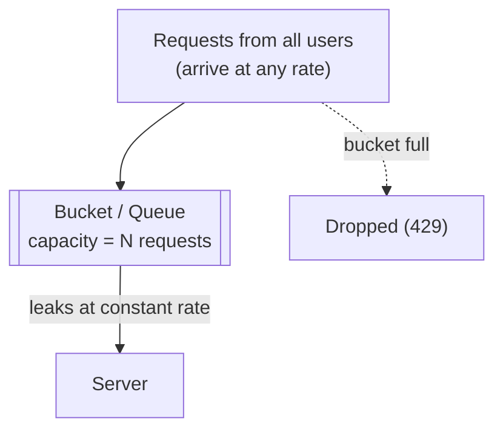
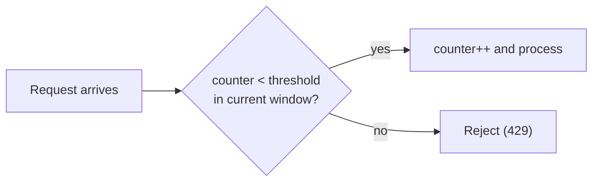
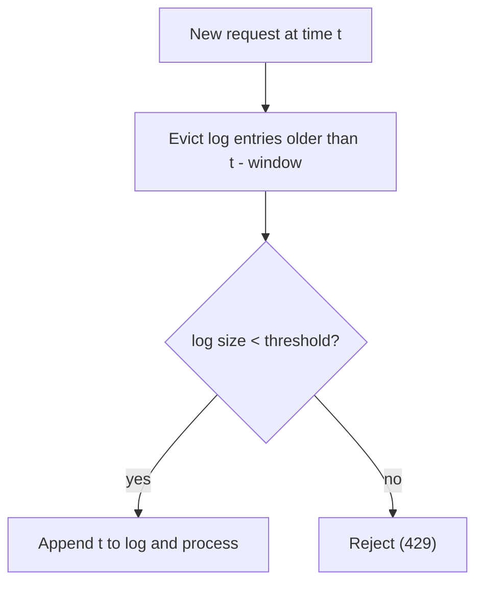
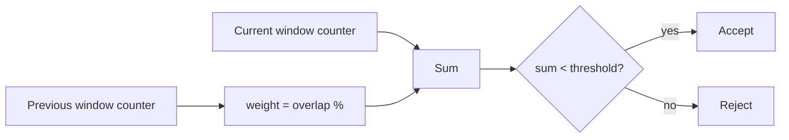

# Chapter 13: Rate Limiting and Rate Limiting Algorithms

> My notes on what rate limiting is, why every serious system needs it, and how the five classic algorithms (Token Bucket, Leaky Bucket, Fixed Window Counter, Sliding Window Log, Sliding Window Counter) work, along with their trade-offs.

---

## Table of Contents

1. [The Problem](#1-the-problem)
2. [What Is Rate Limiting?](#2-what-is-rate-limiting)
3. [Where the Rate Limiter Sits](#3-where-the-rate-limiter-sits)
4. [Algorithm 1: Token Bucket](#4-algorithm-1-token-bucket)
5. [Algorithm 2: Leaky Bucket](#5-algorithm-2-leaky-bucket)
6. [Algorithm 3: Fixed Window Counter](#6-algorithm-3-fixed-window-counter)
7. [Algorithm 4: Sliding Window Log](#7-algorithm-4-sliding-window-log)
8. [Algorithm 5: Sliding Window Counter](#8-algorithm-5-sliding-window-counter)
9. [Comparison and How to Choose](#9-comparison-and-how-to-choose)
10. [Practical Implementation Notes](#10-practical-implementation-notes)
11. [Key Takeaways](#11-key-takeaways)

---

## 1. The Problem

A typical application has many clients sending requests to a server, and the server answers each one. That is a normal request-response cycle.

Trouble starts when a single client sends requests continuously and aggressively (a script, a bot, a misconfigured retry loop, or a deliberate attack):

- The server's resources (CPU, memory, connections, database capacity) get consumed by one client.
- Genuine users now compete for whatever is left. Their requests queue up and responses are delayed.
- The server becomes slow and, in the worst case, unavailable for everyone.

A simple analogy: refreshing a large website thousands of times per second is effectively exploiting the provider's infrastructure. One abusive user should not be able to degrade the experience of everyone else.



---

## 2. What Is Rate Limiting?

**Rate limiting** is a technique that controls how many requests a client may send to a server within a given time window. Requests beyond the allowed rate are either **rejected** or **delayed**.

Example policy: *"One client may send at most 3 requests per minute."*

- Requests 1 to 3 in the minute: processed normally.
- Request 4 within the same minute: rejected (or told to wait).
- Once the minute elapses, the client can send requests again.

When a request is rejected, the standard response is:

```
HTTP 429 Too Many Requests
```

Often accompanied by a `Retry-After` header telling the client how long to wait.

### What do we limit by?

The "client" identity can be defined in several ways:

| Key | Notes |
|---|---|
| IP address | Simple, but many users can share one IP (NAT, offices) |
| User ID / session | Accurate for authenticated traffic |
| API key | Common for public APIs, supports per-plan limits |
| Endpoint | Protect expensive routes (e.g. `/login`, `/search`) more tightly |

### Benefits

- **Fairness:** no single client can monopolize resources.
- **Availability:** protects the server from overload and from simple DoS-style floods.
- **Cost control:** bounds usage of metered downstream resources.
- **Security:** slows brute-force attacks on login, OTP and password-reset endpoints.

---

## 3. Where the Rate Limiter Sits

The rate limiter is placed **in front of** the server, so rejected requests never consume application resources.



In practice it is usually implemented in one of these places:

- At the **API gateway** or load balancer (most common, centralised).
- As **middleware** inside the application.
- In a dedicated service backed by a fast shared store such as **Redis**, so limits hold across multiple server instances.

---

## 4. Algorithm 1: Token Bucket

### Idea

A **bucket** holds **tokens**. Every request must take one token to be processed. A **refiller** adds tokens to the bucket at a fixed rate. If the bucket is empty, the request is rejected.

Two parameters define the behaviour:

| Parameter | Meaning |
|---|---|
| **Bucket capacity** | Maximum tokens the bucket can hold (maximum burst size) |
| **Refill rate** | Tokens added per unit time (long-term sustained rate) |



### Worked example

Refill rate = **3 tokens/second**, capacity = **5 tokens**.

1. Second 1: the refiller adds 3 tokens. Users A, B and C each arrive and each take one token, and the server processes all three. The bucket is now empty.
2. User D arrives, finds no tokens, and is rejected.
3. Second 2: the refiller adds 3 more tokens. New arrivals can use them.
4. If a single user sends 3 requests at once, all three tokens go to that user and the bucket is empty again.
5. Suppose nobody arrives for 2 seconds. In the first second 3 tokens are added. In the second, the refiller tries to add 3 more, but capacity is 5, so only **2** fit (3 + 2 = 5). Extra tokens are discarded.

```
Time ->   t0        t1          t2
Bucket:   [     ]   [***  ]     [*****]   <- capped at capacity (5), not 6
```

### Strengths

- Allows **bursts** of traffic up to the bucket size while enforcing an average rate.
- Very cheap: only two numbers per client (token count, last refill timestamp).
- Widely used (many API gateways and cloud providers use variants of this).

### Drawbacks

1. **A burst can drain the bucket instantly.** If the refiller adds 20 tokens every 5 seconds and one user sends 20 requests immediately, the bucket is empty. Every other user must wait up to 4 seconds, which increases their **latency**.
2. **Unfairness / starvation.** One client can grab all the tokens, leaving others waiting.
3. **Tuning is non-trivial.** Capacity and refill rate must be chosen together; poor values give either too little burst tolerance or too much.

---

## 5. Algorithm 2: Leaky Bucket

### Idea

Requests are placed into a **bucket (queue)**. The bucket has a **hole** at the bottom, so requests **leak out** at a **constant rate** and are forwarded to the server. If the bucket is full when a new request arrives, that request is dropped.



Where Token Bucket controls *entry* with tokens, Leaky Bucket controls the *exit*: the server always sees a smooth, steady stream, regardless of how bursty the input is.

### Key parameters

| Parameter | Meaning |
|---|---|
| **Bucket size** | How many requests can wait in the queue |
| **Leak (outflow) rate** | Requests released to the server per unit time, set to match server capacity |

### Example

- Requests arrive at **1000 req/s**.
- The leak rate is **2 req/s**, which is what the server can safely handle.
- The server is never overloaded, since it only ever receives 2 req/s.

### Strengths

- Produces a **perfectly smooth output rate**, which protects fragile downstream services.
- Memory-efficient, since the queue has a fixed size.
- Good fit when the backend needs a stable processing rate (e.g. payment gateways, third-party APIs with strict quotas).

### Drawbacks

Suppose the bucket holds **2000 requests**, the inflow is **1000 req/s**, and the server processes **100 req/s**:

| Second | Arrivals | Processed | Queue size |
|---|---|---|---|
| 1 | +1000 | -100 | 900 |
| 2 | +1000 | -100 | 1800 |
| 3 | +1000 | -100 | would reach 2700, but capacity is 2000, so about 800 are dropped |

1. **High latency under load:** requests sit in the queue waiting their turn.
2. **Stale requests:** by the time an old request is processed, the client may have given up.
3. **Bursts are not tolerated well:** a burst fills the queue, after which new (possibly more important) requests are dropped.
4. Needs two parameters (queue size, leak rate) to be tuned correctly.

---

## 6. Algorithm 3: Fixed Window Counter

### Idea

Time is divided into **fixed-size windows** (e.g. 1 second each). For each window we keep a **counter** of requests. If the counter reaches the threshold, further requests in that window are rejected. When the next window starts, the counter resets to 0.

Threshold example: **3 requests per second** gives a window size of **1 second**.



### Walkthrough

```
Window 1 [0s - 1s]      Window 2 [1s - 2s]        Window 3 [2s - 3s]
 req -> counter 1  OK    2 reqs -> counter 2  OK    3 reqs -> counter 3  OK
 2 reqs -> counter 3 OK  1 req  -> counter 3  OK    1 req  -> REJECT
                         2 reqs -> REJECT           (counter resets at 3s)
```

At each window boundary the counter is reset to zero.

### Strengths

- Extremely simple to implement (one counter per client per window).
- Very low memory and CPU cost.

### The boundary problem

The weakness is at the **edges of windows**. The rule is "3 per second", yet a client can exceed that over *any* one-second span that straddles two windows.

```
 Window 1                    Window 2
|------------------------|------------------------|
0s                      1s                       2s
                 [  0.5s ----- 1.5s  ]   <- a 1-second span
                    *  *    |   *  *
                 2 requests | 2 requests = 4 requests in one second
```

- 2 requests arrive at 0.7s: counter(W1) = 2, allowed.
- 2 requests arrive at 1.2s: counter(W2) = 2, allowed.
- Between 0.5s and 1.5s, which is a valid 1-second span, the server processed **4** requests, even though the limit is **3**.

In the worst case a client can send up to **2x the limit** around a boundary.

---

## 7. Algorithm 4: Sliding Window Log

### Idea

This algorithm fixes the boundary problem by tracking the **exact timestamp of every accepted request** in a log, and using a **window that slides** with time rather than snapping to fixed boundaries.

Threshold example: **3 requests per 5 seconds**, so the window size is 5 seconds.

On each new request:

1. Remove all timestamps older than `now - window_size` from the log.
2. If the log contains fewer than the threshold entries, accept the request and append its timestamp.
3. Otherwise, reject.



### Walkthrough (limit = 3 per 5 s)

| Time | Event | Window | Log after | Result |
|---|---|---|---|---|
| 1s | request | [0, 5] | {1} | accepted |
| 3s | request | [0, 5] | {1, 3} | accepted |
| 4.5s | request | [0, 5] | {1, 3, 4.5} | accepted |
| 5.5s | request | [0.5, 5.5] | {1, 3, 4.5} | **rejected** (3 already in window) |
| 6.5s | 2 requests | [1.5, 6.5] | entry `1` expired, log is {3, 4.5} | first accepted -> {3, 4.5, 6.5}; second **rejected** |
| 7.5s | request | [2.5, 7.5] | still {3, 4.5, 6.5} | **rejected** |
| 8.5s | request | [3.5, 8.5] | `3` expired, log is {4.5, 6.5} | accepted |

The window slides continuously, so the limit is enforced for **every** possible window of that size, with no boundary loophole.

### Strengths

- **Most accurate** of all the algorithms; the limit is never exceeded in any window.

### Drawbacks

- **Memory-hungry:** it stores one timestamp per request. With a limit of 10,000 requests per window and millions of users, that adds up quickly.
- Eviction and counting add CPU cost (mitigated by sorted sets in Redis).
- Even rejected requests may be logged in some implementations, which inflates memory use.

---

## 8. Algorithm 5: Sliding Window Counter

### Idea

A **hybrid** of Fixed Window Counter and Sliding Window Log. We keep only **counters** (cheap, like fixed windows) but estimate the sliding window by taking a **weighted portion of the previous window** plus the **current window's count**.

```
Estimated count = (requests in current window)
                + (requests in previous window x overlap fraction of previous window)
```

### Example

Limit = 3 requests per second (1-second windows). We are 20% of the way into the current window, so the sliding 1-second span covers **80%** of the previous window and **20%** of the current one.

```
 Previous window (counter = 2)        Current window
|------------------------------|---------------------|
0s                            1s       ^ now = 1.2s
        |<---- 80% of prev ---->|<-- 20% of current -->|
```

- Previous window had **2** accepted requests, so 2 x 0.8 = **1.6** counted.
- Current window already has **1** request, so total = 1.6 + 1 = **2.6**.
- Threshold is 3, and 2.6 < 3, so the new request is **accepted**; the current window counter becomes 2 and the estimate rises to 3.6, so further requests are rejected until the window rolls forward.

If the estimate is already at or above the threshold, the request is rejected.



### Strengths

- **Memory-efficient** (two counters per client), like the fixed window.
- **Smooths out the boundary spike** of the fixed window approach.
- Good accuracy in practice; used by large-scale systems as a sensible default.

### Drawbacks

- It is an **approximation**: it assumes requests in the previous window were evenly distributed, which may not be true.
- Slightly more complex than fixed window.

---

## 9. Comparison and How to Choose

| Algorithm | Allows bursts | Memory | Accuracy | Output smoothness | Main weakness |
|---|---|---|---|---|---|
| Token Bucket | Yes (up to capacity) | Very low | Good | Bursty | One client can drain all tokens |
| Leaky Bucket | No (queued) | Low (queue) | Good | Very smooth | Latency; stale requests; queue fills |
| Fixed Window Counter | Yes (at edges) | Very low | Low at boundaries | Bursty | Up to 2x limit at window edges |
| Sliding Window Log | No | High | Exact | Smooth | Memory per request |
| Sliding Window Counter | Slightly | Low | Approximate (high) | Smooth | Assumes even distribution |

### Rules of thumb

- **Need to allow short bursts, with a long-term average limit?** Token Bucket.
- **Backend needs a steady, predictable input rate?** Leaky Bucket.
- **Simplest and cheapest, and boundary spikes are acceptable?** Fixed Window Counter.
- **Strict accuracy matters and volumes are moderate?** Sliding Window Log.
- **Large scale, good accuracy and low memory?** Sliding Window Counter.

---

## 10. Practical Implementation Notes

- **Shared state:** with multiple server instances, counters and tokens must live in a shared store (commonly **Redis**), otherwise each instance would enforce its own separate limit.
- **Atomicity:** read-modify-write on counters must be atomic (Redis `INCR`, Lua scripts, or transactions) to avoid race conditions where two concurrent requests both slip under the limit.
- **Informative responses:** return `429 Too Many Requests` and helpful headers such as `Retry-After`, or `X-RateLimit-Limit` / `X-RateLimit-Remaining`.
- **Different limits for different things:** stricter on `/login` and write endpoints, looser on cached reads; different tiers per plan.
- **Failure mode:** decide what happens if the rate limiter store is down (fail open to keep the service available, or fail closed to stay safe).
- **Clients should back off:** exponential backoff with jitter on the client side prevents synchronized retry storms.

---

## 11. Key Takeaways

- Rate limiting protects availability and fairness by capping how fast any one client can hit a system.
- Rejected requests get an **HTTP 429**; they never reach the application.
- **Token Bucket** and **Leaky Bucket** are bucket-based: one controls how requests *enter*, the other how they *leave*.
- **Fixed Window Counter** is simple but has the edge-of-window flaw. **Sliding Window Log** fixes it with perfect accuracy at a memory cost. **Sliding Window Counter** is the pragmatic hybrid.
- There is no single best algorithm; pick based on burst tolerance, memory budget, accuracy needs and backend sensitivity.
