# Chapter 14 — How HTTPS Works (SSL/TLS)

> **System Design Course Notes**
>
> Level: Beginner to Intermediate  
> Goal: Understand how HTTPS protects communication, why encryption alone cannot prevent man-in-the-middle attacks, how digital certificates establish server identity, and how TLS combines cryptography to provide confidentiality, integrity, and authentication.

---

## Table of Contents

1. [Introduction to HTTP and HTTPS](#1-introduction-to-http-and-https)
2. [Understanding Encryption](#2-understanding-encryption)
3. [Symmetric Encryption](#3-symmetric-encryption)
4. [Asymmetric Cryptography](#4-asymmetric-cryptography)
5. [Why HTTPS Uses Hybrid Cryptography](#5-why-https-uses-hybrid-cryptography)
6. [The Man-in-the-Middle Attack](#6-the-man-in-the-middle-attack)
7. [Digital Certificates and Certificate Authorities](#7-digital-certificates-and-certificate-authorities)
8. [How a Server Obtains a Certificate](#8-how-a-server-obtains-a-certificate)
9. [How Browsers Verify Certificates](#9-how-browsers-verify-certificates)
10. [How TLS Prevents Man-in-the-Middle Attacks](#10-how-tls-prevents-man-in-the-middle-attacks)
11. [Self-Signed Certificates](#11-self-signed-certificates)
12. [The TLS Handshake: From Connection to Secure Communication](#12-the-tls-handshake-from-connection-to-secure-communication)
13. [What HTTPS Protects—and What It Does Not](#13-what-https-protectsand-what-it-does-not)
14. [Common Misconceptions](#14-common-misconceptions)
15. [Quick Revision](#15-quick-revision)
16. [Interview Questions](#16-interview-questions)
17. [Key Takeaways](#17-key-takeaways)

---

# 1. Introduction to HTTP and HTTPS

## 1.1 What Is HTTP?

**HTTP (Hypertext Transfer Protocol)** is an application-layer protocol that defines how clients and servers exchange requests and responses.

A client might be a browser, mobile application, or backend service. A server receives requests, performs the required work, and returns responses.

For example, when you log in to a website, your browser might send a request like this:

```http
POST /login HTTP/1.1
Host: example.com
Content-Type: application/json

{
  "email": "user@example.com",
  "password": "mySecretPassword"
}
```

The server processes the request and returns a response.

The problem is that **HTTP by itself does not encrypt the request or response**.

An attacker who can observe unprotected HTTP traffic may be able to read credentials, inspect personal information, or modify messages in transit.


This is especially dangerous on untrusted networks, compromised routers, or other paths where an attacker can intercept traffic.

## 1.2 What Is HTTPS?

**HTTPS (HTTP Secure)** is HTTP communicated over a secure TLS connection.

```text
HTTP  = Application-layer request/response protocol

TLS   = Protocol that secures communication

HTTPS = HTTP operating over TLS
```

TLS stands for **Transport Layer Security**. It protects application data exchanged between the TLS endpoints.

When a browser connects to an HTTPS website, TLS establishes cryptographic keys and authenticates the server according to the configured trust model. HTTP messages are then protected using those keys.

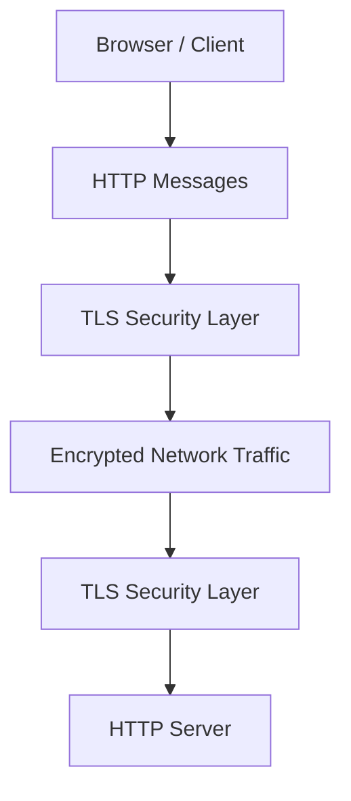

The attacker may still observe that a connection exists, along with certain metadata, but cannot ordinarily read or silently modify properly protected application data.

## 1.3 The Three Security Guarantees

HTTPS provides three central security properties.

| Property | Meaning | What it protects against |
|---|---|---|
| Confidentiality | Data is hidden from unauthorized observers | Reading intercepted messages |
| Integrity | Unauthorized changes to protected data are detected | Undetected message modification |
| Authentication | The peer's identity is verified according to the trust model | Connecting to an impostor server |

For typical browser HTTPS, server authentication is provided through TLS certificates and proof of possession of the corresponding private key.

Client authentication is optional. A normal HTTPS website usually does not require the visitor to present a client certificate.

**Important:** HTTPS protects communication between endpoints. It does not guarantee that the website itself is honest, malware-free, or safe to use.

---

# 2. Understanding Encryption

## 2.1 What Is Encryption?

Encryption transforms readable information into a form that cannot feasibly be understood without the required cryptographic key.

Two terms are useful:

- **Plaintext:** The original readable data.
- **Ciphertext:** The encrypted output.

Conceptually:

```text
Plaintext + Encryption Algorithm + Key
                  |
                  v
              Ciphertext
                  |
                  v
Ciphertext + Decryption Algorithm + Key
                  |
                  v
               Plaintext
```

Suppose a client wants to send:

```text
Transfer $500 to account 1234.
```

Instead of transmitting the message directly, the client encrypts it using an appropriate cryptographic algorithm and key.

An observer sees ciphertext rather than the original message.

Modern encryption algorithms are designed so that recovering plaintext without the necessary secret is computationally infeasible when the algorithm is correctly implemented and the keys remain secure.

## 2.2 Encryption Requires Keys

The algorithm alone does not provide security. The keys must also be managed correctly.

A useful analogy is a locked box:

- The encryption algorithm defines how the lock works.
- The key determines who can lock or unlock the box.
- The ciphertext is the locked box.
- Key management determines who can access the contents.

This leads to the central challenge of secure network communication:

**How can two parties communicate securely when they have not previously shared a secret?**

Two major cryptographic approaches help answer this question: symmetric encryption and asymmetric cryptography.

---

# 3. Symmetric Encryption

## 3.1 Definition

**Symmetric encryption** uses the same secret key for encryption and decryption.


Both parties must possess the same secret key and keep it confidential.

Common symmetric encryption algorithms include AES and ChaCha20. In secure protocols, these are commonly used with authenticated encryption mechanisms such as AES-GCM and ChaCha20-Poly1305.

## 3.2 Why Symmetric Encryption Is Efficient

Symmetric encryption is efficient enough to protect large amounts of application data.

After a secure connection is established, a browser may transmit megabytes of HTML, images, API responses, and other data. Symmetric cryptography is well suited to this task.

## 3.3 The Key-Distribution Problem

Imagine that a client generates a secret key:

```text
K = my-secret-session-key
```

The client encrypts a message using K.

The server needs K to decrypt the message.

But how can the client send K to the server securely if the network is not yet protected?

If the client transmits the key in plaintext, an attacker can capture it and decrypt the intercepted messages.

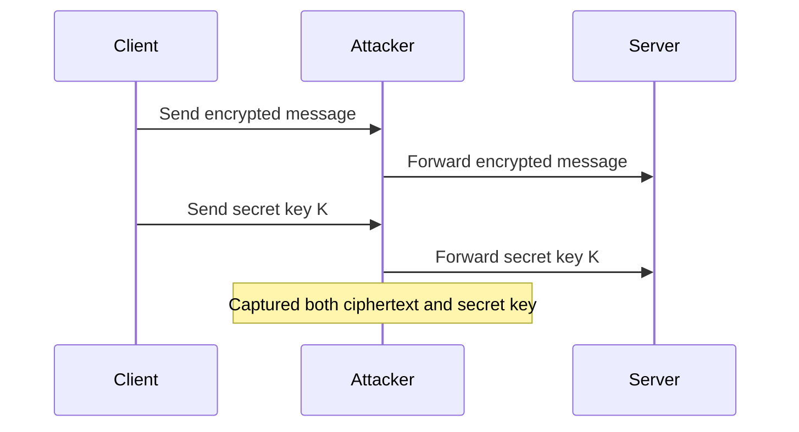

The encryption algorithm might be perfectly secure, but the key has been exposed.

### The lesson

Symmetric encryption is excellent for protecting data, but the communicating parties need a secure way to establish their shared secret.

That problem leads us to asymmetric cryptography.

---

# 4. Asymmetric Cryptography

## 4.1 Definition

**Asymmetric cryptography** uses a mathematically related pair of keys:

- **Public key:** Can be shared openly.
- **Private key:** Must remain secret.

The keys are related, but knowing the public key should not make it practically feasible to derive the private key.

Asymmetric cryptography supports several distinct operations, including encryption, digital signatures, and key establishment. These operations must not be confused with one another.

## 4.2 Public-Key Encryption

In a public-key encryption scheme, someone can encrypt a message using the recipient's public key. The corresponding private key is required to decrypt it.

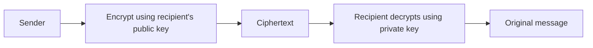

This can solve a key-distribution problem under the assumption that the public key genuinely belongs to the intended recipient.

However, **the assumption about identity is crucial**. An attacker can generate their own public/private key pair and pretend the public key belongs to the server.

We will address this in the man-in-the-middle section.

## 4.3 Digital Signatures

Digital signatures provide a different capability.

A signer uses a private signing key to produce a signature over data. A verifier uses the corresponding public key to check whether the signature is valid.

A signature can provide evidence that:

- The signed data has not been changed since signing.
- The signer possessed the corresponding private key.

A valid signature does not automatically prove a real-world identity. The verifier must also have a trustworthy way to associate the public key with that identity.

This is exactly where certificates become important.

## 4.4 Public-Key Cryptography Is Not One Single Mechanism

A common beginner mistake is to assume every public-key operation works by encrypting with one key and decrypting with the other.

Different algorithms have different purposes:

| Mechanism | Main purpose |
|---|---|
| RSA encryption | Public-key encryption in supported schemes |
| RSA signatures | Digital signatures |
| ECDSA | Digital signatures |
| Ed25519 | Digital signatures |
| ECDH | Establishing a shared secret using elliptic-curve Diffie–Hellman |
| X25519 | A widely used elliptic-curve Diffie–Hellman key-agreement mechanism |

For modern HTTPS, key agreement and digital signatures are particularly important.

**Critical technical distinction:** A public key used for a signature is not simply an encryption key that happens to be used differently. Cryptographic algorithms have specific security properties and intended uses.

---

# 5. Why HTTPS Uses Hybrid Cryptography

Using asymmetric cryptography for every byte of a large response would be inefficient. Symmetric encryption is better suited to protecting large amounts of data.

HTTPS therefore uses a hybrid approach:

1. Authenticate the server using its certificate and proof of private-key possession.
2. Establish shared cryptographic secrets using a secure key-agreement process.
3. Derive symmetric traffic keys.
4. Protect application data with symmetric authenticated encryption.

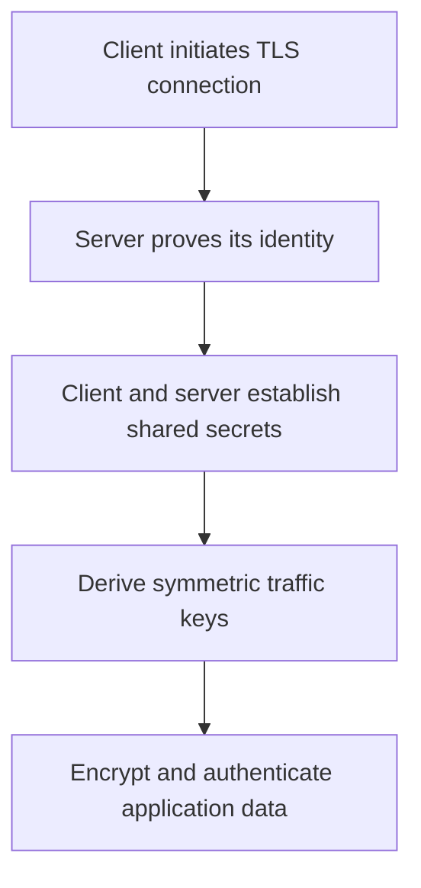

## 5.1 Why Not Just Use Symmetric Encryption?

Because the parties need a secure method to establish their secret keys.

## 5.2 Why Not Just Use Asymmetric Encryption?

Because symmetric encryption is generally more efficient for protecting the large volume of data exchanged during a session.

## 5.3 What Actually Happens in Modern TLS?

A useful distinction is between the conceptual hybrid approach and the exact protocol.

In TLS 1.3, a typical full handshake uses ephemeral Diffie–Hellman key agreement, often with X25519 or another supported group.

The client and server exchange public key shares and independently derive the same shared secret. The shared secret itself is not sent over the network.

The certificate authenticates the server, while its digital signature during the handshake proves possession of the corresponding private signing key.

The parties then derive traffic keys from the handshake secrets.

This means modern TLS 1.3 generally does **not** send a symmetric session key encrypted with the server's certificate public key.

That older explanation is a useful historical model of hybrid cryptography, but it is not an accurate description of the normal TLS 1.3 handshake.

---

# 6. The Man-in-the-Middle Attack

## 6.1 The Problem: Encryption Does Not Automatically Establish Identity

Suppose a client connects to a server and receives a public key.

The client can use the key to perform cryptographic operations, but how does it know the key belongs to the intended server?

Without authentication, the client might unknowingly establish an encrypted connection with an attacker.

This is called a **man-in-the-middle (MITM) attack**.

## 6.2 How the Attack Works

Imagine that an attacker can intercept communication between a browser and a banking website.

The attacker generates their own key pair:

```text
Attacker public key
Attacker private key
```

The attacker then impersonates the server when communicating with the browser.

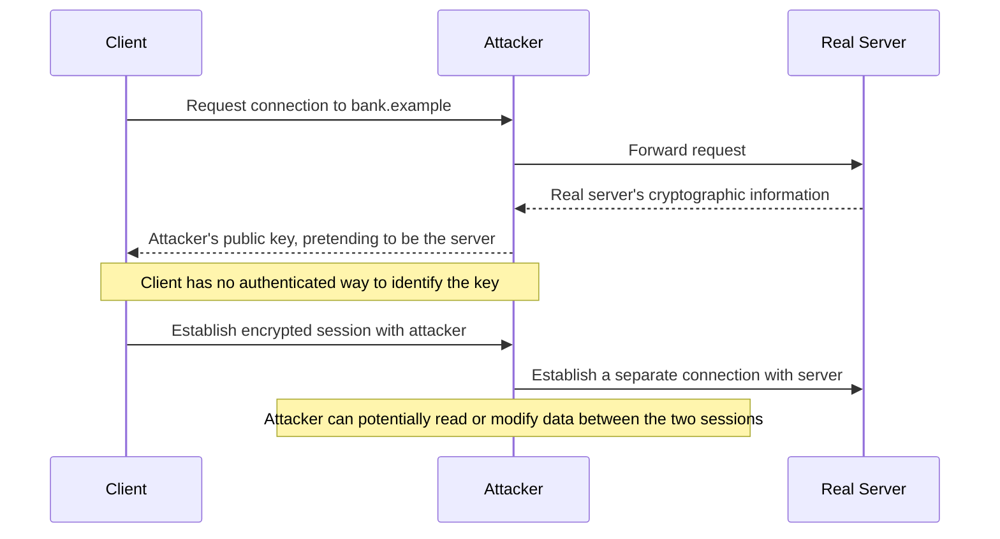

The attacker creates two separate encrypted connections:

- One between the client and the attacker.
- Another between the attacker and the legitimate server.

The client may believe it has a secure connection to the bank even though it has actually established one with the attacker.

Encryption is operating on both connections, but the client has authenticated the wrong endpoint.

## 6.3 Why a Reverse Proxy Analogy Helps

A reverse proxy normally receives requests on behalf of a backend server. That role is not inherently malicious.

An attacker performing a MITM attack behaves like an unauthorized intermediary: they intercept the connection, terminate one encrypted session, and create another.

The important issue is not that a proxy exists. It is that the client has been tricked into trusting the wrong endpoint.

## 6.4 The Missing Property: Authentication

The central question becomes:

> How can a client verify that a public key really belongs to the domain it intends to visit?

The solution used by ordinary HTTPS is a system of digital certificates, Certificate Authorities, and TLS handshake authentication.

---

# 7. Digital Certificates and Certificate Authorities

## 7.1 What Is a TLS Certificate?

A **TLS certificate** is a digitally signed document that binds a public key to an identity, such as a domain name.

For a typical public website, the certificate identifies the domain for which it is valid and contains the public key used in the server's authentication process.

The certificate is not the private key, and it does not contain the secret traffic keys used to encrypt the session.

## 7.2 What Does a Certificate Contain?

A typical X.509 server certificate contains fields such as:

| Field | Purpose |
|---|---|
| Subject Alternative Name (SAN) | Identifies the DNS names or IP addresses covered by the certificate |
| Subject public key information | Contains the public key and its algorithm |
| Issuer | Identifies the certificate issuer |
| Validity period | Specifies when the certificate is valid |
| Serial number | Identifies the certificate within the issuer's namespace |
| Key usage and extended key usage | Restrict supported cryptographic purposes |
| Digital signature | Allows the issuer's signature to be verified |

The domain name is generally checked against the certificate's Subject Alternative Name extension. Relying on the older Common Name field alone is not sufficient for modern browser validation.

## 7.3 What Is a Certificate Authority?

A **Certificate Authority (CA)** is an entity that issues certificates under defined policies.

Publicly trusted CAs are recognized through trust stores maintained by operating systems, browsers, or other software.

Examples of public certificate providers include Let's Encrypt, DigiCert, and Sectigo.

The client does not trust every certificate it receives. Instead, it evaluates whether the certificate chains to a trusted root and whether the relevant identity and validity checks succeed.

## 7.4 The Chain of Trust

A typical public certificate chain contains three levels:

1. **Root CA:** A trust anchor already trusted by the client.
2. **Intermediate CA:** A CA certificate signed by a trusted root or another trusted intermediate.
3. **Server certificate:** The certificate identifying the website, typically signed by an intermediate CA.

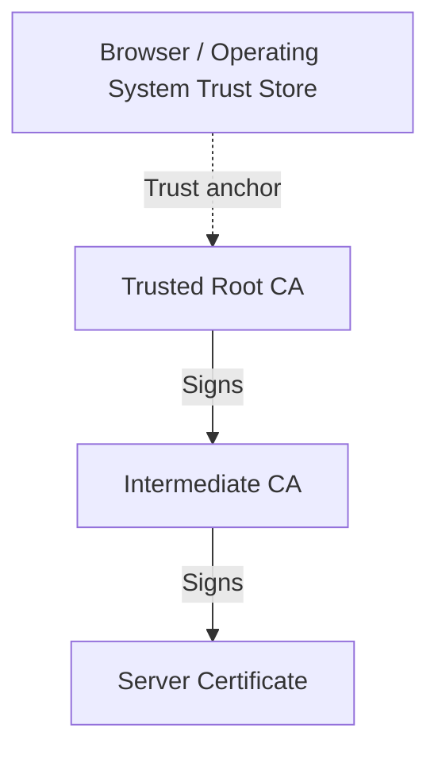

The arrows represent signing relationships.

The root certificate is commonly self-signed, but a browser does not trust it merely because its self-signature is valid. It trusts it because it has been included as a trust anchor through the client's trust configuration.

An intermediate CA helps protect the root's private key by allowing the root to remain offline or otherwise tightly controlled.

---

# 8. How a Server Obtains a Certificate

A website operator must obtain a certificate for the domain it intends to serve.

A simplified issuance workflow looks like this:

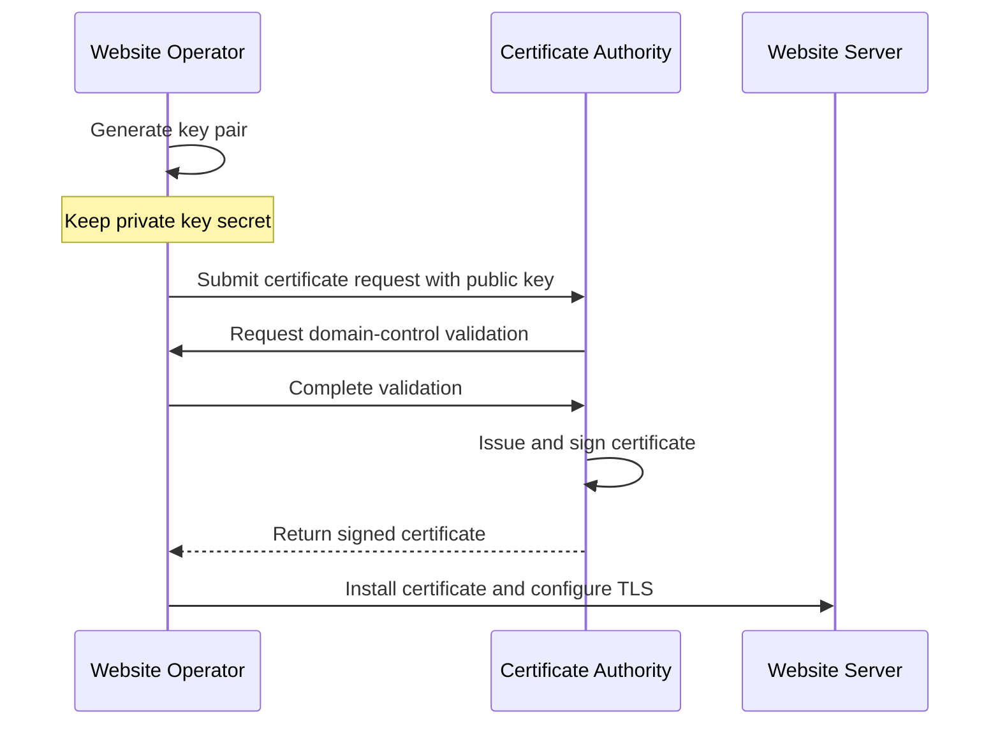

## Step 1: Generate a key pair

The server operator or certificate-management system generates the appropriate cryptographic key material.

The private key must remain protected. It is not sent to the CA as part of an ordinary certificate request.

## Step 2: Create a Certificate Signing Request

A **Certificate Signing Request (CSR)** contains the public key and requested identity information, along with a signature proving possession of the corresponding private key.

A CSR is a request for a certificate, not a certificate itself.

## Step 3: Prove control of the domain

The CA validates that the requester satisfies the required authorization rules.

Common methods include:

- **DNS validation:** Publish a required DNS record.
- **HTTP validation:** Serve a specific challenge at a required HTTP path.
- **TLS-based validation:** Complete a specified challenge using the domain's TLS service.

The exact methods available depend on the certificate type and the CA's rules.

## Step 4: The CA issues the certificate

Once the required validation succeeds, the CA creates and signs the certificate.

The signature allows clients to detect unauthorized modification and verify the issuer's signature.

## Step 5: Install and configure the certificate

The server administrator configures the certificate and corresponding private key.

In a typical deployment, the server sends its leaf certificate and necessary intermediate certificates during the TLS handshake.

The server should not send its private key to the client.

## Free vs. paid certificates

Some CAs provide certificates without charging a certificate fee, while other certificate products and services are paid.

A certificate's price does not automatically determine whether the cryptography is stronger. The certificate type, validation requirements, key management, and service configuration matter more.

---

# 9. How Browsers Verify Certificates

Receiving a certificate is not enough. The browser must validate it.

## 9.1 Step-by-Step Verification

Suppose the user visits:

```text
https://www.example.com
```

The server presents a certificate for that connection.

The browser performs several checks, including:

1. **Chain validation:** Can the certificate chain be validated to a trusted root?
2. **Signature validation:** Are the relevant certificate signatures cryptographically valid?
3. **Hostname validation:** Does the certificate cover `www.example.com`?
4. **Validity period:** Is the certificate within its permitted validity dates?
5. **Usage constraints:** Is the certificate suitable for the intended purpose?
6. **Additional policy checks:** Do applicable revocation, algorithm, and platform policies permit acceptance?

A certificate that passes the signature check may still be rejected because it covers the wrong domain or has expired.

## 9.2 How Digital Signatures Are Verified

A CA signs a certificate using its private signing key.

Conceptually, the CA produces a signature over the certificate's signed data. The browser uses the issuer's public key and a suitable signature-verification algorithm to verify that signature.

Modern signature verification is not simply a universal process of decrypting a hash with the CA's public key. The exact operation depends on the signature algorithm.

The important result is that the client can detect if the signed certificate data has been altered and verify that the signature was produced using the corresponding private key, assuming the cryptographic scheme is secure.

## 9.3 What Does the Certificate Actually Prove?

A valid certificate provides a binding between an identity and a public key under the issuer's validation process.

For a domain-validated certificate, the CA generally verifies control of the domain according to its validation procedures.

This does not mean the CA has verified that the business is honest, that the website's content is safe, or that every claim on the website is true.

The certificate's guarantee must not be interpreted more broadly than its validation policy supports.

## 9.4 Revocation and Expiration

A certificate should not be accepted merely because its signature is valid.

Certificates have validity periods. CAs can also revoke certificates, for example when a private key is compromised or a certificate was issued improperly.

Clients may use mechanisms such as OCSP, OCSP stapling, CRLs, browser-specific revocation systems, and other policies to handle revocation.

Revocation checking behavior varies by client and deployment. It is not accurate to assume that every browser always performs an identical, mandatory online revocation check for every certificate.

## 9.5 The Verification Decision

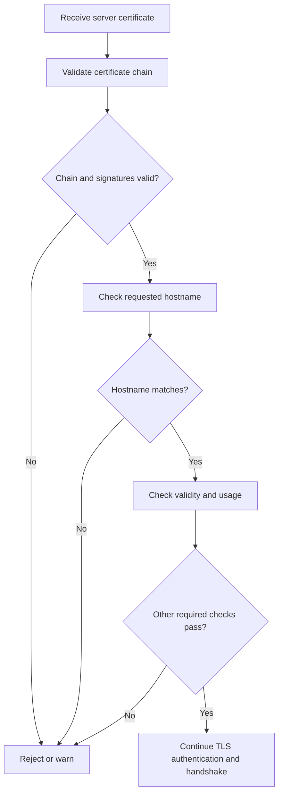

A successful certificate check is only one part of the TLS handshake. The server must also prove possession of the private key associated with its certificate, as required by the negotiated TLS handshake.

---

# 10. How TLS Prevents Man-in-the-Middle Attacks

Now revisit the earlier attack.

The attacker intercepts a browser connection to `bank.example` and presents their own public key.

The browser checks the associated certificate.

There are several possible outcomes.

### Case 1: The attacker has no acceptable certificate for the target domain

The certificate may be self-signed, issued by an untrusted CA, expired, or valid for a different hostname.

The browser rejects the connection or warns the user, depending on the failure and client policy.

### Case 2: The attacker forwards the real server's certificate

The certificate contains the legitimate server's public key.

Forwarding the certificate does not give the attacker the corresponding private key. In a normal TLS handshake, the attacker cannot impersonate the legitimate server merely by copying the certificate.

### Case 3: The attacker obtains a certificate that is accepted for the target domain

This is a more serious scenario. It could involve a compromised CA, improper certificate issuance, compromised domain control, or another failure in the trust process.

HTTPS security depends on protecting the entire authentication system, not just on using strong encryption.

## The Successful Attack Is Blocked

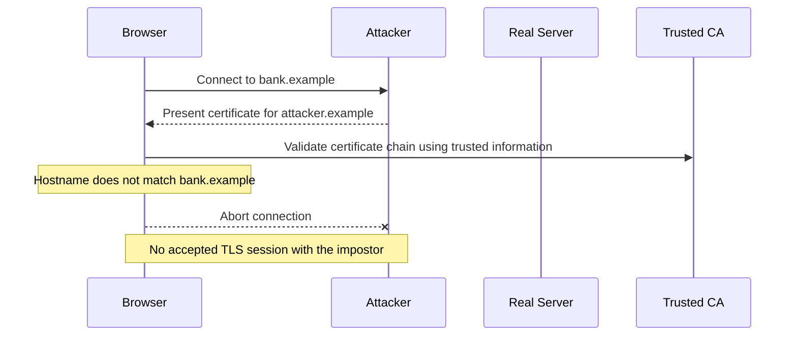

The browser detects that the certificate does not authenticate the intended hostname and refuses to proceed with an ordinary authenticated HTTPS connection.

### Why the certificate system works

The attacker may create a public/private key pair. What they cannot normally do is obtain an accepted certificate binding their public key to someone else's domain without satisfying the CA's validation requirements or compromising some part of the trust system.

**The key lesson:** Encryption protects data. Authentication helps ensure the encryption is established with the intended peer.

---

# 11. Self-Signed Certificates

## 11.1 What Is a Self-Signed Certificate?

A self-signed certificate is a certificate whose signature is created using the private key corresponding to the public key contained in that certificate.

Anyone can generate one.

Because there is no independently trusted issuer establishing the certificate's identity binding, a client that has not explicitly configured trust for it cannot ordinarily use it to authenticate a public website.

## 11.2 Does a Self-Signed Certificate Provide Encryption?

It can participate in an encrypted TLS connection.

However, encryption alone does not prove that the peer is the intended server.

If an attacker can replace the certificate with another self-signed certificate and the client accepts either one without a trusted identity check, the client may be communicating securely with the wrong party.

## 11.3 Appropriate Uses

Self-signed certificates can be useful for:

- Local development.
- Testing TLS configuration.
- Controlled environments with explicitly provisioned trust.
- Some internal systems where certificate trust is managed out of band.

For internal production environments, an organization may instead operate a private CA and install its trust anchor on authorized clients.

**Rule of thumb:** Do not disable certificate validation merely to make an HTTPS connection work. Fix the certificate, hostname, trust configuration, or chain problem instead.

---

# 12. The TLS Handshake: From Connection to Secure Communication

This section brings the previous concepts together.

Modern TLS 1.3 is more precise and secure than the simplified historical model in which the client encrypts a symmetric session key using the server's public key.

## 12.1 A Simplified TLS 1.3 Handshake

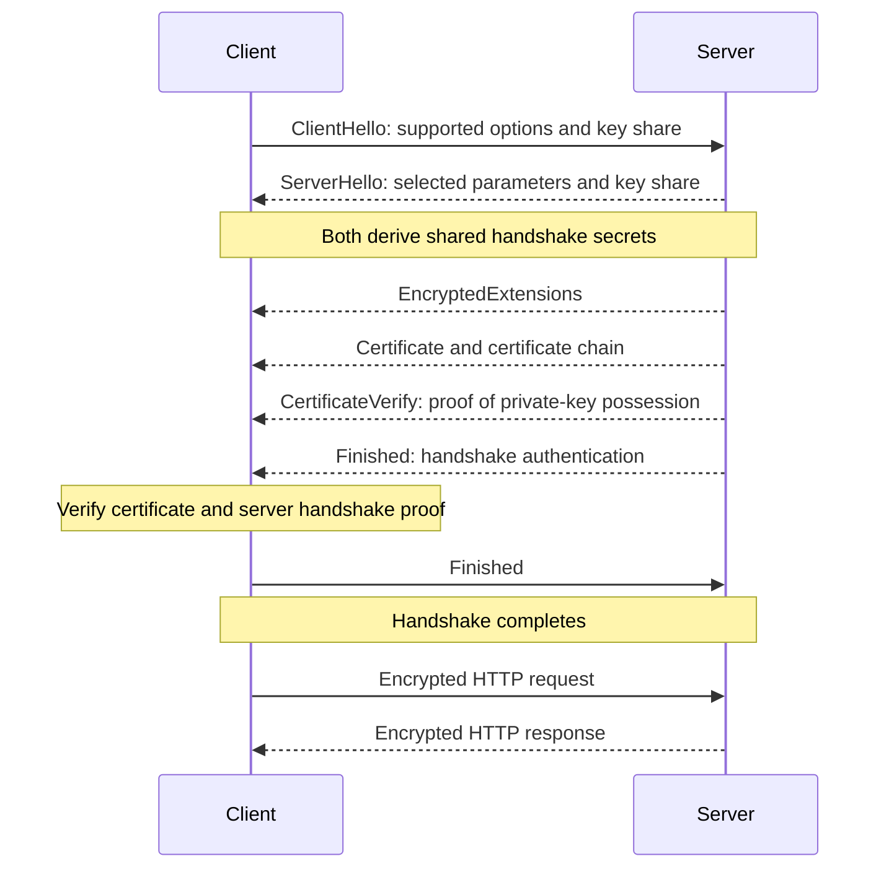

This is a simplified representation of a typical full TLS 1.3 handshake. Exact messages can vary depending on configuration, authentication requirements, and whether a resumed session is used.

## Step 1: ClientHello

The client initiates the TLS handshake and advertises supported protocol parameters and cryptographic options.

It typically includes an ephemeral key share for key agreement.

## Step 2: ServerHello

The server selects compatible parameters and provides its key share.

Using the exchanged key-agreement information and their own private ephemeral key material, the client and server independently derive a shared secret.

The secret itself is not transmitted across the network.

## Step 3: Derive handshake keys

The parties use a key-derivation function, together with the handshake secrets and transcript information, to derive keys for protecting handshake messages.

## Step 4: Authenticate the server

The server sends its certificate and a CertificateVerify message.

The CertificateVerify signature proves possession of the private key corresponding to the certificate and binds the proof to the handshake transcript.

The client validates the certificate chain, hostname, validity, and other required checks.

This combination matters: the certificate identifies the public key, while the handshake signature proves that the peer possesses the corresponding private key.

## Step 5: Verify Finished messages

The Finished messages provide cryptographic verification of the handshake transcript using keys derived during the handshake.

They help detect tampering with the handshake messages.

## Step 6: Derive application traffic keys

The client and server derive application traffic keys from the handshake's key schedule.

These symmetric keys protect subsequent application data.

The actual key material is never sent as a plaintext session key.

## Step 7: Exchange HTTP data

The browser sends HTTP requests through the established TLS connection.

The server decrypts and processes them, then returns protected HTTP responses.

The application data receives confidentiality and integrity protection from the negotiated TLS record-protection mechanism.

## 12.2 What About Forward Secrecy?

A common property of ephemeral key agreement is **forward secrecy**.

With a correctly implemented ephemeral Diffie–Hellman handshake, later compromise of the server's long-term certificate signing key does not by itself reveal previously recorded session traffic, assuming the ephemeral secrets were discarded and the other security assumptions hold.

This is one important reason modern TLS uses ephemeral key agreement rather than relying on older RSA key-transport handshakes.

## 12.3 HTTPS at a Glance

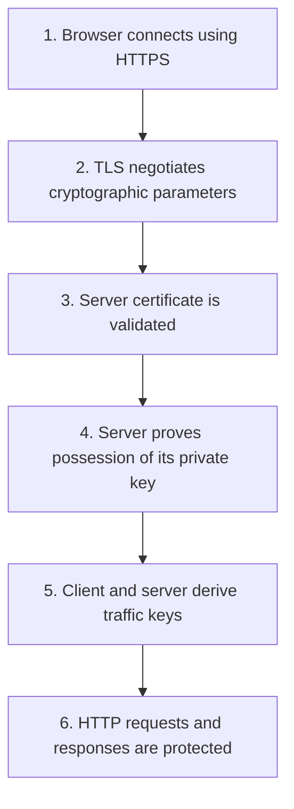

The central workflow is:

**Authenticate the server → establish shared secrets → derive symmetric keys → protect application traffic.**

---

# 13. What HTTPS Protects—and What It Does Not

HTTPS is essential, but it does not eliminate every security risk.

## 13.1 What HTTPS Protects

When correctly configured and authenticated, HTTPS protects against an ordinary network observer who attempts to:

- Read the contents of HTTP requests and responses.
- Modify protected traffic without detection.
- Impersonate the server without satisfying the client's authentication checks.
- Recover traffic keys merely by observing the handshake.

## 13.2 What HTTPS Does Not Automatically Protect

| Threat | Why HTTPS alone is insufficient |
|---|---|
| Phishing | A malicious website can have a valid certificate for its own domain |
| Malware on the device | Malware may read data before encryption or after decryption |
| Compromised server | The server can access the data it is designed to process |
| Application vulnerabilities | SQL injection, broken authorization, and logic errors remain possible |
| Weak passwords | TLS does not make an easy-to-guess password strong |
| Metadata exposure | IP addresses, traffic timing, and some connection metadata may remain visible |
| Malicious browser extensions | Extensions may access browser data depending on permissions |
| Incorrect certificate trust | A compromised or misconfigured trust system can undermine authentication |

HTTPS is a transport-security mechanism, not a substitute for secure application design.

## 13.3 What Can a Network Observer Still Learn?

Even when HTTPS is working correctly, an observer may be able to infer that a device communicates with a particular IP address, observe traffic volume, and measure timing.

DNS requests may also reveal domain lookups unless protected by appropriate mechanisms. TLS generally does not hide every aspect of the connection from the network.

The HTTP request path and headers are protected inside the TLS connection, but some metadata needed to establish or route the connection may be visible.

---

# 14. Common Misconceptions

### Misconception 1: HTTPS means the website is trustworthy.

**Correction:** HTTPS authenticates the server's domain according to the certificate system. It does not guarantee that the site is honest or safe.

### Misconception 2: The certificate contains the private key.

**Correction:** A normal TLS certificate contains public key information. The associated private key is kept separately and must be protected.

### Misconception 3: The browser encrypts every message using the server's public key.

**Correction:** Modern TLS generally uses public-key cryptography for authentication and key agreement, then symmetric traffic keys to protect application data.

### Misconception 4: A certificate proves that a company is legitimate.

**Correction:** A domain-validated certificate normally establishes a validated association between a domain and a public key. It does not automatically establish the owner's honesty or business legitimacy.

### Misconception 5: A valid signature alone proves that a certificate is safe.

**Correction:** The client must also validate the trust chain, hostname, validity period, intended usage, and other applicable requirements.

### Misconception 6: Self-signed certificates cannot encrypt traffic.

**Correction:** They can support encrypted TLS sessions, but clients need a trustworthy way to authenticate the identity. Self-signing alone does not provide public trust.

### Misconception 7: TLS makes a compromised server safe.

**Correction:** TLS protects data in transit. A compromised endpoint can access data available to that endpoint.

### Misconception 8: SSL and TLS are interchangeable modern protocols.

**Correction:** SSL is the historical predecessor. Modern HTTPS uses TLS. The phrase "SSL certificate" remains common terminology, even though the certificate is used with TLS.

---

# 15. Quick Revision

| Concept | Meaning | Role in HTTPS |
|---|---|---|
| HTTP | Application-layer request/response protocol | Defines web communication |
| HTTPS | HTTP secured by TLS | Protects HTTP traffic |
| TLS | Transport Layer Security | Provides secure communication |
| Symmetric encryption | Shared secret key protects data | Efficient application traffic protection |
| Asymmetric cryptography | Public/private key mechanisms | Authentication and key agreement |
| Key agreement | Parties independently establish shared secret material | Establishes the basis for traffic keys |
| Digital signature | Cryptographic proof verifiable with a public key | Authenticates handshake messages and signed data |
| Certificate | Signed identity-to-public-key binding | Associates a public key with a domain |
| Certificate Authority | Entity that issues certificates | Establishes trusted certificate bindings |
| Trust store | Collection of trusted certificate authorities or trust anchors | Provides the starting point for certificate validation |
| Certificate chain | Sequence of certificate signatures leading to a trust anchor | Enables certificate trust validation |
| MITM attack | Attacker intercepts communication between endpoints | Addressed through authenticated TLS |
| Forward secrecy | Past session secrets remain protected after certain later key compromises | Supported by ephemeral key agreement |
| Self-signed certificate | Certificate signed by its own corresponding private key | Useful in controlled trust environments |

## The Entire Concept in Six Lines

1. HTTP alone does not encrypt traffic.
2. Symmetric encryption is efficient but requires both parties to establish shared secret keys.
3. Public-key cryptography supports authentication and key agreement without sending the shared secret directly.
4. Certificates help a client associate a server's public key with the intended domain.
5. TLS authenticates the server and derives traffic keys through a secure handshake.
6. HTTPS then protects HTTP data with confidentiality and integrity, subject to correct configuration and secure endpoints.

---

# 16. Interview Questions

### Q1. What is the difference between HTTP and HTTPS?

HTTP defines the request-response protocol. HTTPS is HTTP protected by TLS, which provides confidentiality, integrity, and authentication.

### Q2. Why is symmetric encryption insufficient by itself for secure communication?

Both parties need the same secret key. If that key is transmitted over an unprotected channel, an attacker may obtain it. A secure key-establishment mechanism is therefore needed.

### Q3. What is the difference between symmetric and asymmetric cryptography?

Symmetric encryption uses a shared secret key. Asymmetric cryptography uses related public and private keys for operations such as digital signatures, public-key encryption, or key agreement.

### Q4. Why does HTTPS use both symmetric and asymmetric cryptography?

Public-key mechanisms support authentication and secure key establishment, while symmetric cryptography efficiently protects large volumes of application data.

### Q5. What is a man-in-the-middle attack?

An attacker intercepts communication between two parties and attempts to impersonate one or both endpoints, potentially reading or modifying information.

### Q6. What is the role of a TLS certificate?

It binds a public key to an identity, such as a domain name, through a digitally signed certificate that clients can validate using a trusted chain.

### Q7. What is a Certificate Authority?

A CA issues certificates under defined validation policies. Its certificates or trust anchors allow clients to validate chains leading to the identities they trust.

### Q8. Why does the browser need a trust store?

It needs a trusted starting point for certificate-chain validation. Without a trustworthy association between the issuer's key and the trust anchor, a certificate signature alone cannot establish the intended identity.

### Q9. What happens if the certificate is valid but the hostname is wrong?

The browser rejects the certificate for that hostname because the certificate does not authenticate the domain the client intended to visit.

### Q10. Does TLS 1.3 encrypt a session key using the server's certificate public key?

Not in the normal full handshake. TLS 1.3 typically uses ephemeral Diffie–Hellman key agreement to derive shared secrets, then derives symmetric traffic keys.

### Q11. What is forward secrecy?

It is a property under which later compromise of a long-term authentication key does not, by itself, reveal previously recorded session traffic. Ephemeral key agreement can provide this property when correctly implemented.

### Q12. What is the difference between a certificate and a private key?

The certificate contains public identity and key information plus an issuer's signature. The private key is secret cryptographic material used in operations such as signing or key establishment.

### Q13. Can a self-signed certificate encrypt communication?

Yes. Encryption can still occur, but a client that does not explicitly trust the certificate lacks a reliable basis for authenticating the server's identity.

### Q14. Does HTTPS hide all information from network observers?

No. It protects application data, but IP addresses, timing, traffic volume, and some connection metadata may remain visible.

### Q15. What are the three main guarantees of HTTPS?

Confidentiality, integrity, and authentication.

---

# 17. Key Takeaways

- **HTTPS = HTTP over TLS.** TLS protects communication between endpoints.
- **Symmetric encryption** efficiently protects application data but requires secure establishment of shared keys.
- **Asymmetric cryptography** provides mechanisms for authentication, digital signatures, and key agreement.
- **Certificates bind public keys to identities** under a CA's validation process.
- **The trust store establishes the starting point** for validating certificate chains.
- **Certificate validation and handshake authentication work together** to prevent ordinary key-substitution attacks.
- **Modern TLS 1.3 uses ephemeral key agreement** rather than the older RSA session-key-transport model.
- **A certificate is public; the private key must remain secret.**
- **Self-signed certificates can encrypt**, but public clients do not automatically trust their identity claims.
- **HTTPS protects data in transit**, not every aspect of the application, device, or website.

---

## Recommended Next Topics

To deepen your understanding of web security and networking, study these topics next:

1. **TCP vs. UDP** — Understand the transport layer beneath HTTPS.
2. **DNS and Domain Resolution** — Learn how a browser finds a server.
3. **TLS 1.3 in Detail** — Study handshake messages, key derivation, and session resumption.
4. **Digital Signatures and Hashing** — Understand certificate signatures and integrity.
5. **Cookies, Sessions, and Authentication** — Learn how web applications maintain user identity.
6. **OAuth 2.0 and OpenID Connect** — Understand delegated authorization and user authentication.

The most important mental model to retain is this:

**TLS does not merely encrypt a connection. It authenticates the intended server, establishes shared secrets, derives traffic keys, and then protects communication against network observation and tampering.**