# Chapter 14: How HTTPS Works (SSL & TLS)

> My notes on how a client and server communicate securely over the internet: why plain HTTP is unsafe, how symmetric and asymmetric encryption fit together, why encryption alone is not enough (the man-in-the-middle problem), and how SSL/TLS certificates and Certificate Authorities establish trust.

---

## Table of Contents

1. [The Starting Point: HTTP](#1-the-starting-point-http)
2. [Idea 1: Encrypt the Data](#2-idea-1-encrypt-the-data)
3. [Symmetric Encryption and Its Key-Sharing Problem](#3-symmetric-encryption-and-its-key-sharing-problem)
4. [Asymmetric Encryption](#4-asymmetric-encryption)
5. [The Hybrid Approach](#5-the-hybrid-approach)
6. [The Remaining Hole: Man-in-the-Middle as a Reverse Proxy](#6-the-remaining-hole-man-in-the-middle-as-a-reverse-proxy)
7. [The Solution: SSL/TLS Certificates](#7-the-solution-ssltls-certificates)
8. [How a Certificate Is Obtained](#8-how-a-certificate-is-obtained)
9. [How the Client Verifies the Server](#9-how-the-client-verifies-the-server)
10. [Foiling the Attacker](#10-foiling-the-attacker)
11. [Self-Signed Certificates](#11-self-signed-certificates)
12. [The Full HTTPS Flow at a Glance](#12-the-full-https-flow-at-a-glance)
13. [Key Takeaways](#13-key-takeaways)

---

## 1. The Starting Point: HTTP

A client sends a request and the server returns a response. That is the basic request-response cycle, and it normally runs over **HTTP**.

The catch: **HTTP sends data in plain text.** Anything that travels between the client and the server is readable by anyone who can observe the traffic.

Consider a banking app where a user submits an email and password. A **man-in-the-middle (MITM)** attacker sitting anywhere on the path (public Wi-Fi, a compromised router, an ISP-level tap) can simply read those credentials.

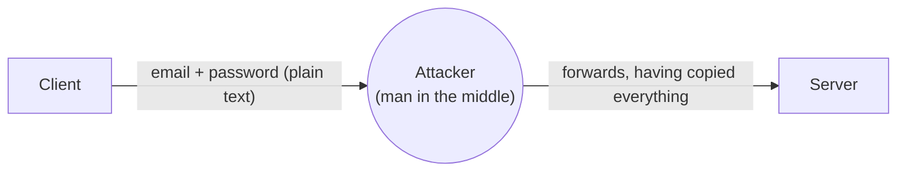

We need to make the data unreadable to anyone except the intended server.

---

## 2. Idea 1: Encrypt the Data

Instead of sending the email and password directly, the client **encrypts** (locks) the data before sending it. The server **decrypts** (unlocks) it on arrival. An attacker who intercepts the traffic only sees scrambled bytes.

This raises the real question: **which keys do we use to lock and unlock the data, and how do both sides get them safely?**

---

## 3. Symmetric Encryption and Its Key-Sharing Problem

In **symmetric encryption**, a **single shared key** is used for both encryption and decryption.

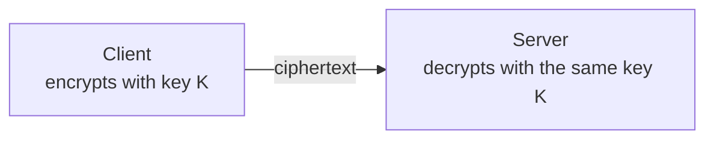

It is fast and efficient, which is why bulk data encryption uses it. But there is a fundamental flaw:

> For the server to decrypt the data, it needs the same key. So the key must be sent to the server too.

If the key travels over the same insecure network, the attacker simply captures **both the encrypted data and the key**, and decrypts everything.

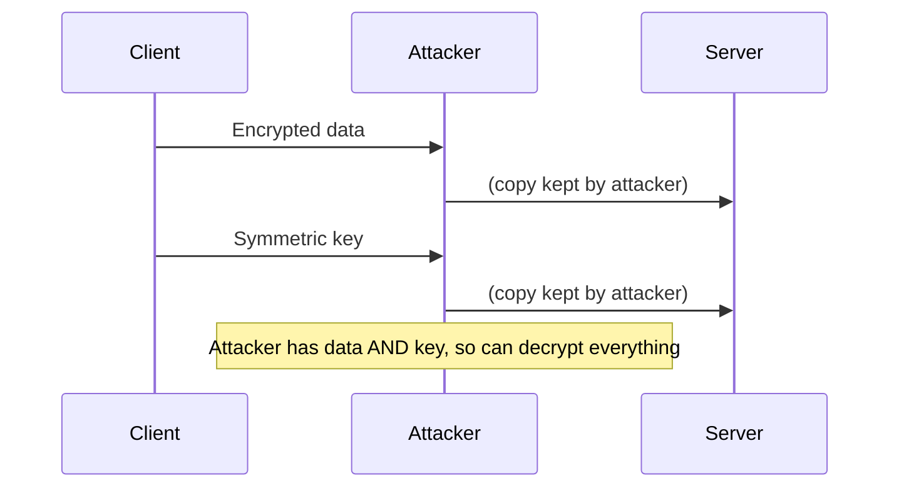

**Conclusion:** symmetric encryption alone cannot solve the key-distribution problem.

---

## 4. Asymmetric Encryption

**Asymmetric encryption** uses a **key pair**:

| Key | Who holds it | Purpose |
|---|---|---|
| **Public key** | Shared with anyone | Used to **encrypt** data |
| **Private key** | Kept secret by the owner | Used to **decrypt** data |

The crucial property: **data encrypted with a public key can only be decrypted by the matching private key.** Knowing the public key does not help anyone recover the private key.

So the server can publish its public key openly. Even if an attacker copies it, they can only use it to *encrypt* messages to the server, never to *read* them.

The downside: asymmetric cryptography is **computationally expensive**, so it is impractical for encrypting every byte of a long session.

---

## 5. The Hybrid Approach

The practical solution combines both: use **asymmetric encryption** to safely exchange a **symmetric key**, then use that fast symmetric key for the actual data.

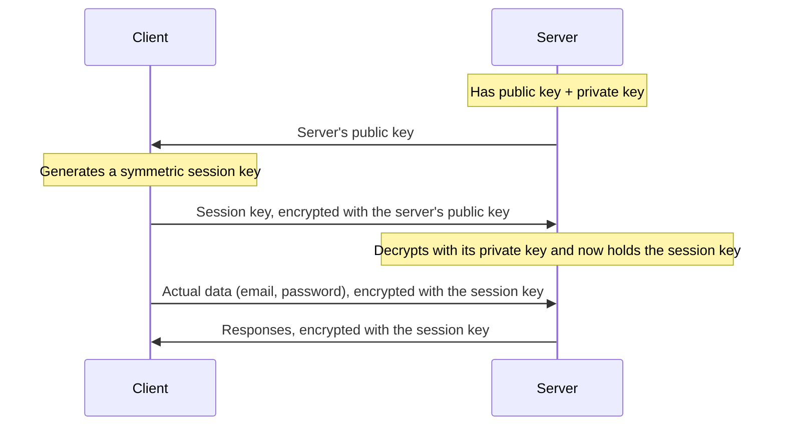

Step by step:

1. The server sends its **public key** to the client. An attacker may copy it, which is harmless.
2. The client generates a **symmetric key** and encrypts it with the server's public key.
3. The client sends this encrypted key to the server.
4. Only the server's **private key** can decrypt it, so the attacker watching the wire learns nothing.
5. Both sides now share a symmetric key that was never exposed. All further traffic uses it.

At this point it looks secure. So how can an attacker still break it?

---

## 6. The Remaining Hole: Man-in-the-Middle as a Reverse Proxy

The weakness is **trust**. The client receives *a* public key, but has **no way of knowing whether it truly belongs to the server**.

If the attacker acts as a **reverse proxy** sitting between client and server, this is what happens:

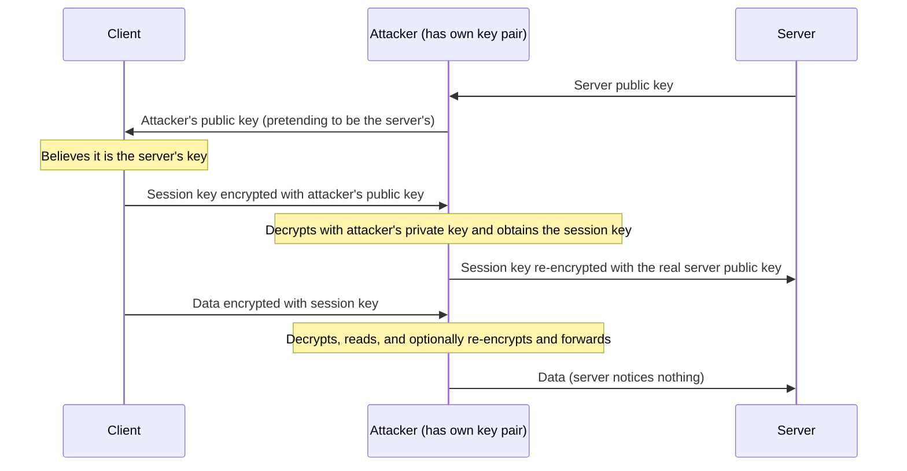

Result: the attacker has the session key and can read and even modify all the traffic, despite both symmetric and asymmetric encryption being in use.

**The root problem is not encryption strength, it is authentication.** The client needs a way to verify: *"Is this public key really from the server I intended to talk to?"* We need a **trusted third party** to vouch for the server's identity.

---

## 7. The Solution: SSL/TLS Certificates

An **SSL/TLS certificate** is a digital document that binds a **domain name** to a **public key**, vouched for by a **Certificate Authority (CA)** that clients already trust.

> Note on naming: SSL is the older protocol; modern secure connections actually use **TLS** (Transport Layer Security). The name "SSL certificate" has stuck around, but today's handshake is TLS. HTTPS = HTTP running over TLS.

### What a certificate contains

| Field | Meaning |
|---|---|
| **Domain name** | The site the certificate was issued for (e.g. `www.example.com`) |
| **Server's public key** | The key clients should use for this domain |
| **Issuer** | The CA that vouches for it |
| **Validity period** | Not-before / not-after dates |
| **Digital signature** | The CA's cryptographic proof that the above details are authentic and unmodified |

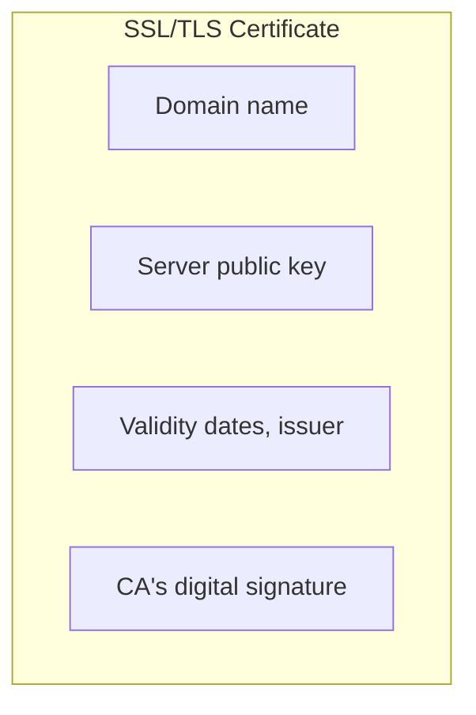

### Certificate Authorities (CAs)

CAs are organizations trusted by browsers and operating systems, such as GoDaddy, DigiCert, Sectigo and Let's Encrypt. Their public keys come **pre-installed** in the client's trust store, which is why the client can verify their signatures without trusting the server.

---

## 8. How a Certificate Is Obtained

We do not create the certificate ourselves, we request it from a CA.

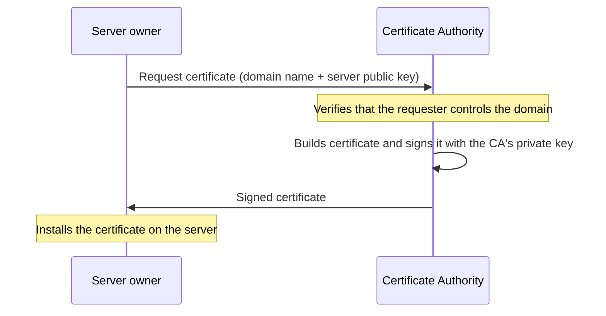

1. Generate a key pair on the server (the private key never leaves the server).
2. Send the **domain name** and **public key** to the CA.
3. The CA verifies domain ownership.
4. The CA **signs** the certificate and returns it.

Commercial CAs charge for some certificate types, while others (like Let's Encrypt) issue them for free through automation.

---

## 9. How the Client Verifies the Server

When the client connects, the server sends its **certificate** along with its public key (the public key is inside the certificate). The client then verifies it.

The intuition from my notes: *the signature is the CA's stamp that "this public key belongs to this domain", and the client re-checks that stamp using the CA's public key.* In more precise terms:

1. The CA computed a **hash** of the certificate contents (domain + server public key + other fields) and **signed** it using the **CA's private key**. That is the signature.
2. The client already has the **CA's public key** in its trust store.
3. The client uses the CA's public key to verify the signature, and independently hashes the certificate contents it received.
4. If the signature is valid and matches, then the certificate has **not been altered** and was **really issued by that CA**, so the public key inside belongs to that domain.
5. The client also checks that the domain matches the one it requested, and that the certificate has not expired or been revoked.

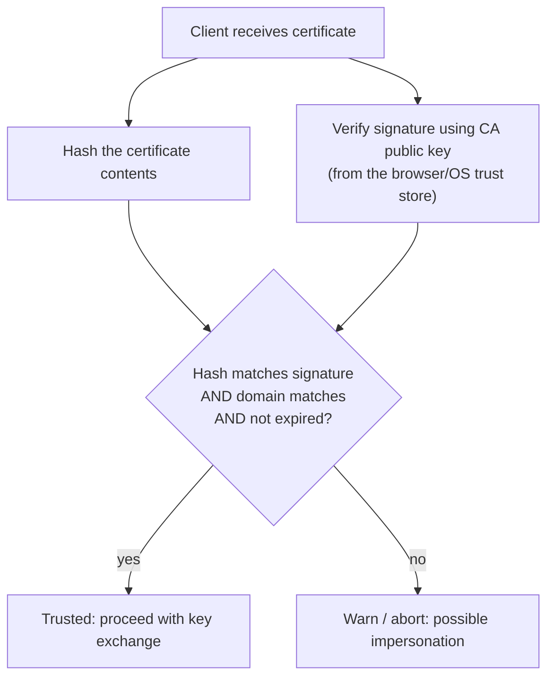

Real-world certificates are usually validated through a **chain of trust**: server certificate -> intermediate CA -> root CA (pre-trusted in the client). The logic at each link is the same signature check.

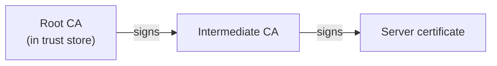

---

## 10. Foiling the Attacker

Now repeat the earlier attack with certificates in place.

**Scenario:** the attacker intercepts the connection and sends **their own public key** to the client, claiming it is the server's.

- The attacker has no valid certificate for the target domain, because a CA would not issue one to someone who doesn't control it.
- If they forward the real server's certificate, the public key inside will be the server's, not theirs, so using it gains them nothing (they cannot decrypt without the server's private key).
- If they present a certificate with *their* key, the signature will **not verify**: the CA never signed that combination of domain + key.

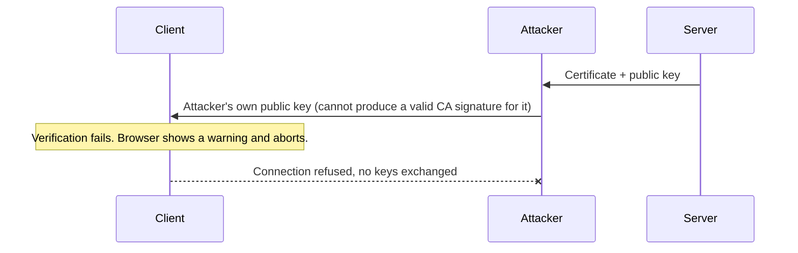

The client detects the mismatch and refuses to proceed, so the symmetric key is never handed to the attacker. This is what browsers surface as a certificate error or "Your connection is not private".

---

## 11. Self-Signed Certificates

Anyone can generate their own certificate and sign it with their own key, which is called a **self-signed certificate**.

- It gives encryption, but **no third-party verification of identity**.
- Browsers do not trust it by default and show a warning, because anyone (including an attacker) could have produced it.
- Reasonable for **local development, internal tools and testing**, where you control both ends and can explicitly trust the certificate.
- Not appropriate for public production sites.

---

## 12. The Full HTTPS Flow at a Glance

A simplified view of what happens when a browser opens an HTTPS site:

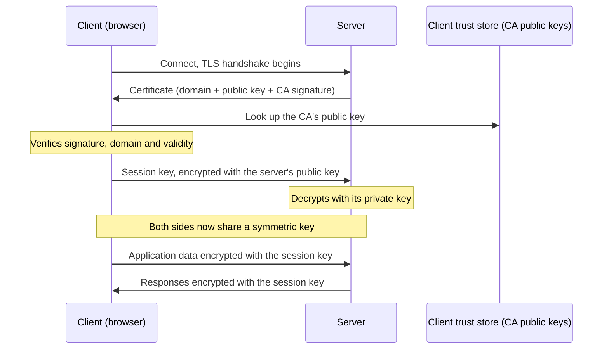

> Modern TLS 1.3 uses ephemeral Diffie-Hellman key exchange rather than directly encrypting a session key with the server's public key, which gives forward secrecy. The overall idea is the same: use asymmetric crypto and certificates to authenticate and agree on a shared symmetric key, then use that key for speed.

Three guarantees HTTPS provides:

| Property | How it is achieved |
|---|---|
| **Confidentiality** | Symmetric encryption of all data in transit |
| **Integrity** | Tampering is detected (message authentication) |
| **Authentication** | Certificate verified by a trusted CA proves the server's identity |

---

## 13. Key Takeaways

- **HTTP is plain text**, so anyone on the path can read or alter it. **HTTPS = HTTP + TLS.**
- **Symmetric encryption** is fast but has a key-distribution problem. **Asymmetric encryption** solves key exchange but is slow. Real systems use both (the hybrid approach).
- Encryption alone is not enough: without verifying *who* you are talking to, a man-in-the-middle can substitute their own public key.
- An **SSL/TLS certificate** binds a domain to a public key, signed by a **Certificate Authority** the client already trusts.
- The client verifies the signature using the CA's public key from its trust store, so an attacker's substituted key fails verification.
- **Self-signed certificates** encrypt but are not trusted, so keep them for development and testing.
