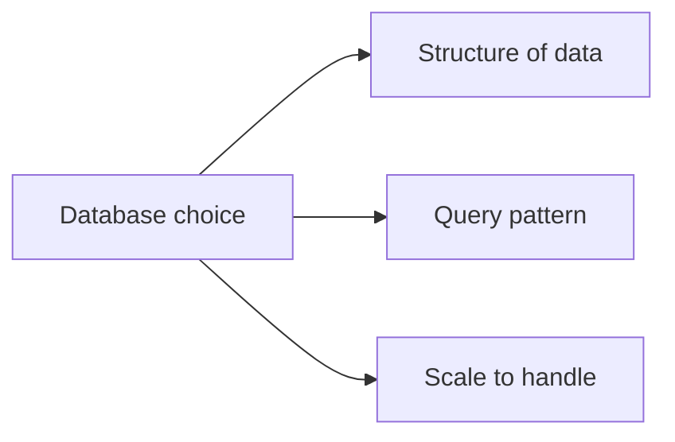
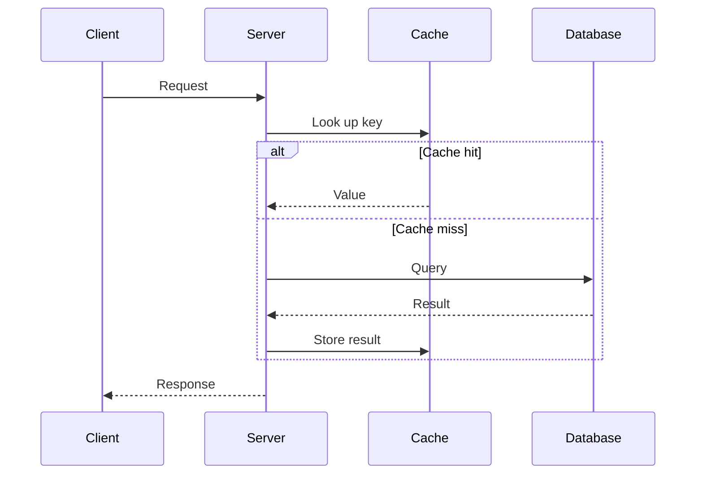
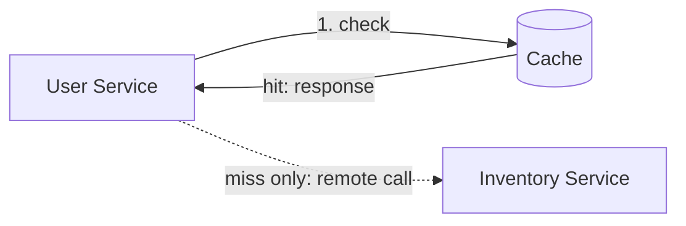
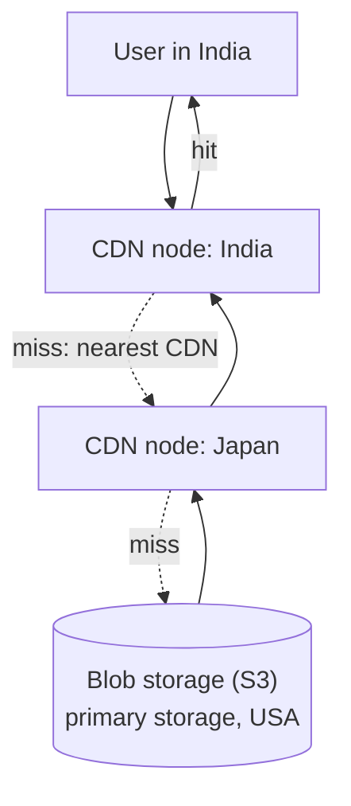
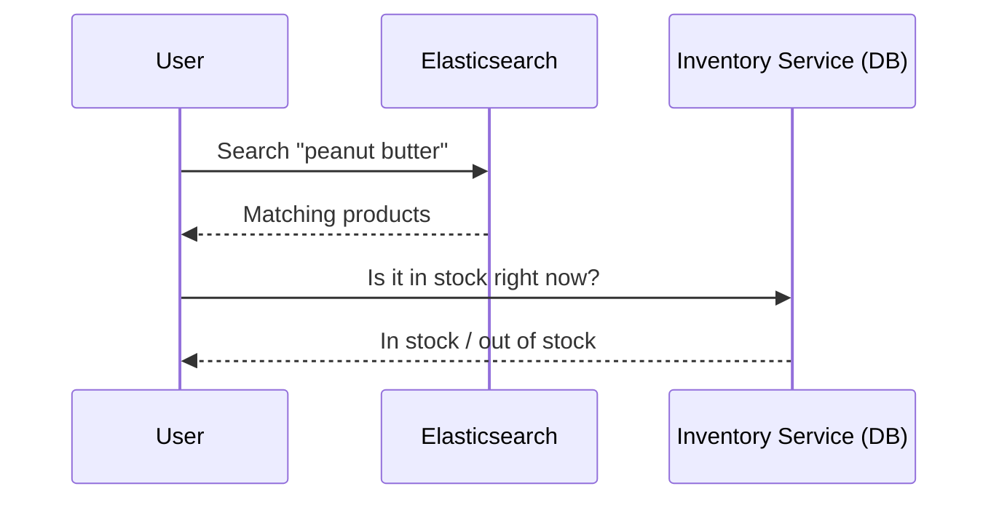
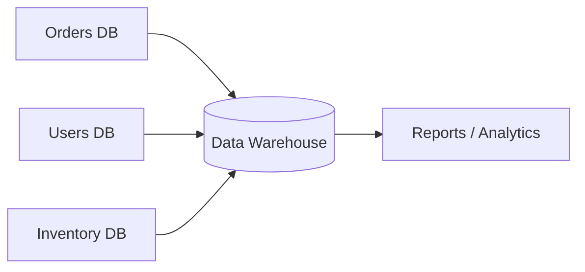
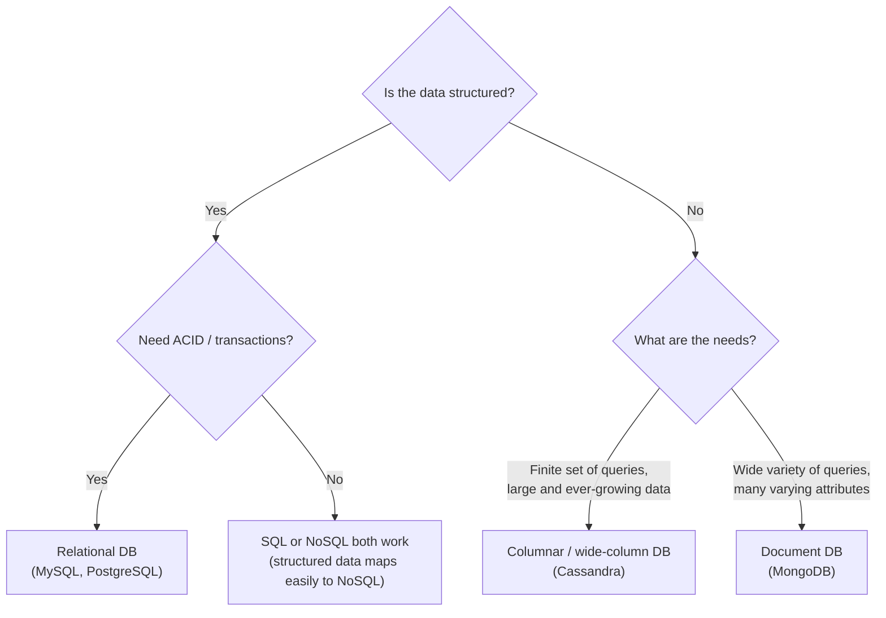
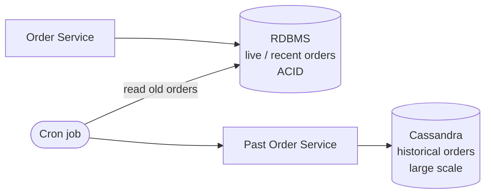

# Chapter 15: SQL vs NoSQL Databases and Database Design Choice

> My notes on how to choose the right data store for each part of a system. The quality of a design, and how well it scales, depends heavily on this choice. Covers the deciding factors, the specialised stores (cache, blob storage + CDN, search engine, data warehouse), a decision flow for SQL vs NoSQL, and a real-world example of using several databases together.

---

## Table of Contents

1. [Why Database Choice Matters](#1-why-database-choice-matters)
2. [Factors That Drive the Choice](#2-factors-that-drive-the-choice)
3. [Caching Solutions](#3-caching-solutions)
4. [Blob Storage and CDN](#4-blob-storage-and-cdn)
5. [Search: Text Search Engines](#5-search-text-search-engines)
6. [Data Warehouse](#6-data-warehouse)
7. [SQL vs NoSQL: The Decision Flow](#7-sql-vs-nosql-the-decision-flow)
8. [Real-World Example: Order Service](#8-real-world-example-order-service)
9. [Cheat Sheet](#9-cheat-sheet)
10. [Key Takeaways](#10-key-takeaways)

---

## 1. Why Database Choice Matters

How good a design is, and how well the system can scale, depends on the database(s) chosen.

- The choice does **not** change *functional* requirements (what the system does).
- It strongly affects **non-functional** requirements: latency, scalability, availability, consistency, cost.

In system design interviews and in large-scale systems, "which database and why" is one of the most important decisions.

---

## 2. Factors That Drive the Choice

### 2.1 Structure of the data

| Type | Description | Example |
|---|---|---|
| **Structured** | Fixed format and schema, organised as rows and columns | Users, orders, payments |
| **Unstructured / semi-structured** | No fixed schema or predefined model | Product catalogues with varying attributes, logs, documents |

### 2.2 Query pattern

How will the data be accessed?

- Need to **join** results from multiple tables, or maintain **ACID** properties: relational database.
- Need simple **"get the value for this key"** lookups: key-value store.
- Need text search with typo tolerance: search engine.

### 2.3 Scale

- **Small scale**, or even millions of records and thousands of users: a relational database (PostgreSQL, MySQL) is usually enough, and is easy to manage and supports transactions.
- **Very large scale**, billions of records and millions of users: NoSQL stores that scale horizontally become necessary.

---

## 3. Caching Solutions

### 3.1 Use case 1: Frequently accessed data

If users repeatedly request the same data, hitting the database each time is wasteful.

**Latency without a cache** (illustrative numbers):

| Hop | Time |
|---|---|
| Client to server | 2 ms |
| Server to database | 2 ms |
| Database back to server | 2 ms |
| Server back to client | 2 ms |
| **Total** | **8 ms** |

**With a cache:** the first request fetches from the database and stores the result in the cache. Subsequent requests are served from the cache.

| Hop | Time |
|---|---|
| Client to server | 2 ms |
| Server to cache | 1 ms |
| Cache back to server | 1 ms |
| Server back to client | 2 ms |
| **Total** | **6 ms** |

The cache is faster because it is an **in-memory** store. The bigger win at scale is that the database is protected from repeated load.

### 3.2 Use case 2: Avoiding repeated remote calls

In a microservices e-commerce system, a user service may need data from an inventory service on every operation. A remote call adds network latency each time (for example 2 ms there and 2 ms back).

Solution: **cache the inventory service's response** so the user service reads from the cache instead of making the remote call.

### 3.3 Which tool?

**Redis** is a key-value in-memory store, commonly used for caching. For example, key = `user_id`, value = the user's profile.

---

## 4. Blob Storage and CDN

**Static data** (images, videos, audio) is stored as **objects** in **blob storage**. This applies to e-commerce product media, video streaming platforms and music apps. A typical example is **Amazon S3**.

### The latency problem

If the storage bucket is hosted in one region (say the USA) and a large share of traffic comes from another (say India), every request must travel a long way, so latency goes up.

### The solution: a CDN in front of blob storage

A **Content Delivery Network (CDN)** distributes static content geographically, with servers close to users.

- Blob storage is the **primary** storage (source of truth for the files).
- CDN nodes in different regions hold copies of the content popular in that geography.
- If the nearest node does not have the content, the request falls through to the next nearest node, and finally to the origin storage.

---

## 5. Search: Text Search Engines

An e-commerce app needs search by product name, brand or category. A normal database is not designed for this, so we use a **text search engine** such as an **Elasticsearch cluster**, which is built on **Apache Lucene**.

### Features we need

| Feature | Meaning |
|---|---|
| **Fuzzy search** | Tolerates misspellings. Typing "protien" still returns protein products |
| **Autocomplete / auto-suggest** | After typing "pro", it suggests "protein" |

### Keeping search data up to date

When a new product arrives (for example a new peanut butter brand), it is indexed in the search cluster so users can find it by searching for the product or brand name.

### Elasticsearch vs a real database

| | Database | Elasticsearch |
|---|---|---|
| Durability guarantee | Strong: data should not be lost | No such guarantee to rely on |
| Role | **Source of truth** | Search index only |
| Knows live stock? | Yes (if it owns that data) | No |

Because Elasticsearch is **not a source of truth**, the flow for a product search is:

Search results come from the search engine, while **current availability** comes from the inventory service's database.

---

## 6. Data Warehouse

To run **analytics and reports** across all of a company's data, we use a **data warehouse**: a very large database where company data from many sources is consolidated, with rich querying capabilities on top to serve reporting and analysis.

---

## 7. SQL vs NoSQL: The Decision Flow

### 7.1 Structured data + ACID needs: relational

Example: a payment service. Money debited from user A's account must be credited to user B's account. It must never happen that A is debited but B is not credited. That requires **ACID** (atomicity, consistency, isolation, durability) and transactions.

Best fit: **RDBMS**, such as MySQL or PostgreSQL.

### 7.2 Structured data without ACID needs

Both SQL and NoSQL work, since structured data can be mapped into a NoSQL store easily. The choice comes down to scale and other requirements.

### 7.3 Unstructured data, finite queries, large growing data: columnar

If the **set of queries is limited**, but there is a **very large amount of data that keeps growing over time**, use a columnar (wide-column) database such as **Cassandra**.

### 7.4 Unstructured data, wide variety of queries, many attributes: document DB

Example: a shopping cart. Different products carry different attributes:

| Product | Example attributes |
|---|---|
| Shirt | shoulder width, length, chest width |
| Trousers | waist, length |
| Phone | storage, RAM, screen size |
| TV | resolution, screen size (32", 34", 36") |

Since each product has different attributes, a rigid table schema is awkward. A **document database** such as **MongoDB** stores each item as a flexible document keyed by an id, with whatever attributes that item needs.

---

## 8. Real-World Example: Order Service

In an Amazon-like application, an **Order Service**:

- Places orders.
- Invokes the Payment Service.
- Updates inventory counts depending on payment success or failure.
- Triggers other services such as delivery and notifications.

Live orders can succeed or be cancelled, so we need **ACID** transactions. A relational database fits well.

### The scaling problem

If the app has 10 million users and receives on the order of **hundreds of thousands of new orders every day**, the relational database keeps growing and will eventually hit its capacity limits.

### The fix: use two databases together

Look at *what actually needs ACID*: only **live / recent** orders. Old orders are effectively read-only history.

- **Order Service + RDBMS:** holds only live and recent orders (where transactions matter).
- **Past Order Service + Cassandra:** a **cron job** periodically moves older orders out of the RDBMS into Cassandra, which suits large, ever-growing data with a limited set of queries.

### When is an order "past"?

When it is outside the return window. Once a customer can no longer return or cancel the order, it no longer needs live transactional handling and can be archived into Cassandra.

**Lesson:** different databases cooperate, each providing the guarantees it is best at. RDBMS gives ACID, columnar storage gives huge-scale storage.

---

## 9. Cheat Sheet

| Need | Choose | Example |
|---|---|---|
| Transactions / ACID on structured data | Relational DB | PostgreSQL, MySQL |
| Hot data, repeated reads, avoid remote calls | In-memory cache (key-value) | Redis |
| Images, videos, audio | Blob storage + CDN | S3 + CDN |
| Search with typos, autocomplete | Text search engine | Elasticsearch (Lucene) |
| Company-wide analytics and reports | Data warehouse | Large analytical DB |
| Huge, growing data, limited query set | Columnar / wide-column | Cassandra |
| Varied attributes, varied queries | Document DB | MongoDB |

---

## 10. Key Takeaways

- Database choice depends on **data structure, query pattern and scale**.
- **Relational databases** are the default for structured data needing ACID transactions.
- Use a **cache** (Redis) for hot data and to avoid repeated remote calls.
- Use **blob storage with a CDN** for static media, to cut geographic latency.
- Use a **search engine** (Elasticsearch) for search features, but never treat it as the source of truth.
- Use a **data warehouse** for analytics across all company data.
- Use **Cassandra** for huge, growing data with a limited query set, and **MongoDB** for varied attributes and flexible queries.
- Real systems combine several data stores, each handling the part it is best suited for.
